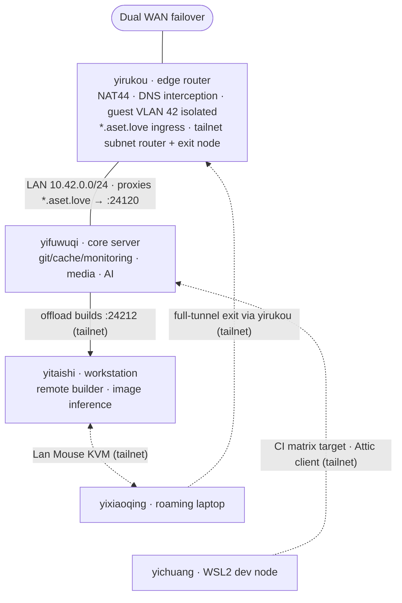

# Gang Documentation

Technical reference for the yi NixOS gang: five declarative hosts behind a
custom edge router, documented from the codebase outward. The sidebar is the
full index; this page orients you and tracks what is undecided.

Four invariants shape everything else in this book:

- **Forgejo is the git primary.** `git.aset.love` is writable origin; GitHub is
  a push mirror only.
- **IPv4-only WAN by design.** On-net uses static ULA; GUA is gated on a
  prefix-delegation checklist, not a bug.
- **`sudo` is disabled gang-wide.** Elevation is `su -` as root.
- **This book auto-builds from `develop`.** Watchexec on `yifuwuqi` rebuilds
  and serves it at `docs.aset.love` seconds after each commit.

## Topology

Roles and per-host hardware detail live on each host's page under **Gang Hosts**; the address table below is generated from the registry (`modules/addresses.nix`) and cannot drift from it.

{{#include generated/hosts.md}}

`yichuang` (WSL2 development node) is unregistered and absent from the
registry by design; the topology diagram above shows where it sits.

## In this book

**Gang & Architecture**

- [Host profiles](hosts/yirukou.md) — per-machine hardware, roles, and quirks, from `yirukou` to `yichuang`.
- [yirukou Router & Edge](networking/yirukou.md) — address plan, dual-WAN failover, DHCP, and DNS interception at the perimeter.
- [IPv6: ULA now, GUA later](networking/ipv6-ula-gua.md) — why the WAN is IPv4-only and what must be true before that changes.
- [Sysctl & Firewall Hardening](networking/sysctl-firewall.md) — the authoritative port and sysctl matrix for router vs server.
- [Tailscale Subnet Forwarding](networking/tailscale-subnet-forwarding.md) — how tailnet clients reach LAN services, and the CPE-admin exception.

**Services & Infrastructure**

- [Hosted Services Directory](services/hosted-services.md) — every web service, its port, and its `*.aset.love` domain.
- [DNS & Reverse Proxy](services/dns-and-proxy.md) — AdGuard → Unbound → Valkey resolution and the nginx ingress chain.
- [Monitoring & Observability](services/monitoring.md) — Prometheus, Loki, Grafana, and the internet probe ladder.
- [Podman Operations](services/podman-operations.md) — container triage and repair runbook.
- [Nix Build Mesh & Binary Cache](services/nix-build-cache.md) · [CI/CD Pipeline](services/ci-cd.md) — how closures are built, cached, and deployed across hosts.
- [Secrets and Host Keys](services/secrets.md) — SOPS recipients, `/persist/keys`, and key-rotation recipes.
- [AI-SSH Restricted Lane](services/ai-ssh.md) — the only sanctioned remote-access path for agents.

**Hardware & Workstation**

- [Gang Provisioning Runbook](hardware/bootstrap-runbook.md) — end-to-end onboarding of a new machine.
- [New Compute Host Research](hardware/new-compute-host-research.md) — the open R$ 12.000 capacity question.
- [Hardware Authentication & Tokens](hardware/bootstrap.md) — FIDO2, fingerprint, TPM, and Secure Boot enrollment.
- [AmpliTube 5](audio/amplitube.md) · [Pro-Audio Drum Kits](audio/drums.md) — the `yitaishi` studio stack on Wine/yabridge.

## Open decisions & status

- **New compute host — purchase undecided.** Options B2/E/A′ all fit the
  R$ 12.000 ceiling; RAM alone on `yifuwuqi` does not fix QLC/CPU stalls for
  Minecraft. See [New Compute Host Research](hardware/new-compute-host-research.md).
- **IPv6 GUA — gated.** Waiting on a PD large enough for LAN + VLAN plus
  Happy-Eyeballs validation. See [IPv6: ULA now, GUA later](networking/ipv6-ula-gua.md).
- **mTLS phases 2–4 and `yirukou` impermanence — draft/active.** See the
  **Architecture Plans & RFCs** section in the sidebar.

## Source of truth

Documentation follows a strict **Codebase → Documentation** flow:

- **Address registry & topology**: `modules/addresses.nix`
- **Host hardware & networking**: `hosts/<hostname>/`
- **Service implementations**: `modules/services/`
- **Per-host service enablement**: `hosts/<hostname>/services.nix`
- **Keys & identities**: `secrets/keys.nix`
- **User dotfiles**: `users/`
