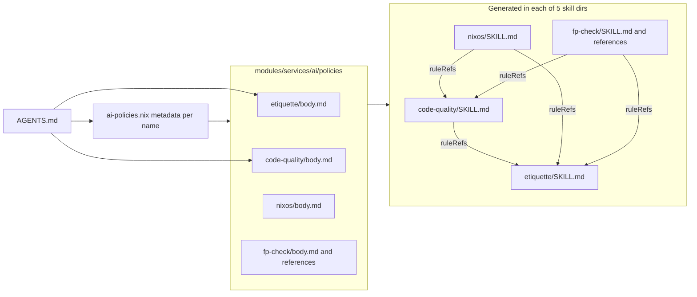

# AI Policies: Skill References, Uniform Layout, and fp-check

## Status: IMPLEMENTED — 2026-10-31 (switch pending)

Land the reviewed draft:

- an `fp-check` skill with an on-demand `references/` folder;
- one folder layout for every policy;
- skill-to-rule links (`ruleRefs`);
- a repo-root `AGENTS.md`.

Fix the draft's duplication, formatter, and accuracy defects in the same pass.

______________________________________________________________________

## Objective

Ship one more agent skill through `users/home/ai-policies.nix` without duplicating any text. Each fact (rule body, routing condition, skill trigger) lives in exactly one source file, every policy has the same folder layout, and evaluation fails when a generated link would dangle.

______________________________________________________________________

## Current State

The starting point, before this plan:

1. `users/home/ai-policies.nix` defines `policies`. `distribute` writes each skill's `SKILL.md` into 5 `agentSkillDirs` and each rule into 5 rule paths. `realizeAgentPolicies` then replaces the home-manager symlinks with real 0444 files. There is no support for extra files per skill.
1. Policy sources are flat files: `modules/services/ai/{etiquette,code-quality,nixos}.md`. The draft skill brings a different layout: a folder with `body.md` and `references/`.
1. Both `checks.yijia` and home-manager user `yi` (via `modules/home-manager.nix`, `users/home/yijia.nix`, `users/home/common.nix`) evaluate the module.
1. `nix/treefmt.nix` runs mdformat on every `*.md`, including from pre-commit. Its plugins are gfm, frontmatter, and gfm-alerts; there is no math plugin.
1. Review findings on the draft:
   - `linkedRuleReferences` uses `listToAttrs (map ... { name; value; })`. Section 6 of `nixos.md` forbids that pattern.
   - `referenceFiles` re-implements `distribute`, and `skillReferencePaths` duplicates `skillPaths`.
   - `makeSkillFile` always appends `"\n"`, which changes every existing `SKILL.md`.
   - Copying rule bodies into each skill produces 25 generated duplicates of text the runners already load.
   - The Nix `references.*.description` fields restate the routing in `body.md`, so each link appears twice in `SKILL.md`.
   - `body.md` repeats the references: the math workflow, the theory-to-code workflow, and the reporting format (three times). It is loaded in full every time the skill triggers.
   - Skill bodies restate the rules they link:
     - the draft repeats `code-quality`'s smallest-diff and no-premature-abstraction principles, and `etiquette` §3's evidence duty, and also repeats itself;
     - `nixos.md` §6 restates `code-quality`'s "No Representation Bouncing".
   - mdformat will rewrite the LaTeX (`\(`, `\mathrm`, `\circ`, `_A`): it doubles backslashes and reads `_..._` as emphasis. `nixos.md:46` already shows `$A \\times B$`.
   - Accuracy problems:
     - "Initial / final algebra" should be "initial algebra / final coalgebra".
     - The adjunction row leaves out the natural bijection between hom-sets.
     - `haskell.md` says naturality can't be inferred from a signature, which contradicts the parametricity note in `category-theory.md`.
   - The description matches almost every coding task.
   - `AGENTS.md` paraphrases the Nix descriptions, so "when to use" has a second source.

______________________________________________________________________

## Decisions

1. **Name `fp-check`.** The policy attribute, source folder, generated skill dir, and frontmatter `name:` all use it. The body title stays "Verified Functional Programming and Category Theory".
1. **Uniform layout.** Every policy is `modules/services/ai/policies/<name>/body.md`, plus `references/` when needed. The source stays `body.md`, not `SKILL.md`, because Nix adds the frontmatter.
   - `policies` holds only metadata per name.
   - `resolvedPolicies` derives `body`, `references`, and the `ruleRefs` default in one place.
   - The layout mirrors the generated `<skill>/{SKILL.md,references/}`, so relative links resolve both in the repo and in the generated skill.
1. **Link rules instead of copying them.** `ruleRefs` renders a `## Linked rules` section in the generated `SKILL.md`, with lines like `- Follow the [etiquette](../etiquette/SKILL.md) rule.`
   - Evaluation asserts that every ref is in both `rulePolicies` and `skillPolicies`, so the sibling file exists in every skill dir.
   - code-quality links etiquette; nixos and `fp-check` link etiquette and code-quality.
1. **Skills are self-contained.** No skill links to another skill.
1. **Skills never restate the rules they link.** A linked rule is always loaded, so a restatement costs context in every session and invites the two copies to drift apart. A skill keeps only its domain-specific additions. `code-quality` and `fp-check` stay separate: they load at different times and cover different concerns.
1. **The directory is the reference manifest.** `references` comes from the regular files in `<name>/references` via `builtins.readDir`, passed as `home.file` path sources, with no `writeText` and no Nix descriptions.
   - The routing section of `body.md` is the only "when to read" text.
   - Evaluation asserts that every shipped reference is linked from the body as `](references/<file>)`.
1. **`body.md` is the router.** It holds the core rules, the routing, and a short workflow whose last step hands check, repair, and report off to the references.
   - The math workflow, the theory-to-code workflow, and the explanation and design checklists live in `category-theory.md`.
   - `verification.md` holds the single reporting format.
1. **No LaTeX.** Equations go into `text` fences using Unicode symbols (∘ η μ ⇒ ≅). Inline symbols become code spans.
1. **Narrowed description:** "Category theory (explanations, exercises, categorical design), functional-programming abstractions (functors, monads, folds, natural transformations), formal specifications, property-based testing, dependent types, and proof assistants (Lean, Rocq, Agda, Idris). Separates generated, compiled, tested, and proven evidence. Not for routine coding outside these topics."
1. **`AGENTS.md`:**
   - Keep the portability paragraph and the "linking does not load" paragraph.
   - Link the two always-on rules.
   - Point to `policies` as the skill index.
   - Record decisions 2, 4, and 5 as policy conventions.
1. **`git mv` for the moves**, at the user's request: an exception to etiquette §2, limited to the renames. Content edits stay unstaged.



______________________________________________________________________

## Phases

### Phase 1: Skill Content (`modules/services/ai/policies/fp-check/`)

- `body.md`:
  - Keep the intro, the core rules, and the route-the-task links, written in `](references/<file>)` form.
  - Keep a short workflow (deliverable, target, rigor) whose last step points to the loop and result pattern in `verification.md`, and to `category-theory.md` for mathematical checks.
- `category-theory.md`:
  - Merge (don't just append) the math workflow into "Reason from definitions to structure": define notation first, label definition, intuition, example, lemma, and theorem, and add a counterexample when a general claim is false.
  - Merge the theory-to-code steps and the design checklist into "Apply theory to code responsibly".
  - Merge the explanation checklist into "Teach without jargon stacking".
  - Fix the table rows:
    - Exponential / adjunction: `Hom(F A, B) ≅ Hom(A, G B)` natural in `A` and `B`; currying `Hom(A × B, C) ≅ Hom(A, C^B)` in a cartesian closed setting.
    - Initial algebra / final coalgebra: folds versus unfolds and observation.
  - Move the laws into `text` fences.
- `verification.md`: make "Concise result pattern" the only reporting format: Target, Artifact, Evidence (checks run plus the evidence-ladder label), Boundary.
- `haskell.md`: say that `forall a. f a -> g a` between lawful `Functor`s is natural by parametricity, assuming no `seq`, bottom, or unsafe escapes. State that assumption, or property-test the naturality law.

### Phase 2: Uniform Layout (Moves, Content Unchanged)

```bash
mkdir -p modules/services/ai/policies/{etiquette,code-quality,nixos}
git mv modules/services/ai/etiquette.md modules/services/ai/policies/etiquette/body.md
git mv modules/services/ai/code-quality.md modules/services/ai/policies/code-quality/body.md
git mv modules/services/ai/nixos.md modules/services/ai/policies/nixos/body.md
git mv <draft skill folder> modules/services/ai/policies/fp-check
```

### Phase 3: `users/home/ai-policies.nix`

```nix
policyRoot = ../../modules/services/ai/policies;

policies = {
  etiquette = { description = "..."; isRule = true; isSkill = true; };
  code-quality = { description = "..."; isRule = true; isSkill = true; ruleRefs = [ "etiquette" ]; };
  nixos = { description = "..."; isRule = false; isSkill = true; ruleRefs = [ "etiquette" "code-quality" ]; };
  fp-check = { description = "..."; isRule = false; isSkill = true; ruleRefs = [ "etiquette" "code-quality" ]; };
};

resolvedPolicies = lib.mapAttrs (
  name: meta:
  let
    dir = policyRoot + "/${name}";
    refsDir = dir + "/references";
  in
  { ruleRefs = [ ]; }
  // meta
  // {
    body = builtins.readFile (dir + "/body.md");
    references = lib.optionalAttrs (builtins.pathExists refsDir) (
      lib.mapAttrs (ref: _: refsDir + "/${ref}") (
        lib.filterAttrs (_: type: type == "regular") (builtins.readDir refsDir)
      )
    );
  }
) policies;

skillFiles = skill: file: map (target: "${target}/${skill}/${file}") agentSkillDirs;
skillPaths = name: skillFiles name "SKILL.md";

makeSkillFile =
  name: policy:
  let
    inherit (policy) ruleRefs;
    linkedRules = lib.optionalString (ruleRefs != [ ]) ''

      ## Linked rules

      ${lib.concatMapStringsSep "\n" (rule: "- Follow the [${rule}](../${rule}/SKILL.md) rule.") ruleRefs}
    '';
  in
  assert lib.all (
    rule: lib.assertMsg (rulePolicies ? ${rule} && skillPolicies ? ${rule}) "${name}: ruleRef ${rule} must be a rule and a skill"
  ) ruleRefs;
  assert lib.all (
    ref: lib.assertMsg (lib.hasInfix "](references/${ref})" policy.body) "${name}: references/${ref} is not linked from its body"
  ) (lib.attrNames policy.references);
  makePolicyFile "skill" "name: ${name}\n" name (policy // { body = policy.body + linkedRules; });

referenceFiles = lib.concatMapAttrs (
  skill: policy: distribute (ref: skillFiles skill "references/${ref}") (_: lib.id) policy.references
) skillPolicies;
```

- `skillPolicies` and `rulePolicies` filter `resolvedPolicies`. `agentFiles` becomes the existing union `// referenceFiles`. `realizeAgentPolicies` needs no change: it iterates over `agentFiles` and already creates directories.

### Phase 4: Deduplicate Against Linked Rules

- `fp-check/body.md`:
  - Drop the core rule about claiming checks that never ran (etiquette §3 and `verification.md` cover it).
  - Narrow the untrusted-proposal rule to proofs and mathematical explanations.
  - Drop the routing line's repeat of the language-neutral rule.
  - Drop the small-candidate workflow step (code-quality covers it).
- `fp-check/references/verification.md`:
  - Remove the sentences on local changes and on regenerating whole artifacts (code-quality covers them).
  - Narrow "run the project's own checks" to law checks, proof kernels, and locked dependencies.
  - Fold the residual-uncertainty step into the result pattern's "Boundary".
  - Drop the repeat of "determinism is not correctness".
- `fp-check/references/haskell.md`: drop the intro's repeat of the language-neutral rule.
- `nixos/body.md` §6: rewrite to the Nix-specific combinators and anti-patterns, applying code-quality's "No Representation Bouncing" instead of restating it. This also fixes `A × B`.

### Phase 5: `AGENTS.md` (Repo Root)

- Write it per decision 10. No `CLAUDE.md` shim (see open questions).

### Phase 6: Verification

- Stage 1 (layout only):
  - `nix fmt`, `statix check`, and `deadnix --fail` pass.
  - The session scratch script's `inspect 1` compares generated agent files against `HEAD`:
    - 25 files become 45, with 20 under `fp-check/`;
    - all 50 links resolve;
    - `etiquette` and the 10 rule files are byte-identical;
    - `code-quality` and `nixos` only gain the appended section.
  - `nix flake check --no-build` exits 0.
- Stage 2 (content):
  - `rg -n '\\\\' AGENTS.md modules/services/ai/policies` returns nothing.
  - An `rg` over the repo for the removed sentences and the draft's original folder name returns nothing.
  - `inspect 2` repeats the stage 1 checks, but `nixos` may differ from `HEAD` from §6 onward.
  - `assert-probe` shows a bad `ruleRef` and an unlinked reference both failing evaluation with their messages.
  - `nix flake check --no-build` exits 0. The `yifuwuqi` `home.file` eval lists 20 `fp-check/` paths.
- Audit `git diff --cached` and `git diff`: the only stage changes are the renames, and the user's `flake.lock` and `modules/desktop/apps.nix` stay untouched.

______________________________________________________________________

## Rollout Order

1. Phases 1, 3, and 5, then stage 1 verification of the layout move (Phase 2).
1. Phase 4, then stage 2 verification.
1. Hand-off: the user reviews, stages, and commits, then runs `su -` and `nh os switch /home/yi/the.files/nixos` on each host that uses `modules/home-manager.nix`.

______________________________________________________________________

## Open Questions

- Existing limitation: `realizeAgentPolicies` turns home-manager symlinks into real files, so home-manager can't remove skill files that are later renamed or dropped. The new `references/` folder adds more such files. Out of scope; a follow-up could prune against a manifest.
- Claude Code may read only `CLAUDE.md` at the repo level. A root `CLAUDE.md` containing `@AGENTS.md` would cover sessions without home-manager. Not included.
