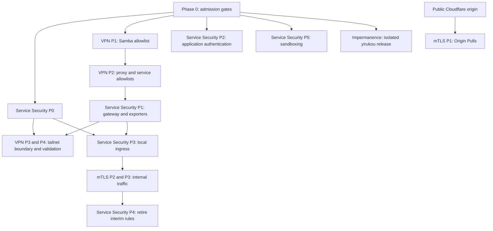

# Architecture Security Rollout

## Status: DRAFT — Phase 0–1 deployed and verified 2026-11-08

## Objective

Order the infrastructure-security work without turning independent workstreams
into false prerequisites. This document is the canonical cross-plan roadmap;
the linked plans retain ownership of their implementation details and
acceptance checks.

## Current State

### Repository-Verified

- [Service Security Phase 0](service-security-architecture-plan.md#phase-0-forward-isolation)
  and [VPN to LAN Phase 1](vpn-to-lan-migration-plan.md#phase-1-storage-and-database-services)
  were activated on `yifuwuqi`. The active generation declares
  `networking.firewall.filterForward`, explicit container WAN and fallback-route
  allowances, and a loopback-only FlareSolverr publish; Samba's active
  allowlist excludes the VPN CIDR. Later phases remain outstanding.
- [Impermanence on yirukou](impermanence-yirukou-plan.md) is not implemented:
  the flake has no impermanence input or module, and
  `hosts/yirukou/hardware.nix` still configures an Ext4 root.
- [Infrastructure mTLS](mtls-architecture-plan.md) is not implemented:
  inter-host proxying, exporter scrapes, and Vector-to-Loki use plaintext
  HTTP, and no service CA or runtime certificate configuration exists.
- `restrictedProxyConfig` allows only trusted LAN `10.42.0.0/24` and
  `fd75:c55f:6d19:1::/64`, excluding the untrusted VLAN 42 CIDRs. VPN to LAN
  Phase 2 removed its VPN CIDR in source and adds a `yirukou` input SNAT that
  presents subnet-route Tailnet clients to nginx as `10.42.0.1`; that phase
  awaits deployment.
- The existing `fufu.land` vhost is an HTTP-only static response. It is the
  selected public-edge canary and must become the first HTTPS,
  Cloudflare-authenticated listener.

### Preflight Evidence 2026-11-08

- The Cloudflare dashboard mapping was confirmed SSH-only.
- `yitaishi` installs `10.42.0.0/24` through `tailscale0` and reaches
  `10.42.0.2`.

### Deployment Evidence 2026-11-08

- The 09:20 activation created `cloudflared0` and started Cloudflared and
  Gluetun successfully.
- The corrected 09:28 activation restored qBittorrent, FlareSolverr,
  torrent-indexer, slskd, and Soularr. FlareSolverr answers on loopback and
  Cloudflared owns `10.89.0.2`.
- The Gluetun HTTP proxy returned `204` from `https://cp.cloudflare.com` and
  timed out to `192.168.0.1`; `10.42.0.2:24191` refused connections. A Tailnet
  client reached `192.168.0.1` through the advertised fallback route.
- Samba listens on `10.42.0.2:445` with its LAN-only allowlist. `yitaishi` has
  an enabled automount for `//10.42.0.2/share`.

### Live-Host Verified 2026-11-08

- `yirukou` mounts `/dev/nvme0n1p2` as `/` with Ext4; it has not migrated to
  tmpfs root. Its `tailscaled` service is active.
- At the time checked, `yirukou` reported `MemTotal: 7854640 kB` and
  `Active(anon): 852088 kB`. These are point-in-time observations, not sizing
  guarantees for an impermanence rollout.
- `yifuwuqi` routes its preferred default through `10.42.0.1`; the fallback
  default is via `192.168.0.1`.

### External or Operational Verification Pending

- Cloudflare DNS and Authenticated Origin Pull state before the conditional
  edge tier.
- The first public hostname and its rollout date.
- The Cloudflare tunnel's SSH public hostname moving from `ssh.fufu.land` to
  `cloudflare.fufu.land`, followed by removal of the public `ssh.fufu.land`
  record.

## Decisions

1. This roadmap owns only cross-plan sequence and gates. Each linked plan owns
   its Nix changes, deployment commands, and service-specific verification.
1. Plans distinguish repository-verified facts, dated host observations, and
   external decisions. A dated observation must not be presented as a
   permanent deployment guarantee.
1. Impermanence is a dedicated `yirukou` boot migration. It may be scheduled
   after its own revalidation and before a later `yirukou` feature release,
   but it must not share a generation with VPN, service-security, or mTLS
   changes.
1. `yirukou` is the future public edge. Its WAN TCP ingress remains closed
   today; `fufu.land` is the first public Cloudflare-to-`yirukou` canary and
   returns only `hello world`. Internal mTLS has a separate critical path and
   must not wait for that edge tier.
1. Cloudflared is an SSH fail-safe only. Forward filtering permits its required
   WAN egress and a source-scoped connection to `yifuwuqi` SSH, but grants no
   cloudflared route to `yirukou`, the local ingress, or hosted application
   backends. Its tunnel hostname is `cloudflare.fufu.land`; `ssh.fufu.land` is
   plain SSH to `yifuwuqi` over the LAN and the subnet route.
1. Internal administration occurs through SSH on `yifuwuqi`: no remote
   PostgreSQL, direct AdGuard administration, or anonymous Grafana Security
   dashboard. This boundary does not apply to explicitly client-facing hosted
   websites.
1. Client-facing hosted vhosts allow trusted LAN
   `10.42.0.0/24` and `fd75:c55f:6d19:1::/64`, but deny the untrusted VLAN
   `10.42.42.0/24` and `fd75:c55f:6d19:2::/64`. The same distinction must
   survive the future public-edge rollout.
1. NetBird is retired. Tailnet clients reach services through `yirukou`'s LAN
   subnet route; direct `yifuwuqi` Tailscale access is limited to SSH and DNS.
   Host firewalls are the authoritative service boundary, while Tailnet policy
   must permit authorized clients to use the subnet route. Tailscale
   masquerades only forwarded traffic, so `yirukou` SNATs subnet-route
   connections to its own nginx to `10.42.0.1`, keeping client-facing
   allowlists LAN-only.
1. Use a Sops-backed static internal CA and a shared Nginx mTLS frontend for
   exporters. This avoids a runtime CA service and exporter-specific TLS
   capability work.

## Phases

### Phase 0 — Close Admission Gates

1. Preserve container WAN egress, including cloudflared's SSH-fallback tunnel,
   and a source-scoped cloudflared-to-SSH allowance without allowing container
   access to `yirukou` or the local ingress.
1. Confirm subnet-route approval and a client that reaches LAN services through
   `yirukou`.
1. Recheck that the Cloudflare dashboard maps cloudflared only to SSH before
   applying forward filtering.

### Phase 1 — Establish Safe Network Boundaries

1. Deploy Service Security Phase 0 with explicit container WAN and
   `tailscale0 -> enp4s0` forwarding allowances.
1. Deploy VPN to LAN Phase 1 once the subnet-route precondition is met.
1. Service Security Phases 2 and 5 may proceed independently after their
   application and sandboxing decisions are made.

### Phase 2 — Remove Overlay Reachability

1. Deploy VPN to LAN Phase 2.
1. Deploy Service Security Phase 1 to scope the gateway rule and interim
   exporter access.
1. Verify designated client-facing vhosts succeed from trusted LAN and fail
   from the untrusted VLAN before retiring overlay access.
1. Deploy VPN to LAN Phases 3 and 4 only after Service Security Phase 0 has
   preserved the `192.168.0.1/32` Tailscale route and its validations are
   ready.

### Phase 3 — Move Backends Behind Local Ingress

Deploy Service Security Phase 3: create the `yifuwuqi` local ingress, move
appropriate backends to loopback or sockets, and make its generated route set
the only ingress contract for later mTLS.

### Phase 4 — Authenticate Cross-Host Traffic

1. Deploy mTLS Phases 2 and 3 after the local ingress works.
1. Retire Service Security Phase 4's interim IP rules only after both internal
   mTLS phases pass their checks.

### Dedicated Maintenance Lane — Impermanence

Revalidate the disk layout, DynamicUser state, cache size, and key staging on
`yirukou`; then deploy the impermanence plan in a separate boot generation.
This lane is not a prerequisite for the current persistent-root deployments,
but becomes relevant before any later tmpfs-root release.

### Conditional Edge Lane — Cloudflare Origin Pulls

Deploy mTLS Phase 1 with the `fufu.land` public Cloudflare-proxied canary.
Keep trusted-LAN browser access separate from the Cloudflare-authenticated
public listener or prove an equivalent policy; never require a Cloudflare
client certificate from LAN browsers. Validate dashboard state, trusted-LAN
access, untrusted-VLAN rejection, and direct-origin rejection in that same
release.

## Rollout Order

## Rollout Checklist

Check deployment items after activation; check acceptance items after their
runtime gates pass.

- [x] Resolve Cloudflared, internal-administration, NetBird/Tailnet,
  trusted-LAN versus untrusted-VLAN, static-CA/exporter-frontend, and
  certificate-rotation policy decisions.
- [x] Close the Phase 0 admission gates for container WAN egress, SSH-only
  cloudflared mapping, and subnet-route use.
- [x] Deploy [Service Security Phase 0](service-security-architecture-plan.md#phase-0-forward-isolation).
- [x] Deploy [VPN to LAN Phase 1](vpn-to-lan-migration-plan.md#phase-1-storage-and-database-services).
- [ ] Deploy the independent Service Security Phase 2 application-auth and
  Phase 5 sandboxing work when their decisions are resolved.
- [ ] Deploy [VPN to LAN Phase 2](vpn-to-lan-migration-plan.md#phase-2-web-proxy-and-development-services).
- [ ] Verify designated client-facing vhosts allow trusted LAN and reject the
  untrusted VLAN.
- [ ] Deploy [Service Security Phase 1](service-security-architecture-plan.md#phase-1-gateway-and-exporter-sources).
- [ ] Deploy and validate [VPN to LAN Phases 3–4](vpn-to-lan-migration-plan.md#phase-3-host-firewall-rules)
  after Service Security Phase 0 preserves the Tailscale route.
- [ ] Deploy [Service Security Phase 3](service-security-architecture-plan.md#phase-3-local-ingress).
- [ ] Deploy [mTLS Phases 2–3](mtls-architecture-plan.md#phase-2-inter-host-upstream-proxy-mtls-tier-2-lan-inter-host)
  after the local ingress is healthy.
- [ ] Retire interim rules in [Service Security Phase 4](service-security-architecture-plan.md#phase-4-retire-interim-ip-rules).
- [ ] At a separate safe point after preflight, schedule and complete the
  [impermanence maintenance release](impermanence-yirukou-plan.md#rollout-order).
- [ ] Deploy `fufu.land` as the public Cloudflare canary through
  [mTLS Phase 1](mtls-architecture-plan.md#phase-1-cloudflare-authenticated-origin-pulls-tier-1-edge-ingress).

## Open Questions

No cross-plan design choice remains open. Activate the conditional edge tier
when the `fufu.land` canary is scheduled for deployment.
