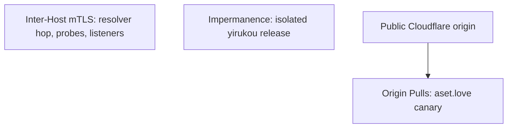

# Architecture Security Rollout

## Status: ACTIVE — remaining lanes: inter-host mTLS (resolver hop), impermanence, conditional edge

## Objective

Order the infrastructure-security work without turning independent workstreams
into false prerequisites. This document is the canonical cross-plan roadmap;
the linked plans retain ownership of their implementation details and
acceptance checks.

## Current State

### Repository-Verified

- [Impermanence on yirukou](impermanence-yirukou-plan.md) is not implemented:
  the flake has no impermanence input or module, and
  `hosts/yirukou/hardware.nix` still configures an Ext4 root.
- [Inter-Host mTLS](inter-host-mtls-plan.md) is deployed for its resolver lane:
  Phases 2, 3, 4, 5 and 6b are live on all three hosts and their runtime
  acceptance passes — `yifuwuqi` resolves only over DoT to `yirukou`'s AdGuard
  with plaintext `:53` at zero, the four LAN `dns`/`dns6` self-probes return
  `1`, and the log-only `mtls-peer` table is installed and checked. What
  remains is 6a's dev-server firewall rules, the Phase 5 week-long log read,
  and deleting the plan. Cloudflare Origin Pulls stay dormant until the
  `aset.love` canary.
- The apex `aset.love` vhost is the selected public-edge canary. It already
  serves its static response over HTTPS with the ACME certificate, but is not
  yet Cloudflare-authenticated or reachable from the WAN.

### External or Operational Verification Pending

- Cloudflare DNS and Authenticated Origin Pull state before the conditional
  edge tier.
- The first public hostname and its rollout date.

## Decisions

1. This roadmap owns only cross-plan sequence and gates. Each linked plan owns
   its Nix changes, deployment commands, and service-specific verification.
1. Plans distinguish repository-verified facts, dated host observations, and
   external decisions. A dated observation must not be presented as a
   permanent deployment guarantee.
1. Impermanence is a dedicated `yirukou` boot migration. It may be scheduled
   after its own revalidation and before a later `yirukou` feature release,
   but it must not share a generation with another lane's changes.
1. `yirukou` is the future public edge. Its WAN TCP ingress remains closed
   today; `aset.love` is the first public Cloudflare-to-`yirukou` canary and
   returns only `hello world`. Internal mTLS has a separate critical path and
   must not wait for that edge tier.
1. Internal administration occurs through SSH on `yifuwuqi`: no remote
   PostgreSQL, direct AdGuard administration, or anonymous Grafana Security
   dashboard. This boundary does not apply to explicitly client-facing hosted
   websites.
1. Client-facing hosted vhosts allow trusted LAN
   `10.42.0.0/24` and `fd75:c55f:6d19:1::/64`, but deny the untrusted VLAN
   `10.42.42.0/24` and `fd75:c55f:6d19:2::/64`. The same distinction must
   survive the future public-edge rollout.

## Phases

### DNS Lane — Resolver Hop

Deployed 2026-11-26. `eno1` on `yifuwuqi` points `resolved` at `yirukou`'s
AdGuard DoT listener on `:853` under the `dns.aset.love` name, after the
one-resolver-path phase removed the competing links — `UseDNS = false` on
`enp4s0`, `acceptDns = false` on `tailscale0`, empty `FallbackDNS`. No new
daemon, port or firewall rule, and every device-facing plain DNS path is
unchanged; acceptance is recorded in the
[Inter-Host mTLS](inter-host-mtls-plan.md) plan.

### Dedicated Maintenance Lane — Impermanence

Revalidate the disk layout, DynamicUser state, cache size, and key staging on
`yirukou`; then deploy the impermanence plan in a separate boot generation.
This lane is not a prerequisite for the current persistent-root deployments,
but becomes relevant before any later tmpfs-root release.

### Conditional Edge Lane — Cloudflare Origin Pulls

Deploy Cloudflare Authenticated Origin Pulls with the `aset.love` public
Cloudflare-proxied canary. Keep trusted-LAN browser access separate from the
Cloudflare-authenticated public listener or prove an equivalent policy; never
require a Cloudflare client certificate from LAN browsers. Validate dashboard
state, trusted-LAN access, untrusted-VLAN rejection, and direct-origin
rejection in that same release.

## Rollout Order

## Rollout Checklist

Check deployment items after activation; check acceptance items after their
runtime gates pass.

- [ ] From a VLAN 42 client, verify that designated client-facing vhosts
  reject the untrusted VLAN.
- [ ] From a LAN client other than `yifuwuqi`, confirm that
  `curl http://10.42.0.1:9100/metrics` fails (the Service Security Phase 1
  negative probe).
- [x] Deploy the resolver hop in
  [Inter-Host mTLS](inter-host-mtls-plan.md) (Phase 2 then Phase 3), verified
  2026-11-26.
- [ ] At a separate safe point, schedule and complete the
  [impermanence maintenance release](impermanence-yirukou-plan.md#rollout-order).
- [ ] Deploy `aset.love` as the public Cloudflare canary with Authenticated
  Origin Pulls: pin Cloudflare's Origin Pull CA, add `ssl_client_certificate`
  and `ssl_verify_client on` through `extraConfig` on the public listener, and
  keep the trusted-LAN browser path separate so LAN browsers are never asked
  for a Cloudflare client certificate.

## Open Questions

No cross-plan design choice is open. Activate the conditional edge tier when
the `aset.love` canary is scheduled for deployment.
