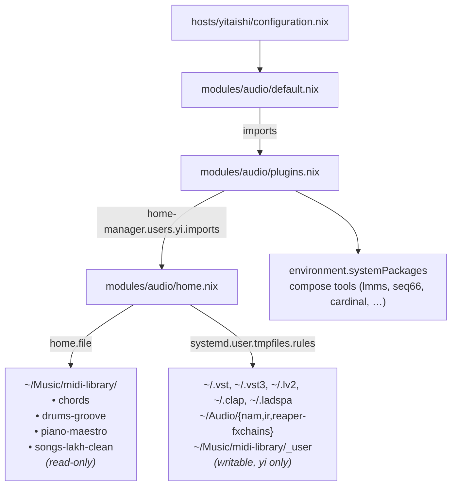
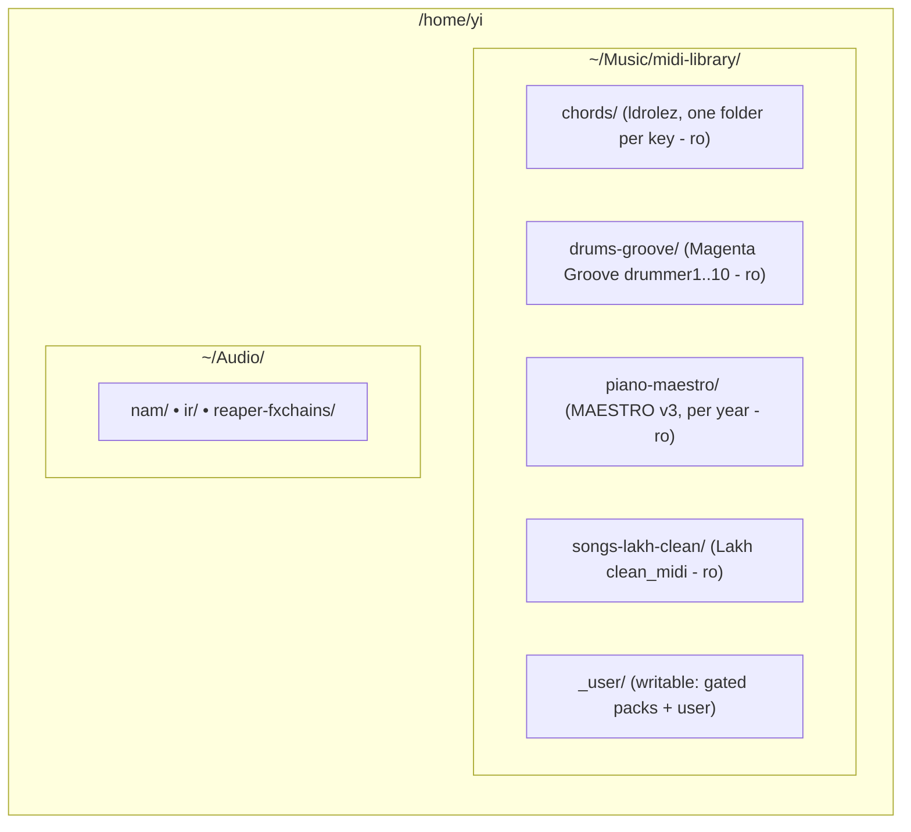

# MIDI Libraries, Compose Tools, and FX Presets (yitaishi / yi)

## Status: IMPLEMENTED — 2026-10-31 (yitaishi switch pending)

Re-reviewed against `develop` at `bd9a714` (nixpkgs `5772e199`, flake.lock of 2026-10-31). Part of the tool list and all writable folders landed in `cc3507d` (2026-09-05). The MIDI library was never started: despite its message, `8cc4232` added only this plan and no audio code.

The carla re-enable and `audio-module-fixes-plan.md`, which splits `modules/audio/` into `default.nix`, `plugins.nix` and `packages/`, both landed in `c80c2f0`.

______________________________________________________________________

## Objective

On `yitaishi`, for user `yi`:

1. Install the remaining compose/authoring tools system-wide.
1. Fetch a small MIDI reference library into `~/Music/midi-library`, pinned to upstream-published hashes where they exist.
1. Keep writable drop folders for gated MIDI packs and NAM/IR/FX-chain presets.

______________________________________________________________________

## Current State

1. **Module layout**: `modules/audio.nix` is now `modules/audio/`. Only `hosts/yitaishi/configuration.nix` imports it.
   - `default.nix`: musnix, PipeWire, WirePlumber and PAM; imports `plugins.nix`.
   - `plugins.nix`: `environment.systemPackages` and the writable-folder list.
   - `packages/`: `mt-power-drum-kit.nix` and `drum-locker.nix`, auto-wired as `audioPkgs`.
1. **Landed in `cc3507d`**:
   - `dexed` (VST3, CLAP), `stochas` (VST3), `vmpk`, `fluidsynth` and `soundfont-fluid` in `environment.systemPackages`.
   - Writable `~/Audio/{nam,ir,reaper-fxchains}` and `~/.{vst,vst3,lv2,clap,ladspa}` via `systemd.user.tmpfiles.rules`, replacing the draft's `home.file` `.keep` files. `plugins.nix` now generates those rules with `map` over a list of directory names.
1. **Plugin search paths**: musnix exports `LV2_PATH`, `CLAP_PATH`, `VST_PATH`, `VST3_PATH`, `LADSPA_PATH`, `DSSI_PATH` and `LXVST_PATH` (`environment.sessionVariables`, `mkDefault`). `audio-module-fixes-plan.md` dropped the module's old `VST3_PATH` override and its Wine folder. All of them include `/run/current-system/sw/lib/<format>`, so new system plugins need no path changes.
1. **Carla**: commented out in `cc3507d` along with `# pkgs.cardinal # depends on carla`; re-enabled and moved with the package list into `plugins.nix` in `c80c2f0`. `guitar-rig-plugins-plan.md` keeps carla optional.
1. **Not started**: the home module, `~/Music/midi-library`, and the tools below.
1. **Home-manager precedent**: `modules/desktop/niri.nix` and `modules/desktop/mango.nix` set `home-manager.users.yi.imports` from a NixOS module; `modules/desktop/gnome/default.nix` keeps its home module as a sibling `home.nix`.
1. **Docs**: `786f43d` removed `modules/audio-home.nix` and `~/Music/midi-library/` from `docs/src/hosts/yitaishi.md` §4.2, since neither exists.

Remaining draft tools in the 2026-10-31 lock, unchanged from the 2026-10-30 lock. All evaluate, none is broken or insecure, and all except `linuxsampler` are on cache.nixos.org:

| Package             | Version                   | Plugins               | Notes                                      | Plan      |
| ------------------- | ------------------------- | --------------------- | ------------------------------------------ | --------- |
| `lmms`              | 1.2.2-unstable-2026-04-21 | —                     | runtime dependency on carla                | add       |
| `giada`             | 1.5.0                     | —                     |                                            | add       |
| `seq66`             | 0.99.22                   | —                     | binary is `qseq66`                         | add       |
| `qmidiarp`          | 0.7.1                     | LV2                   |                                            | add       |
| `helio-workstation` | 3.18                      | —                     | binary is `helio`                          | add       |
| `cardinal`          | 26.02                     | LV2, VST2, VST3, CLAP | runtime dependency on carla                | uncomment |
| `midivisualizer`    | 7.3                       | —                     | binary is `MIDIVisualizer`; draft optional | add       |
| `linuxsampler`      | 2.3.1                     | —                     | unfree, so not on cache.nixos.org          | drop      |

______________________________________________________________________

## Decisions

### 1. Scope (unchanged)

- **Decision**: Fetch ldrolez chords, Magenta Groove, MAESTRO (MIDI only) and Lakh `clean_midi`. Heavy datasets (Lakh full, LA-MIDI, Slakh2100) stay out of the store. No `yabridge`.
- **Rationale**: FX/processing presets are not a portable cross-plugin library. Factory presets already ship inside `lsp-plugins`, `calf`, `dragonfly-reverb`, `guitarix` and `surge-xt`. The one large free processing "library", NAM `.nam` models plus IR `.wav`s, has no stable bulk URL, so it stays a writable drop folder.

### 2. Home content in `modules/audio/home.nix`, imported from `plugins.nix` (revised 2026-10-31)

- **Decision**: `modules/audio/plugins.nix` adds `home-manager.users.yi.imports = [ ./home.nix ];`.
- **Rationale**:
  - Same pattern as `niri.nix` and `mango.nix`, and no `mkHome` flag is needed because only yitaishi imports `modules/audio`. Home-manager links for `yi` only and removes stale links on switch; tmpfiles `L+` links would hit every user and are never cleaned up.
  - `plugins.nix` rather than `default.nix`: it owns `audioPkgs`, and the Amp Locker data link from `guitar-rig-plugins-plan.md` joins the same `home-manager.users.yi` block.

### 3. Writable folders move to home-manager tmpfiles, `yi` only (revised 2026-10-31)

- **Decision**: Move the directory-name list from `plugins.nix` into `home.nix`, as home-manager's `systemd.user.tmpfiles.rules` (still generated with `map`), and append `"Music/midi-library/_user"`. Drop the draft's `.keep` files.
- **Rationale**:
  - The NixOS option created the folders for every user with a systemd user instance (`yi`, `workd`). The home-manager option writes `~/.config/user-tmpfiles.d/home-manager.conf` for `yi` only and runs `systemd-tmpfiles --user --create` on activation, so no re-login is needed.
  - The `-` owner fields resolve to the invoking user and its primary group: `yi:yi` (gid 1000).
  - One mechanism for writable `$HOME` folders, and tmpfiles creates missing parents. The empty folders the old rules created for `workd` stay until removed by hand.

### 4. `fetchurl` with hex `sha256`, one table-driven unpack (revised)

- **Decision**: One attrset of `name → { url; sha256; root ? ""; }`, one `unpack` helper, and `lib.mapAttrs'` into `home.file`.
- **Rationale**:
  - `fetchurl` hashes the archive file itself, so the hex value is the upstream digest and can be compared directly. A `fetchzip` NAR hash cannot.
  - stdenv's `unpackFile` with the `unzip` setup hook handles both `.zip` and `.tar.gz`, replacing the draft's duplicate `unzipTo`/`untarTo`.
  - `root` strips the wrapper folder in the Groove (`groove/`), MAESTRO (`maestro-v3.0.0/`) and Lakh (`clean_midi/`) archives. The draft would have produced `drums-groove/groove/drummer1/…`.

### 5. Tools: the draft list minus `linuxsampler` (revised)

- **Decision**: Add `lmms`, `giada`, `seq66`, `qmidiarp`, `helio-workstation` and `midivisualizer`; uncomment `cardinal`; drop `linuxsampler`.
- **Rationale**:
  - `cardinal` was commented out only because it depends on carla, which is back. `lmms` has the same runtime dependency, so both stand or fall with carla.
  - `linuxsampler` is `licenses.unfree`, so Hydra does not build it, and its source host (`download.linuxsampler.org`) timed out on 2026-10-30, so a local build fails too. `sfizz` covers SFZ and `fluidsynth` + `soundfont-fluid` / `x42-gmsynth` cover GM (all present); only GigaStudio `.gig` support is lost.

### 6. Lakh: trust-on-first-use pin for `clean_midi`, no `lmd_aligned` alternative (revised)

- **Decision**: Pin `clean_midi.tar.gz` to the hash computed on 2026-10-30, which a fixed-output build accepted.
- **Rationale**: The Lakh page publishes no archive checksums, so the draft's `lmd_aligned` hash (`2bf5400e…f6e53b`) is correct but self-computed, not upstream. `lmd_aligned` is also laid out by Million Song Dataset track ID with MD5 file names, so it cannot be browsed. `clean_midi` is `Artist/Title.mid`.

### 7. ldrolez bumped to `v0.20260914` (revised)

- **Decision**: Use `free-midi-chords-20260914.zip` (released 2026-10-14) instead of `20260314`.
- **Rationale**: Latest release (still on 2026-10-31) with about 300 more files; its GitHub asset digest matches a local prefetch.

______________________________________________________________________

## Architecture



## Pinned Sources

| Folder             | Archive                         | `sha256`          | Upstream digest            | Store size            | License         |
| ------------------ | ------------------------------- | ----------------- | -------------------------- | --------------------- | --------------- |
| `chords`           | `free-midi-chords-20260914.zip` | `153c4d9b…918c8b` | GitHub release asset       | 6.1 MB (~13.8k files) | MIT             |
| `drums-groove`     | `groove-v1.0.0-midionly.zip`    | `651cbc52…1dcc1e` | Magenta dataset page       | 5.5 MB (~1.2k files)  | CC BY 4.0       |
| `piano-maestro`    | `maestro-v3.0.0-midi.zip`       | `70470ee2…dde12c` | Magenta dataset page       | 81 MB (~1.3k files)   | CC BY-NC-SA 4.0 |
| `songs-lakh-clean` | `clean_midi.tar.gz`             | `de1bb64c…c33dc5` | none (computed 2026-10-30) | 782 MB (~17.2k files) | CC BY 4.0       |

Total is ≈ 874 MB in the store, plus ≈ 300 MB of downloaded archives that are build-time only and collectable by GC. MAESTRO's non-commercial license rules out commercial reuse of its MIDI. The same ldrolez release also has `free-midi-progressions-20260914.zip` (flattened progressions for hardware sequencers), digest `4473e17a…94507d`.

______________________________________________________________________

## Phases

### Phase 1 — Tools (`modules/audio/plugins.nix`)

Uncomment `pkgs.cardinal` in place and add a compose group to `environment.systemPackages`:

```nix
# MIDI compose / sequence
pkgs.lmms
pkgs.giada
pkgs.seq66
pkgs.qmidiarp
pkgs.helio-workstation
pkgs.midivisualizer
```

### Phase 2 — MIDI library

In `modules/audio/plugins.nix`, delete the `systemd.user.tmpfiles.rules` block and add:

```nix
home-manager.users.yi.imports = [ ./home.nix ];
```

New `modules/audio/home.nix`. On 2026-10-30 its `libraries`/`unpack` part passed `nixfmt --check`, `statix` and `deadnix`, and was evaluated and built against `yitaishi` through `extendModules`. All four libraries built with no wrapper folder, and yifuwuqi got no `Music/` entries. The directory list moves in verbatim from `plugins.nix`, plus `_user`.

```nix
{ pkgs, lib, ... }:
let
  # sha256 is hex so it can be diffed against the upstream-published digest
  libraries = {
    chords = {
      url = "https://github.com/ldrolez/free-midi-chords/releases/download/v0.20260914/free-midi-chords-20260914.zip";
      sha256 = "153c4d9b186fb240473df5d4cb999502bd4e3264e22d03ff4d0a1c95b1918c8b";
    };
    drums-groove = {
      url = "https://storage.googleapis.com/magentadata/datasets/groove/groove-v1.0.0-midionly.zip";
      sha256 = "651cbc524ffb891be1a3e46d89dc82a1cecb09a57c748c7b45b844c4841dcc1e";
      root = "groove";
    };
    piano-maestro = {
      url = "https://storage.googleapis.com/magentadata/datasets/maestro/v3.0.0/maestro-v3.0.0-midi.zip";
      sha256 = "70470ee253295c8d2c71e6d9d4a815189e35c89624b76d22fce5a019d5dde12c";
      root = "maestro-v3.0.0";
    };
    # no upstream checksum exists; trust-on-first-use
    songs-lakh-clean = {
      url = "http://hog.ee.columbia.edu/craffel/lmd/clean_midi.tar.gz";
      sha256 = "de1bb64cbc0cf35545a05b5c3e786aa6890cfa144edffc4b827ff41bf8c33dc5";
      root = "clean_midi";
    };
  };

  unpack =
    name:
    {
      url,
      sha256,
      root ? "",
    }:
    pkgs.runCommandLocal "midi-${name}" { nativeBuildInputs = [ pkgs.unzip ]; } ''
      mkdir tree
      (cd tree && unpackFile ${pkgs.fetchurl { inherit url sha256; }})
      mv tree/${root} "$out"
    '';
in
{
  # Writable directories in $HOME for user plugins, NAM models and MIDI packs
  systemd.user.tmpfiles.rules = map (dir: "d %h/${dir} 0755 - - - -") [
    ".vst"
    ".vst3"
    ".lv2"
    ".clap"
    ".ladspa"
    "Audio/nam"
    "Audio/ir"
    "Audio/reaper-fxchains"
    "Music/midi-library/_user"
  ];

  home.file = lib.mapAttrs' (
    name: entry: lib.nameValuePair "Music/midi-library/${name}" { source = unpack name entry; }
  ) libraries;
}
```

In the same commit, update `docs/src/hosts/yitaishi.md` §4.2 with the new tools and the `~/Music/midi-library/` tree, and list `modules/audio/home.nix` under Key Source Files.

Resulting layout in `/home/yi`:



### Phase 3 — Manual follow-ups (no config)

- Reaper: add `~/Music/midi-library` as a Media Explorer shortcut. The draft's Bitwig step is dropped because `bitwig-studio` is commented out.
- The Groove MIDI is GM-mapped; play it through `x42-avldrums`.
- Amp/cab tone: download `.nam` models and IR `.wav`s from TONE3000 (formerly ToneHunt) into `~/Audio/nam` and `~/Audio/ir`. IRs load into `ir-lv2` or x42's `zeroconvo.lv2`, not Dragonfly (algorithmic).
- Gated MIDI packs (JJ Groove, OddGrooves, Unison, Cymatics) go into `~/Music/midi-library/_user`.
- LSP and similar plugins have no central preset packs; save EQ/comp chains as Reaper FX chains in `~/Audio/reaper-fxchains`.
- Optional, as `workd`: `rmdir` the empty folders the old system-wide rules created (`~/.vst`, `~/.vst3`, `~/.lv2`, `~/.clap`, `~/.ladspa`, `~/Audio/{nam,ir,reaper-fxchains}`, `~/Audio`).

______________________________________________________________________

## Rollout Order

1. Done in `c80c2f0`: the carla re-enable (`lmms` and `cardinal` need it) and `audio-module-fixes-plan.md`.
1. Land Phases 1–2 plus the host-doc update in one commit, before `guitar-rig-plugins-plan.md`: it appends `Audio/tapf` to the `home.nix` list and adds its Amp Locker data link to the same `home-manager.users.yi` block.
1. Push to `develop`. CI builds the yitaishi closure, downloads ≈ 300 MB of archives once (Lakh over plain HTTP; the pinned hash guarantees integrity) and pushes ≈ 874 MB of MIDI trees to the `yi` Attic cache. `attic-watch-store` on yifuwuqi pushes the fetched archives too.
1. On yitaishi: `su -`, then `nh os switch /home/yi/the.files/nixos`.
1. Phase 3.

______________________________________________________________________

## Verification

`home.nix` is a new file, and evaluating a git flake ignores untracked files. Until it is staged, build the libraries from the working tree with `--impure`, and evaluate the whole config from a snapshot the way `audio-module-fixes-plan.md` Phase 6 does.

Before switching:

```bash
cd /home/yi/the.files/nixos
flake="git+file://$PWD"
nix build --impure -L --no-link --print-out-paths --expr "let pkgs = (builtins.getFlake \"$flake\").nixosConfigurations.yitaishi.pkgs; in map (f: f.source) (builtins.attrValues (import ./modules/audio/home.nix { inherit pkgs; inherit (pkgs) lib; }).home.file)"
snap=/tmp/ai/<session-id>.tar
git ls-files -z --cached --others --exclude-standard |
  tar --null --ignore-failed-read --transform 's,^,source/,' -T - -cf "$snap"
nix flake check --no-build --option tarball-ttl 0 "tarball+file://$snap"
nix eval --option tarball-ttl 0 --json "tarball+file://$snap#nixosConfigurations.yitaishi.config.home-manager.users.yi.home.file" \
  --apply 'f: builtins.filter (n: builtins.match "Music/.*" n != null) (builtins.attrNames f)'
# expect the four Music/midi-library/* entries
nix eval --option tarball-ttl 0 --json "tarball+file://$snap#nixosConfigurations.yifuwuqi.config.home-manager.users.yi.home.file" \
  --apply 'f: builtins.filter (n: builtins.match "Music/.*" n != null) (builtins.attrNames f)'
# expect [ ]
nix build --no-link --option tarball-ttl 0 "tarball+file://$snap#nixosConfigurations.yitaishi.config.system.build.toplevel"
```

After switching, on yitaishi. Home-manager activation runs `systemd-tmpfiles --user --create`, so `_user` exists without a re-login:

```bash
ls ~/Music/midi-library   # chords drums-groove piano-maestro songs-lakh-clean _user
stat -c '%U:%G %a %n' ~/.vst3 ~/Audio/nam ~/Music/midi-library/_user   # yi:yi 755
command -v lmms giada qseq66 qmidiarp helio Cardinal MIDIVisualizer
```

______________________________________________________________________

## Open Questions

None. Resolved 2026-10-31:

1. **Lakh `clean_midi`**: kept, pinned as above, despite being 782 MB of the ≈ 874 MB and the only pin without an upstream checksum.
1. **`midivisualizer`**: added.
1. **ldrolez progressions**: not added; the `free-midi-progressions-20260914.zip` digest stays on record above.
1. **Writable folders**: scoped to `yi`, owned `yi:yi` (Decision 3).
