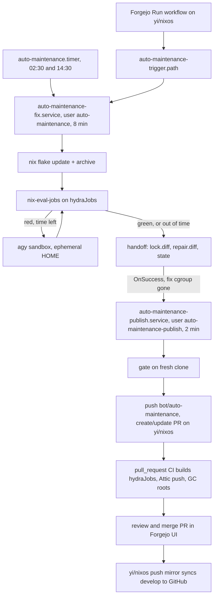

# Auto-Maintenance Bot Plan

## Objective

Keep one open PR (`bot/auto-maintenance` → `develop`) on `yi/nixos` in Forgejo that runs `nix flake update` and repairs evaluation breakage via `agy` (`gemini-3.8-flash-medium`). Forgejo CI builds the PR and pushes closures to Attic; the PR is reviewed and merged directly in the Forgejo UI, which automatically push-mirrors `develop` to GitHub. A deterministic script owns git, `flake.lock`, and the PR. The bot holds no GitHub token, cannot push to `main` or `develop`, and each run is capped at 10 minutes. Schedule and GC ordering come from [modules/maintenance.nix](../../../modules/maintenance.nix).

## Current state

- Bot host: `yifuwuqi` (Forgejo primary repo `yi/nixos` with SSH push mirror to `categoricalcat/nixos` on GitHub per [forgejo-github-sync.md](../services/forgejo-github-sync.md), Attic, Forgejo runner `native` as `nix-builder`, which holds the root deploy key `keys/deploy` in [forgejo-runner.nix](../../../modules/services/forgejo-runner.nix)).
- **Forgejo exposure**: yirukou proxies `git.fufu.land` to trusted CIDRs only, but [forgejo.nix](../../../modules/services/forgejo.nix) still has `service.DISABLE_REGISTRATION = false`: any self-registered LAN/tailnet account can run jobs on the instance-wide `native` runner as `nix-builder`.
- **CI**: [ci.yml](../../../.forgejo/workflows/ci.yml) builds `hydraJobs` ([nix/ci.nix](../../../nix/ci.nix)) on push to `main`/`develop` and on `pull_request`; [ci/build.sh](../../../ci/build.sh) roots `develop` and `bot/auto-maintenance` toplevels (needs `GITHUB_HEAD_REF` fallback so `pull_request` events match `bot/auto-maintenance`); [cd.yml](../../../.forgejo/workflows/cd.yml) is a `workflow_dispatch` button.
- **Local listeners**: [opencode.nix](../../../modules/services/opencode.nix) runs `opencode serve --hostname 0.0.0.0` as `yi`; any local process that reaches it can run commands as `yi`.
- Existing patterns: `nxd-agy` (unpinned `nix run`) in [packages/wrappers.nix](../../../packages/wrappers.nix), `CI=1` raw changelog fallback in [nix/scripts/lock-to-changelog.sh](../../../nix/scripts/lock-to-changelog.sh), timer + oneshot + `LoadCredential` in [modules/services/attic/closure-keeper.nix](../../../modules/services/attic/closure-keeper.nix), `slot` timers in [modules/maintenance.nix](../../../modules/maintenance.nix) (`cveScan` already runs at `05,17:30`).
- **`google-antigravity-cli` 1.4.7** (embedded changelog):
  - Auth: Google sign-in token at `~/.gemini/antigravity-cli/antigravity-oauth-token` (file-based storage without a keyring); alternatives `GEMINI_API_KEY` + `modelProvider: "gemini"`, `AGY_ADC_AUTH`.
  - Headless (`-p`): no timeout unless `--print-timeout`; on expiry it returns partial output and exits 0; waits for background tasks until the deadline (30 min cap); permission prompts are soft-denied and reported as `denied_actions`; API/quota failures exit 3 with an `AGY_ERROR` JSON line on stderr.
  - Sandbox: `--mode` silently falls back to the default mode when the terminal sandbox is unavailable; `enableTerminalSandbox` errors instead; `sandboxAllowNetwork` controls command egress.
  - Permissions live in `~/.gemini/antigravity-cli/settings.json` ([antigravity-cli.nix](/etc/nix/inputs/home-manager/modules/programs/antigravity-cli.nix)); `agy -p /config` and `agy -p /permissions` print effective settings non-interactively.
- **systemd**: `RuntimeMaxSec=` has no effect on `Type=oneshot`; oneshots are capped with `TimeoutStartSec=`.

## Decisions

### Forgejo PR & landing

- **Bot account & branch protection**: non-admin Forgejo user `auto-maintenance` is added as a Write collaborator on `yi/nixos`. Branch protection on `main` and `develop` restricts direct pushes to `yi`, so the bot token can only push `bot/auto-maintenance` and manage PRs.
- **Source & publish**: `fix` fetches `develop` from `http://127.0.0.1:<forgejo.httpPort>/yi/nixos.git`. `publish` skips if `bot/auto-maintenance` has commits not authored by the bot (preserving manual edits on the PR branch), `--force-with-lease` pushes `bot/auto-maintenance` over loopback HTTP, and creates or updates one open PR (`bot/auto-maintenance` → `develop`) on `yi/nixos` via the Forgejo REST API. Commit 1: `flake.lock`; Commit 2 (optional): repair + `statix`/`deadnix` on touched files. Operator-owned bot author, no co-author trailers. No push when the lock is unchanged vs `develop`; close the PR and delete `bot/auto-maintenance` once the branch has no diff vs `develop`.
- **PR body & landing**: status (`green|red`, `verified: partial|full`), rounds used, `CI=1 lock-to-changelog` output, lock-only trace when red, and gate rejection reason. Opening or updating the PR triggers `pull_request` CI on `yi/nixos`, which builds `hydraJobs`, pushes closures to Attic, and roots `bot/auto-maintenance` host toplevels. Review and merge (fast-forward) directly in the Forgejo PR UI; merging updates `develop` on `yi/nixos` and immediately push-mirrors to GitHub (`categoricalcat/nixos`).
- **Bootstrap (manual, once in Forgejo UI)**: create the `auto-maintenance` user in Site Administration, add as Write collaborator on `yi/nixos`, enable branch protection on `main` and `develop` (push whitelist: `yi`), create a `write:repository` token for `auto-maintenance`, then set `service.DISABLE_REGISTRATION = true`.

### Credentials

- **agy (personal account)**: a fresh sign-in in a throwaway home (`HOME=$(mktemp -d) agy`) gives the bot its own refresh token, so an interactive logout does not break it. Copy `.gemini/antigravity-cli/antigravity-oauth-token` into sops `tokens/agy-oauth-token` and delete the temp home. It shares the personal quota, and its scopes may include `cloud-platform`/Drive; the controls below contain it. Not a Forgejo secret: Forgejo jobs run as `nix-builder`. `invalid_grant` fails the run; redo the sign-in.
- **Forgejo**: `tokens/auto-maintenance-forgejo` (`write:repository`, bot user only), used only by the publish unit via `GIT_ASKPASS` and the Forgejo REST API.
- Sops secrets are `0400` `root`, consumed via `LoadCredential=`.

### Units, 10-minute cap & sandbox

- **Users & units**: `auto-maintenance-fix.service` (`User=auto-maintenance`, agy token only) runs sync, update, eval, and agy, then writes a handoff (`lock.diff`, `repair.diff`, `state.json`, `trace.txt`). `OnSuccess=` starts `auto-maintenance-publish.service` (`User=auto-maintenance-publish`, Forgejo token only, never runs agy) after the fix cgroup is gone; it reads the handoff read-only, gates, and pushes from its own fresh clone with `core.hooksPath=/dev/null`. agy's user cannot write publish's files or read its credential.
- **Hard cap (10 min)**: fix `TimeoutStartSec=8min`, publish `TimeoutStartSec=2min`, `TimeoutStopSec=15s`, `KillMode=control-group` (kills agy background tasks). A fix timeout means `OnSuccess=` never fires, nothing is published, and the metric records `timeout`.
- **Soft deadline (7 min in fix)**: `timeout --kill-after=10s` around eval and agy; `--print-timeout` is the remaining budget; agy exit 0 is not success (re-eval decides); exit 3 stops the rounds. Rounds run only while time remains (≤3, about 1 in practice). After a round, re-eval only the failed attributes, then everything if time allows (`verified: partial|full`). Out of time while red: publish the lock commit + trace.
- **Eval**: `nix flake archive` (prefetch, so sandboxed evals need no network), then `lixPackageSets.lix_2_96.nix-eval-jobs --flake .#hydraJobs --workers 2` (the set CI builds).
- **agy invocation**: from the deployed closure (pinned `inputs.antigravity-nix` in `flake.nix`, assert version ≥ 1.4.7), never `nix run` from the updated checkout. `env -i` with `HOME=/tmp/agy-home` (on `PrivateTmp`; token copied in per run, wiped with agy's memory at unit stop) and an explicit `PATH`; `--model gemini-3.8-flash-medium --sandbox --mode accept-edits --print-timeout <remaining> --output-format json "<prompt>"`. JSON logged to `/var/lib/auto-maintenance/logs/<run>.json` (`0600`, 14d retention); status lines and the `denied_actions` count go to the journal.
- **`settings.json`**: `enableTerminalSandbox: true`, `sandboxAllowNetwork: false`, `allowNonWorkspaceAccess: false`, `trustedWorkspaces` = bot checkout only. Abort if stderr reports the sandbox unavailable.
  - `allow`: `command(nix flake check)`, `command(nix eval)`, `command(statix)`, `command(deadnix)`, `command(nixf-diagnose)`, `command(rg)`, `command(fd)`.
  - `deny`: `command(git)`, `command(gh)`, `command(curl)`, `command(wget)`, `command(ssh)`, `command(sops)`, `command(env)`, `command(printenv)`, `command(cat /run)`, `command(nix run)`, `command(nix shell)`, `command(nix develop)`, `command(nix * --impure)`, `read_url(*)`.
  - `ask`: `command(*)` (soft-denied headless).
- **Systemd hardening**: `ProtectSystem=strict`, `ProtectHome=true`, `PrivateTmp=true`, `NoNewPrivileges=true`, `RestrictSUIDSGID=true`, `CapabilityBoundingSet=`, `MemoryMax`, `CPUQuota`, a separate `StateDirectory` per unit, `InaccessiblePaths=/persist/keys /run/secrets /var/lib/nix-builder`.
- **Egress guard**: `networking.nftables.tables` output chain (the NixOS firewall has no `extraOutputRules`). For `meta skuid auto-maintenance`: allow DNS to loopback; reject `addresses.containers.isolation.blockedDestinationSubnets` + `100.64.0.0/10` + ULA, and loopback TCP 24000-24999, 5432, 9050, 9100-9999, 11437. The publish user is not restricted (needs Forgejo on loopback).
- **Gate (publish)**: reject the repair if it touches anything outside `*.nix`/`*.md`, or `secrets/`, `.sops.yaml`, `flake.lock`, `flake.nix`, `.forgejo/`, `ci/`, `modules/maintenance.nix`, or the bot module; exceeds 10 files or 200 lines; contains token patterns (`ya29.`, `1//0`, `GOCSPX-`, `AIza`); or adds sensitive settings (`authorizedKeys`, sudo/wheel, firewall, `sops`, `builtins.fetch*`). Reject the lock diff unless only `locked` fields change (`original` identical, checked with `jq`). A rejected repair still publishes the lock commit with the reason. agy only sees the eval trace + static prompt.
- **Concurrency & pause**: systemd merges duplicate starts; `flock` across fix/publish; `ConditionPathExists=!/var/lib/auto-maintenance/paused` on fix.

### Schedule, button & metrics

- **Schedule**: `autoMaintenance = slot "*-*-* 02,14:30:00" "5m";` in [modules/maintenance.nix](../../../modules/maintenance.nix) (`Persistent=true`, `FixedRandomDelay`), `After=nh-clean.service`.
- **Button**: `.forgejo/workflows/auto-maintenance.yml` on `yi/nixos` (`workflow_dispatch`, `runs-on: native`, `timeout-minutes: 15`) runs `ci/auto-maintenance.sh trigger`: write `/run/auto-maintenance/trigger` (tmpfiles `f`, owner `nix-builder`), which `auto-maintenance-trigger.path` (`PathModified=`) turns into a fix start; poll `systemctl show` on both units; write the result + PR link to `$GITHUB_STEP_SUMMARY`. No polkit, no token; presses during a run wait on it. No `TriggerLimit*`/`StartLimit*` (a path unit that hits its limit stops watching).
- **Metrics**: root `ExecStopPost=+` writes `auto_maintenance_last_run_timestamp_seconds{unit}` and `auto_maintenance_last_success{unit}` (from `$SERVICE_RESULT`) to `auto_maintenance_<unit>.prom` in `allAddresses.monitoring.nodeTextfileDir`.

## Phases & rollout

1. **Phase 1 (Auth, sandbox & Forgejo gate)**: via `systemd-run` with the fix unit's hardening and egress rule, confirm the personal sign-in token works headless with the minimal file set, `agy -p /config` / `agy -p /permissions` show the settings keys, the sandbox blocks network and `git push`, `nix eval` works inside the sandbox, and a `write:repository` token can push `bot/auto-maintenance`, create/edit/close a PR against `develop` on `yi/nixos`, and is rejected by branch protection when pushing to `develop`. Time update + eval to calibrate the deadlines.
1. **Phase 2 (Bootstrap & secrets)**: Forgejo `auto-maintenance` user, Write collaborator + branch protection on `yi/nixos`, token; add `tokens/agy-oauth-token` and `tokens/auto-maintenance-forgejo` to `secrets/secrets.yaml`; document in [docs/src/services/secrets.md](../services/secrets.md) and a new `docs/src/services/auto-maintenance.md` (review, merging, pause, re-sign-in).
1. **Phase 3 (`ci/auto-maintenance.sh` & `ci/auto-maintenance-prompt.md`)**: `fix`, `publish`, `trigger`.
1. **Phase 4 (`modules/services/auto-maintenance.nix`)**: `yifuwuqi` assertion, both users, both services, slot timer, path unit, tmpfiles, nft table, `settings.json`, pinned `inputs.antigravity-nix`, `ExecStopPost=+` metrics; import in [hosts/yifuwuqi/services.nix](../../../hosts/yifuwuqi/services.nix).
1. **Phase 5 (Wiring)**: button workflow, slot change, `DISABLE_REGISTRATION = true` in [modules/services/forgejo.nix](../../../modules/services/forgejo.nix), use `${GITHUB_HEAD_REF:-${GITHUB_REF_NAME:-}}` in [ci/build.sh](../../../ci/build.sh) so `pull_request` runs for `bot/auto-maintenance` root host toplevels.
1. **Phase 6 (Verification & rollout)**: run `statix`, `deadnix`, `shellcheck`, `nix flake check --no-build`, verify `serviceConfig`/timer/path via `nix eval`, deploy, press the button once, then enable the timer.

## Open questions

- Pinning container `image@sha256:` digests in a later scope.
