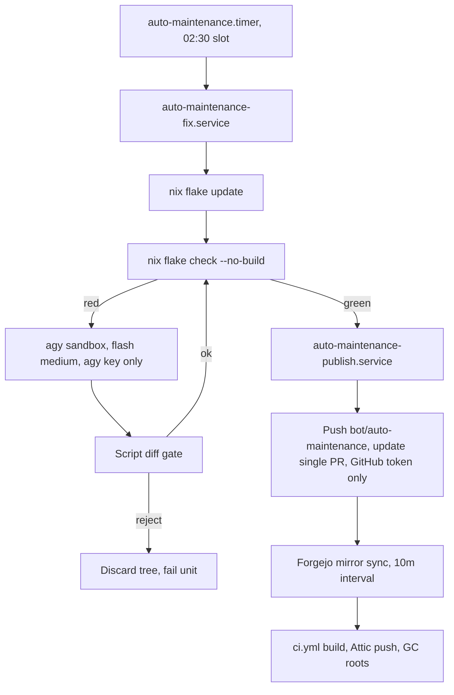

# Auto-Maintenance Bot Plan

## Objective

Keep one open PR on `categoricalcat/nixos` (base `develop`) that runs `nix flake update` and repairs evaluation breakage via `nxd-agy` (`gemini-3.8-flash-medium`). A deterministic script owns git, `flake.lock`, and the PR. The Antigravity credential cannot reach GitHub, secrets, or paths outside the bot checkout. Schedule, GC ordering, and CI GC roots come from the [fleet maintenance plan](maintenance-schedules-plan.md).

## Current state

- Bot host: `yifuwuqi` (Forgejo pull mirror `yi/nixos`, Attic, Forgejo/GitHub runners; `nix-builder` runs untrusted PR CI). Planning host: `yitaishi`.
- **Mirror & CI gap**: Forgejo syncs from GitHub every `8h0m0s` ([docs/src/services/ci-cache.md](../services/ci-cache.md)) and [.forgejo/workflows/ci.yml](../../../.forgejo/workflows/ci.yml) triggers on `push` to `main`/`develop` only (`pull_request` never fires on a pull mirror).
- **Attic retention**: CD ([.forgejo/workflows/cd.yml](../../../.forgejo/workflows/cd.yml), `gate` in [ci/deploy.sh](../../../ci/deploy.sh)) requires closures in Attic (1d retention). Without CI GC roots, unmerged PR closures are collected on Monday GC.
- Existing patterns: `nxd-agy` in [packages/wrappers.nix](../../../packages/wrappers.nix), `CI=1` raw changelog fallback in [nix/scripts/lock-to-changelog.sh](../../../nix/scripts/lock-to-changelog.sh), timer + oneshot + `LoadCredential` in [modules/services/attic/closure-keeper.nix](../../../modules/services/attic/closure-keeper.nix).
- **Verified `google-antigravity-cli` 1.4.6**: flags `--print`, `--print-timeout`, `--model gemini-3.8-flash-medium` (encodes medium effort), `--mode accept-edits|auto|plan`, `--sandbox`, `--add-dir`, `--output-format json`; env vars `GEMINI_API_KEY`, `GOOGLE_API_KEY`, `GOOGLE_APPLICATION_CREDENTIALS`, `AGY_ADC_AUTH`, `ANTIGRAVITY_CONFIG_REL_DIR`; permissions in `~/.gemini/antigravity-cli/settings.json` ([antigravity-cli.nix](/etc/nix/inputs/home-manager/modules/programs/antigravity-cli.nix)).

## Decisions

### Token & sandbox isolation

- **User & split units**: dedicated `auto-maintenance` user (isolated from `nix-builder` `/proc/<pid>/environ`). `auto-maintenance.timer` triggers `auto-maintenance-fix.service` (`LoadCredential=tokens/agy-api-key`, runs update/check/agy, `OnSuccess=` publish); `auto-maintenance-publish.service` (`LoadCredential=tokens/auto-maintenance-github`, runs commit/push/PR, never runs agy). Sops secrets `0400` `root`.
- **Execution**: `env -i` with explicit allowlist (`HOME=/var/lib/auto-maintenance/agy-home`, `PATH`, key var), `--model gemini-3.8-flash-medium --sandbox --mode accept-edits --print-timeout 15m --output-format json` (logged to `/var/lib/auto-maintenance/logs/<run>.json` `0600`; status lines only in journal). Max 3 rounds, `RuntimeMaxSec=2h`, `MemoryMax`, `CPUQuota`.
- **Permissions (`settings.json`)**:
  - `allow`: `command(nix flake check)`, `command(nix eval)`, `command(statix)`, `command(deadnix)`, `command(nixf-diagnose)`, `command(rg)`, `command(fd)`.
  - `deny`: `command(git)`, `command(gh)`, `command(curl)`, `command(wget)`, `command(ssh)`, `command(sops)`, `command(env)`, `command(printenv)`, `command(cat /run)`, `command(nix run)`, `command(nix shell)`, `command(nix develop)`.
  - `ask`: `command(*)` (fails closed with no TTY).
- **Systemd hardening**: `ProtectSystem=strict`, `ProtectHome=true`, `ReadWritePaths=/var/lib/auto-maintenance`, `PrivateTmp=true`, `NoNewPrivileges=true`, `RestrictSUIDSGID=true`, `CapabilityBoundingSet=`, `InaccessiblePaths=/persist/keys /run/secrets /var/lib/nix-builder`.
- **Diff gate & untrusted input**: reject/discard if `git diff --name-only` touches outside `*.nix`/`*.md` or touches `secrets/`, `.sops.yaml`, `flake.lock`, `.forgejo/`, `ci/`, `modules/maintenance.nix`, or the bot module. agy only sees `nix flake check` trace + static prompt; PR body uses `CI=1 lock-to-changelog`. Pin `inputs.antigravity-nix` in `flake.nix`.
- **GitHub token**: fine-grained PAT/App on `categoricalcat/nixos` (`contents: write`, `pull_requests: write`), `GIT_ASKPASS` credential helper, GitHub ruleset restricting bot pushes to `bot/*` and requiring PRs on `main`/`develop`.

### PR, schedule, CI & metrics

- **PR contract**: branch `bot/auto-maintenance` (base `develop`), fast-forward only, skip if human commits exist or lock is unchanged and check passes. Commit 1: `flake.lock`; Commit 2 (optional): repair + `statix`/`deadnix` on touched files (after 3 failed rounds, push lock commit and comment trace). Operator-owned bot author, no co-author trailers.
- **Schedule & CI**: uses `config.yi.maintenance.slots.autoMaintenance` (`*-*-* 02:30:00`, 5m delay, `Persistent=true`) and `After=nh-clean.service`. Add `bot/auto-maintenance` to `on.push.branches` in [ci.yml](../../../.forgejo/workflows/ci.yml), lower Forgejo mirror interval to `10m` (`services.forgejo.settings.mirror.DEFAULT_INTERVAL = "10m"` in [modules/services/forgejo.nix](../../../modules/services/forgejo.nix)), and root `develop` + `bot/auto-maintenance` toplevels in [ci/build.sh](../../../ci/build.sh) under `/var/lib/nix-builder/gcroots/<ref>/<host>`.
- **Metrics**: root `ExecStopPost=+` writes `auto_maintenance_last_run_timestamp_seconds{unit}` and `auto_maintenance_last_success{unit}` (from `$SERVICE_RESULT`) to `/var/lib/prometheus-node-exporter/textfile/auto_maintenance_<unit>.prom`.

## Phases & rollout

1. **Phase 1 (Auth gate)**: verify `env -i HOME=$(mktemp -d) PATH=$PATH GEMINI_API_KEY=<key> agy --model gemini-3.8-flash-medium --print "ok"` (`GEMINI_API_KEY` / `GOOGLE_API_KEY` / `GOOGLE_APPLICATION_CREDENTIALS`) and confirm `--sandbox` blocks `git push` non-interactively.
1. **Phase 2 (Secrets)**: add `tokens/agy-api-key` and `tokens/auto-maintenance-github` to `secrets/secrets.yaml` and document in [docs/src/services/secrets.md](../services/secrets.md).
1. **Phase 3 (`ci/auto-maintenance.sh` & `ci/auto-maintenance-prompt.md`)**: `fix` (HTTPS sync `/var/lib/auto-maintenance/repo`, update, check/agy loop, diff gate) and `publish` (commit, `GIT_ASKPASS` push, GitHub REST PR update with `CI=1 lock-to-changelog`).
1. **Phase 4 (`modules/services/auto-maintenance.nix`)**: `yifuwuqi` assertion, user/state dir, `settings.json`, services, slot timer, `ExecStopPost=+` metrics, `inputs.antigravity-nix` in `flake.nix`, import in [hosts/yifuwuqi/services.nix](../../../hosts/yifuwuqi/services.nix).
1. **Phase 5 (CI wiring)**: `bot/auto-maintenance` in `ci.yml`, `10m` mirror interval in Forgejo UI + `forgejo.nix`, GC roots in `ci/build.sh`.
1. **Phase 6 (Verification & rollout)**: run `statix`, `deadnix`, `shellcheck`, `nix flake check --no-build`, verify `serviceConfig`/`timer`/`after` via `nix eval`, deploy after maintenance phases 2-4, test `systemctl start auto-maintenance-fix.service`, then enable timer.

## Open questions

- Headless auth env var for `agy` (Phase 1); PAT vs GitHub App; whether `--sandbox` restricts network egress (or add `IPAddressAllow=` to fix unit); pinning container `image@sha256:` digests in a later scope.
