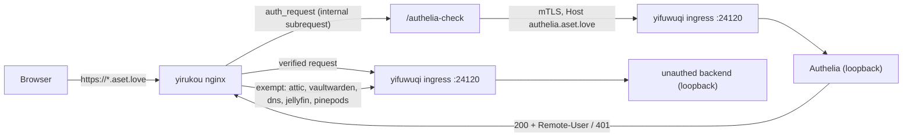

# Centralised Credentials: Vaultwarden + Authelia

## Status: DRAFT — reviewed and corrected 2026-11-24 (third pass: the `auth_request` endpoint is `/api/authz/auth-request` and `session.secret` is not required without Redis, both settled from the pinned v4.39.28 source; earlier passes: nginx variable scope, `proxy-allowlist` interaction, Authelia DB auth, Forgejo gate cost, backup completeness). Not started; nothing blocks it.

## Objective

Two jobs that look like one and are not:

- **Store** — one durable, human-usable, restorable home for every credential. Vaultwarden.
- **Gate** — one credential for the web fleet, enforced *in front of* services that have no auth of their own. Authelia + nginx `auth_request`.

Target invariant, stated as an acceptance test rather than a slogan:

> `client -> gate -> service`: a browser request reaches an unauthenticated backend only after Authelia verified a session. Machine paths and native clients are *named* exemptions, each with a reason, never accidents.

"Why two services" is answered in [Why two services, not one](#why-two-services-not-one) with the capability gap and each rejected single-service variant.

## Evidence Status

- **Repository-verified 2026-11-24**: every `file:line` below, plus the absence of `auth_basic`/`auth_request`/`forward_auth` anywhere in the tree (`rg` over `!docs/**` returns nothing).
- **Upstream-verified** against `/etc/nix/inputs/nixpkgs`: `--with-http_auth_request_module` in the generic nginx build ([generic.nix:142](/etc/nix/inputs/nixpkgs/pkgs/servers/http/nginx/generic.nix)), `services.vaultwarden` backend/backup semantics (sqlite-only `backupDir` assertion at [vaultwarden/default.nix:212-216](/etc/nix/inputs/nixpkgs/nixos/modules/services/security/vaultwarden/default.nix), `ENABLE_WEBSOCKET` set only under `configureNginx` at [:263-266](/etc/nix/inputs/nixpkgs/nixos/modules/services/security/vaultwarden/default.nix)), `services.authelia.instances` option shapes including `environmentVariables` with the documented `_FILE` suffix ([authelia.nix:122-132](/etc/nix/inputs/nixpkgs/nixos/modules/services/security/authelia.nix)), the default `pg_hba` (`local … peer`, `host … 127.0.0.1/32 md5` at [postgresql.nix:686-695](/etc/nix/inputs/nixpkgs/nixos/modules/services/databases/postgresql.nix)), and `update-users-groups.pl` activation behaviour ([:299-300, :307-314](/etc/nix/inputs/nixpkgs/nixos/modules/config/update-users-groups.pl)).
- **Must be confirmed at implementation time** (cannot be settled by evaluation):
  - Whether TOTP devices can be enrolled with the file backend.
  - Whether `actions/checkout` can be repointed at a loopback clone URL; the fallback is a plain `git clone` step (Decision 12), so either outcome is shippable.
- **Settled from the pinned Authelia source** (`v4.39.28`, read directly rather than from docs):
  - **The `auth_request` target is `/api/authz/auth-request`**, not `/api/authz/forward-auth`. The endpoint names are `legacy`, `auth-request`, `ext-authz`, `forward-auth` ([schema/const.go:152-155](https://github.com/authelia/authelia/blob/v4.39.28/internal/configuration/schema/const.go)) and all four are registered by default ([schema/server.go:91-141](https://github.com/authelia/authelia/blob/v4.39.28/internal/configuration/schema/server.go)). The `AuthRequest` implementation reads `X-Original-Method` + `X-Original-URL` ([handler_authz_impl_authrequest.go:19-37](https://github.com/authelia/authelia/blob/v4.39.28/internal/handlers/handler_authz_impl_authrequest.go)) and answers **401** on failure, which is what nginx's `error_page 401` needs; the `ForwardAuth` implementation reads `X-Forwarded-Method/Proto/Host/URI` and answers a redirect. Phase 3 already sets the `X-Original-*` headers, so only the URI changes.
  - **`session.secret` is not required without Redis.** The "secret is required" check lives in `validateRedisCommon`, reached only when `config.Session.Redis != nil` ([validator/session.go:19-51, 257-261](https://github.com/authelia/authelia/blob/v4.39.28/internal/configuration/validator/session.go)). Decision 8 stands as written.

## Current State (repository-verified 2026-11-24)

- **SOPS holds machines, not people.** `secrets/secrets.yaml` is encrypted to the host age keys ([keys.nix](../../../secrets/keys.nix)), identity derived from each host's SSH host key ([sops.nix](../../../secrets/sops.nix)). Root-only. Of the four `passwords/*` keys in the schema, only `passwords/opencode` is wired ([opencode.nix:22-24](../../../modules/services/opencode.nix)); `passwords/workd` has zero `.nix` consumers and `passwords/nextcloud` is consumed only by a module that is commented out ([services.nix:27](../../../hosts/yifuwuqi/services.nix)). `passwords/yi` is **declared nowhere** — no `sops.secrets."passwords/yi"` exists, and `users.nix:74` is root's plain path `/persist/keys/passwords/root`, not this key. It is therefore a dead schema entry until Phase 4 declares it.
- **Every app password is mutable DB state with no declarative path.** Forgejo admin via CLI ([bootstrap-runbook.md](../hardware/bootstrap-runbook.md)), Jellyfin first-run wizard, \*arr/Readarr/Prowlarr `AuthenticationMethod` + Users table, Pinepods first admin. Losing one means a sqlite/schema reset, not a lookup.
- **Some services have no auth at all**, so there is nothing to lose and nothing to look up: Grafana anonymous Admin ([grafana.nix:129-131](../../../modules/services/monitoring/grafana.nix) — `auth.anonymous.enabled = true`, `org_role = "Admin"`, with `auth.disable_login_form = true` at [:128](../../../modules/services/monitoring/grafana.nix)), AdGuard (`mutableSettings = false`, no `users:` block, loopback admin at [adguardhome.nix:32-45](../../../modules/services/adguardhome.nix)), qBittorrent (`WebUI\LocalHostAuth=false` + `AuthSubnetWhitelist=127.0.0.1`, [qbittorrent-vpn.nix:94-96](../../../modules/services/qbittorrent-vpn.nix) — the ingress proxies *from* `127.0.0.1`, so the whitelist is fully bypassed), SillyTavern (`basicAuthMode = false`, [sillytavern.nix:138-141](../../../modules/services/ai/sillytavern.nix)), Homepage, SearXNG, Docs, Firecrawl, Pinepods, `sd-cpp`.
- **At least one service is already API-authenticated and must not be gated.** Attic rejects unauthenticated API calls — asserted in the DR drill ([test.nix:263-268](../../../secrets/test.nix)). Forward-auth on it adds no security and breaks substitution.
- **The only web gate is network position.** `mkLocalVhosts` and `mkRemoteVhosts` admit by LAN CIDR + mTLS peer certificate ([proxy-vhosts.nix](../../../modules/services/proxy-vhosts.nix)), never by identity. The `proxy-allowlist` contract ([checks.nix:119-162](../../../nix/checks.nix)) pins that allow/deny sequence and only inspects lines beginning `allow `/`deny ` ([checks.nix:133](../../../nix/checks.nix)), so an `auth_request` directive can be added without tripping it — **but a new `proxy_pass` location cannot**: `served` is true for any location with `proxyPass` or `proxy_pass` in `extraConfig` ([checks.nix:134-140](../../../nix/checks.nix)), so the internal subrequest location is a contract violation unless the contract learns one exemption (Decision 13).
- **Two proxy hops, one client.** yifuwuqi's ingress pins the peer subject `CN=yirukou-client` ([mtls.nix:142-146](../../../modules/services/mtls.nix)) and the firewall admits only yirukou to `24120` ([firewall.nix:74-77](../../../hosts/yifuwuqi/networking/firewall.nix)). Every web request into yifuwuqi therefore passes through yirukou. This is what makes one enforcement point sufficient.
- **`$forwarded_proto` and `$forwarded_host` exist only on yifuwuqi.** They are `map`s declared in [local-ingress.nix:25-34](../../../modules/services/local-ingress.nix) and used by `mkLocalVhosts` ([proxy-vhosts.nix:230-231](../../../modules/services/proxy-vhosts.nix)). yirukou declares neither, so any yirukou-side vhost config referencing them fails `nginx -t` with *unknown variable* at startup. The 401 redirect must use `$scheme`/`$host`, which are correct at that hop because the request there *is* the client request.
- **`proxiedServices` is not the whole web surface.** `mkRemoteVhosts` is generated from that table alone ([proxy-vhosts.nix:171-196](../../../modules/services/proxy-vhosts.nix)), but yirukou also serves vhosts that never reach yifuwuqi: AdGuard UI ([nginx-proxy.nix:147](../../../modules/services/nginx-proxy.nix)), DoH ([nginx-proxy.nix:157](../../../modules/services/nginx-proxy.nix)), GoAccess ([nginx-proxy.nix:167](../../../modules/services/nginx-proxy.nix)), and `sd-cpp.aset.love` ([nginx-proxy.nix:190](../../../modules/services/nginx-proxy.nix)), whose registry key is `sd-cpp` and whose current name is `image` (Phase 0). Service-to-service traffic bypasses all of them: SillyTavern reaches `sd-cpp` over the tailnet address and port, not the vhost ([sillytavern.nix:26-31](../../../modules/services/ai/sillytavern.nix), asserted in [sillytavern-settings-overlay-test.sh:64](../../../modules/services/ai/sillytavern-settings-overlay-test.sh)), and the Forgejo runner reaches Attic and Forgejo on loopback ([ci/deploy.sh:36](../../../ci/deploy.sh), [forgejo-runner.nix:96](../../../modules/services/forgejo-runner.nix), [:124](../../../modules/services/forgejo-runner.nix)).
- **`yi` has no persisted password.** `hashedPasswordFile` is set only for `root`, only on `yitaishi`/`yixiaoqing`, and points at a plain path ([users.nix:64-77](../../../users/users.nix)); `mutableUsers = true` ([users.nix:37](../../../users/users.nix)). yirukou's `/` is **ext4 today** ([hardware.nix:27-33](../../../hosts/yirukou/hardware.nix)) — the tmpfs root and its persistence list are a *planned* change ([impermanence-yirukou-plan.md](impermanence-yirukou-plan.md)), whose list contains no `/etc/shadow`. The problem is therefore latent on yirukou and present on any fresh install; it is not "already broken at every reboot".
- **yifuwuqi has no impermanence.** [hardware.nix](../../../hosts/yifuwuqi/hardware.nix) declares only `/` and `/boot`; `/persist` there is a plain directory on root ext4 (that is where postgres lives, [hosts.nix](../../../modules/addresses/hosts.nix)). New yifuwuqi state needs no persistence work.
- **No vault, no IdP.** `vaultwarden`, `authelia`, `lldap`, `kanidm`, `oauth2-proxy` appear nowhere outside nixpkgs. [web-apps.nix:57-60](../../../modules/desktop/web-apps.nix) bookmarks the **cloud** `vault.bitwarden.com`, so a store is in use but the fleet owns no copy of it and has no backup of it. The only backup tooling in-tree is the sqlite path inside the Vaultwarden module, which Postgres would leave unused.
- **Vhost names are nicknames, not identities.** Eight fleet services use a role or nickname (`git`, `cache`, `home`, `search`, `agent`, `companion`, `cast`, `image`) and AdGuard's vhost (`adguard`) disagrees with its registry key (`adguardhome`) — nine registry domains in total ([hosts.nix](../../../modules/addresses/hosts.nix)). One registry key disagrees with its own module name (`sd-cpp` vs `services.sd-cpp-node`). Every consumer reads `service.domain`, so the churn is nine registry lines — but the change is not free: bookmarks, a Forgejo remote, three stale source comments, and one vendored Grafana dashboard hardcode the old names. Phase 0 freezes the naming so the gate, the cookie domain and the exemption list are written once against stable names.
- **Plans need no `SUMMARY.md` entry**: the docs service appends `src/plans/*.md` at serve time ([hosted-services.md](../services/hosted-services.md)).

## Why two services, not one

### The two roles need different capabilities

| Requirement                                                             | Vaultwarden                     | Authelia                                                                                       |
| ----------------------------------------------------------------------- | ------------------------------- | ---------------------------------------------------------------------------------------------- |
| Store arbitrary third-party credentials, usable by a human without root | yes — that is its whole purpose | no — the users backend holds *login identity* (username, argon2 hash, TOTP), not app passwords |
| Survive and restore as data                                             | yes — `pg_dump` + `DATA_FOLDER` | partly — TOTP enrolments are state; users are config                                           |
| Gate *any* HTTP app per request, without app changes                    | no                              | yes — designed for `auth_request`                                                              |
| Per-user session across many hostnames, 2FA at login                    | no                              | yes — `session.cookies` per cookie domain                                                      |
| Fail independently of the apps                                          | n/a                             | yes                                                                                            |

### Each single-service variant, and why it fails

1. **Authelia alone → gate without a store.** The "I lost my password" case is not a login problem, it is a *record* problem: Forgejo's admin, the \*arr `Users` table, Jellyfin's first-run wizard and Pinepods' first admin are database rows. A gate creates no record of them, and forward-auth does not remove the app-native credentials that still sit behind it.
1. **Vaultwarden alone → store without a gate.** Every zero-auth service stays zero-auth; qBittorrent's whitelist bypass, Grafana's anonymous Admin and AdGuard's missing users block all remain. And the vault's own auth is a *client-side* protocol (master password + KDF + device 2FA), so it cannot be repurposed into a request gate.
1. **SOPS as the store.** Already rejected: age identities derive from host SSH keys, files are root-only, and every edit is a rebuild + deploy. No client, no revisions, no autofill, no per-entry audit. SOPS stays the machine-facing store.
1. **Authelia's users file as the store.** Rotating a service password would become a Nix + sops change and a deploy — recreating the recovery project this plan exists to delete. The file backend's job is one login identity per human, nothing else.

### Why they must not be fused (the actual cost of coupling)

- **Failure domains.** If the vault were the gate, a vault restart logs the whole fleet out, and any vault problem locks every service. If the gate stored secrets, its database becomes the most sensitive artifact in the fleet while sitting on the request path of every page load.
- **Threat models.** The gate sees every browser request and must stay cheap, online and boring. The vault holds everything and must be encrypted at rest, backed up, and rarely touched.
- **Auth strength runs the other way for one service.** Vaultwarden's own auth (master password + 2FA + KDF, plus the LAN CIDR/mTLS position) is *stronger* than forward-auth. Gating the vault would be a downgrade for its extension and mobile clients, which cannot complete a browser redirect (Decision 5).

## Decisions

1. **Vaultwarden, not SOPS, is the human store of record.** SOPS stays machine-facing (tokens, keys, service wiring); humans get a real client with autofill, revisions and 2FA. This plan adds **four** sops keys, all machine-facing: `tokens/vaultwarden-admin`, `services/authelia/storage-password`, `services/authelia/jwt-secret`, `services/authelia/storage-encryption-key`. The split is enforced per key, not per file: Phase 5 moves only the human-only entries and duplicates the dual-use ones; nothing the fleet needs to boot leaves sops.
1. **Postgres, not sqlite.** yifuwuqi already runs socket-only Postgres driven by `pgDatabases` ([hosts.nix:91-95](../../../modules/addresses/hosts.nix), [postgresql.nix](../../../modules/services/postgresql.nix)). Add `vaultwarden = "vaultwarden"` to that map — one source of truth, and `ensureDBOwnership` creates the role. Do **not** set `services.vaultwarden.configurePostgres`; that starts a second server. The module's own `backupDir` is sqlite-only, so its bundled timer is unused and a `pg_dump` unit is required (Phase 2).
1. **The gate sits on `yirukou` — one enforcement point, not two.** Proof that one point suffices: yifuwuqi's ingress admits only `CN=yirukou-client` and its firewall admits only yirukou's address to `24120`, so no browser reaches a yifuwuqi backend except through yirukou. Proof that the gate cannot live only in `proxiedServices`: AdGuard, DoH, GoAccess and `sd-cpp.aset.love` are yirukou-local vhosts that `mkRemoteVhosts` never generates. Therefore the gate is **one predicate and one helper**: an `auth = true` flag on the service spec, consumed by a single `mkAuthGate` used by `mkRemoteVhosts` and by the yirukou-local vhosts in [nginx-proxy.nix](../../../modules/services/nginx-proxy.nix). The yifuwuqi ingress (`mkLocalVhosts`) is deliberately *not* gated: it admits only the gateway certificate, so a second gate there would be a second failure domain for no admitted request.
1. **Authelia runs on yifuwuqi with its storage in the existing Postgres, authenticating with a sops-held password.** It is exposed as `authelia.${baseDomain}` through the ingress — it needs a `proxiedServices` entry both so browsers can log in and so yirukou's subrequest has an upstream. Its `server.address` is loopback only. Peer auth is the wrong lane here: the module names the OS user `authelia-main` for instance `main` ([authelia.nix:22-43, 265-268](/etc/nix/inputs/nixpkgs/nixos/modules/services/security/authelia.nix)) while `pgDatabases` derives the role from each map *value* ([postgresql.nix:8, 15-20](../../../modules/services/postgresql.nix)), so the two names would only line up if the database were renamed `authelia-main` — and whether Authelia accepts a socket *directory* as `storage.postgres.host` is unconfirmed. It is a Go binary using a libpq-shaped DSN, so assume TCP. Therefore: `storage.postgres` over loopback with `AUTHELIA_STORAGE_POSTGRES_PASSWORD_FILE` supplied through the module's documented `_FILE` lane in `environmentVariables` ([authelia.nix:122-132](/etc/nix/inputs/nixpkgs/nixos/modules/services/security/authelia.nix)). The default `pg_hba` already carries `host all all 127.0.0.1/32 md5`, and PostgreSQL negotiates SCRAM for a SCRAM-hashed password under an `md5` entry.
1. **Named exemptions, each justified.** A gated path must be a human UI or a browser-driven API.
   - `attic` — already API-authenticated; every host substitutes from `https://${attic.domain}/...` ([client.nix:8](../../../modules/services/attic/client.nix)), so a 401 here breaks every `nix build` in the fleet. The trusted public key is cache-name based, so the Phase 0 rename does not invalidate it.
   - `vaultwarden` — extension/mobile clients speak `POST /identity/connect/token`; an HTML redirect is not a valid token response, and its own auth is stronger than the gate.
   - `jellyfin`, `pinepods` — native TV/mobile and podcast clients cannot complete a browser login.
   - `authelia` — its own login page cannot require a session, or the redirect loops.
   - `dns.${baseDomain}` — the vhost has exactly one location, `/dns-query`, which is a machine protocol with no cookie jar ([nginx-proxy.nix:157-163](../../../modules/services/nginx-proxy.nix)). The whole vhost is exempt; there is no "gated vhost with an ungated path" to design.
   - Out of scope rather than exempt: the `_` default vhost, `/loki/` and every exporter location live on the yifuwuqi ingress behind the client certificate and never traverse yirukou's vhost set ([proxy-vhosts.nix:256-268](../../../modules/services/proxy-vhosts.nix)).
1. **Forward-auth authenticates the request, not the user inside the app.** A service with no user model stays single-user behind a door; that is the honest limit and it is the point of gating the zero-auth set. Where an app understands a header or OIDC, propagate identity instead of hiding it: `auth_request_set $user ...` plus `proxy_set_header Remote-User` feeding Grafana `auth.proxy` and \*arr `AuthenticationMethod=External`, and native OIDC later for Grafana and Forgejo. Without this, Grafana's anonymous Admin makes the gate decorative for *authorization* even when it works for *access*.
1. **One cookie domain for the whole base domain.** `session.cookies` must carry `domain = baseDomain` and `authelia_url = https://authelia.${baseDomain}`, otherwise each hostname gets an independent session and the post-login redirect lands on the wrong host. The 401 redirect is built from `$scheme` and `$host`, **not** `$forwarded_proto`/`$forwarded_host`: those maps exist only on yifuwuqi, and referencing an undefined variable makes nginx refuse to start ([local-ingress.nix:25-34](../../../modules/services/local-ingress.nix)).
1. **No Redis.** The nixpkgs module documents `sessionSecretFile` as Redis-only ([authelia.nix:102-108](/etc/nix/inputs/nixpkgs/nixos/modules/services/security/authelia.nix)), and the pinned source confirms `session.secret` is validated only under `Redis != nil`, so nothing supplies it ([validator/session.go:257-261](https://github.com/authelia/authelia/blob/v4.39.28/internal/configuration/validator/session.go)). Postgres storage only.
1. **`yi` gets a `hashedPasswordFile` from sops, and `mutableUsers` stays `true` on yifuwuqi.**
   - Mechanism, from the activation script: for an **existing** account, `/etc/shadow` keeps its current hash and is overwritten with `hashedPassword` only when `mutableUsers = false` ([update-users-groups.pl:299-300](/etc/nix/inputs/nixpkgs/nixos/modules/config/update-users-groups.pl)); for a **new** account the hash is written regardless of `mutableUsers` ([:307-314](/etc/nix/inputs/nixpkgs/nixos/modules/config/update-users-groups.pl)).
   - Consequence for `yirukou`: today `/` is ext4 and `/etc/shadow` persists, so `yi` already exists and the file is ignored exactly as on yifuwuqi. Once [impermanence-yirukou-plan.md](impermanence-yirukou-plan.md) lands, every boot starts with an empty `/etc`, the account is re-created from the declarative spec, and the hash is written unconditionally — so the file becomes effective *through that plan*, not through this one. Until then, Phase 4 is a fresh-install safety net.
   - Consequence for `yifuwuqi`: `/etc` persists, so `yi` already exists and the file is ignored. Flipping `mutableUsers = false` would also remove every undeclared account — a much larger change than this plan, and not worth taking to make one declaration effective. **Decision: stay mutable; the file is a fresh-install net on this host.**
   - Accepted cost either way: the sops value is the truth, and a `passwd yi` change is overwritten at the next activation that applies it.
1. **A vhost name is its registry key, slugified, permanently.** `domain = "${name}.${baseDomain}"` — no nicknames (`git`, `home`, `cast`, `image`), no role names (`cache`, `agent`), no abbreviations. This plan is the last chance to pay that cost cheaply: the gate, the Authelia exemption list, the session cookie and every bookmark and client URI all key off these names, so after Phase 0 a rename is a cross-cutting change instead of a nine-line registry edit (Phase 0).
1. **`ADMIN_TOKEN` is a plain random token, not an argon2 hash.** A generated token has no `$`, so the quoting and expansion questions that a PHC hash invites disappear, and the sops value is directly usable by `/admin`. Corollary worth writing down once: `EnvironmentFile=` performs no variable expansion — systemd documents `Environment=` as "variable expansion is not performed inside the strings and the `$` character has no special meaning", and `EnvironmentFile=` adds only quoting and backslash rules. No `$$` rewriting anywhere.
1. **Forgejo is gated, and CI's clone hop moves to loopback in the same batch.** Forgejo is the one app where the gate has a visible cost: HTTPS git remotes stop working, and CI jobs clone through the public hostname today ([ci-cd.md:64](../services/ci-cd.md)). Both are acceptable and both are paid at once: the SSH remote on `24212` is a separate systemd sshd path that never touches nginx, and the three workflows replace `actions/checkout` with an explicit clone from `http://127.0.0.1:24200` on the runner's own host (it already has `git` in `hostPackages` and reaches Forgejo on loopback). If `actions/checkout` can be repointed instead, that is one less edit; either way CI must not traverse the gate.
1. **The `proxy-allowlist` contract learns exactly one exemption.** A location whose `extraConfig` declares `internal;` is not reachable from the network, so the LAN allow/deny sequence is meaningless for it. The predicate gains one term ([checks.nix:134-140](../../../nix/checks.nix)) and nothing else relaxes: every *served* non-internal location still has to carry the exact registry CIDRs.

## Target Topology

### Request lifecycle (the `client > auth > unauthed service` chain, per request)

1. Browser asks for `https://grafana.aset.love/api/dashboards`. yirukou's vhost matches a gated service.
1. nginx issues an internal subrequest to `/authelia-check` **before** touching the backend. Bodies are off (`proxy_pass_request_body off`), so a 1 GB upload is not buffered twice; only headers travel. The LAN `allow`/`deny` pair stays on the location as the outer admission check; the subrequest is the inner one, and the request must satisfy both.
1. The subrequest crosses the mTLS ingress with `Host: authelia.aset.love` and `X-Original-URL`. Authelia answers on status alone:
   - `2xx` → proceed; `Remote-User`/`Remote-Groups` headers ride along on the real request.
   - `401` → nginx returns `302` to `authelia.aset.love/?rd=<original url>`; the login page posts credentials, sets the `.aset.love` session cookie, and bounces back.
   - anything else (including Authelia down → `502`) → the request is denied. The gate fails closed.
1. Only after `2xx` does nginx proxy to the yifuwuqi ingress, which enforces `allow`/`deny` + the client-certificate check and then reaches the backend.

Consequences that follow from `auth_request` semantics and are worth stating rather than discovering:

- It is **per request**, not per page: every XHR, asset, and WebSocket upgrade re-verifies. Session revocation takes effect on the next request, not at next login.
- A WebSocket is verified once at upgrade; the established connection outlives session expiry until the client reconnects.
- Upstream 401s are only converted into a login redirect if `proxy_intercept_errors` is on; it stays off, so an app's own auth challenge is not hijacked.

## Phases

### Phase 0 — Freeze and slugify every hostname (must land first)

Every vhost name today is either a nickname (`git`, `home`, `search`, `agent`, `companion`, `cast`, `image`, `cache`) or a redundant match (`adguard` for a service keyed `adguardhome`). Rename each to its **registry key**, so the domain is derived rather than authored: `domain = "${name}.${baseDomain}"`. This must precede the gate because the Authelia cookie domain, the exemption list, and every bookmark and client URL reference these names.

| Current               | New                     | Registry key  | Why                                                          |
| --------------------- | ----------------------- | ------------- | ------------------------------------------------------------ |
| `git.aset.love`       | `forgejo.aset.love`     | `forgejo`     | Hosts Forgejo, not a generic git server                      |
| `cache.aset.love`     | `attic.aset.love`       | `attic`       | "Cache" names a role, the registry names the software        |
| `home.aset.love`      | `homepage.aset.love`    | `homepage`    | `home` is ambiguous with a directory                         |
| `search.aset.love`    | `searxng.aset.love`     | `searxng`     | Same class                                                   |
| `agent.aset.love`     | `opencode.aset.love`    | `opencode`    | `agent` describes a use, not the service                     |
| `companion.aset.love` | `sillytavern.aset.love` | `sillytavern` | Same class                                                   |
| `cast.aset.love`      | `pinepods.aset.love`    | `pinepods`    | "Cast" names the protocol, not the app                       |
| `image.aset.love`     | `sd-cpp.aset.love`      | `sd-cpp`      | Registry key is `sd-cpp`; `image` is a category              |
| `adguard.aset.love`   | `adguardhome.aset.love` | `adguardhome` | Matches the registry key; `dns` stays separate (DoH, not UI) |

Already correct: `grafana`, `cockpit`, `radarr`, `sonarr`, `lidarr`, `readarr`, `prowlarr`, `torrent-indexer`, `bazarr`, `jellyfin`, `jellyseerr`, `qbittorrent`, `slskd`, `docs`, `flaresolverr`.

Not service vhosts at all, so nothing to rename: `ssh` (the fleet sshd), `goaccess` (yirukou's log dashboard), `webdav` (module commented out, [services.nix:37](../../../hosts/yifuwuqi/services.nix)), `smb` (an AdGuard DNS rewrite to yifuwuqi, never a vhost — [adguardhome.nix:141-145](../../../modules/services/adguardhome.nix)), `cloudflare.${baseDomain}` (the tunnelled sshd endpoint), and the apex/legacy redirects.

Mechanical consequence: nine one-line registry edits ([hosts.nix](../../../modules/addresses/hosts.nix)) and almost nothing else, because nearly every consumer reads `service.domain` — `mkRemoteVhosts` ([proxy-vhosts.nix:183](../../../modules/services/proxy-vhosts.nix)), homepage `ping` ([homepage.nix:85](../../../modules/services/homepage.nix)), homepage's SearXNG shortcut ([homepage.nix:54](../../../modules/services/homepage.nix)), desktop web apps ([web-apps.nix:93](../../../modules/desktop/web-apps.nix)), Grafana `root_url` ([grafana.nix:125](../../../modules/services/monitoring/grafana.nix)), Pinepods `HOSTNAME` ([pinepods.nix:113](../../../modules/services/pinepods.nix)), Cockpit ([cockpit.nix:27](../../../modules/services/cockpit.nix)), Forgejo `ROOT_URL` ([forgejo.nix:39](../../../modules/services/forgejo.nix)), the CI env helper ([github-runner.nix:16](../../../modules/services/github-runner.nix)), and Attic's substituter ([client.nix:8](../../../modules/services/attic/client.nix)).

Hand-written exceptions that spell a hostname out and therefore need an edit or a decision:

- Four yirukou-local vhosts in [nginx-proxy.nix](../../../modules/services/nginx-proxy.nix): `adguard` ([147](../../../modules/services/nginx-proxy.nix)) must follow the rename; `dns` ([157](../../../modules/services/nginx-proxy.nix)) and `goaccess` ([167](../../../modules/services/nginx-proxy.nix)) keep their names; `sd-cpp` ([190](../../../modules/services/nginx-proxy.nix)) already reads `sdCpp.domain` and moves for free.
- SearXNG's `base_url` hardcodes `search.` instead of reading its registry entry ([searxng.nix:71](../../../modules/services/searxng.nix)) — make it read `service.domain`, the latter being the point of this phase.
- Stale comments that name old hostnames, free to fix in the same pass: [forgejo.nix:3](../../../modules/services/forgejo.nix), [sillytavern.nix:232](../../../modules/services/ai/sillytavern.nix), [adguardhome.nix:40](../../../modules/services/adguardhome.nix).
- AdGuard's `server_name` ([adguardhome.nix:196](../../../modules/services/adguardhome.nix)) is `dns.${baseDomain}`, which does not change, but the same file owns the `*.${baseDomain}` rewrite ([adguardhome.nix:152](../../../modules/services/adguardhome.nix)) that already resolves the new names to yirukou. No edit needed; listed so it is not mistaken for an oversight.

Outside the Nix tree, and therefore a manual step, not a rebuild:

- `users/assets/dotfiles/ssh/config` — `cloudflare.aset.love` stays; the `ssh.workd.land` stanza already points there and is stale in name only.
- The Forgejo remote on every checkout: `git remote set-url origin ssh://forgejo@forgejo.aset.love:24212/yi/nixos.git` ([forgejo-github-sync.md:50](../services/forgejo-github-sync.md)).
- Browser bookmarks, the Bitwarden entries' URIs, and any `*.arr` indexer URL pointed at `torrent-indexer.aset.love`.
- Grafana's vendored AdGuard dashboard hardcodes `https://adguard.aset.love` ([adguard.json:640](../../../modules/services/monitoring/dashboards/vendor/adguard.json), [:1331](../../../modules/services/monitoring/dashboards/vendor/adguard.json)); it is treefmt-excluded vendor output, so edit by hand or leave it broken.
- `docs/`: ~17 hand-written files mention a renamed hostname (`docs/src/generated/services.md` is one of them and regenerates). They are prose, not contracts, so no check catches a stale `cache.aset.love`; grep every old name after the change.

Transition: keep every old name as a `301` in `nginx-proxy.nix` next to the existing legacy-domain redirect ([nginx-proxy.nix:204-218](../../../modules/services/nginx-proxy.nix)) for one deploy cycle, then delete the shims. ACME needs no new certs: it is one wildcard per base domain ([nginx-proxy.nix:52-54](../../../modules/services/nginx-proxy.nix)).

Acceptance: `nix eval .#nixosConfigurations.yirukou.config.services.nginx.virtualHosts` contains exactly the new names; `curl -sI https://forgejo.aset.love` is `200`; the old name is `301`; `git push` works over the new remote; `nix flake check --no-build` passes after `docs/src/generated/services.md` is regenerated (`nix build .#docs-generated`, then install the fragments — otherwise `docs-registry-sync` fails by design).

### Phase 1 — Vaultwarden (the recovery store)

- [addresses/hosts.nix](../../../modules/addresses/hosts.nix): add `pgDatabases.vaultwarden`, plus a `services.vaultwarden` registry entry (`name`, `group = "Infrastructure"`, `domain = "vaultwarden.${baseDomain}"`, port `24150` — verified free).
- `modules/services/vaultwarden.nix`: `dbBackend = "postgresql"`, `DATABASE_URL = "postgresql:///vaultwarden?host=/run/postgresql"`, `ROCKET_ADDRESS = "127.0.0.1"`, `ROCKET_PORT` from the registry, `DOMAIN`, `SIGNUPS_ALLOWED = false`, and **`ENABLE_WEBSOCKET = true`** — the module only pins it under `configureNginx`, which stays off here, so set it explicitly rather than inherit an upstream default through a path this file does not exercise. Peer auth needs no password and no extra group: `pg_hba` carries `local all all peer` and the module's service user is `vaultwarden`, the same name `ensureDBOwnership` creates as the role. Do **not** set `backupDir` (sqlite-only assertion).
- Admin token via `sops.templates` → `environmentFile`, a plain random token (Decision 11).
- Verify the token rather than trust the reading: `systemctl show -p Environment` does **not** contain `EnvironmentFile=` values, so the check is `sudo tr '\0' '\n' < /proc/$(systemctl show -p MainPID --value vaultwarden)/environ | grep '^ADMIN_TOKEN='` compared against the sops value by the operator. A mangled token fails silently (the admin page just refuses), so this is part of Phase 1 acceptance.
- [proxy-vhosts.nix](../../../modules/services/proxy-vhosts.nix): `vaultwarden = { bodySize = "512M"; }` in `proxiedServices`, marked exempt from the gate (Decision 5).
- Notification hub: Vaultwarden's `/notifications/hub` is a websocket, and `proxiedServices` already upgrades by default (`websockets = spec.websockets or true`, [proxy-vhosts.nix:86](../../../modules/services/proxy-vhosts.nix)), so the `/` location covers it. No per-path entry is needed; the `ENABLE_WEBSOCKET` env var above is the only switch.
- [secrets/.secrets.example.yaml](../../../secrets/.secrets.example.yaml) + [secrets.md](../services/secrets.md): `tokens/vaultwarden-admin` recipe.
- Regenerate `docs/src/generated/services.md` and add a `hosted-services.md` §2 entry — `docs-registry-sync` fails otherwise.

### Phase 2 — Backups that restore

- `pg_dump -Fc` unit + timer to `/var/backup/vaultwarden/`, run as `User = postgres` so peer auth needs no credential and no `LoadCredential`. Cover **both** databases: `vaultwarden` and (once Phase 3 lands) `authelia` — TOTP enrolments live in the latter, so losing it means re-enrolling every second factor.
- **`pg_dump` alone is not a restore.** With the Postgres backend, attachments, sends and RSA keys stay in `DATA_FOLDER` (`/var/lib/vaultwarden`), which the sqlite-era `backupDir` would have swept up. `tar` that directory on the same schedule; an item whose attachment is missing restores as a broken entry.
- Acceptance: restore both artefacts into a scratch database and a scratch directory, log in, and read one item with an attachment back. Recorded before Phase 3 begins.

### Phase 3 — Authelia (one credential for the fleet)

1. `pgDatabases.authelia`, a registry entry (`authelia.${baseDomain}`, port `24140`), and `modules/services/authelia.nix` with `services.authelia.instances.main`: `default_2fa_method = "totp"`, `server.address = "tcp://127.0.0.1:<port>"`, `storage.postgres` on loopback with `AUTHELIA_STORAGE_POSTGRES_PASSWORD_FILE` pointing at the sops secret (Decision 4), file authentication backend rendered as a `sops.template` and wired via `settings.authentication_backend.file.path`, and `secrets.{jwtSecretFile,storageEncryptionKeyFile}` pointing at `sops.secrets` paths (no `sessionSecretFile`, Decision 8). Three new sops keys: `services/authelia/{storage-password,jwt-secret,storage-encryption-key}`. Add `authelia` to `proxiedServices` so both hops get a vhost for it.
1. [proxy-vhosts.nix](../../../modules/services/proxy-vhosts.nix): export `proxiedServices` (today a `let` binding consumed only by the two builders) with a per-service `auth = true` flag, and consume it from a single `mkAuthGate` helper used by `mkRemoteVhosts` and by the yirukou-local vhosts in [nginx-proxy.nix](../../../modules/services/nginx-proxy.nix):
   - in the gated location: `auth_request /authelia-check;`, `auth_request_set $authelia_user $upstream_http_remote_user;`, `proxy_set_header Remote-User $authelia_user;`, and `error_page 401 =302 https://authelia.${baseDomain}/?rd=$scheme://$host$request_uri;` (Decision 7 — `$scheme`/`$host`, never the yifuwuqi-only `$forwarded_*` maps).
   - a sibling internal location: `internal;`, `proxy_pass_request_body off;`, `proxy_set_header Content-Length "";`, `proxy_set_header Host authelia.${baseDomain};`, `proxy_set_header X-Original-URL $scheme://$host$request_uri;`, `proxy_set_header X-Original-Method $request_method;`, plus `cfg.upstreamTls` so the subrequest authenticates over the mTLS hop. It proxies to `/api/authz/auth-request` — the `AuthRequest` implementation, which reads exactly these two `X-Original-*` headers and returns 401 (Evidence Status). The `internal;` marker is what keeps `proxy-allowlist` honest (Decision 13).
   - `proxy_intercept_errors` stays off (nginx default), so an upstream 401 from an app that does its own auth is passed through rather than converted into a login redirect.
1. `authelia` itself joins the exemption set, together with the Decision 5 list. `dns.${baseDomain}` is exempt as a whole, not per path.
1. [homepage.nix:85](../../../modules/services/homepage.nix): it `ping`s every service URL, so every gated service turns red. Drive `ping` from the same gating flag — gated means no `ping` — rather than editing the dashboard by hand.
1. Forgejo: `auth = true`, and the same batch repoints CI to loopback (Decision 12). SSH remotes on `24212` need no change.
1. Flip services in small batches, verifying browser login and one native client each. Start with the ones where forward-auth *adds* security — Grafana, AdGuard, qBittorrent — and turn Grafana's anonymous Admin off in the same batch (Decision 6).

### Phase 4 — Repair the password gap

- [users.nix](../../../users/users.nix): declare `sops.secrets."passwords/yi"` with `neededForUsers = true` (the option exists for exactly this: it moves the secret to `/run/secrets-for-users` and guarantees it exists before accounts are created), then give `yi` (and `workd`, if still used) `hashedPasswordFile = config.sops.secrets."passwords/yi".path`. Note this key has **no** consumer today, so Phase 4 is its first declaration.
- `mutableUsers` stays `true` on yifuwuqi (Decision 9). The file is a fresh-install net there and becomes load-bearing on yirukou only once impermanence lands.
- `passwords/nextcloud` is deleted by Phase 5, after its value is in the vault — Phase 4 does not touch it.
- Verify: `passwd -S yi` reports `P` on a freshly created account, and the `/etc/shadow` hash for `yi` equals the sops value. On an existing mutable account it will not, and that is the documented outcome. The reboot proof belongs to [impermanence-yirukou-plan.md](impermanence-yirukou-plan.md) until that lands.

### Phase 5 — Migration: SOPS → Vaultwarden (human-only credentials)

The direction is one-way and narrow. **Machine secrets do not move.** The vault cannot bootstrap the fleet: `cloudflare_api_token` gates ACME (and therefore the vault's own TLS), `ADMIN_TOKEN` gates the vault's admin page, and a fresh host needs its sops payload before any vault exists. Making the vault the source of truth for those inverts the dependency graph and turns one restore into two. SOPS stays the machine-facing store of record; the vault is the human-facing one.

Classification of all 27 leaf keys in [.secrets.example.yaml](../../../secrets/.secrets.example.yaml):

| Class                 | Keys                                                                                                                                                                                                                                                                                                                                | Action                                                                                                                                                                                                                     |
| --------------------- | ----------------------------------------------------------------------------------------------------------------------------------------------------------------------------------------------------------------------------------------------------------------------------------------------------------------------------------- | -------------------------------------------------------------------------------------------------------------------------------------------------------------------------------------------------------------------------- |
| Machine-only (19)     | `cloudflare_api_token`, `nix/access-tokens`, `keys/deploy`, `tokens/{forgejo-runner,github-runner-nixos,attic-server-jwt-env,attic-push-token,playit-agent,cloudflared,localtonet-authtoken}`, `services/grafana/secret-key`, `services/proton/wireguard_private_key`, `services/slskd/api_key`, `arr/*_api_key` ×5, `passwords/yi` | stay in sops. Optionally a vault *secure note* as a labelled, non-authoritative recovery copy. `passwords/yi` is an argon2 hash for `hashedPasswordFile`, not a usable credential, and Phase 4 gives it its first consumer |
| Both (6)              | `passwords/opencode`, `samba/credentials/yi`, `services/slskd/{username,password,web_password}`, `tokens/deepseek`                                                                                                                                                                                                                  | duplicate: sops remains authoritative, the vault gets a Login item for human lookup. Documented drift cost, and the vault item says which side wins                                                                        |
| Human-only / dead (2) | `passwords/workd`, `passwords/nextcloud`                                                                                                                                                                                                                                                                                            | migrate to the vault, then delete the sops key                                                                                                                                                                             |

The four keys this plan adds (`tokens/vaultwarden-admin` and the three `services/authelia/*` above) are all machine-only and are not migration candidates.

Steps:

1. **`passwords/workd`** — no `.nix` consumer. Read it as root (`su -`, then `sops secrets/secrets.yaml`; `SOPS_AGE_KEY` is already exported for root, [sops.nix:35-39](../../../secrets/sops.nix)), create a Login item in the vault, then `sops unset secrets/secrets.yaml '["passwords"]["workd"]'` and reinstall the payload with `nix build .#secrets && sudo ./result/bin/sync-secrets` ([sync-secrets.sh:15-18](../../../secrets/scripts/sync-secrets.sh)). `setup-sops` also chains it ([setup-sops.sh:116](../../../secrets/scripts/setup-sops.sh)), but it regenerates keys and the mTLS mesh first, which this step does not need.
1. **`passwords/nextcloud`** — the module is commented out ([services.nix:27](../../../hosts/yifuwuqi/services.nix)). Move the value to the vault *first* so it survives if Nextcloud is re-enabled, then delete the sops key the same way.
1. **The six "both" keys** — create vault Login items with the URI set to the service's new slugified hostname (Phase 0), so autofill matches. Do not delete the sops keys. Record in each vault item's notes that sops is authoritative.
1. **The circularity** — the Vaultwarden master password cannot live in the vault it unlocks, and neither can the vault's `ADMIN_TOKEN`. Both stay human-held: master password memorized plus one offline written record; `ADMIN_TOKEN` stays a sops secret.

Mechanics: a human does all of this in a root shell. The etiquette rule forbids agents from reading or decrypting secret material, so no agent executes these steps and no value passes through Nix, a tool call, or a transcript. Two client options — the vault web UI (adequate for ~8 items) or `bw create item --session <key>` reading JSON from stdin. Neither `bw` nor `rbw` is in the tree today; add `rbw` to a devshell if the CLI lane is wanted, since `bw` needs Node.

Acceptance: `sops secrets/secrets.yaml` shows `passwords.workd` and `passwords.nextcloud` gone and the other 25 keys intact; the vault holds a Login item for each of the six duplicated keys plus the two migrated ones; `nix eval .#nixosConfigurations.yifuwuqi.config.sops.secrets` no longer contains the deleted paths, and evaluation still passes.

### Phase 6 — Identity, not just a door

- Grafana: `auth.proxy` fed by `auth_request_set $user $upstream_http_remote_user`; \*arr: `AuthenticationMethod=External` on the same header. Both are per-app wiring on top of the gate, not a prerequisite.
- Forgejo: native OIDC via Authelia's `identity_providers.oidc`; retire its forward-auth entry. Same for Grafana once `generic_oauth` is in place.

## Rollout Order

1. **Phase 0** — one deploy cycle of pure renaming, with `301` shims. Nothing else in flight, so a broken bookmark is attributable.
1. Phase 1 + 2 on yifuwuqi; populate the vault by hand from the running services. **This is the step that answers "I lost my password"** — and for the \*arr/Jellyfin/Forgejo entries it is a *reset* first (CLI/sqlite), then store.
1. Phase 5 (migration). It needs a populated vault, so it follows Phase 1, and it is independent of the gate.
1. Phase 4 (independent, tiny).
1. Phase 3 on Grafana/AdGuard/qBittorrent, then the remaining human UIs. Verify an exempt path after *every* batch: `nix build` still substitutes from Attic, a Bitwarden extension still syncs, and a CI job still clones.
1. Phase 6 refinement: header auth for Grafana/\*arr, then native OIDC for Grafana and Forgejo.

## Verification

- `nix flake check --no-build` — `proxy-allowlist` must still pass after Decision 13's one-term change, and must still fail if a served non-internal location loses its allow/deny pair.
- Generated config proof: `nix eval .#nixosConfigurations.yirukou.config.services.nginx.virtualHosts.<gated>.locations."/".extraConfig` contains `auth_request`; the same expression for `attic.aset.love`, `vaultwarden.aset.love` and `dns.aset.love` contains none; each gated vhost has exactly one location whose `extraConfig` starts with `internal;`.
- Startup proof, which is what catches an undefined variable: `nginx -t` on yirukou, and `systemctl status nginx` after the switch. A `$forwarded_*` reference would fail here and nowhere earlier.
- Gate proof, from a LAN client: `curl -sI https://grafana.aset.love` → `302` to `authelia.aset.love`; after login, `200`. `curl -sI https://attic.aset.love/yi/nix-cache-info` → `200` (exempt). `curl -sI https://forgejo.aset.love` → `302` (and `https://git.aset.love` → `301` to `forgejo.aset.love`), while a CI job still clones from loopback.
- Backend-independence proof: `systemctl stop authelia` on yifuwuqi and confirm gated vhosts answer `500` (fail closed — the `/authelia-check` subrequest gets `502` and `auth_request` denies any non-2xx/401/403 status with `500`) while `attic.aset.love` and `vaultwarden.aset.love` keep serving. The gate must never be a SPOF for Attic or the vault.
- Store proof: restore both `pg_dump` output and the `DATA_FOLDER` tarball into scratch locations, log in, and read one item *with an attachment* (Phase 2 acceptance gate).
- Vaultwarden admin-token proof: `sudo tr '\0' '\n' < /proc/$(systemctl show -p MainPID --value vaultwarden)/environ | grep '^ADMIN_TOKEN='` equals the sops value, and `/admin` accepts it. (`systemctl show -p Environment` is not evidence: it lists only unit-level `Environment=`.)
- Password proof: `passwd -S yi` reports `P` on a fresh account, and the `yi` line in `/etc/shadow`'s hash field equals the sops value there. On an existing `mutableUsers` account neither holds — record which condition was met.

## Open Questions

- **Where do \*arr/Jellyfin passwords actually come from now?** Unrecoverable by design — Phase 1 must include a reset pass, so scope it as such rather than assuming a migration.
- **Should Authelia users come from a file backend or lldap?** File is one less service and needs no self-service enrolment; lldap becomes worth it at 3+ real users or as soon as self-service TOTP enrolment matters (Evidence Status: unconfirmed for the file backend).
- **Does AdGuard's admin password move into SOPS?** `mutableSettings = false` means the users block is declarative, so it *can* — but the sops-template-as-config path for `adguardhome` needs verifying before promising it. Gating it is the interim answer.
- **Pinepods/Firecrawl hardcoded `postgres`/`pinepods` passwords** ([pinepods.nix](../../../modules/services/pinepods.nix), [firecrawl.nix](../../../modules/services/firecrawl.nix)) are hardcoded store-visible placeholders. In scope here, or a separate pass?
- **Does qBittorrent's `AuthSubnetWhitelist=127.0.0.1` stay?** Yes while the ingress is the only client ([qbittorrent-vpn.nix:249-253](../../../modules/services/qbittorrent-vpn.nix)); it is what lets the proxy front qBittorrent without embedding qBittorrent credentials. Any local process on yifuwuqi still bypasses the UI auth — unchanged by this plan.
