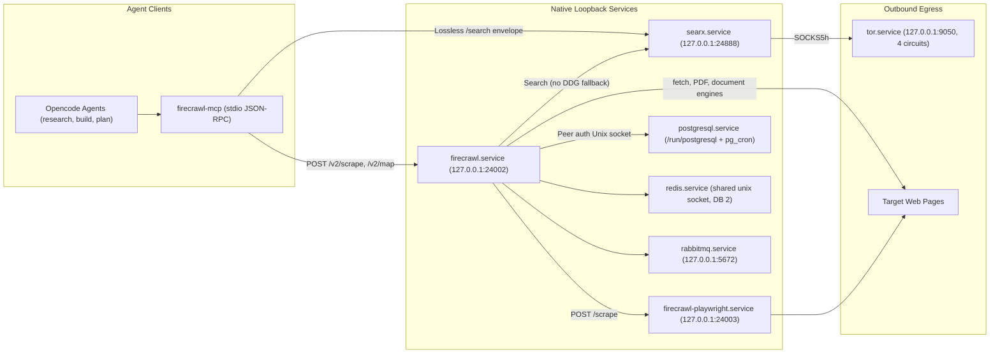

# Native Firecrawl Packaging & Lossless SearXNG Integration

## Status: DRAFT — not started; claims audited against upstream `v2.11.0`, the locked nixpkgs/SearXNG/pg_cron sources, and live `yifuwuqi` state on 2026-11-20

## Objective

1. Consolidate every Firecrawl artifact (API/workers, Playwright renderer, NuQ PostgreSQL schema, MCP stdio bridge, NixOS service module, and NixOS VM integration test) under `packages/firecrawl/`, retiring `modules/services/firecrawl.nix` and `packages/firecrawl-mcp/`.
1. Replace the 5 floating-tag Podman OCI containers with deterministic, source-built Nix derivations running as hardened `127.0.0.1` systemd services. Reuse the existing host PostgreSQL cluster and host-local Valkey through a dedicated database/role and logical DB — no second instance of either — and add loopback RabbitMQ, which has no host equivalent. That lets SearXNG (`modules/services/searxng.nix`) bind `127.0.0.1`, still serving `search.aset.love` through the local ingress as the regular service it is, and closes the container-bridge firewall exposure.
1. Keep search private and lossless where it is consumed:
   - **Firecrawl**: remove the silent clearnet `ddgSearch` fallback, so a configured SearXNG endpoint is the only search egress and its failures surface as errors. OpenCode is the only consumer and searches through `firecrawl-mcp`, so Firecrawl's own `/v1/search` and `/v2/search` keep upstream's request and response shapes.
   - **`firecrawl-mcp`**: give agents every SearXNG search parameter (time range, categories, engines, language, paging, safe search, timeout) through `firecrawl_search`, validated against an explicit domain; return SearXNG's JSON envelope without field projection, expose only locally supported `scrape` options plus `map`, keep all tool schemas flat for `llama.cpp`, and check the stated invariants with TypeScript, example tests, and seeded property tests.

## Current state

- **Floating OCI stack & network exposure (`modules/services/firecrawl.nix`)**:
  - Runs 5 Podman containers (`ghcr.io/firecrawl/{firecrawl,playwright-service,nuq-postgres}:latest`, `docker.io/library/redis:alpine`, `docker.io/library/rabbitmq:4-management`), two of them private PostgreSQL and Redis instances beside the host's own cluster (`modules/services/postgresql.nix`) and Valkey (`modules/services/valkey.nix`).
  - Publishes `"24002:3002"` on `0.0.0.0` instead of `127.0.0.1` (`modules/services/firecrawl.nix:191`), contradicting [AI & Local Inference](../services/ai-rocm.md) and `users/programs/opencode.nix:12`.
  - `playwright-service:latest` crash-loops at cold boot when `corepack` fetches `pnpm` over the network (`modules/services/firecrawl.nix:103`); readiness probes `GET /` (`line 114`) instead of upstream's `GET /v0/health/readiness`.
  - Sets dead upstream variables (`POSTGRES_URL`, `SEARCH_PROVIDER`, `SEARXNG_BASE_URL`), leaves `USE_DB_AUTHENTICATION=false` and `NUQ_BACKEND=pg` implicit, and globally pins `SEARXNG_CATEGORIES="science,general"`. Upstream's compose knobs are no better guide: `POSTGRES_HOST` only steers the harness's container bootstrap and is ignored once `NUQ_DATABASE_URL` and `NUQ_RABBITMQ_URL` are set, and no `v2.11.0` code reads `NUM_WORKERS_PER_QUEUE`, `CRAWL_CONCURRENT_REQUESTS`, or `BROWSER_POOL_SIZE`.
  - Starts the default 5 NuQ workers and 10 Playwright pages. Only the API's own listener honours `HOST`: the queue, extract, NuQ, prefetch, and reconciler workers and the Playwright service call `app.listen(port)` and bind every interface unless patched.
  - Uses inline `pkgs.writeShellScript` (`line 31`) and raw `"${pkg}/bin/..."` paths with 5x duplicated systemd network dependency blocks.
- **SearXNG loopback & Tor bypass (`modules/services/searxng.nix`, `hosts/yifuwuqi/networking/firewall.nix`)**:
  - `modules/services/searxng.nix:65` binds `0.0.0.0` (contradicting [Hosted Web Services Directory](../services/hosted-services.md)) and `hosts/yifuwuqi/networking/firewall.nix:89` opens port `24888` to application container subnets solely so containerized Firecrawl can reach SearXNG via `host.containers.internal`.
  - Upstream Firecrawl `apps/api/src/search/v2/index.ts` and `apps/api/src/search/index.ts` fall through to unproxied clearnet `ddgSearch` whenever `searxng_search` returns empty results or swallows an error.
- **Lossy MCP bridge & verification gaps (`packages/firecrawl-mcp/`)**:
  - `compactResult` (`packages/firecrawl-mcp/firecrawl-mcp.ts:213-223`) strips everything except `url`, `title`, `content`, and `publishedDate` — dropping `img_src`/`thumbnail` (`images`), `iframe_src`/`length` (`videos`), `authors`/`doi`/`journal` (`science`), and `engine`/`category`/`score`.
  - Top-level SearXNG fields (`answers` from the Calculator/Unit-converter/Hash plugins, `infoboxes`, `suggestions`, `corrections`) are discarded, and `unresponsive_engines` is dropped whenever `results.length > 0`. Those plugins run by upstream default, not by configuration: SearXNG removed the `enabled_plugins` setting that `modules/services/searxng.nix:255-259` still sets, so the live instance keeps `oa_doi_rewrite` off and `tracker_url_remover` on, the opposite of what that list declares.
  - `language` is forwarded unvalidated (`en_US`, `zh-Hant`, and `english` fail SearXNG's `^[a-z]{2,3}(-[a-zA-Z]{2})?$` + `'auto'` check with HTTP 400); `timeout_limit = 0` passes `0` to SearXNG (immediately timing out all engines); `clampInt(pageno, 1, Infinity)` formats large numbers as `"1e+..."`, failing SearXNG's `.isdigit()` check with HTTP 400.
  - `packages/firecrawl-mcp/default.nix` omits `finalAttrs:`, `meta.license`, and runtime/property tests beyond `tsc --noEmit`.
- **Audited upstream constraints (`firecrawl/firecrawl` tag `v2.11.0`, locked nixpkgs/SearXNG/pg_cron)**:
  - Firecrawl uses `pnpm@10`/lockfile v9. Nixpkgs' Playwright module is `1.64.1`, while upstream pins `1.58.1`; browser revisions and the Node module must come from the same nixpkgs Playwright package. In `1.64.1`, `chromium.launch({ headless: true })` — the service's only launch — resolves to the `chromium-headless-shell` executable, which nixpkgs' `browsers-chromium` set omits.
  - `apps/api/native` git-ignores `Cargo.lock` and depends on two unpinned git crates (`nodesig` at `HEAD`, `calamine` at branch `fc-prod`), so upstream's own image build is not reproducible. Its `index.js` loader and `index.d.ts` typings, which the runtime and `tsc` import, are likewise git-ignored outputs of `napi build`; a bare `cargo build` yields neither.
  - SearXNG unions explicit `engines` and `categories`; they are not XOR. Its parser bounds `pageno`, `safesearch`, language, and `time_range`, but accepts any float for `timeout_limit` — `0`, negatives, and `nan` included — and only caps it silently at `outgoing.max_request_timeout` (`15.0`, `modules/services/searxng.nix:136`).
  - The existing PostgreSQL module derives databases/owners from `modules/addresses.nix`. NuQ extensions must be created as `postgres`, while NuQ objects and cron jobs must be owned by `firecrawl`. `pg_cron`'s default libpq mode would reconnect as `firecrawl` and fail the default `pg_hba` (password on loopback TCP, peer mismatch on the socket), so it needs background-worker mode. Those workers report `backend_type = 'pg_cron'`, which NuQ's `nuq_maintenance_watchdog` filters out by matching only `'client backend'`.
  - Every Firecrawl Redis client is `ioredis` constructed from a URL, so one `?db=N` logical DB namespaces them all, and BullMQ only warns when `maxmemory-policy` is not `noeviction`. The host-local Valkey on `yifuwuqi` runs `allkeys-lru` under a 512 MB cap, serves SearXNG on DB 1, and has no writer of TTL-less keys: DB 0 holds about 29k stale entries in Unbound's cachedb key shape, none touched in the last 60 days (300-key sample).
  - RabbitMQ has no host equivalent and cannot be dropped: without `NUQ_RABBITMQ_URL` the harness tries to start a container and the extract worker throws at startup. `services.rabbitmq` also enables socket-activated `epmd` on `[::]:4369` and an Erlang distribution listener on every interface.

## Decisions

1. **Single package root (`packages/firecrawl/`)**:
   - Co-locate all Firecrawl derivations, patches, MCP TypeScript sources/tests, `module.nix`, and `test.nix` inside `packages/firecrawl/` (following the `packages/dev-certs/{default,module}.nix` and `packages/gateway-failover/{default,test}.nix` layout).
   - Instantiate the package with `pkgs.callPackage` at each consumer, as every other local package does (`packages/dev-certs/module.nix:42`): `flake.nix` `perSystem.packages` exposes `firecrawl` plus `firecrawl-playwright` and `firecrawl-mcp` from its `passthru`, while `module.nix` and `users/programs/opencode.nix` call it directly. An entry in `nix/overlays.nix` would reach neither `perSystem`'s `pkgs` nor the VM test's nodes, which apply no overlays; the identical expression already evaluates to one derivation everywhere.
1. **Native Nix derivations (`v2.11.0` pinned)**:
   - Share a single `fetchFromGitHub` (`firecrawl/firecrawl`, tag `v2.11.0`) across `api.nix`, `playwright.nix`, and `nuq-schema.nix`.
   - Build `libhtml-to-markdown.so` with `buildGoModule` (`-buildmode=c-shared`). Build the `@mendable/firecrawl-rs` N-API module inside the pnpm workspace with `rustPlatform.cargoSetupHook` and the workspace's own `napi build`, against a vendored `packages/firecrawl/Cargo.lock` (`rustPlatform.importCargoLock`, with `outputHashes` for its git crates), and smoke-load the result. Build the Node workspaces with `nodejs_22`, `pnpm_10`, `fetchPnpmDeps` (`fetcherVersion = 5`), and `pnpmConfigHook`.
   - Replace upstream Playwright `1.58.1`'s `playwright`/`playwright-core` modules with the matching `pkgs.playwright-test` modules, and point `PLAYWRIGHT_BROWSERS_PATH` at a headless-shell-only set from `pkgs.playwright-driver.selectBrowsers` (Chromium, Firefox, WebKit, and ffmpeg off). Set `PLAYWRIGHT_SKIP_VALIDATE_HOST_REQUIREMENTS=1`.
   - Patch the five worker health/metrics listeners to pass the API's existing `config.HOST`, and Playwright's `api.ts` to pass `process.env.HOST ?? "127.0.0.1"`, to `app.listen`. The Go library is loaded only under `USE_GO_MARKDOWN_PARSER=true`; the module sets it so the packaged artifact is not dead.
1. **Shared host infrastructure & non-colliding loopback ports**:
   - Add `firecrawl` to `allAddresses.hosts.yifuwuqi.services.postgresql.databases`, letting the existing PostgreSQL module create the database and peer-auth role on the shared cluster. Install `pg_cron`, set `cron.database_name = "firecrawl"`, `cron.use_background_workers = true`, `cron.max_running_jobs = 8`, and `max_worker_processes = 16`; create extensions as `postgres`, grant `firecrawl` usage on schema `cron`, then `SET ROLE firecrawl` before applying patched NuQ DDL so tables and cron jobs have the runtime owner.
   - Strip `ALTER SYSTEM` and `pg_reload_conf()` from `nuq.sql` so the shared cluster's WAL/checkpoint settings remain untouched; widen the watchdog's filter to `backend_type IN ('client backend', 'pg_cron')` so it still cancels stuck reindexes; keep named `cron.schedule` calls idempotent.
   - Reuse the host-local Valkey (`services.redis.servers.""`) over its unix socket rather than adding an instance. Register logical DBs in `allAddresses.hosts.yifuwuqi.services.valkey.databases` (`searxng = 1`, `firecrawl = 2`; DB 0 is Unbound's on `yirukou` and stays unused here), mirroring `postgresql.databases`, and make the eviction policy a per-host registry value beside `maxMemory`: `allkeys-lru` on `yirukou`, whose Unbound can store TTL-less keys, and `noeviction` on `yifuwuqi`, as BullMQ requires. Add loopback-only RabbitMQ at `127.0.0.1:5672`.
   - Allocate Playwright (`24003`), queue worker (`24020`), extract worker (`24021`), and two NuQ workers starting at `24022` (derived prefetch/reconciler ports `24024`/`24025`) in `modules/addresses.nix`.
   - Set only effective controls: `NUQ_WORKER_COUNT=2` and Playwright `MAX_CONCURRENT_PAGES=5`. Set `ENV=local`, `USE_DB_AUTHENTICATION=false`, `NUQ_BACKEND=pg`, and all dependency URLs explicitly for reproducibility, not as concurrency controls.
1. **SearXNG contract in `firecrawl-mcp`, privacy invariant in Firecrawl**:
   - Keep pure parameter types, normalizers, query encoding, envelope guards, and transient-failure classification in `packages/firecrawl/searxng-contract.ts`, imported by `firecrawl-mcp.ts` and its test, so the server file holds only RPC and I/O.
   - Supported input domain: non-empty `q`; user-facing SearXNG categories (`general`, `images`, `videos`, `news`, `map`, `music`, `it`, `science`, `files`, `social media`); trimmed, non-empty, comma-free engine names, because SearXNG splits `engines` on `,` and strips each name; normalized language matching `^[a-z]{2,3}(-[a-zA-Z]{2})?$` or `auto`; safe base-10 integer `pageno >= 1`; integer `safesearch` in `0..2`; `time_range` in `day|week|month|year`; and finite `timeout_limit` in `(0, 15]`, rejecting what SearXNG would run with no budget or cap silently. The ceiling mirrors `outgoing.max_request_timeout`. That is every parameter SearXNG's search-query parser reads, except its `category_<name>` alias form and the `engine_data-*` paging tokens that its JSON output never emits.
   - Preserve SearXNG semantics: `engines` and `categories` are both encoded and unioned, explicit `time_range` is never silently removed for news, and values are rejected rather than clamped.
   - MCP search returns SearXNG's response body verbatim after validating a parsed copy. It retries once only when the first envelope has no payload and every `unresponsive_engines` reason is transient; plugin-only answers/infoboxes count as payload, and partial failures are returned as they are.
   - Keep `firecrawl-mcp` schemas flat (`search`, `scrape`, `map`): every property is a scalar or an array of scalars, with no `oneOf`/`anyOf`/`allOf`/`not`/`$ref`. A recursive structural test establishes that property for the shipped schemas; only a live llama.cpp registration smoke test may claim grammar-compiler compatibility.
   - Firecrawl keeps upstream's search request and response shapes. Its only search patch removes the `ddgSearch` fallback: with `SEARXNG_ENDPOINT` set, an empty SearXNG answer is returned as empty and an adapter failure reaches the caller as an error. The module sets neither `SEARXNG_ENGINES` nor `SEARXNG_CATEGORIES`, so that path follows SearXNG's own defaults instead of today's global pin.
1. **Cutover and rollback**:
   - Treat NuQ/Redis/RabbitMQ state as transient: stop submissions and drain active jobs before deployment rather than migrating queue state.
   - Let the NixOS switch stop removed Podman units before native units claim their ports. Loading `pg_cron` restarts the shared `postgresql.service` once, briefly interrupting Forgejo, Attic, and Grafana.
   - Roll back by switching to the previous generation. Keep the legacy PostgreSQL/RabbitMQ state under `/var/lib/container-volumes/firecrawl`, the `firecrawl_*` Podman networks, and the cached images through native acceptance; remove them only after the live smoke tests pass.

## Phases

### Phase 1 — Native Derivations & Upstream Patches in `packages/firecrawl/`

- Create `packages/firecrawl/default.nix` pinning `firecrawl/firecrawl` (`v2.11.0`) once and exposing `firecrawl` (`api.nix`) with `passthru = { inherit playwright nuqSchema mcp; }`:
  - `packages/firecrawl/api.nix`: builds `libhtml-to-markdown.so` with a fixed Go vendor hash and builds `apps/api` with `pnpm_10`, `pnpmConfigHook`, `fetchPnpmDeps` `fetcherVersion = 5`, `strictDeps = true`, and `finalAttrs:`. Build the N-API module in that workspace with `rustPlatform.cargoSetupHook` and `napi build` against the vendored `packages/firecrawl/Cargo.lock`, generated once with `cargo generate-lockfile` from the pinned `Cargo.toml`. Install the complete production `node_modules`, compiled `dist`, native modules, and Go library; wrap `firecrawl-harness` with `--chdir $out/lib/firecrawl-api`, `--start-docker`, and `nodejs_22` plus `bash` on `PATH`, because the harness spawns `sh -c "node dist/…"`.
  - Add build-time smoke checks that load `@mendable/firecrawl-rs` and `libhtml-to-markdown.so` from `$out` and `require` the compiled API entrypoint, whose `require.main` guard keeps the server from starting, so missing runtime modules surface without contacting external services.
  - `packages/firecrawl/patches/no-ddg-fallback.patch`: when `SEARXNG_ENDPOINT` is set, make `search/index.ts` and `search/v2/index.ts` return the SearXNG result as is, empty included, and let request failures from the two `searxng.ts` adapters propagate to the caller instead of reaching `ddgSearch`. Add an upstream Vitest case asserting `ddgSearch` is never called for empty and failing SearXNG answers.
  - `packages/firecrawl/patches/loopback-listeners.patch`: pass `config.HOST` to the `app.listen` calls in `queue-worker.ts`, `extract-worker.ts`, `nuq-worker-runner.ts`, `nuq-prefetch-worker.ts`, and `nuq-reconciler-worker.ts`.
  - `packages/firecrawl/playwright.nix`: build `apps/playwright-service-ts` with nixpkgs' matching Playwright Node modules and the headless-shell-only browser set; patch `api.ts` to bind `process.env.HOST ?? "127.0.0.1"` and smoke-test `/health` against that browser.
  - `packages/firecrawl/nuq-schema.nix`: extract `apps/nuq-postgres/nuq.sql`, remove cluster-wide tuning/reload statements, grant `firecrawl` usage on schema `cron`, insert `SET ROLE firecrawl` after extension creation, and widen the watchdog's `backend_type` filter. Fail the build when an expected statement is missing, so upstream SQL drift cannot reach the shared cluster unreviewed.

### Phase 2 — Lossless `firecrawl-mcp` & Property/Example Suite

- Relocate `packages/firecrawl-mcp/` into `packages/firecrawl/mcp.nix`, `packages/firecrawl/firecrawl-mcp.ts`, `packages/firecrawl/package.json`, and `packages/firecrawl/tsconfig.json` (which also type-checks the contract and the new `firecrawl-mcp.test.ts`), and remove `packages/firecrawl-mcp/`.
- Keep the derivation minimal (`finalAttrs:`, `strictDeps`, `lib.fileset.toSource`, fixed type tarballs, build/check/install hooks, and complete `meta`, including license/main program); include sources and tests without copying local `node_modules`.
- Upgrade `packages/firecrawl/firecrawl-mcp.ts`:
  - Move the pure contract into `packages/firecrawl/searxng-contract.ts` and remove `compactResult`; minimally validate the envelope shape on a parsed copy, apply the retry policy above, and return the response body verbatim.
  - Reject malformed values rather than clamping: `pt_BR` canonicalizes to `pt-BR`; pageno must be a safe integer `>= 1`; safesearch must be integer `0|1|2`; timeout must be finite in `(0, 15]`; engine names must be comma-free; categories and engines may coexist; explicit time range is always forwarded.
  - Expand `scrape` only with formats supported by this deployment (`markdown`, `html`, `rawHtml`, `links`, `images`) plus `onlyMainContent`, `waitFor`, `includeTags`, `excludeTags`, and `timeout`. Do not expose `summary`, `audio`, `video`, or `redactPII` without their missing AI/avgrab/fire-privacy services.
  - Add `map` (`url`, `search`, `includeSubdomains`, `limit` → `POST /v2/map`) with runtime bounds matching Firecrawl. Keep all schemas flat.
  - Guard stdio startup with `import.meta.main`, so pure encoders and RPC handlers can be imported by the `node:test` suite. Comparing `import.meta.url` with `pathToFileURL(process.argv[1])` is false whenever the entry is reached through a symlink.
- Enable `doCheck = true` in `packages/firecrawl/mcp.nix` running `node --test firecrawl-mcp.test.ts`:
  - Seeded properties, from a dependency-free PRNG with a fixed seed and case count that prints the failing case: accepted pagenos encode as `/^[1-9]\d*$/` without exponent notation; normalization is idempotent; URLSearchParams round-trips the canonical domain; categories and engines are both present when supplied; out-of-domain values always throw. Generators cover the boundaries (`0`, `1`, `2^53 - 1`, `2^53`, `1e21`, `NaN`, `±Infinity`, non-integers, `timeout_limit` at `0` and `15`), malformed locales, and empty, whitespace-only, and comma-bearing names.
  - Deterministic examples: the shipped schemas are flat per the definition above; mock HTTP covers plugin-only answers/infoboxes, valid zero results, transient retry versus non-transient failure, partial `unresponsive_engines`, malformed JSON/HTTP errors, and `scrape`/`map` bounds.
  - Label this evidence precisely as type-checked, example-tested, and seeded property-tested; it is not formal verification and the schema test is not an actual llama.cpp compile.

### Phase 3 — Native Service Module, SearXNG Loopback & Repo Wiring

- Create `packages/firecrawl/module.nix` and delete `modules/services/firecrawl.nix`:
  - Extend PostgreSQL with `ps.pg_cron`, `shared_preload_libraries = [ "pg_cron" ]`, the bounded background-worker settings above, and enough worker slots for NuQ's concurrent 15-second jobs. Run `firecrawl-db-init.service` as `postgres`, with `ON_ERROR_STOP`, after `postgresql-setup.service` has created the database and role; the patched schema creates extensions and grants cron-schema usage before switching to role `firecrawl`.
  - Point all three Redis URLs at the shared Valkey socket and the registered logical DB (`unix://…?db=N`, the form SearXNG already uses), joining group `redis` through `SupplementaryGroups`. Configure RabbitMQ at `127.0.0.1:5672`; its Erlang distribution listener and the socket-activated `epmd` bind every interface, so pair `IPAddressDeny = "any"` with `IPAddressAllow = "localhost"` on `rabbitmq.service`, `epmd.socket`, and `epmd.service`, since systemd applies socket-unit and service-unit lists separately.
  - Configure `firecrawl-playwright.service` with `HOST=127.0.0.1`, `PORT=24003`, `MAX_CONCURRENT_PAGES=5`, `BLOCK_MEDIA=true`, and a `/health` readiness gate.
  - Configure `firecrawl.service` with `HOST=127.0.0.1`, `PORT=24002`, exact internal worker ports, `ENV=local`, `USE_DB_AUTHENTICATION=false`, `NUQ_BACKEND=pg`, `NUQ_WORKER_COUNT=2`, `USE_GO_MARKDOWN_PARSER=true`, the Redis URLs above, both NuQ PostgreSQL URLs (peer auth over `/run/postgresql`), RabbitMQ/Playwright/SearXNG URLs, and a `/v0/health/readiness` gate.
  - Use explicit `User=firecrawl` plus `DynamicUser=true` so PostgreSQL peer auth resolves to the database role. Apply `systemdHardening` to both Node services minus `MemoryDenyWriteExecute`; retain outbound `AF_INET`/`AF_INET6` for SearXNG and target-page access.
  - Order the API after and require database initialization, `redis.service`, `rabbitmq.service`, and `firecrawl-playwright.service`. Gate the two Node services' readiness in `ExecStartPost` with `curl --fail --retry … --retry-all-errors`, which retries refused connections and error statuses without a poller script; the other dependencies are `Type=notify` or oneshot units.
  - Drop obsolete container UIDs (`334..337`, `343`), `init-firecrawl-network.service`, and `/var/lib/container-volumes/firecrawl` tmpfiles rules.
- Update `modules/addresses.nix` with the `firecrawl` PostgreSQL database, the Valkey logical-DB registry and per-host eviction policy, and the exact ports; update `modules/services/valkey.nix` (policy from the registry), `flake.nix`, `nix/devshell.nix`, `hosts/yifuwuqi/services.nix`, and `users/programs/opencode.nix` (take `mcp` from the package through `lib.getExe`; add `firecrawl_map` by deriving the tool and permission sets from one name list, which the top-level `permission` block reuses instead of repeating the names).
- Tighten `modules/services/searxng.nix`: `bind_address = "127.0.0.1"`, the Valkey DB from the registry, and the dead `enabled_plugins` list replaced by the `plugins` mapping it meant to express (`oa_doi_rewrite` active, `tracker_url_remover` inactive). Remove `searxng.port` from the container host-API rule in `hosts/yifuwuqi/networking/firewall.nix`.

### Phase 4 — NixOS VM Integration Test, Documentation & Retirement

- Author `packages/firecrawl/test.nix` and wire `perSystem.checks.firecrawl` in `flake.nix`:
  - Boot the native stack on the repo's own PostgreSQL and Valkey modules, a deterministic target-page server, and a mock SearXNG server in an offline QEMU VM. Enable `TEST_SUITE_SELF_HOSTED` and `ALLOW_LOCAL_WEBHOOKS` only in the VM so Firecrawl and Playwright may reach the fixture.
  - Verify extensions, NuQ object ownership, registered cron jobs, API/Playwright readiness, Firecrawl's keys confined to its Valkey logical DB, loopback-only listeners for API, every worker, Playwright, and AMQP, and the IP filter on RabbitMQ's Erlang sockets.
  - Exercise Firecrawl's patched search path against the mock: a valid empty answer returns empty and a failing one surfaces an error, with no `ddgSearch` egress. The mock exercises adapter control flow; it says nothing about real Tor circuit rotation.
  - Drive `firecrawl-mcp` over stdio through `search`, `scrape`, and `map`; assert scrape/map against the local fixture and search against the mock.
- Update documentation (`docs/src/services/hosted-services.md`, `docs/src/services/ai-rocm.md`, `docs/src/hosts/yifuwuqi.md`, `docs/src/services/podman-operations.md`, `docs/src/services/monitoring.md`, `docs/src/networking/sysctl-firewall.md`, and comment in `modules/services/pinepods.nix`).
- Run full verification (`treefmt --fail-on-change`, `eslint`, targeted upstream Vitest, MCP `node:test`, `nixpkgs-hammer`, `nix flake check --no-build`, all three package builds, `nixosConfigurations.yifuwuqi` build, and `checks.x86_64-linux.firecrawl`) and audit `git diff`. Retire `docs/src/plans/firecrawl-plan.md` only after live acceptance and legacy cleanup, in the change set that completes the plan.

## Rollout order

- [ ] **1.1** Build `packages/firecrawl/{default,api,playwright,nuq-schema}.nix`, the vendored `Cargo.lock`, and `patches/{loopback-listeners,no-ddg-fallback}.patch`; resolve source, Go vendor, Cargo git, and pnpm SRI hashes; run native-module and Playwright smoke checks (AI).
- [ ] **2.1** Migrate `firecrawl-mcp` into `packages/firecrawl/` with `searxng-contract.ts`, implement lossless SearXNG search plus locally supported `scrape`/`map`, and pass TypeScript, examples, and seeded properties (AI).
- [ ] **3.1** Replace `modules/services/firecrawl.nix` with `packages/firecrawl/module.nix`, add the database, Valkey logical DB and eviction policy, and ports, bind every HTTP listener and SearXNG to loopback, prune the firewall rule, and wire flake/devshell/OpenCode consumers (AI).
- [ ] **4.1** Add `packages/firecrawl/test.nix`, update docs, run `treefmt --fail-on-change`, `eslint`, `nixpkgs-hammer`, `nix flake check --no-build`, package/host builds, and `checks.x86_64-linux.firecrawl` (AI).
- [ ] **4.2** Stop submissions, drain active jobs, deploy `yifuwuqi`, and verify native units, loopback sockets, `search.aset.love` still serving, a real Tor-backed search, scrape/map, and llama.cpp tool registration (User).
- [ ] **4.3** After acceptance, remove the legacy stack's Podman images, the `firecrawl_*` networks, and `/var/lib/container-volumes/firecrawl` (User).
- [ ] **4.4** Retire `docs/src/plans/firecrawl-plan.md` in the completing change set and audit `git diff` (AI).

## Open questions

None — native packaging, shared PostgreSQL/Valkey, the Firecrawl search scope, the supported SearXNG domain, transient-state cutover, and the rollback boundary are decided.
