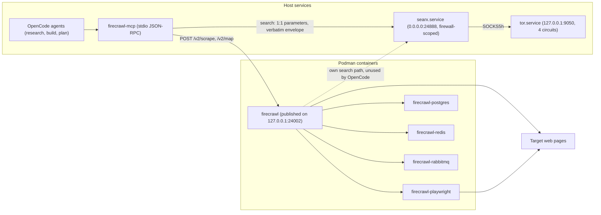

# Firecrawl Container Fixes & Lossless SearXNG Search

## Status: DRAFT — not started; claims audited against the running `yifuwuqi` containers, upstream `v2.11.0`, and the locked SearXNG source on 2026-11-20

## Objective

1. Keep Firecrawl as five unmodified upstream containers with their own PostgreSQL, Redis, and RabbitMQ: no source build and no patch to upstream code or SQL.
1. Fix what configuration alone can fix in `modules/services/firecrawl.nix`: publish the API on loopback only, let the Playwright container recover from a failed boot, stop four idle queue workers, and drop dead environment variables.
1. Keep `firecrawl-mcp`, OpenCode's only route to search, a 1:1 bridge to SearXNG and make it lossless: every SearXNG search parameter in with SearXNG's own meaning (time range, categories, engines, language, paging, safe search, timeout), SearXNG's whole JSON answer out, plus the `scrape` options this deployment supports and `map`. SearXNG itself is unchanged and keeps serving `search.aset.love`.

## Current state

- **Why Firecrawl is containerized**:
  - Upstream's schema assumes it owns the database server. `apps/nuq-postgres/nuq.sql` issues 15 `ALTER SYSTEM` settings and reloads the configuration, and the image runs it as superuser on database `postgres` with `cron.database_name = 'postgres'`. On the host cluster (`modules/services/postgresql.nix`) those settings would also govern Forgejo, Attic, and Grafana unless the SQL were edited.
  - Five worker listeners and the Playwright service call `app.listen(port)` with no host, so on the host network they would bind every interface unless patched.
- **Measured cost** (about an hour after boot, idle; RAM plus swap charged to each container cgroup):
  - `firecrawl` 2177 MiB, `firecrawl-rabbitmq` 139 MiB, `firecrawl-postgres` 120 MiB, `firecrawl-redis` 9 MiB. The duplicated PostgreSQL and Redis hold 129 MiB between them, 6% of what the Firecrawl container holds.
  - Inside `firecrawl`, eleven Node processes run; each of the five NuQ workers holds about 242 MiB.
- **Container configuration (`modules/services/firecrawl.nix`)**:
  - `ports` (`:191`) publishes `0.0.0.0:24002`. Podman forwards published ports by DNAT, and the host firewall accepts every DNAT'd connection (`ct status dnat accept` in nixpkgs' `firewall-nftables.nix`), so the per-interface allowlists in `hosts/yifuwuqi/networking/firewall.nix` do not cover it. The API takes requests without a key (`USE_DB_AUTHENTICATION` is unset). [AI & Local Inference](../services/ai-rocm.md) and `users/programs/opencode.nix:12` both describe it as localhost-only.
  - `podman-firecrawl-playwright.service` is down, so scrapes run without a browser: a `waitFor` scrape comes back with `The engine used does not support the following features: waitFor`. The image prepares `pnpm` for root at build time but runs as another user and starts through `pnpm start`, so Corepack downloads `pnpm` from `registry.npmjs.org` on every start. At the 17:17 boot on 2026-11-20 host name resolution kept failing for another 43 s after `network-online.target` was reached; the unit failed with `EAI_AGAIN` five times in its first six seconds and hit its start limit. Earlier boots that day started it on the first attempt. Only `podman-firecrawl` has the no-start-limit, 30-second backoff (`:110-111`); the Playwright unit keeps systemd's defaults (100 ms restart delay, five starts per 10 s), so it stays down until someone restarts it.
  - Five NuQ workers run, the `NUQ_WORKER_COUNT` default, but nothing OpenCode calls reaches them: `/v2/scrape` runs its job inside the API process (`skipNuq`) and `/v2/map` fetches sitemaps in-process. They serve only the crawl and batch endpoints.
  - `POSTGRES_URL`, `SEARCH_PROVIDER`, and `SEARXNG_BASE_URL` (`:197`, `:203`, `:204`) are dead: no line of the running image's code names them.
- **Search paths**:
  - Firecrawl's own search (`apps/api/src/search/index.ts`, `search/v2/index.ts`) asks SearXNG first and falls through to unproxied `ddgSearch` when the answer is empty or the request fails. Its adapter forwards only the query, language, and page, with engines and categories pinned by environment. No OpenCode tool calls it.
  - OpenCode searches through `firecrawl-mcp`, which queries SearXNG's JSON API directly on `localhost:24888`.
  - SearXNG binds `0.0.0.0` (`modules/services/searxng.nix:65`) and `hosts/yifuwuqi/networking/firewall.nix:89` admits application-container subnets to its port, so the Firecrawl container can reach it. [Hosted Web Services Directory](../services/hosted-services.md) §2.2 wrongly says it is bound to loopback.
- **Lossy MCP bridge (`packages/firecrawl-mcp/`)**:
  - `compactResult` (`firecrawl-mcp.ts:213-223`) keeps only `url`, `title`, `content`, and `publishedDate`, dropping `img_src`/`thumbnail` (`images`), `iframe_src`/`length` (`videos`), `authors`/`doi`/`journal` (`science`), and `engine`/`category`/`score`.
  - Top-level `answers`, `infoboxes`, `suggestions`, and `corrections` are discarded, and `unresponsive_engines` is dropped whenever any result exists. Live, `md5 hello` returns a `hash_plugin` answer the tool never shows, and a query with 34 results also reported `wikipedia: too many requests`.
  - Parameters are rewritten or forwarded unchecked: `categories` is omitted whenever `engines` is set, and `time_range` is removed from news-only queries; `language` is not validated (`en_US`, `zh-Hant`, and `english` get HTTP 400); `timeout_limit = 0` reaches SearXNG as `0`, giving every engine no time; `clampInt(pageno, 1, Infinity)` renders large numbers as `1e+21`, which SearXNG rejects with HTTP 400.
  - Names are narrower than SearXNG's or unchecked: the `categories` enum offers nine of the 33 categories the instance accepts, so `repos`, `packages`, or `q&a` cannot be requested; an unknown `engines` name is not caught, although SearXNG then drops it and runs a default `general` search instead (live, `engines=bogus` returned 31 `brave` and `duckduckgo` results).
  - `scrape` offers `summary`, which fails here with `UNKNOWN_ERROR` because no LLM is configured, and exposes only `formats` and `onlyMainContent`. `/v2/map` works here without fire-engine (a live call returned five `nixos.org` links) but has no tool.
  - The package's only gate is `tsc --noEmit`, and `default.nix` declares no `meta.license`.
- **SearXNG's request contract (locked source)**:
  - Its documented Search API (`docs/dev/search_api.rst`) has eight parameters: `q`, `categories`, `language`, `pageno`, `time_range`, `format`, `safesearch`, and `theme`. The search-query parser (`searx/webadapter.py`) also reads `engines` and `timeout_limit`.
  - The parser unions explicit `engines` with `categories`; they are not exclusive (live, `engines=arxiv` with `categories=it` returned both sets). It bounds `pageno`, `safesearch`, `language`, and `time_range`, but accepts any float for `timeout_limit` (`0`, negatives, and `nan` included), which the search then caps silently at `outgoing.max_request_timeout` (`15.0`, `modules/services/searxng.nix:136`).
  - `GET /config` lists what the instance knows: 33 category names, of which the ten UI tabs are a subset, and 261 engines. The parser drops any other category or engine name silently.
  - Request parameters also feed cookie-style preference overrides (`disabled_engines`/`enabled_engines`, `disabled_plugins`/`enabled_plugins`, UI settings), which the documented API does not include.

## Decisions

1. **Containers stay and upstream stays unmodified**:
   - Sharing the host PostgreSQL means editing `nuq.sql`, which Objective 1 rules out, and running on the host network would leave the wildcard listeners to the firewall alone unless they were patched. The private PostgreSQL and Redis cost 129 MiB together, less than one idle NuQ worker.
   - Images keep floating on `:latest` under the repo's podman auto-update policy (`modules/virtualisation/podman.nix`). The running `firecrawl` image was built on 2026-11-20 and already differs from `v2.11.0` (its processes start through `dist/src/main.js`), so every upstream fact here is a snapshot and the rollout re-checks the ones this plan depends on.
   - SearXNG keeps its all-interfaces bind and container firewall rule, and Firecrawl's own search keeps its DuckDuckGo fallback; no OpenCode tool reaches that path.
1. **Configuration-only fixes**:
   - Publish the API on `127.0.0.1:24002`, the form `modules/services/pinepods.nix` already uses.
   - Give `podman-firecrawl-playwright` the restart policy `podman-firecrawl` has (`StartLimitIntervalSec = 0`, `RestartSec = "30s"`), defined once for both units. Evaluated against the current configuration, the unit then renders `StartLimitIntervalSec=0`, `Restart=on-failure`, and `RestartSec=30s`: a failed start is retried every 30 s without limit, and at the 17:17 boot the third attempt, about a minute after the first, would have run after the host was resolving names again. The download itself stays, because skipping it means overriding the container command, which would tie the module to the image's internal entry point under a floating tag.
   - Set `NUQ_WORKER_COUNT = 1`. One worker keeps the crawl and batch endpoints working, one job at a time, and stopping four frees about 970 MiB of RAM and swap.
   - Remove the three dead variables.
   - Leave the readiness probe on `GET /` (upstream's `/v0/health/readiness` handler in `v2.11.0` is the same unconditional `200`, and both paths answer `200` live) and `MAX_CONCURRENT_PAGES` at `10` (a ceiling on concurrent browser pages that costs nothing while idle).
1. **1:1 SearXNG contract in `firecrawl-mcp`**:
   - Each `firecrawl_search` parameter maps to exactly one SearXNG request parameter and keeps SearXNG's meaning; the table below is the whole mapping. The tool accepts what this instance accepts and rejects what the instance would refuse, drop silently, cap silently, or run with no time budget.
   - `format` is always `json`, and `theme` only shapes HTML. With those two, the mapping covers all eight parameters of SearXNG's documented Search API, plus `engines` and `timeout_limit`, which the parser reads although that page omits them. The `category_<name>` alias, the `engine_data-*` paging tokens that JSON output never emits, and the cookie-style preference overrides are outside that API and stay out of the tool.
   - Category and engine names come from the instance: the server reads `GET /config` and keeps the first successful answer for the life of the process. `tools/list` advertises the category names as the `categories` enum when it has them and leaves the items unconstrained otherwise.
   - Preserve SearXNG semantics: `engines` and `categories` are both encoded and unioned, explicit `time_range` is never silently removed for news, and values are rejected rather than clamped. The one normalization is the locale separator (`pt_BR` becomes `pt-BR`).
   - Keep pure parameter types, normalizers, query encoding, envelope guards, and transient-failure classification in `packages/firecrawl-mcp/searxng-contract.ts`, imported by `firecrawl-mcp.ts` and its test, so the server file holds only RPC and I/O.
   - MCP search returns SearXNG's response body verbatim after validating a parsed copy. It retries once only when the first envelope has no payload and every `unresponsive_engines` reason is transient; plugin-only answers/infoboxes count as payload, and partial failures are returned as they are.
   - Keep `firecrawl-mcp` schemas flat (`search`, `scrape`, `map`): every property is a scalar or an array of scalars, with no `oneOf`/`anyOf`/`allOf`/`not`/`$ref`. A recursive structural test establishes that property for the shipped schemas; only a live llama.cpp registration smoke test may claim grammar-compiler compatibility.
1. **Cutover and rollback**:
   - The switch restarts the `firecrawl` and `firecrawl-playwright` containers and leaves PostgreSQL, Redis, and RabbitMQ running. A scrape in flight at that moment fails; nothing needs draining or migrating.
   - Roll back by switching to the previous generation.

`firecrawl_search` parameter mapping (Decision 3):

| Tool parameter  | SearXNG parameter | Accepted                                                                       | SearXNG on anything else                                                         |
| --------------- | ----------------- | ------------------------------------------------------------------------------ | -------------------------------------------------------------------------------- |
| `query`         | `q`               | non-empty string, passed through unchanged                                     | HTTP 400 on an empty query                                                       |
| `categories`    | `categories`      | category names the instance lists (33 today)                                   | drops the name silently                                                          |
| `engines`       | `engines`         | engine names the instance lists (261 today)                                    | drops the name silently; with none left it searches the default category         |
| `language`      | `language`        | `auto`, or a code matching `^[a-z]{2,3}(-[a-zA-Z]{2})?$`                       | HTTP 400                                                                         |
| `pageno`        | `pageno`          | safe integer from `1`, sent as plain digits                                    | HTTP 400                                                                         |
| `time_range`    | `time_range`      | `day`, `week`, `month`, `year`                                                 | HTTP 400                                                                         |
| `safesearch`    | `safesearch`      | `0`, `1`, `2`                                                                  | HTTP 400                                                                         |
| `timeout_limit` | `timeout_limit`   | finite number in `(0, 15]`; the ceiling mirrors `outgoing.max_request_timeout` | accepts any float: `0` times every engine out, more than `15` is capped silently |

## Phases

### Phase 1 — Container fixes in `modules/services/firecrawl.nix`

- Publish `"127.0.0.1:${toString firecrawlPort}:3002"`.
- Define the no-start-limit backoff once and apply it to `podman-firecrawl` and `podman-firecrawl-playwright`, keeping its explanatory comment with the shared definition. Both generated units must render `StartLimitIntervalSec=0` and `RestartSec=30s`.
- Set `NUQ_WORKER_COUNT = "1"` on the `firecrawl` container, with a comment naming why one worker suffices.
- Delete `POSTGRES_URL`, `SEARCH_PROVIDER`, and `SEARXNG_BASE_URL`.

### Phase 2 — 1:1 Lossless `firecrawl-mcp` & Property/Example Suite

- Add `packages/firecrawl-mcp/searxng-contract.ts` and `packages/firecrawl-mcp/firecrawl-mcp.test.ts`. `tsconfig.json` includes both and allows `.ts` import specifiers; in `default.nix` the fileset gains both, the contract is installed beside the entry file, and `meta` gains a license and a current description.
- Upgrade `packages/firecrawl-mcp/firecrawl-mcp.ts`:
  - Move the pure contract into `searxng-contract.ts` and remove `compactResult`; minimally validate the envelope shape on a parsed copy, apply the retry policy above, and return the response body verbatim.
  - Read the instance's category and engine names from `GET /config`, validate against them, and fill the `categories` enum from them in `tools/list`.
  - Reject malformed values rather than clamping: `pt_BR` canonicalizes to `pt-BR`; pageno must be a safe integer `>= 1`; safesearch must be integer `0|1|2`; timeout must be finite in `(0, 15]`; category and engine names must be ones the instance lists; categories and engines may coexist; explicit time range is always forwarded.
  - Expand `scrape` only with formats this deployment serves (`markdown`, `html`, `rawHtml`, `links`, `images`) plus `onlyMainContent`, `waitFor`, `includeTags`, `excludeTags`, and `timeout`. Remove `summary`, and do not expose `audio`, `video`, or `redactPII`: their AI, avgrab, and fire-privacy services are absent.
  - Add `map` (`url`, `search`, `includeSubdomains`, `limit` → `POST /v2/map`) with runtime bounds matching Firecrawl. Keep all schemas flat.
  - Guard stdio startup with `import.meta.main`, so pure encoders and RPC handlers can be imported by the `node:test` suite. Comparing `import.meta.url` with `pathToFileURL(process.argv[1])` is false whenever the entry is reached through a symlink.
- Enable `doCheck = true` in `packages/firecrawl-mcp/default.nix` running `node --test firecrawl-mcp.test.ts`:
  - Seeded properties, from a dependency-free PRNG with a fixed seed and case count that prints the failing case: accepted pagenos encode as `/^[1-9]\d*$/` without exponent notation; normalization is idempotent; URLSearchParams round-trips the canonical domain; categories and engines are both present when supplied; out-of-domain values always throw. Generators cover the boundaries (`0`, `1`, `2^53 - 1`, `2^53`, `1e21`, `NaN`, `±Infinity`, non-integers, `timeout_limit` at `0` and `15`), malformed locales, and empty, whitespace-only, and unlisted names against a fixture instance listing.
  - Deterministic examples: the shipped schemas are flat per the definition above; mock HTTP covers the `/config` listing and its absence at `tools/list`, plugin-only answers/infoboxes, valid zero results, transient retry versus non-transient failure, partial `unresponsive_engines`, malformed JSON/HTTP errors, and `scrape`/`map` bounds.
  - Label this evidence precisely as type-checked, example-tested, and seeded property-tested; it is not formal verification and the schema test is not an actual llama.cpp compile.

### Phase 3 — OpenCode Wiring, Documentation & Retirement

- `users/programs/opencode.nix`: add `firecrawl_map` by deriving the tool and permission sets from one name list, which the top-level `permission` block reuses instead of repeating the names; update the comments that list the tools and parameters.
- Update documentation:
  - [Hosted Web Services Directory](../services/hosted-services.md): §2.2 states SearXNG's real bind and firewall scope; §2.4 records the loopback publish and the single NuQ worker.
  - [AI & Local Inference](../services/ai-rocm.md) §5.3: the three tools, the 1:1 parameter mapping with `timeout_limit` and the instance's own category list, and the verbatim envelope.
  - [Podman Operations](../services/podman-operations.md): the restart-loop guard covers both units.
- Run full verification (`nix fmt -- --fail-on-change`, `eslint`, `nixpkgs-hammer`, `nix flake check --no-build`, the `firecrawl-mcp` build with its `node:test` suite, and the `nixosConfigurations.yifuwuqi` build) and audit `git diff`. Retire `docs/src/plans/firecrawl-plan.md` only after live acceptance, in the change set that completes the plan.

## Rollout order

- [ ] **0.1** Restart the failed Playwright unit now, as root: `systemctl reset-failed podman-firecrawl-playwright.service`, then `systemctl start podman-firecrawl-playwright.service`. The lasting fix lands with 1.1 (User).
- [ ] **1.1** Apply the four container fixes in `modules/services/firecrawl.nix`, build `nixosConfigurations.yifuwuqi`, and confirm the restart policy in both generated units (AI).
- [ ] **2.1** Upgrade `packages/firecrawl-mcp/` with `searxng-contract.ts`, the 1:1 lossless search, the supported `scrape` options, `map`, and the test suite; pass TypeScript, examples, and seeded properties (AI).
- [ ] **3.1** Add `firecrawl_map` to `users/programs/opencode.nix`, update docs, and run `nix fmt -- --fail-on-change`, `eslint`, `nixpkgs-hammer`, `nix flake check --no-build`, and the package and host builds (AI).
- [ ] **3.2** Deploy `yifuwuqi` and verify: `podman ps` shows `127.0.0.1:24002->3002/tcp` and another LAN host gets no answer on port `24002`; `podman top firecrawl` lists one `nuq-worker`; `podman-firecrawl-playwright.service` is active with `StartLimitIntervalUSec=0` and `RestartUSec=30s`, and a `waitFor` scrape no longer carries the unsupported-feature warning; `search.aset.love` still serves; OpenCode runs a search that sets every parameter, a search in a non-tab category such as `repos`, a scrape, and a map; llama.cpp registers the three tool schemas (User).
- [ ] **3.3** Retire `docs/src/plans/firecrawl-plan.md` in the completing change set and audit `git diff` (AI).

## Open questions

- Outside this plan: `modules/services/searxng.nix:255-265` sets `enabled_plugins`, a settings key the locked SearXNG source no longer reads, so the choices it records (`oa_doi_rewrite` on, `tracker_url_remover` off) are not in effect: `/config` reports `oa_doi_rewrite` disabled and `tracker_url_remover` enabled. Fixing it changes live `search.aset.love` behaviour and needs its own decision.
