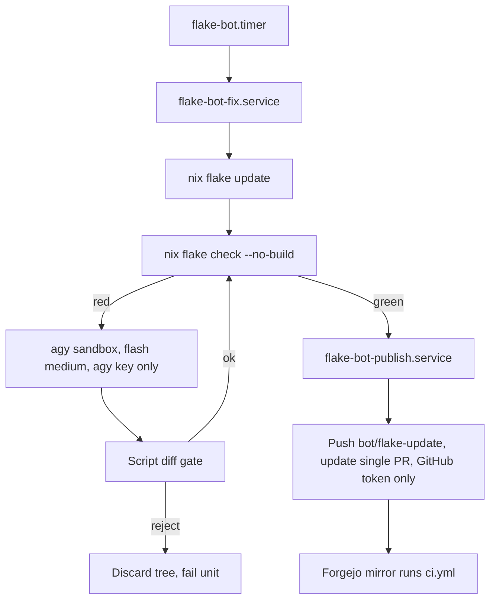

# Flake Update Bot Plan

## Objective

Keep exactly one open PR on `categoricalcat/nixos` (base `develop`) that periodically runs `nix flake update` and repairs evaluation breakage caused by the update. `nxd-agy` on `gemini-3.8-flash-medium` is the fixer. A deterministic script owns git, `flake.lock`, and the PR. The Antigravity credential must be unable to reach GitHub, secrets, or anything outside the bot checkout.

## Current state

- Bot host: `yifuwuqi` (Forgejo mirror, Attic, Forgejo runner, GitHub runner). Planning host: `yitaishi`.
- GitHub is the write target. Forgejo `yi/nixos` is a read-only pull mirror ([docs/src/services/ci-cache.md](../services/ci-cache.md)), so the bot pushes to GitHub and the existing [.forgejo/workflows/ci.yml](../../../.forgejo/workflows/ci.yml) builds the PR.
- [packages/wrappers.nix](../../../packages/wrappers.nix): `nxd-agy` = `nix run github:jacopone/antigravity-nix#google-antigravity-cli` (unpinned, latest every run).
- [nix/scripts/lock-to-changelog.sh](../../../nix/scripts/lock-to-changelog.sh) calls `nxd-agy --dangerously-skip-permissions --print` on upstream commit messages (untrusted text), and falls back to the raw summary when `CI` is set.
- Timer + oneshot + `LoadCredential` pattern: [modules/services/attic/closure-keeper.nix](../../../modules/services/attic/closure-keeper.nix).
- `nix-builder` runs CI jobs from PR content (Forgejo + GitHub runners).

### Verified agy CLI surface (`google-antigravity-cli` 1.4.6)

- Flags: `--print`, `--print-timeout`, `--model`, `--effort low|medium|high|xhigh|max`, `--mode accept-edits|auto|plan`, `--sandbox`, `--add-dir`, `--output-format json`, `--dangerously-skip-permissions`.
- `agy models` lists `gemini-3.8-flash-medium` ("Gemini 3.8 Flash (Medium)").
- Binary references env vars `GEMINI_API_KEY`, `GOOGLE_API_KEY`, `GOOGLE_APPLICATION_CREDENTIALS`, `AGY_ADC_AUTH`, `ANTIGRAVITY_CONFIG_REL_DIR`. Which one headless auth honors is not yet verified.
- Home-manager [antigravity-cli module](/etc/nix/inputs/home-manager/modules/programs/antigravity-cli.nix) writes `~/.gemini/antigravity-cli/settings.json` with `permissions.{allow,deny,ask}` entries like `command(git)`.

## Decisions

### Model

- `--model gemini-3.8-flash-medium`. The slug already encodes medium effort; `--effort` is not passed.

### Token safety (agy credential)

Threats: credential exfiltration by a prompt-injected agent, credential reuse by CI jobs, leakage into journal or `ps`, and the agent using the GitHub token.

- **Dedicated user**: `flake-bot` system user, not `nix-builder`. CI jobs run PR-controlled code as `nix-builder` and could read `/proc/<pid>/environ` of the same uid.
- **Two units, one credential each**:
  - `flake-bot-fix.service` loads only `tokens/agy-api-key`. Runs update, check, and agy. No GitHub token exists in its namespace.
  - `flake-bot-publish.service` loads only `tokens/flake-bot-github`. Runs commit, push, PR. Never invokes agy.
  - `flake-bot.timer` triggers fix; fix `OnSuccess=` publish.
- **Credential delivery**: sops secrets referenced by path, `owner = "root"`, `mode = "0400"`, handed to the unit with `LoadCredential=`. The script reads `$CREDENTIALS_DIRECTORY/agy-api-key` into the single env var agy honors, inside `env -i` with an explicit allowlist (`HOME`, `PATH`, `NIX_PATH` unset, key var). Never passed as an argv, never `set -x`.
- **Isolated agy home**: `HOME=/var/lib/flake-bot/agy-home`. Interactive login profiles in `/home/yi/.gemini` are never used. `ProtectHome=true`.
- **No dangerous flags**: `--dangerously-skip-permissions` is forbidden in the bot. agy runs with `--sandbox --mode accept-edits` and a bot-specific `settings.json` (written by the module):
  - `allow`: `command(nix flake check)`, `command(nix eval)`, `command(statix)`, `command(deadnix)`, `command(nixf-diagnose)`, `command(rg)`, `command(fd)`.
  - `deny`: `command(git)`, `command(gh)`, `command(curl)`, `command(wget)`, `command(ssh)`, `command(sops)`, `command(env)`, `command(printenv)`, `command(cat /run)`, `command(nix run)`, `command(nix shell)`, `command(nix develop)`.
  - `ask`: `command(*)`. In print mode with no TTY this fails closed.
- **Filesystem confinement** (systemd): `ProtectSystem=strict`, `ReadWritePaths=/var/lib/flake-bot`, `PrivateTmp=true`, `NoNewPrivileges=true`, `RestrictSUIDSGID=true`, `CapabilityBoundingSet=`, `InaccessiblePaths=/persist/keys /run/secrets /var/lib/nix-builder`. Nix store access through the daemon socket only.
- **Post-agy diff gate** (script, not model): reject the run if `git diff --name-only` touches anything other than `*.nix` / `*.md`, touches `secrets/`, `.sops.yaml`, `flake.lock`, `.forgejo/`, `ci/`, or this bot's own module. Rejection = discard tree, fail unit.
- **Untrusted input**: upstream commit messages never reach agy with tools on. PR body uses `CI=1 lock-to-changelog` (raw summary path). agy receives only the `nix flake check` trace plus the fixed prompt file.
- **Pinned CLI**: replace the floating `nix run github:jacopone/antigravity-nix` in the bot with a locked input (`inputs.antigravity-nix` in `flake.nix`). The bot updates it like any other input, so a new CLI version arrives as a reviewed lock bump.
- **Limits**: `--print-timeout 15m` per call, max 3 repair rounds, `RuntimeMaxSec=2h`, `MemoryMax`, `CPUQuota` so the Forgejo matrix keeps headroom.
- **Journal hygiene**: agy output goes to `/var/lib/flake-bot/logs/<run>.json` (`--output-format json`, `0600`). Journal gets status lines only.

### GitHub token safety

- Fine-grained PAT (or GitHub App) scoped to `categoricalcat/nixos`, permissions `contents: write`, `pull_requests: write`, nothing else.
- GitHub ruleset: `develop` and `main` require PR; bot identity may only push `bot/*`. A leaked token can at most move `bot/flake-update`.
- Git push uses `GIT_ASKPASS` script reading the credential file, not a token-in-URL.

### PR contract

- Branch `bot/flake-update`, base `develop`. Open PR for that head = append commits. Closed/merged = new branch from `origin/develop`.
- Human commits on the branch = skip run (bot does not overwrite human work). Fast-forward pushes only; no force push.
- Commit 1 per run: `flake.lock` (script). Commit 2 if any: agy repair, message written by the script from the check trace. Author = bot git identity owned by the operator. No agent names or co-author trailers.
- No lock change and green check = exit without pushing.

### Repair scope

- Breakage only: agy may edit what is needed to make `nix flake check --no-build` pass after this update, then `statix` / `deadnix` on touched files. Unresolved after 3 rounds = push lock commit, comment the trace on the PR, leave it open.

## Phases

### Phase 1: Auth gate (blocking)

- On `yifuwuqi` as operator, confirm agy headless auth with an isolated home and one env var:
  `env -i HOME=$(mktemp -d) PATH=$PATH GEMINI_API_KEY=<key> agy --model gemini-3.8-flash-medium --print "ok"`.
- Record which variable works (`GEMINI_API_KEY`, `GOOGLE_API_KEY`, or `GOOGLE_APPLICATION_CREDENTIALS` service-account file). If none works without interactive login, stop; the plan falls back to manual runs.
- Confirm `--sandbox` blocks a denied command (`git push`) in print mode and exits non-zero rather than hanging.

### Phase 2: Secrets (operator)

- Add `tokens/agy-api-key` and `tokens/flake-bot-github` to `secrets/secrets.yaml` (operator, `sops`, root). Document both rows in [docs/src/services/secrets.md](../services/secrets.md) by path only.

### Phase 3: Script `ci/flake-bot.sh`

- Subcommands `fix` and `publish`, matching the two units.
- `fix`: sync checkout in `/var/lib/flake-bot/repo` from GitHub (read-only HTTPS, no token), branch logic, `nix flake update`, check loop with agy, diff gate, leave tree + state file for publish.
- `publish`: commit, `GIT_ASKPASS` push, create or update PR via GitHub REST, PR body from `CI=1 lock-to-changelog`.
- Prompt in `ci/flake-bot-prompt.md`: allowed paths, forbidden paths, stop when check passes, no network, no git.

### Phase 4: Module `modules/services/flake-update-bot.nix`

- Hostname assertion (`yifuwuqi`), like closure-keeper.
- `flake-bot` user, `StateDirectory=flake-bot`, both services, timer (`OnCalendar=daily`, `Persistent=true`), hardening above, agy `settings.json` generated with `pkgs.formats.json`.
- `inputs.antigravity-nix` added to `flake.nix`; module uses its `google-antigravity-cli` package instead of `nxd-agy`.
- Import from [hosts/yifuwuqi/services.nix](../../../hosts/yifuwuqi/services.nix).

### Phase 5: Verification

- `statix check modules/services/flake-update-bot.nix`, `deadnix modules/services/flake-update-bot.nix`, `shellcheck ci/flake-bot.sh`.
- `nix flake check --no-build`.
- `nix eval .#nixosConfigurations.yifuwuqi.config.systemd.services.flake-bot-fix.serviceConfig` to confirm hardening and that only `agy-api-key` is loaded; same for publish with `flake-bot-github`.

## Rollout order

1. Phase 1 auth gate passes.
1. Operator adds both sops secrets and the GitHub ruleset.
1. Script, prompt, module, and flake input land via normal PR.
1. Operator deploys `yifuwuqi`.
1. Operator runs `systemctl start flake-bot-fix.service` once, inspects `/var/lib/flake-bot/logs/`, the diff, and the PR.
1. Enable timer.

## Open questions

- Headless auth variable for agy (Phase 1 decides).
- PAT vs GitHub App for the publish token.
- Whether agy `--sandbox` restricts network egress or only terminal commands; if only commands, consider `IPAddressAllow=` limited to Google API ranges plus cache hosts for the fix unit.
