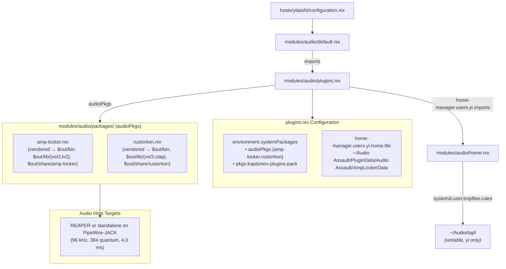

# Guitar Rig Plugins Plan: Amp Locker, Rustortion, and KPP (yitaishi)

## Status: IMPLEMENTED — 2026-10-31 (yitaishi switch pending)

Re-reviewed against `develop` at `bd9a714` (nixpkgs `5772e199`). `audio-module-fixes-plan.md` landed in `c80c2f0`; this plan lands after `audio-midi-presets-plan.md`, whose `home.nix` it extends.

Deferred 2026-10-31: Hex Forge (no `guitar-amp-mod` tag pins a public DSP submodule commit, and there is no x86_64 Linux release) and Amp Locker EX 0.9.1B (GUI-only installer).

Integrate three complementary guitar amplification and distortion systems into the audio stack on `yitaishi` (`modules/audio/`):

1. **Amp Locker** v1.6.0: Audio Assault's free amp locker; standalone, VST3 and LV2.
1. **Rustortion**: a standalone, open-source Rust amp simulator (`OpenSauce/rustortion`) with 12 DSP stages, NAM loading, IR cab sim and an Iced GUI; also VST3 and CLAP.
1. **KPP (Kapitonov Plugins Pack)**: a Kemper-style tube amp profiler/emulator (`tubeAmp`, `.tapf` profiles) plus an analog pedal suite.

______________________________________________________________________

## Objective

Provide a guitar suite on `yitaishi` for three workflows:

- **Commercial ToneLib-style experience**: Amp Locker with a turnkey GUI, interchangeable heads/cabs/pedals and preset management.
- **Lightweight Rust core**: Rustortion standalone on PipeWire-JACK, or as VST3/CLAP directly in REAPER.
- **Deep analog profiling**: KPP `tubeAmp` and its stompbox emulations (`Bluedream`, `Distruction`, `Fuzz`, `Deadgate`, `Octaver`, `Single2Humbucker`) with profile storage and REAPER FX-chain integration.

______________________________________________________________________

## Current State

1. **Target host**: only `hosts/yitaishi/configuration.nix` imports `modules/audio`.
1. **Low-latency foundation**:
   - musnix with `rtirq`: USB xhci IRQ threads at 95..90, above the PipeWire/JACK RT threads at 88.
   - PipeWire at 96 kHz with the quantum fixed at 384 (4.0 ms); the Scarlett 4i4 runs the Pro Audio profile.
   - PAM: musnix grants `@audio` `rtprio 99` and `memlock unlimited`, and the module adds only `nice -11`. The old local `rtprio 95` line never took effect, because musnix's later line wins.
1. **Layout** (since `c80c2f0`):
   - `default.nix`: realtime, PipeWire, WirePlumber, PAM.
   - `plugins.nix`: `environment.systemPackages`, plus the directory-name list that generates `systemd.user.tmpfiles.rules`. `audio-midi-presets-plan.md` moves that list into a `yi`-only `home.nix`, imported from `plugins.nix`.
   - `packages/*.nix`: `callPackage` files auto-wired into `audioPkgs` by `lib.packagesFromDirectoryRecursive`. `packages/drum-locker.nix` is the Audio Assault precedent (a template).
1. **Plugin paths**: musnix exports `VST3_PATH`, `CLAP_PATH`, `LV2_PATH`, `LADSPA_PATH` and the rest as `mkDefault`, all including `/run/current-system/sw/lib/<format>`; `/lib` is in `environment.pathsToLink`.
1. **Existing packages**:
   - Hosts and DAWs: `reaper`, `carla` (needed by `lmms`/`cardinal`), `jalv`.
   - Amps and distortion: `guitarix`, `gxplugins-lv2`, `tonelib-gfx`, `tonelib-metal`, `neural-amp-modeler-lv2`, `chow-centaur`, `mod-distortion`, `airwindows-lv2`.
   - KPP: `pkgs.kapitonov-plugins-pack` 1.2.1 is in `plugins.nix`. It installs LV2 bundles (with X11 UIs) and LADSPA plugins; the factory profiles (`American Clean`, `British Crunch`, `Modern Metal`, …) ship in `lib/lv2/kpp_tubeamp.lv2/profiles/`.
   - Amp Locker and Rustortion are not packaged.
1. **Upstreams (checked 2026-10-31)**:
   - `OpenSauce/rustortion` `v0.3.0` (2026-07-26) is the latest release. `rustortion-standalone-x86_64-unknown-linux-gnu.tar.xz` (GitHub digest `sha256:df4292a6…83a777fa`, also published as a `.sha256` asset) holds `rustortion`, `impulse_responses/` and `presets/` under one wrapper folder. `Rustortion-linux-x86_64.zip` (`sha256:adfe6808…eea795a8`) holds `Rustortion.clap` and `Rustortion.vst3/` with no wrapper folder.
   - `AmpLocker109/AmpLockerLinux.zip` (v1.6.0, 256 MB, last modified 2026-10-26) holds `Amp Locker Standalone`, `Amp Locker.vst3/`, `Amp Locker.lv2/`, `AmpLockerData/` and `How To Install.txt`. The install note puts the data contents in `~/Audio Assault/PluginData/Audio Assault/AmpLockerData/`. S3 publishes no checksum, and the ETag has a multipart suffix, so it is not an MD5.
1. **Runtime libraries** (sonames in the binaries' strings, NEEDED confirmed by autoPatchelf):
   - Rustortion: the plugin builds link `libX11`/`-xcb` and the standalone links `libasound`. Both `dlopen` `libEGL` and `libwayland-client`/`-egl`; the standalone also `libX11`/`-xcb`, `libXcursor`, `libXi`, `libxkbcommon`(`-x11`) and `libjack.so.0`. Neither references `libvulkan` or `libXrandr`.
   - Amp Locker (JUCE 7): needs `libasound`, `libcurl`, `libfreetype` and `libstdc++`, and `dlopen`s `libX11`, `libXext`, `libXcursor`, `libXinerama`, `libXrandr` and `libXss`; the standalone also `libjack.so.0`.
1. **autoPatchelf**: `runtimeDependencies` reach only dynamic executables; `appendRunpaths` reaches every patched ELF, plugin `.so` files included.
1. **nixpkgs naming**: the `xorg` package set is deprecated (`warnAlias`). Use the top-level names: `libx11`, `libxext`, `libxcursor`, `libxinerama`, `libxrandr`, `libxscrnsaver`, `libxi`.
1. **JACK**: `services.pipewire.jack.enable` exposes PipeWire's `libjack` only through the session `LD_LIBRARY_PATH`. The reaper overlay in `nix/overlays.nix` links `pipewire.jack` instead of `libjack2`, so it talks to PipeWire's JACK emulation instead of hanging on a nonexistent `jackd`.

______________________________________________________________________

## Decisions

1. **Co-location in `modules/audio/packages/`**: `amp-locker.nix` and `rustortion.nix` are `callPackage` files picked up automatically as `audioPkgs.*`. Enabling one means listing it in `plugins.nix`.
1. **Host agnosticism**: every plugin runs standalone (directly on PipeWire-JACK) or natively inside REAPER via LV2, VST3 or CLAP. Carla is installed for `lmms`/`cardinal` but is not required by these plugins.
1. **Explicit dependencies**: each file declares its libraries as `callPackage` arguments; no `config.programs.nix-ld.libraries`. Linked libraries go in `buildInputs`; `dlopen`ed ones go in `appendRunpaths`, so plugin `.so` files get them too. JACK resolves to `pipewire.jack`, not `libjack2`.
1. **Amp Locker**: v1.6.0 only (`AmpLockerLinux.zip`), with a trust-on-first-use SRI `hash`. Install the standalone as `$out/bin/amp-locker` with a desktop entry, `Amp Locker.vst3` into `$out/lib/vst3`, `Amp Locker.lv2` into `$out/lib/lv2`, and `AmpLockerData` into `$out/share/amp-locker`.
1. **Amp Locker data**: `plugins.nix` links `~/Audio Assault/PluginData/Audio Assault/AmpLockerData` to the package's data with `home.file` (`recursive = true`, so the folders stay writable), in the same `home-manager.users.yi` block that imports `home.nix`.
1. **Rustortion**: `fetchurl` both release assets with hex `sha256` set to GitHub's published digests, so the pins can be compared with upstream, as in the MIDI plan; `sourceRoot = "."` because the zip has no wrapper folder. Install `$out/bin/rustortion` (with a desktop entry), `$out/lib/vst3/Rustortion.vst3`, `$out/lib/clap/Rustortion.clap`, and the factory `impulse_responses/` and `presets/` into `$out/share/rustortion`.
1. **KPP**: keep `pkgs.kapitonov-plugins-pack`, and add one writable `"Audio/tapf"` to the `home.nix` directory list for user profiles; the factory profiles stay in the bundle.
1. **No shared vendored-binary builder**: the install layouts of the four vendored packages still differ.

______________________________________________________________________

## Architecture



______________________________________________________________________

## Phases

### Phase 1 — Rustortion (`modules/audio/packages/rustortion.nix`)

- `srcs`: both release assets via `fetchurl`, with `sourceRoot = "."`.
  - `rustortion-standalone-x86_64-unknown-linux-gnu.tar.xz`, `sha256 = "df4292a6b73f7a14db0a0889653e7fafba792dff2a8f44b2a81c0a9683a777fa"`.
  - `Rustortion-linux-x86_64.zip`, `sha256 = "adfe68085aaa1998c30fa4019c277bf28161809cf4501ddd9e1f3af0eea795a8"`.
- `nativeBuildInputs = [ autoPatchelfHook unzip copyDesktopItems ]`; stdenv already unpacks `.tar.xz`.
- `buildInputs = [ alsa-lib libx11 stdenv.cc.cc.lib ]`; autoPatchelf named `libx11` for the plugin builds.
- `appendRunpaths = [ (lib.makeLibraryPath [ libGL wayland libx11 libxcursor libxi libxkbcommon pipewire.jack ]) ]`.
- Installs as in Decision 6.

### Phase 2 — Amp Locker (`modules/audio/packages/amp-locker.nix`)

- `src`: `fetchurl` of `https://audioassaultdownloads.s3.amazonaws.com/AmpLocker/AmpLocker109/AmpLockerLinux.zip`, with the `hash` from `nix store prefetch-file --json <url>`; `sourceRoot = "."`.
- `nativeBuildInputs = [ autoPatchelfHook unzip copyDesktopItems ]`.
- `buildInputs = [ alsa-lib curl freetype stdenv.cc.cc.lib ]`, extended with whatever autoPatchelf reports as missing.
- `appendRunpaths = [ (lib.makeLibraryPath [ libx11 libxext libxcursor libxinerama libxrandr libxscrnsaver pipewire.jack ]) ]`.
- `meta.license = lib.licenses.unfree` (`allowUnfree` is set).
- Installs as in Decision 4; the data link as in Decision 5:

```nix
home-manager.users.yi = {
  imports = [ ./home.nix ];
  home.file."Audio Assault/PluginData/Audio Assault/AmpLockerData" = {
    source = "${audioPkgs.amp-locker}/share/amp-locker/AmpLockerData";
    recursive = true;
  };
};
```

### Phase 3 — KPP profile folder (`modules/audio/home.nix`)

- Append `"Audio/tapf"` to the directory-name list.
- `pkgs.kapitonov-plugins-pack` is already listed.
- In `docs/src/hosts/yitaishi.md` §4.2, note that user `.tapf` files go in `~/Audio/tapf`, `tubeAmp`'s profile button loads them in REAPER (or Carla), and the factory profiles sit in `kpp_tubeamp.lv2/profiles/`.

### Phase 4 — Wiring and verification

- In `plugins.nix`, list `audioPkgs.amp-locker` and `audioPkgs.rustortion` in the amp/cab group.
- New files are untracked until you stage them, and evaluating a git flake ignores untracked files. Build each derivation from the working tree with `--impure`, for example `nix build --impure --expr '(builtins.getFlake "git+file:///home/yi/the.files/nixos").nixosConfigurations.yitaishi.pkgs.callPackage ./modules/audio/packages/rustortion.nix { }'`, then check `readelf -d` NEEDED and RUNPATH on every ELF. Evaluate the whole config from a snapshot as in `audio-module-fixes-plan.md` Phase 6.
- Run `nix fmt`, `statix check` and `deadnix --fail` on `modules/audio`, then `nix flake check --no-build` and a yitaishi toplevel build, both from the snapshot.
- After switching: rescan plugins in REAPER. Rustortion's standalone resolves its IR, NAM, preset and recording folders against its working directory by default (`./impulse_responses`, `./nam`, `./presets`, `./recordings`); set them in Settings, for example to `~/Audio/ir` and `~/Audio/nam`. The plugin builds embed the factory IRs.

______________________________________________________________________

## Rollout Order

1. `audio-module-fixes-plan.md` landed in `c80c2f0`.
1. Land `audio-midi-presets-plan.md` first; this plan extends its `home.nix` and its `home-manager.users.yi` block in `plugins.nix`.
1. Write and build `rustortion.nix` and `amp-locker.nix` one at a time.
1. Wire them, the Amp Locker data link and `Audio/tapf`, then run the Phase 4 checks.
1. On yitaishi: `su -`, then `nh os switch /home/yi/the.files/nixos`. Launch each standalone and rescan plugins in REAPER.

______________________________________________________________________

## Open Questions

None. Resolved 2026-10-31:

1. **KPP folders**: `~/Audio/tapf` only; the factory profiles ship inside the bundle.
1. **Amp Locker hash**: trust-on-first-use, since S3 publishes no checksum.
