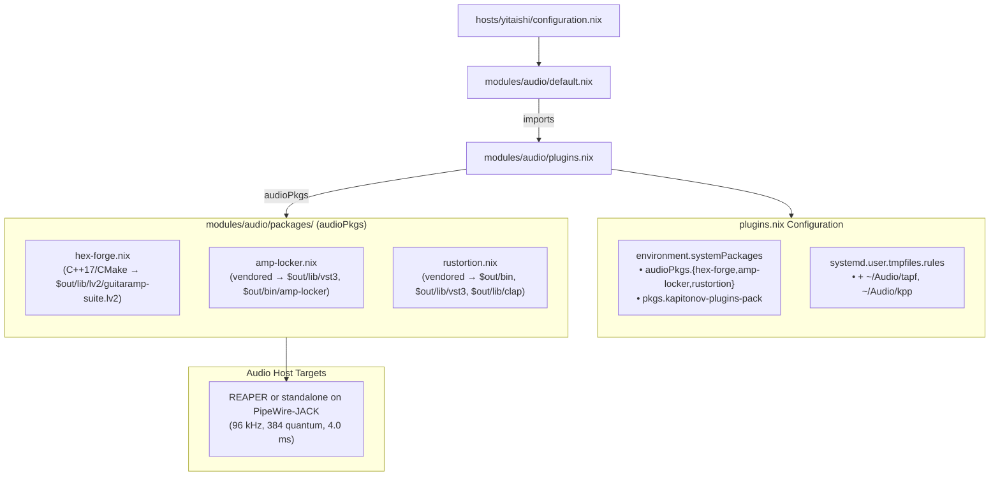

# Guitar Rig Plugins Plan: Hex Forge, Amp Locker, Rustortion, and KPP (yitaishi)

## Status: DRAFT — reviewed 2026-10-30

Reviewed against `develop` at `daed5ba` and `audio-module-fixes-plan.md`, which this plan lands after. Nothing here is implemented yet.

Integrate four complementary guitar amplification and distortion systems into the audio stack on `yitaishi` (`modules/audio/`):

1. **Hex Forge**: the largest free, modular, fully self-contained open-source guitar and bass rig (`rpowell5064/guitar-amp-mod`), with a native X11 GUI for REAPER and other LV2 hosts.
1. **Amp Locker EX**: Audio Assault's latest locker (`Amp Locker EX [BETA] v0.9.1B`), alongside `v1.6.0`; standalone and VST3.
1. **Rustortion**: a standalone, open-source Rust amp simulator (`OpenSauce/rustortion`) with 12 DSP stages, NAM loading, IR cab sim and an Iced GUI; also VST3 and CLAP.
1. **KPP (Kapitonov Plugins Pack)**: a Kemper-style tube amp profiler/emulator (`tubeAmp`, `.tapf` profiles) plus an analog pedal suite.

______________________________________________________________________

## Objective

Provide a comprehensive, high-fidelity guitar suite on `yitaishi` for four workflows:

- **Modular studio rig**: Hex Forge hosted natively in REAPER (standalone, or Carla if desired) with its X11 panel: 15 amp voicings, 11 drives, 4 fuzzes, 10 cabs + IR loader, stage room/feedback simulator, delay/reverb, wah/octave and a scratchpad looper.
- **Commercial ToneLib-style experience**: Amp Locker EX with a turnkey GUI, interchangeable heads/cabs/pedals and preset management.
- **Lightweight Rust core**: Rustortion standalone on PipeWire-JACK, or as VST3/CLAP directly in REAPER.
- **Deep analog profiling**: KPP `tubeAmp` and its stompbox emulations (`Bluedream`, `Distruction`, `Fuzz`, `Deadgate`, `Octaver`, `Single2Humbucker`) with profile storage and REAPER FX-chain integration.

______________________________________________________________________

## Current State

1. **Target host**: only `hosts/yitaishi/configuration.nix` imports `modules/audio`.
1. **Low-latency foundation**:
   - musnix with `rtirq`: USB xhci IRQ threads at 95..90, above the PipeWire/JACK RT threads at 88.
   - PipeWire at 96 kHz with the quantum fixed at 384 (4.0 ms); the Scarlett 4i4 runs the Pro Audio profile.
   - PAM: musnix grants `@audio` `rtprio 99` and `memlock unlimited`, and the module adds only `nice -11`. The old local `rtprio 95` line never took effect, because musnix's later line wins.
1. **Layout** (after `audio-module-fixes-plan.md`):
   - `default.nix`: realtime, PipeWire, WirePlumber, PAM.
   - `plugins.nix`: `environment.systemPackages`, plus the directory-name list that generates `systemd.user.tmpfiles.rules` (`~/.vst`, `~/.vst3`, `~/.lv2`, `~/.clap`, `~/.ladspa`, `~/Audio/{nam,ir,reaper-fxchains}`).
   - `packages/*.nix`: `callPackage` files auto-wired into `audioPkgs` by `lib.packagesFromDirectoryRecursive`. `packages/drum-locker.nix` is the Audio Assault precedent (a template).
1. **Plugin paths**: musnix exports `VST3_PATH`, `CLAP_PATH`, `LV2_PATH`, `LADSPA_PATH` and the rest as `mkDefault`, all including `/run/current-system/sw/lib/<format>`. The module no longer overrides `VST3_PATH`.
1. **Existing packages**:
   - Hosts and DAWs: `reaper`, `carla` (re-enabled, staged, needed by `lmms`/`cardinal`), `jalv`.
   - Amps and distortion: `guitarix`, `gxplugins-lv2`, `tonelib-gfx`, `tonelib-metal`, `neural-amp-modeler-lv2`, `chow-centaur`, `mod-distortion`, `airwindows-lv2`.
   - KPP: `pkgs.kapitonov-plugins-pack` (1.2.1) is in `plugins.nix`, without `.tapf` profile folders or docs.
   - Hex Forge, Amp Locker and Rustortion are not packaged.
1. **Upstreams (checked 2026-10-30)**:
   - `rpowell5064/guitar-amp-mod` has tag `v1.22.0`.
   - `OpenSauce/rustortion` `v0.3.0` ships `Rustortion-linux-x86_64.zip` (GitHub digest `sha256:adfe6808…eea795a8`) and `rustortion-standalone-x86_64-unknown-linux-gnu.tar.xz` (`sha256:df4292a6…83a777fa`, also published as a `.sha256` asset).
   - Both Amp Locker archives return HTTP 200: `AmpLocker109/AmpLockerEXLinux.tar.gz` and `AmpLocker109/AmpLockerLinux.zip`. Neither has a published checksum.
1. **nixpkgs naming**: the `xorg` package set is deprecated (`warnAlias`). Use the top-level names: `libx11`, `libxext`, `libxcursor`, `libxrandr`, `libxi`.
1. **JACK**: `services.pipewire.jack.enable` exposes PipeWire's `libjack` only through the session `LD_LIBRARY_PATH`. The reaper overlay in `nix/overlays.nix` links `pipewire.jack` instead of `libjack2`, so it talks to PipeWire's JACK emulation instead of hanging on a nonexistent `jackd`.

______________________________________________________________________

## Decisions

1. **Co-location in `modules/audio/packages/`**: `hex-forge.nix`, `amp-locker.nix` and `rustortion.nix` are `callPackage` files picked up automatically as `audioPkgs.*`. Enabling one means listing it in `plugins.nix`.
1. **Host agnosticism**: every plugin runs standalone (directly on PipeWire-JACK) or natively inside REAPER via LV2, VST3 or CLAP. Carla is installed for `lmms`/`cardinal` but is not required by these plugins.
1. **Explicit dependencies**: each file declares its libraries as `callPackage` arguments; no `config.programs.nix-ld.libraries`. JACK links against `pipewire.jack`, not `libjack2`.
1. **Hex Forge**: source build with `cmake` from `rpowell5064/guitar-amp-mod` `v1.22.0` (`fetchSubmodules = true`), configured with `-DHEXCHAIN_X11UI=ON` so REAPER shows the native panel (`hexchain_ui.so`). It installs `guitaramp-suite.lv2` into `$out/lib/lv2`.
1. **Amp Locker**: track the latest. EX v0.9.1B (`AmpLockerEXLinux.tar.gz`) is primary, with v1.6.0 (`AmpLockerLinux.zip`) alongside. Patch with `autoPatchelfHook` and explicit libraries; install the VST3 into `$out/lib/vst3` and a standalone wrapper `$out/bin/amp-locker` with desktop file and icon.
1. **Rustortion**: `fetchurl` both release assets with hex `sha256` set to GitHub's published digests, so the pins can be compared with upstream, as in the MIDI plan. Patch with `autoPatchelfHook`. It installs `$out/bin/rustortion` (with a `.desktop` entry), `$out/lib/vst3/Rustortion.vst3` and `$out/lib/clap/Rustortion.clap`.
1. **KPP**: keep `pkgs.kapitonov-plugins-pack`, and add `"Audio/tapf"` and `"Audio/kpp"` to the `plugins.nix` directory list for profiles.

______________________________________________________________________

## Architecture

______________________________________________________________________

## Phases

### Phase 1 — Hex Forge (`modules/audio/packages/hex-forge.nix`)

- `pname = "hex-forge"`, `version = "1.22.0"`.
- `src = fetchFromGitHub { owner = "rpowell5064"; repo = "guitar-amp-mod"; rev = "v1.22.0"; fetchSubmodules = true; hash = "…"; }`.
- `nativeBuildInputs = [ cmake pkg-config ]`; `buildInputs = [ lv2 eigen ]`, plus whatever the X11 UI target needs. Confirm that from the CMake configure output.
- CMake flags: `-DGUITARAMP_ARCH=x86 -DHEXCHAIN_X11UI=ON`.
- Installs `guitaramp-suite.lv2` into `$out/lib/lv2/`.

### Phase 2 — Amp Locker (`modules/audio/packages/amp-locker.nix`)

- `src`: `fetchurl` of `https://audioassaultdownloads.s3.amazonaws.com/AmpLocker/AmpLocker109/AmpLockerEXLinux.tar.gz` (EX, primary) and `…/AmpLocker109/AmpLockerLinux.zip` (v1.6.0). Hashes are pinned on first fetch, since there is no upstream digest.
- `nativeBuildInputs = [ autoPatchelfHook unzip makeWrapper ]`.
- `buildInputs = [ alsa-lib pipewire.jack freetype libglvnd curl libx11 libxext libxcursor ]`, extended with whatever autoPatchelf reports as missing.
- Installs the VST3 bundle(s) into `$out/lib/vst3/`, and the standalone into `$out/bin/amp-locker` with desktop file and icon.

### Phase 3 — Rustortion (`modules/audio/packages/rustortion.nix`)

- `srcStandalone = fetchurl { url = "https://github.com/OpenSauce/rustortion/releases/download/v0.3.0/rustortion-standalone-x86_64-unknown-linux-gnu.tar.xz"; sha256 = "df4292a6b73f7a14db0a0889653e7fafba792dff2a8f44b2a81c0a9683a777fa"; }`.
- `srcPlugin = fetchurl { url = "https://github.com/OpenSauce/rustortion/releases/download/v0.3.0/Rustortion-linux-x86_64.zip"; sha256 = "adfe68085aaa1998c30fa4019c277bf28161809cf4501ddd9e1f3af0eea795a8"; }`.
- `nativeBuildInputs = [ autoPatchelfHook unzip copyDesktopItems ]`; stdenv already unpacks `.tar.xz`.
- `buildInputs = [ alsa-lib pipewire.jack ]`. The Iced/winit/wgpu stack `dlopen`s `vulkan-loader`, `wayland`, `libxkbcommon`, `libx11`, `libxcursor`, `libxrandr` and `libxi`, so those go in `runtimeDependencies` (autoPatchelf adds them to the RPATH); they never appear as `NEEDED`.
- Installs `rustortion` into `$out/bin/`, `Rustortion.vst3` into `$out/lib/vst3/` and `Rustortion.clap` into `$out/lib/clap/`.

### Phase 4 — KPP profile folders (`modules/audio/plugins.nix`)

- Append `"Audio/tapf"` and `"Audio/kpp"` to the directory-name list.
- `pkgs.kapitonov-plugins-pack` is already listed.
- Document where `.tapf` files go and how `tubeAmp` loads them in REAPER (or Carla).

### Phase 5 — Wiring and verification

- In `plugins.nix`, list `audioPkgs.hex-forge`, `audioPkgs.amp-locker` and `audioPkgs.rustortion`.
- New files are untracked until you stage them, and evaluating a git flake ignores untracked files. Either evaluate a snapshot as in `audio-module-fixes-plan.md` Phase 6, or track the files first.
- Build each derivation on its own, for example `(builtins.getFlake "<flake ref>").nixosConfigurations.yitaishi.pkgs.callPackage ./modules/audio/packages/rustortion.nix { }`, then check `readelf -d` for unresolved libraries.
- Run `statix check` and `deadnix --fail` on `modules/audio`, then `nix flake check --no-build`, then `nixos-rebuild build --flake .#yitaishi`.

______________________________________________________________________

## Rollout Order

1. Land `audio-module-fixes-plan.md` first; this plan builds on its `plugins.nix` and `packages/`.
1. Write and build `hex-forge.nix`, `amp-locker.nix` and `rustortion.nix` one at a time.
1. Wire them and the KPP folders into `plugins.nix`, then run the Phase 5 checks.
1. This plan is independent of `audio-midi-presets-plan.md`. Both append to the `plugins.nix` lists, so either can land first.
1. On yitaishi: `su -`, then `nh os switch /home/yi/the.files/nixos`. Launch each standalone and rescan plugins in REAPER.

______________________________________________________________________

## Open Questions

1. **Amp Locker EX and v1.6.0 side by side**: one derivation or two (`amp-locker-ex.nix`, `amp-locker.nix`)? If both ship a VST3 bundle with the same name, they collide in `/run/current-system/sw/lib/vst3`.
1. **Hex Forge X11 UI dependencies**: which libraries `-DHEXCHAIN_X11UI=ON` needs. Confirm from the CMake configure step.
1. **KPP folders**: are both `~/Audio/tapf` and `~/Audio/kpp` needed, or does one suffice?
1. **Amp Locker hashes**: S3 publishes no checksums, so they will be trust-on-first-use pins.
