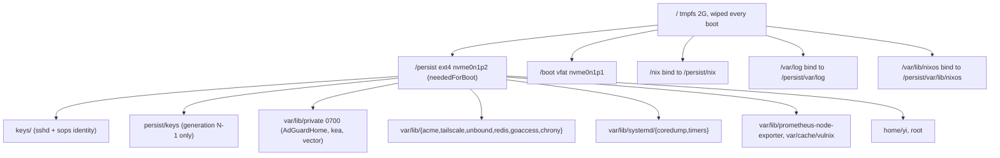

# Impermanence on yirukou (Edge Router & Gateway)

## Status: DRAFT (reviewed and corrected 2026-11-22) — not started

## Objective

Deploy **impermanence** (root-on-tmpfs with selective persistent storage under `/persist`) to **`yirukou`** using a zero-repartitioning, in-place Ext4 strategy with full rollback safety.

`yirukou` keeps its **full monitoring stack** (security monitor, node/systemd/smartctl/nginx/adguard/unbound/valkey/smokeping/blackbox/process exporters, vector) and its **CVE scan**. Only the storage layout changes.

### Scope

Owns:

- `yirukou`'s mount layout, the persistence list, key staging, the boot-staged rollout and rollback.
- The two shared-code changes impermanence forces: the unowned-file sweep root in `security-monitor`, and the initrd ordering proof in a VM test.

Not owned here:

- Network policy and service configuration on `yirukou` (retired plans; live rules in [yirukou](../hosts/yirukou.md)).
- Certificates: [mTLS Architecture Plan](mtls-architecture-plan.md); the DNS
  resolver hop is [mTLS on DNS](mtls-dns-plan.md).

Persists state the other plans rely on: `/var/lib/tailscale` (VPN to LAN subnet router), `/var/cache/vulnix` and `/var/lib/prometheus-node-exporter` (security-monitor gates), and `/persist/keys` (sops, through which mTLS keys arrive).

______________________________________________________________________

## Evidence Status

- **Repository-verified 2026-11-22**: no impermanence input or module; `/` is Ext4 in [hardware.nix](../../hosts/yirukou/hardware.nix); `nixos-rebuild` is absent from `yirukou`'s closure (`system.disableInstallerTools = true`); `nginx` denies loopback via `restrictedProxyConfig`; sops runs as `sops-install-secrets.service`.
- **Input-verified 2026-11-22** against `/etc/nix/inputs`: bind mounts in a `fileSystems` entry are prefixed with `/sysroot` in the initrd and gain `x-systemd.requires-mounts-for=/sysroot/<depends>`; `utils.pathsNeededForBoot` includes `/var/log` and `/var/lib/nixos`; `findmnt` accepts one target per invocation; `nix flake lock --update-input` is deprecated under Lix 2.96.
- **Live-host verified**: observations gathered on `yifuwuqi`, not `yirukou`. `yirukou` is `/` on `nvme0n1p2` Ext4 as of 2026-11-08; `tailscaled` active.
- **Operational verification pending**: `yirukou` partition free space, `DynamicUser` paths, cache sizes, key staging, and every post-reboot acceptance check must be repeated in the maintenance window.

______________________________________________________________________

## Current State

1. **Root layout** (`nvme0n1p2` is the whole ext4 filesystem, not just `/`):
   - `nvme0n1p1` (1 GiB): EFI System Partition (`/boot`, VFAT, UUID `7B94-F350`).
   - `nvme0n1p2` (~239 GiB): Ext4 root, UUID `685d4cb2-aba3-44d5-b9ba-20a9692ff385`.
   - `nvme0n1p3` (~9 GiB): swap, UUID `29757075-8a2d-4171-af0f-1027608f9641`.
1. **The store needs no migration.** Mounting `nvme0n1p2` at `/persist` moves the entire filesystem, so `<disk>/nix` becomes `/persist/nix`; every other absolute path (`<disk>/var/lib/tailscale`, `<disk>/etc/machine-id`) likewise reappears at the same relative location. `keys/` is the only directory whose path changes meaning, because the convention is `/persist/keys` while the disk path is `<disk>/persist/keys` (Decision 3).
1. **Deployment lane** ([configuration.nix:25](../../hosts/yirukou/configuration.nix)): `system.disableInstallerTools = true`, so `nixos-rebuild` does not exist on the host. Deploys run from `yifuwuqi` via `deploy .#yirukou` (`nix/deploy.nix`) or `ci/deploy.sh`, both as root over key-based SSH. `sudo` is disabled fleet-wide.
1. **Repository pre-alignment**: [keys.nix](../../secrets/keys.nix) defines `keysFolder = "/persist/keys"`; `modules/services/ssh` asserts the host key exists before `sshd` starts; [sops.nix](../../secrets/sops.nix) reads `defaultSopsFile` from the same folder and sets `useSystemdActivation = true`, producing **`sops-install-secrets.service`**.
1. **Monitoring that must survive**:
   - `services.security-monitor` writes `${nodeTextfileDir}` = `/var/lib/prometheus-node-exporter/textfile` ([monitoring.nix](../../modules/addresses/monitoring.nix)) and keeps the NVD database in `/var/cache/vulnix` ([security-monitor/default.nix](../../modules/services/monitoring/security-monitor/default.nix)).
   - The CVE scan's unowned-file sweep starts at `/` and uses `-xdev` ([cve-scan.sh:231](../../modules/services/monitoring/security-monitor/scripts/cve-scan.sh)).
   - Exporter state is otherwise `RuntimeDirectory`-only; `nginx` uses `/var/log/nginx`, `/var/cache/nginx`, `/var/lib/nginx`; `vector` is `DynamicUser` with `StateDirectory = vector`.
1. **`DynamicUser` state**: AdGuardHome, kea and vector keep data in `/var/lib/private/<name>`; `/var/lib/<name>` is a systemd-managed symlink. Confirmed for AdGuardHome and vector on `yifuwuqi`; confirm kea on `yirukou` in Phase 2.
1. **Generational rollback is time-boxed**: `boot.loader.systemd-boot.configurationLimit = 10` plus `nix.gc --delete-older-than 7d` ([configuration.nix:69](../../hosts/yirukou/configuration.nix)) means generation N-1 disappears about seven days after the cutover.

______________________________________________________________________

## Decisions

### 1. Root on tmpfs, existing Ext4 mounted at `/persist`

Mount `/` as a 2 GiB tmpfs and the whole existing Ext4 filesystem at `/persist`. Zero repartitioning, zero formatting, and selecting generation N-1 in `systemd-boot` boots straight back into the persistent Ext4 root.

### 2. Initrd-critical binds declared as `fileSystems`, the rest by impermanence

`/nix`, `/var/log` and `/var/lib/nixos` are in `utils.pathsNeededForBoot`, so they must exist *inside the initrd*. The impermanence module generates those initrd mounts (`boot.initrd.systemd.mounts`) with `DefaultDependencies = false` and no dependency on the `/persist` mount, whereas a `fileSystems` entry with `depends = [ "/persist" ]` renders `x-systemd.requires-mounts-for=/sysroot/persist` through the fstab generator. Declaring the initrd-critical binds as `fileSystems` therefore buys explicit ordering from the mechanism the repo already relies on, and leaves `environment.persistence` for stage-2 paths only.

`/var/log` must be an initrd bind anyway: `services.journald` is `Storage = "persistent"` with `SystemMaxUse = 800M`, so the journal lives under `/var/log/journal`.

### 3. Dual-layout key staging (`/keys` copy)

Before the reboot, `cp -a /persist/keys /keys` as root. On the cutover generation `nvme0n1p2` mounts at `/persist`, so disk path `keys/` appears at `/persist/keys`; the legacy `<disk>/persist/keys` appears at `/persist/persist/keys` and is read by generation N-1 only.

### 4. Staged activation (`boot` + reboot, never `switch`)

The running kernel cannot pivot `/` from a block device to tmpfs. Deploy with `deploy .#yirukou --boot`, then reboot.

### 5. Monitoring and the CVE scan stay on `yirukou`

`/var/cache/vulnix`, `/var/lib/prometheus-node-exporter` and `/var/lib/systemd/timers` are persisted. Because the tmpfs root turns `find / -xdev` into a sweep of RAM, the sweep root becomes a module option and `yirukou` sets it to `/persist` (Decision 7).

### 6. Service state persisted

- `/var/lib/{acme,tailscale,unbound,redis,goaccess,chrony,private,prometheus-node-exporter}`
- `/var/lib/systemd/{coredump,timers}`
- `/var/cache/vulnix`
- `/var/log` (initrd bind, Decision 2)
- `/var/lib/nixos` (initrd bind; keeps uid/gid allocation stable for `nix-builder`, `ai`, and every `DynamicUser` peer), plus `/var/lib/logrotate.status` and `/var/lib/systemd/random-seed` as files.
- Homes: `yi` (`.ssh` 0700, `.config/sops` 0700, `the.files`), `root` (`.ssh` 0700, `.config/sops` 0700), plus `.bash_history` for both.

`/var/lib/systemd/network` is deliberately **not** persisted: systemd's default `DUIDType=vendor` derives the DHCP DUID from the persisted machine-id, leaving that directory empty (verified on `yifuwuqi`). The WAN lease check below confirms the derivation still holds after the cutover.

### 7. Sweep root as a module option

`find / -xdev` cannot see `/persist`, `/nix`, or any bind mount from a tmpfs root, so `node_security_unowned_files` would read near-zero and the gate would silently pass. `services.security-monitor.unownedSweepRoot` defaults to `"/"` and is `"/persist"` on `yirukou`; prune paths derive from it.

### 8. Prove the layout in a VM test before touching the router

`pkgs.testers.runNixOSTest` is already used in the flake (`gateway-failover`, `dr-recovery`). A two-disk test boots tmpfs root + ext4 `/persist`, reboots, and asserts every bind, the canary file and machine-id stability. This is the only way to settle Decision 2 before a remote reboot.

______________________________________________________________________

## Architecture & Storage Layout



______________________________________________________________________

## Phases

### Phase 1 — Repository changes

1. **`flake.nix` input** (alphabetical slot near the other `nix-community` inputs):

   ```nix
   impermanence = {
     url = "github:nix-community/impermanence";
     inputs.nixpkgs.follows = "nixpkgs";
     inputs.home-manager.follows = "home-manager";
   };
   ```

1. **`flake.nix:88`** — keep the shared `mkNixosHost` factory; do not hand-write a second `nixosSystem`:

   ```nix
   yirukou = mkNixosHost "yirukou" [ inputs.impermanence.nixosModules.impermanence ];
   ```

1. **New `hosts/yirukou/storage.nix`** (one file: mount layout plus persistence list), imported from `hosts/yirukou/configuration.nix`:

   ```nix
   { lib, ... }:
   {
     fileSystems = {
       "/" = {
         device = "none";
         fsType = "tmpfs";
         options = [ "defaults" "size=2G" "mode=755" ];
       };

       "/persist" = {
         device = "/dev/disk/by-uuid/685d4cb2-aba3-44d5-b9ba-20a9692ff385";
         fsType = "ext4";
         neededForBoot = true;
       };
     }
     // lib.genAttrs [ "/nix" "/var/log" "/var/lib/nixos" ] (dir: {
       device = "/persist${dir}";
       fsType = "none";
       options = [ "bind" ];
       neededForBoot = true;
       depends = [ "/persist" ];
     });

     environment.persistence."/persist" = {
       directories = [
         "/var/lib/acme"
         "/var/lib/tailscale"
         # AdGuardHome, kea and vector keep data here; /var/lib/<name> is a
         # systemd-managed symlink into private/.
         { directory = "/var/lib/private"; mode = "0700"; }
         "/var/lib/unbound"
         "/var/lib/redis"
         "/var/lib/goaccess"
         "/var/lib/chrony"
         "/var/lib/systemd/coredump"
         "/var/lib/systemd/timers"
         "/var/lib/prometheus-node-exporter"
         "/var/cache/vulnix"
       ];
       files = [
         "/etc/machine-id"
         "/var/lib/logrotate.status"
         "/var/lib/systemd/random-seed"
       ];
       users.yi = {
         directories = [
           { directory = ".ssh"; mode = "0700"; }
           { directory = ".config/sops"; mode = "0700"; }
           "the.files"
         ];
         files = [ ".bash_history" ];
       };
       users.root = {
         directories = [
           { directory = ".ssh"; mode = "0700"; }
           { directory = ".config/sops"; mode = "0700"; }
         ];
         files = [ ".bash_history" ];
       };
     };
   }
   ```

1. **`hosts/yirukou/hardware.nix`** — delete only the generated `"/"` entry (lines 28-31); the new definition lives in `storage.nix`. Leave `/boot` and `swapDevices` untouched so the generated file stays as close to `nixos-generate-config` output as possible.

1. **`hosts/yirukou/services.nix`** — pin the sweep root:

   ```nix
   services.security-monitor = {
     enable = true;
     unownedSweepRoot = "/persist";
   };
   ```

1. **`modules/services/monitoring/security-monitor/default.nix`** — add the option and thread it through:

   ```nix
   unownedSweepRoot = lib.mkOption {
     type = lib.types.str;
     default = "/";
     description = "Filesystem root the unowned-file sweep starts at.";
   };
   ```

   Pass it to `cve-scan.sh` as `--sweep-root`, and in the script replace the three literal `/`, `/nix` and `/var/lib/containers` references (lines 231-243) with `${SWEEP_ROOT}`, `${SWEEP_ROOT}/nix` and `${SWEEP_ROOT}/var/lib/containers`.

1. **New `hosts/yirukou/storage-test.nix`**, wired in `nix/checks.nix` as `yirukou-storage = pkgs.testers.runNixOSTest ./hosts/yirukou/storage-test.nix;`. The test:

   - root on tmpfs, `/persist` on a scratch ext4 disk, `imports = [ ./storage.nix ]` with `virtualisation.fileSystems` overrides for device and size;
   - writes canaries into `/root`, `/persist`, `/var/log`, `/var/lib/private` and `/home/yi/.ssh`;
   - reboots and asserts `/tmpfs`, `/persist` ext4, the three binds, canary survival, `0700` modes, and a stable `/etc/machine-id`.

1. **Docs**: replace the filesystem/database narrative in [yirukou.md](../hosts/yirukou.md) with a link to this plan, and note the sweep-root option in [Monitoring](../services/monitoring.md).

### Phase 2 — Pre-migration disk staging (on `yirukou`)

1. Connect as root (`ssh root@yirukou`, port 24212).

1. Copy the key tree to the post-cutover location:

   ```bash
   cp -a /persist/keys /keys
   diff -r /persist/keys /keys
   ls -ld /keys /keys/ssh /keys/sops
   ```

1. Verify the store lives on this filesystem and is intact:

   ```bash
   findmnt -no FSTYPE,SOURCE /nix/store
   test -f /persist/nix/var/nix/db/db.sqlite && echo store-db-ok
   du -sh /nix /persist/keys /var/cache/vulnix /var/log
   df -h /persist
   ```

1. Verify every declared persistence path exists on disk, and confirm the `DynamicUser` layout:

   ```bash
   ls -ld /var/lib/{acme,tailscale,private,unbound,redis,goaccess,chrony,prometheus-node-exporter} \
     /var/lib/systemd/{coredump,timers} /var/cache/vulnix /etc/machine-id /var/lib/logrotate.status
   ls -la /var/lib/private
   ls -l /var/lib/AdGuardHome /var/lib/kea /var/lib/vector
   ```

1. Record the acceptance baseline before the cutover: `cat /etc/machine-id`, `systemctl list-timers --all`, `tailscale status --json | jq -r .Self.ID`, and `ls /var/lib/prometheus-node-exporter/textfile`.

### Phase 3 — Build, stage, reboot (from `yifuwuqi`)

1. Lock and evaluate:

   ```bash
   nix flake update impermanence
   nix flake check --no-build
   nix develop -c nixos-rebuild dry-build --flake .#yirukou
   ```

   `flake.lock` must be committed before deploying: deploy-rs and CI build from a clean tree. `nix flake lock --update-input` is deprecated under Lix 2.96.

1. Run the VM test: `nix build --no-link .#checks.x86_64-linux.yirukou-storage`.

1. Stage the boot generation (never `switch`):

   ```bash
   deploy .#yirukou --boot        # as root on yifuwuqi
   # or: ci/deploy.sh boot yirukou
   ```

   `ssh root@yirukou "nixos-rebuild boot"` is **not** an option: `system.disableInstallerTools = true` removes the command on that host.

1. Confirm the entry before rebooting:

   ```bash
   ssh root@yirukou "ls -1t /boot/loader/entries | head -3; grep -H . /boot/loader/loader.conf"
   ```

1. Reboot: `ssh root@yirukou "systemctl reboot"`.

### Phase 4 — Post-migration stabilization & cleanup

1. Run the verification checklist below.

1. Reboot once more and re-run the canary; a single successful boot cannot distinguish a correct bind order from a lucky one.

1. After the first `nix-gc` run (about seven days) the generational rollback window closes and `/persist/persist/keys` no longer serves any bootable generation:

   ```bash
   ssh root@yirukou "rm -rf /persist/persist"
   ```

   Removing it earlier destroys the only identity that generation N-1 can read, since `sshd` and sops both require `/persist/keys`.

______________________________________________________________________

## Rollout Order

Fleet sequencing is defined by the [Architecture Security Rollout](architecture-rollout-plan.md). This is a dedicated `yirukou` boot release: it may run after its own pre-migration revalidation and before a later `yirukou` feature release, but never in the same generation as VPN, service-security, or mTLS changes.

1. **Code**: `flake.nix`, `hosts/yirukou/storage.nix`, `hosts/yirukou/storage-test.nix`, `hosts/yirukou/hardware.nix`, `hosts/yirukou/configuration.nix`, `hosts/yirukou/services.nix`, `security-monitor/default.nix` and `cve-scan.sh`, `nix/checks.nix`.
1. **Stage keys**: `cp -a /persist/keys /keys`; verify with `diff -r`.
1. **Prove**: `nix flake update impermanence`, `nix flake check --no-build`, `nixos-rebuild dry-build`, `yirukou-storage` VM test. Commit `flake.lock`.
1. **Own generation**: the impermanence generation carries no `yirukou` changes from other plans, so selecting generation N-1 reverts only the storage layout.
1. **Boot**: `deploy .#yirukou --boot` from `yifuwuqi`.
1. **Reboot**: `systemctl reboot` on the target.
1. **Verify**: run the checklist, then reboot once more and repeat the canary.

### Cross-Plan Dependencies

- **Fleet sequence**: [Architecture Security Rollout](architecture-rollout-plan.md) is the canonical dependency order.
- **VPN to LAN**: the subnet router keeps its node key and approved route only if `/var/lib/tailscale` is persisted; confirmed by the tailscale acceptance check.
- **Service Security**: its gates read `/var/cache/vulnix` and `/var/lib/prometheus-node-exporter`; both are persisted, and Decision 7 keeps the sweep honest.
- **mTLS**: the [mTLS HTTP phases](mtls-architecture-plan.md) and the
  [DNS lane](mtls-dns-plan.md) can deploy before this plan while the root is
  persistent. `/persist/keys` staging is required only at this cutover, so
  sops keeps decrypting into `/run/secrets`.
- **Release isolation**: all other `yirukou` changes ship in different generations.

______________________________________________________________________

## Rollback Strategy

1. **Remote, before the network is up**: `systemctl reboot --boot-loader-entry=<entry>.conf`, with `<entry>` from `ls -1t /boot/loader/entries`. This is the preferred path because the console is not otherwise reachable.
1. **Console**: at the `systemd-boot` menu (`boot.loader.timeout` is the 5 s default, so press a key early) select generation N-1.
1. **Generation N-1** mounts `nvme0n1p2` as `/`, reads `/persist/keys`, and leaves all service data at its original path. Nothing on disk was modified except the added `/keys` copy.
1. **Diagnose**: `journalctl -b -1 -u initrd-nixos-activation -u '*.mount' -u local-fs.target`.
1. **If the initrd never reaches stage 2**, no shell exists (`boot.initrd.systemd.emergencyAccess` is unset). Consider enabling it for the cutover generation only and removing it after acceptance.

**The rollback window is bounded**: `nix.gc --delete-older-than 7d` removes generation N-1, and Phase 4 step 3 removes `/persist/persist`. After both, rollback requires reinstalling the previous configuration, not selecting a menu entry.

______________________________________________________________________

## Verification per Host

Run after the reboot into the impermanence generation. `findmnt` takes one target per call and reports a bind as the backing filesystem with an `[fsroot]` suffix, so each line is checked separately.

- [ ] **Mount hierarchy**:

  ```bash
  findmnt -no TARGET,FSTYPE,SOURCE /
  findmnt -no TARGET,FSTYPE,SOURCE /persist
  findmnt -no TARGET,FSTYPE,SOURCE /nix
  findmnt -no TARGET,FSTYPE,SOURCE /var/log
  findmnt -no TARGET,FSTYPE,SOURCE /var/lib/nixos
  ```

  Expected: `/` -> `tmpfs tmpfs`; `/persist` -> `ext4 /dev/nvme0n1p2`; the three binds -> `ext4 /dev/nvme0n1p2[/persist/<name>]`.

- [ ] **Space and RAM**:

  ```bash
  df -h / /persist
  findmnt -no SOURCE /var/cache/vulnix
  free -m
  ```

  Expected: `/` shows 2.0 G with a small used figure; `/var/cache/vulnix` resolves under `/persist`; available memory still leaves headroom above the 2026-11-08 baseline of 852 MB anonymous.

- [ ] **Boot ordering**: `systemctl --failed` and `journalctl -b -p err` show no failed `.mount` unit and no `nixos-activation` failure.

- [ ] **WAN routing and failover**: `ip route show default; systemctl is-active wan-monitor`.

- [ ] **Core daemons**: `systemctl is-active kea-dhcp4-server adguardhome unbound redis nginx tailscaled vector chronyd`.

- [ ] **DHCP leases**: `cat /var/lib/kea/dhcp4.leases` still lists LAN and VLAN 42 clients.

- [ ] **`DynamicUser` state**: `ls -la /var/lib/private; ls -l /var/lib/AdGuardHome` — `private/` holds AdGuardHome, kea and vector; the symlink is intact.

- [ ] **DNS and DNSSEC**: `dig @127.0.0.1 -p 53 google.com +short; dig @127.0.0.1 -p 5335 cloudflare.com +dnssec`.

- [ ] **TLS and proxy allowlist**: `stat /var/lib/acme/aset.love/fullchain.pem` (creation time unchanged), then

  ```bash
  curl -sk --resolve dns.aset.love:443:10.42.0.1 -o /dev/null -w '%{http_code}\n' \
    https://dns.aset.love/dns-query
  ```

  Expected `400` (valid TLS, vhost reached, allowlist passed, empty DoH body). A `403` means the request arrived without SNI and hit the deny rule; requesting `https://127.0.0.1/dns-query` cannot prove anything.

- [ ] **Tailscale identity**: `tailscale status` — same node ID as the Phase 2 baseline, still advertising `10.42.0.0/24` and the exit node, no re-authentication.

- [ ] **Security monitor**: `ls /var/lib/prometheus-node-exporter/textfile` shows `security_cve.prom`, `security_fast.prom` and `gateway_failover.prom`; in Prometheus `node_security_cve_last_scan_success{host="yirukou"} == 1`, `(time() - node_security_cve_last_scan_timestamp_seconds{host="yirukou"}) / 3600 < 26`, and `node_security_unowned_files{host="yirukou"}` is non-zero (a zero after the sweep-root change means the sweep ran on RAM again).

- [ ] **Secrets and host key**: `systemctl is-active sops-install-secrets.service`; `cat /etc/machine-id` matches the Phase 2 baseline; `ssh -o StrictHostKeyChecking=yes root@yirukou hostname` shows the unchanged fingerprint.

- [ ] **Timers**: `systemctl list-timers --all` matches the pre-migration run list; nothing fired spuriously at boot.

- [ ] **Canary**:

  ```bash
  ssh root@yirukou "touch /root/volatile-canary /persist/persistent-canary \
    /var/log/persistent-log-canary && systemctl reboot"
  ssh root@yirukou "[ ! -f /root/volatile-canary ] && [ -f /persist/persistent-canary ] \
    && [ -f /var/log/persistent-log-canary ] && echo PASSED"
  ```

______________________________________________________________________

## Open Questions

- **Q: Why Ext4 root-on-tmpfs instead of reformatting to Btrfs?**
  - **Resolved**: reformatting needs a rescue environment, destroys every rollback generation, and risks a remote edge gateway. The in-place approach keeps a one-keystroke rollback.
- **Q: Does bind-mounting `/persist/nix` to `/nix` cost performance?**
  - **Resolved**: bind mounts are VFS-level; no measurable overhead.
- **Q: Why copy `/persist/keys` to `/keys` instead of a symlink?**
  - **Resolved**: an absolute symlink becomes self-referential once the disk root is `/persist`, and a relative one crosses a mount point.
- **Q: Keep the CVE scan on `yirukou`?**
  - **Resolved 2026-11-22**: keep it. `/var/cache/vulnix` (~1.2 GiB) is persisted, and the sweep root moves to `/persist` so the gate keeps measuring real disk (Decision 7).
- **Q: Does journald split history because `/etc/machine-id` is bound in stage 2?**
  - **Open**: the impermanence file mount runs at `local-fs.target`, after `systemd-journald` starts. Early entries may carry a transient machine-id. Phase 4 checks `journalctl --list-boots` and `cat /etc/machine-id`; if the split is real, bind machine-id from the initrd as a fifth `fileSystems` entry.
- **Q: Should `boot.initrd.systemd.emergencyAccess` be enabled for the cutover generation?**
  - **Open**: it is the only way back into a machine whose initrd fails before stage 2, at the cost of an unauthenticated initrd shell for one generation.
