# Impermanence on yirukou (Edge Router & Gateway)

## Status: DRAFT — not started; repository and live root/memory evidence reviewed 2026-11-08

## Objective

Deploy **impermanence** (root-on-tmpfs with selective persistent storage under `/persist`) to **`yirukou`** using a zero-repartitioning, in-place Ext4 strategy with full rollback safety.

### Scope

Owns:

- `yirukou`'s filesystem layout, the persistence list, key staging, the boot-staged rollout and rollback.

Not owned here:

- Network policy and service configuration on `yirukou`: the retired Service Security Architecture Plan and VPN to LAN Migration Plan (completed 2026-11-09, git history); live rules in [yirukou](../hosts/yirukou.md).
- Certificates: [mTLS Architecture Plan](mtls-architecture-plan.md).

Persists state the other plans rely on: `/var/lib/tailscale` (the VPN to LAN plan's subnet router), `/var/cache/vulnix` and `/var/lib/prometheus-node-exporter` (the security monitor that the service-security plan uses as gates), and `/persist/keys` (sops, through which the mTLS keys arrive).

______________________________________________________________________

## Evidence Status

- **Repository-verified**: the flake has no impermanence input or module;
  `hosts/yirukou/hardware.nix` still configures the Ext4 partition as `/`.
  The keys, SSH, sops, and security-monitor paths below are declared
  conventions, not proof of a tmpfs-root deployment.
- **Live-host verified 2026-11-08**: `/dev/nvme0n1p2` is mounted as `/` with
  Ext4; `tailscaled` is active; `MemTotal` was `7854640 kB` and
  `Active(anon)` was `852088 kB`.
- **Operational verification pending**: actual partition free space,
  DynamicUser state paths on `yirukou`, cache size, key staging, and every
  post-reboot acceptance check must be repeated in the maintenance window.

______________________________________________________________________

## Current State

1. **Current Root Layout**:
   - `nvme0n1p1` (1 GiB): EFI System Partition (`/boot`, VFAT, UUID `7B94-F350`).
   - `nvme0n1p2` (~239 GiB): Traditional persistent root (`/`, Ext4, UUID `685d4cb2-aba3-44d5-b9ba-20a9692ff385`).
   - `nvme0n1p3` (~9 GiB): Dedicated Swap (`[SWAP]`, UUID `29757075-8a2d-4171-af0f-1027608f9641`).
   - The 2026-11-08 live mount check confirms `nvme0n1p2` is still `/`; there
     is no `/persist` mount or `/nix` bind mount. Recheck partition sizes and
     free space before staging.
1. **Memory & Performance**:
   - The 2026-11-08 observation was `7854640 kB` total RAM and `852088 kB`
     active anonymous memory. Re-measure under normal and peak gateway load;
     it supersedes the older 2.6 GiB anonymous-memory estimate.
   - A 2 GiB tmpfs root is expected to consume ~50–100 MiB while `/nix/store`
     remains on disk, provided `/var/cache/vulnix` is persisted. Treat this as
     a sizing hypothesis to verify, not a current measurement.
1. **Fleet Security & Privilege Model**:
   - `sudo` is disabled fleet-wide via `security.sudo.enable = false` in `modules/common.nix`.
   - Administrative tasks and deployments on servers are conducted strictly via key-based root SSH (`ssh root@yirukou`) or `su -` from authorized operator hosts (`secrets/keys.nix`, `hosts/yirukou/configuration.nix`).
1. **Repository Pre-alignment**:
   - `secrets/keys.nix` already defines `keysFolder = "/persist/keys"`.
   - `modules/services/ssh/default.nix` asserts that `${keys.paths.sshHostKey}` (`/persist/keys/ssh/ssh_host_ed25519_key`) exists and is non-empty before starting `sshd`.
   - `secrets/sops.nix` targets `defaultSopsFile = "/persist/keys/sops/secrets.yaml"` and uses the host SSH key as its age identity.
   - `docs/src/services/secrets.md` documents: *"This repository assumes impermanence hosts keep private runtime identity under `/persist/keys`."*
   - Before cutover, `/persist/keys` is a directory on the persistent root, not
     a separate mount. The path convention becomes the intended mount layout
     only after the staged reboot.
1. **Security Monitor State**:
   - `hosts/yirukou/services.nix` enables `services.security-monitor`. The
     shared schedule is `05:30` and `17:30` with a 15-minute timer delay
     (`modules/maintenance.nix`); live timer observations can therefore run
     later than the calendar slot.
   - The NVD cache size recorded on `yifuwuqi` is a planning reference, not
     evidence of the current `yirukou` cache size; measure it before migration.
   - Scan results, the fast audit and `gateway_failover.prom` live in `/var/lib/prometheus-node-exporter/textfile`.
1. **DynamicUser State Directories**:
   - AdGuardHome, kea and vector run with `DynamicUser = true` (nixpkgs modules). Their data lives in `/var/lib/private/<name>`; `/var/lib/<name>` is a symlink that systemd manages, so persisting it does not persist the data. Confirmed on `yifuwuqi` for AdGuardHome and vector.
   - Confirm this layout on `yirukou` during Phase 2; evidence from
     `yifuwuqi` is not sufficient for the target host.

______________________________________________________________________

## Decisions

### 1. Root on tmpfs (Ext4 underlying `/persist`), NOT Btrfs/ZFS Reformatting

- **Decision**: Mount `/` as a 2 GiB `tmpfs` (`mode=755,size=2G`). Mount the existing Ext4 partition (`nvme0n1p2`) at `/persist` with `neededForBoot = true`. Bind-mount `/persist/nix` to `/nix` with `neededForBoot = true` and `depends = [ "/persist" ]`.
- **Rationale**:
  - Requires **zero disk repartitioning or filesystem formatting**.
  - No risk of filesystem corruption or storage migration failures during rollout.
  - Full rollback safety: selecting the previous generation in `systemd-boot` immediately boots back into persistent Ext4 root without touching disk partitions.
  - Zero performance overhead; tmpfs uses negligible RAM (~50–100 MiB) because the Nix store and the vulnix cache remain on disk.

### 2. State Isolation via `impermanence` Module

- **Decision**: Introduce `inputs.impermanence` (`github:nix-community/impermanence`) to manage bind mounts and symlinks under `/persist`.
- **Rationale**: Clean, declarative abstraction that creates `systemd.mounts` units before `local-fs.target` and before application daemons start, eliminating race conditions with system services.

### 3. Dual-Layout Key Staging (`/keys` and `/persist/keys`)

- **Decision**: Prior to rebooting into the new generation, copy `/persist/keys` to `/keys` on `nvme0n1p2` (`cp -a /persist/keys /keys` as root).
- **Rationale**:
  - On the traditional root, the host keys reside at `/persist/keys` on partition `nvme0n1p2`.
  - Before cutover, `/persist/keys` is a directory on the traditional root;
    it is not proof that an impermanence mount layout is already active.
  - When `nvme0n1p2` is mounted at `/persist`, its root directory becomes `/persist`. An existing `/persist/keys` folder on that disk would therefore be visible at `/persist/persist/keys`.
  - Staging `/keys` on `nvme0n1p2` ensures that when mounted at `/persist`, it resolves precisely to `/persist/keys`.
  - Leaving `/persist/keys` intact on disk guarantees that rolling back to the previous generation continues reading `nvme0n1p2:/persist/keys` seamlessly.

### 4. Staged Generation Activation (`boot` + `reboot`, never `switch`)

- **Decision**: Deploy the new generation via `nixos-rebuild boot` (or `deploy --boot`), followed by an explicit `reboot`. Never execute `nixos-rebuild switch`.
- **Rationale**: The Linux kernel cannot live-pivot the active root mount (`/`) from a physical block device (Ext4) to `tmpfs` while running processes, systemd, and open file descriptors exist. The change must be staged in the bootloader and applied during early initrd boot.

### 5. Complete Service State & Systemd Timers Persistence

- **Decision**: In addition to daemon state directories (`/var/lib/{acme,tailscale,unbound,redis,goaccess,chrony}`, plus `/var/lib/private` for the `DynamicUser` services AdGuardHome, kea and vector), persist `/var/lib/systemd/timers`, `/var/lib/systemd/coredump`, and the security monitor's `/var/cache/vulnix` and `/var/lib/prometheus-node-exporter`.
- **Rationale**:
  - Systemd records the last execution timestamp for `Persistent=true` timers (e.g. CVE scans, log rotation) in `/var/lib/systemd/timers`. Without persisting this directory, systemd executes every persistent timer immediately upon every reboot, creating startup CPU and I/O storms.
  - `/var/lib/systemd/coredump` preserves post-mortem debugging data across unexpected router crashes.
  - `DynamicUser` services keep their data in `/var/lib/private/<name>` (Current State, item 6), so `/var/lib/private` is persisted with mode `0700` instead of the `/var/lib/<name>` symlinks.
  - On the tmpfs root, the 1.2 GiB vulnix cache would take most of the 2 GiB and be re-downloaded on every boot. The textfile directory keeps the CVE results and `gateway_failover.prom` between scans and WAN transitions; without it those metrics read as missing until the next run.
  - `/var/lib/tailscale` keeps the node key and approved `10.42.0.0/24` route that the VPN to LAN plan's subnet router depends on.

______________________________________________________________________

## Architecture & Storage Layout

```mermaid
flowchart TD
    ROOT["/ (tmpfs 2G — wiped on every boot)"]

    subgraph Volatile["Volatile RAM (/dev/shm, /tmp, /run, /etc)"]
        VOL["Ephemeral system state & caches"]
    end

    subgraph Mounts["Core Mounts (neededForBoot)"]
        NIX["/nix/ (Store Mount)"]
        PERSIST["/persist/ (Ext4 mount: /dev/nvme0n1p2)"]
        BOOT["/boot/ (VFAT: /dev/nvme0n1p1)"]
    end

    ROOT --> Volatile
    ROOT --> Mounts

    NIX -.->|"bind-mount (depends = ['/persist'])"| PNIX["/persist/nix"]

    subgraph PersistedState["/persist/ Hierarchy (underlying nvme0n1p2)"]
        KEYS["keys/ (SSH host key & SOPS payload)"]
        MID["etc/machine-id (Persisted machine ID)"]
        subgraph VARLIB["var/lib/ Bind Mounts"]
            direction TB
            ACME["acme/ (*.aset.love certs)"]
            TS["tailscale/ (node key & wireguard state)"]
            PRIV["private/ (DynamicUser state: AdGuardHome, kea leases, vector)"]
            UNB["unbound/ (root.key & DNSSEC anchors)"]
            VALKEY["redis/ (Valkey L2 DNS cache dump)"]
            GOA["goaccess/ (web analytics DB)"]
            SYS["systemd/ (coredump, timers)"]
            OTHERS["chrony, nixos, prometheus-node-exporter"]
        end
        VARLOG["var/log/ (journald & nginx access logs)"]
        VARCACHE["var/cache/vulnix/ (NVD database for CVE scans)"]
        subgraph HOMEYI["home/yi/ Bind Mounts"]
            SSH[".ssh/ (mesh, git, ai keys)"]
            SOPS[".config/sops/ (age identity)"]
            HIST[".zsh_history"]
            REPO["the.files/ (flake git repository)"]
        end
        subgraph HOMEROOT["root/ Bind Mounts"]
            ROOTSSH[".ssh/ (known_hosts)"]
            ROOTSOPS[".config/sops/"]
            ROOTHIST[".zsh_history"]
        end
    end

    PERSIST --> KEYS
    PERSIST --> MID
    PERSIST --> VARLIB
    PERSIST --> VARLOG
    PERSIST --> VARCACHE
    PERSIST --> HOMEYI
    PERSIST --> HOMEROOT
```



______________________________________________________________________

## Phases

### Phase 1 — Flake & Module Updates

1. **Add Impermanence Input** to `flake.nix`:
   ```nix
   impermanence = {
     url = "github:nix-community/impermanence";
     inputs.nixpkgs.follows = "nixpkgs";
     inputs.home-manager.follows = "home-manager";
   };
   ```
1. **Wire Module** in `flake.nix` under `nixosConfigurations.yirukou`:
   ```nix
   yirukou = nixpkgs.lib.nixosSystem {
     specialArgs = { inherit inputs global; };
     modules = [
       inputs.impermanence.nixosModules.impermanence
       sops-nix.nixosModules.sops
       home-manager.nixosModules.home-manager
       ./hosts/yirukou/configuration.nix
     ];
   };
   ```
1. **Create `hosts/yirukou/impermanence.nix`**:
   ```nix
   { ... }:
   {
     environment.persistence."/persist" = {
       hideMounts = true;
       directories = [
         # Core Network & Ingress Services (Tier 1)
         "/var/lib/acme"
         "/var/lib/tailscale"

         # DynamicUser services (AdGuardHome, kea, vector) keep their data
         # here; /var/lib/<name> is a symlink that systemd manages.
         {
           directory = "/var/lib/private";
           mode = "0700";
         }

         # DNS, Web Analytics & Clock Drift (Tier 2)
         "/var/lib/unbound"
         # yirukou runs its own valkey as Unbound's L2 cache; without this the
         # RDB snapshot is lost on every boot and the cache starts cold.
         "/var/lib/redis"
         "/var/lib/goaccess"
         "/var/lib/chrony"

         # System, Observability & Core Dumps (Tier 2)
         "/var/log"
         "/var/lib/nixos"
         "/var/lib/systemd/coredump"
         "/var/lib/systemd/timers"

         # Security monitor: the NVD cache would otherwise fill the tmpfs
         # root and re-download every boot; textfile metrics span scans
         "/var/cache/vulnix"
         "/var/lib/prometheus-node-exporter"
       ];
       files = [
         "/etc/machine-id"
       ];
       users.yi = {
         directories = [
           ".ssh"
           ".config/sops"
           "the.files"
         ];
         files = [
           ".zsh_history"
         ];
       };
       users.root = {
         directories = [
           ".ssh"
           ".config/sops"
         ];
         files = [
           ".zsh_history"
         ];
       };
     };
   }
   ```
1. **Update `hosts/yirukou/hardware.nix`**:
   ```nix
   fileSystems = {
     "/" = {
       device = "none";
       fsType = "tmpfs";
       options = [
         "defaults"
         "size=2G"
         "mode=755"
       ];
     };

     "/persist" = {
       device = "/dev/disk/by-uuid/685d4cb2-aba3-44d5-b9ba-20a9692ff385";
       fsType = "ext4";
       neededForBoot = true;
     };

     "/nix" = {
       device = "/persist/nix";
       fsType = "none";
       options = [ "bind" ];
       neededForBoot = true;
       depends = [ "/persist" ];
     };

     "/boot" = {
       device = "/dev/disk/by-uuid/7B94-F350";
       fsType = "vfat";
       options = [
         "fmask=0077"
         "dmask=0077"
       ];
     };
   };
   ```
1. **Import in `hosts/yirukou/configuration.nix`**:
   Add `./impermanence.nix` to `imports`.

### Phase 2 — Pre-Migration Disk Staging (on `yirukou`)

1. Connect as `root` on `yirukou`:
   ```bash
   ssh root@yirukou
   ```
1. Copy `/persist/keys` to `/keys` on `nvme0n1p2`:
   ```bash
   cp -a /persist/keys /keys
   ```
1. Verify key directory permissions and contents:
   ```bash
   diff -r /persist/keys /keys
   ls -ld /keys /keys/ssh /keys/sops
   ls -l /keys/ssh/ssh_host_ed25519_key /keys/sops/secrets.yaml
   ```
1. Verify that all declared persistence directories exist on `nvme0n1p2`:
   ```bash
   ls -ld /var/lib/{acme,tailscale,private,unbound,redis,goaccess,chrony,nixos,prometheus-node-exporter} /var/cache/vulnix /etc/machine-id /home/yi
   ```
1. Confirm the `DynamicUser` layout and the cache size:
   ```bash
   ls -la /var/lib/private
   ls -l /var/lib/AdGuardHome /var/lib/kea /var/lib/vector   # symlinks into private/
   du -sh /var/cache/vulnix
   ```

### Phase 3 — Build, Stage Boot Generation & Reboot

1. Lock flake input and evaluate closure from an authorized operator host (`yitaishi`):
   ```bash
   nix flake lock --update-input impermanence
   nix flake check --no-build
   nixos-rebuild dry-build --flake .#yirukou
   ```
1. Build and set the bootloader generation (do NOT `switch`):
   - **Option A (via SSH on `yirukou`)**:
     ```bash
     ssh root@yirukou
     cd /home/yi/the.files/nixos && git pull
     nixos-rebuild boot --flake .#yirukou
     ```
   - **Option B (from operator client `yitaishi` via `deploy-rs`)**:
     ```bash
     # As root on yitaishi
     deploy .#yirukou --boot
     ```
1. Reboot `yirukou`:
   ```bash
   ssh root@yirukou "reboot"
   ```

### Phase 4 — Post-Migration Stabilization & Cleanup

1. Perform complete system verification (see [Verification per Host](#verification-per-host)).
1. After 7 days of stable production operation across reboots:
   ```bash
   # Remove redundant legacy /persist directory on nvme0n1p2 (now mounted at /persist/persist)
   ssh root@yirukou "rm -rf /persist/persist"
   ```

______________________________________________________________________

## Rollout Order

Fleet sequencing is defined by the [Architecture Security Rollout](architecture-rollout-plan.md).
This is a dedicated `yirukou` boot release: it may run after its own
pre-migration revalidation and before a later `yirukou` feature release, but
never in the same generation as VPN, service-security, or mTLS changes.

1. **Staging**: Execute `cp -a /persist/keys /keys` as `root` on `yirukou`. Verify `diff -r /persist/keys /keys`.
1. **Code**: Edit `flake.nix`, `hosts/yirukou/hardware.nix`, `hosts/yirukou/impermanence.nix`, `hosts/yirukou/configuration.nix`.
1. **Build**: Run `nix flake lock --update-input impermanence` and verify closure evaluation via `nixos-rebuild dry-build --flake .#yirukou`.
1. **Own Generation**: The impermanence generation carries no `yirukou` changes from the service-security, VPN to LAN or mTLS plans, so selecting generation $N-1$ reverts only the storage layout. Ship their `yirukou` changes before or after, never together.
1. **Deploy**: Run `nixos-rebuild boot --flake .#yirukou` on `yirukou` (or `deploy .#yirukou --boot`, which `ci/deploy.sh boot yirukou` wraps; see [CI/CD](../services/ci-cd.md) section 5).
1. **Reboot**: Run `reboot` on `yirukou`.
1. **Verify**: Execute the verification checklist below.

### Cross-Plan Dependencies

- **Fleet sequence**: [Architecture Security Rollout](architecture-rollout-plan.md)
  is the canonical dependency order.
- **VPN to LAN**: the current persistent Ext4 root already retains
  `/var/lib/tailscale`. If this plan lands, that directory must be persisted
  so the subnet router keeps its node key and approved route after reboot.
- **Service Security**: the current persistent root also retains the
  security-monitor state used by its gates. After tmpfs cutover,
  `/var/cache/vulnix`, `/var/lib/prometheus-node-exporter`, and timer state
  become required persistence entries.
- **mTLS**: internal mTLS can deploy before this plan while the root remains
  persistent. `/persist/keys` staging is required only at this plan's tmpfs
  cutover so sops can continue decrypting keys into `/run/secrets`.
- **Release isolation**: all other `yirukou` changes ship in different
  generations (Rollout Order step 4).

______________________________________________________________________

## Rollback Strategy

If `yirukou` fails to boot or experiences network issues during the impermanence migration:

1. **Bootloader Selection**:
   - Access the machine console or serial/HDMI display during boot.
   - In the `systemd-boot` menu, select generation $N-1$ (the previous traditional persistent Ext4 generation).
1. **Filesystem Restoration**:
   - Generation $N-1$ automatically mounts `nvme0n1p2` as `/`.
   - `/persist/keys` remains untouched on `nvme0n1p2` and is read immediately by `sshd` and `sops`.
   - All service directories under `/var/lib/` remain directly on `nvme0n1p2` without data loss.
1. **Post-Rollback Inspection**:
   - Once booted into generation $N-1$, inspect `journalctl -b -1` to diagnose why the impermanence generation failed.

______________________________________________________________________

## Verification per Host

Execute these checks following reboot into the impermanence generation:

- [ ] **Mount Hierarchy**:
  ```bash
  findmnt -no TARGET,FSTYPE,SOURCE / /persist /nix
  ```
  Expected:
  - `/` -> `tmpfs none`
  - `/persist` -> `ext4 /dev/nvme0n1p2`
  - `/nix` -> `none /persist/nix` (bind mount)
- [ ] **Memory Consumption**:
  ```bash
  df -h / /persist
  ```
  Expected: `/` usage ~50–100 MiB out of 2.0 GiB available; `findmnt /var/cache/vulnix` shows a bind mount from `/persist`, not tmpfs.
- [ ] **WAN Routing & Failover**:
  ```bash
  ip route show
  systemctl is-active wan-monitor
  ```
  Expected: Default route points via active WAN (`enp7s0` or `enp6s0`), `wan-monitor` is `active`.
- [ ] **Core Daemon Health**:
  ```bash
  systemctl is-active kea-dhcp4-server adguardhome unbound redis nginx tailscaled vector chronyd
  ```
  Expected: All units return `active`.
- [ ] **DHCP Leases**:
  ```bash
  cat /var/lib/kea/dhcp4.leases
  ```
  Expected: Existing LAN and Untrusted VLAN leases retained.
- [ ] **DynamicUser State**:
  ```bash
  ls -la /var/lib/private
  ls -l /var/lib/AdGuardHome
  ```
  Expected: `private/` lists AdGuardHome, kea and vector; `/var/lib/AdGuardHome` is still a symlink; AdGuard Home keeps its settings.
- [ ] **DNS Resolution & DNSSEC**:
  ```bash
  dig @127.0.0.1 -p 53 google.com +short
  dig @127.0.0.1 -p 5335 cloudflare.com +dnssec
  ```
  Expected: Positive answers with valid DNSSEC signatures.
- [ ] **TLS Certificates & Reverse Proxy**:
  ```bash
  stat /var/lib/acme/aset.love/fullchain.pem
  curl -k https://127.0.0.1/dns-query
  ```
  Expected: ACME certificate valid without requesting a new certificate from Let's Encrypt.
- [ ] **Tailscale Node Identity**:
  ```bash
  tailscale status
  ```
  Expected: Node is online, advertising `10.42.0.0/24` subnet and exit node without re-authentication (the VPN to LAN plan's Decision 1 depends on this route).
- [ ] **Security Monitor**:
  ```bash
  ls /var/lib/prometheus-node-exporter/textfile
  ```
  Expected: `security_cve.prom`, `security_fast.prom` and `gateway_failover.prom` present. In Prometheus, `node_security_cve_last_scan_success{host="yirukou"}` is `1`, `(time() - node_security_cve_last_scan_timestamp_seconds{host="yirukou"}) / 3600` stays below 26, and `gateway_failover_primary_active{host="yirukou"}` exists.
- [ ] **Secrets & Host Key**:
  ```bash
  systemctl status sops-nix.service
  ssh -o StrictHostKeyChecking=yes root@yirukou hostname
  ```
  Expected: Key fingerprint unchanged, sops secrets decrypted into `/run/secrets`.
- [ ] **Canary Persistence Test**:
  ```bash
  ssh root@yirukou "touch /root/volatile-canary /persist/persistent-canary && reboot"
  ```
  After reboot:
  ```bash
  ssh root@yirukou "[ ! -f /root/volatile-canary ] && [ -f /persist/persistent-canary ] && echo 'Canary Test PASSED' && rm -f /persist/persistent-canary"
  ```

______________________________________________________________________

## Open Questions

- **Q: Why Ext4 root-on-tmpfs instead of formatting `nvme0n1p2` to Btrfs?**
  - **Resolved**: Btrfs formatting requires an external rescue boot environment, destroys all rollback generations in `systemd-boot`, and introduces repartitioning risk on a remote edge gateway. The in-place Ext4 tmpfs approach delivers 100% of impermanence benefits with zero formatting downtime and immediate single-keystroke bootloader rollback.
- **Q: Does bind-mounting `/persist/nix` to `/nix` affect Nix store performance?**
  - **Resolved**: Linux kernel bind mounts operate at the VFS layer with zero overhead compared to direct filesystem mounts.
- **Q: Why copy `/persist/keys` to `/keys` on disk instead of symlinking?**
  - **Resolved**: Absolute symlinks (`/keys -> /persist/keys`) would become self-referencing circular loops when `nvme0n1p2` is mounted at `/persist`. Relative symlinks depend on pathname resolution across mount points. A direct copy (`cp -a`) ensures independent, robust access for both the current generation (`/persist/keys` on disk) and the new generation (`/keys` on disk).
- **Q: Keep the CVE scan on `yirukou`?**
  - **Open**: Persisting `/var/cache/vulnix` costs ~1.2 GiB on `/persist`. The alternative is `cveScan.enable = false` on `yirukou` and scanning its closure from `yifuwuqi`, which needs a change in `modules/services/monitoring/security-monitor/`.
