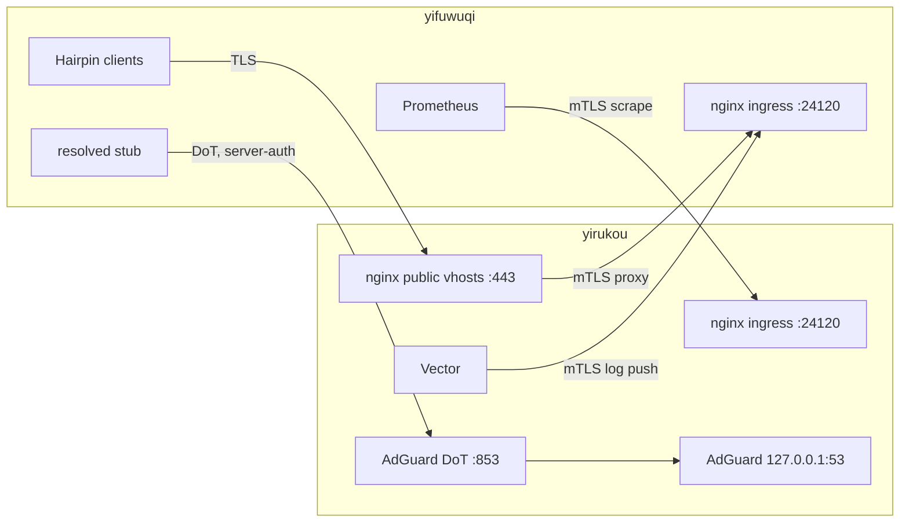
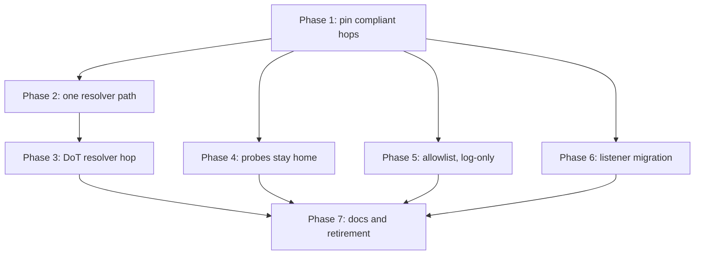

# Inter-Host Traffic Through mTLS nginx

## Status: DRAFT — written 2026-11-23, reworked 2026-11-25 (review: DNS hop is `resolved` DoT, egress detection is log-only, `mTLS on DNS` absorbed); nothing implemented

## Objective

Every service flow between `yifuwuqi` and `yirukou` terminates at nginx under
TLS from the internal service CA, and that becomes a checked invariant rather
than a convention. Anything else one host originates to the other is either an
enumerated transport exception (SSH, ICMP, the tailnet's WireGuard) or shows up
in a log-only egress record, and an eval-time contract stops new code from
adding a plain flow.

One hop is a named exception: the resolver. `yifuwuqi` has no resolver of its
own, and systemd-resolved cannot present a client certificate, so that hop is
server-authenticated TLS (DoT) to AdGuard's existing `:853` listener rather than
mTLS to nginx (Decision 3). The certificate still authenticates the relay; the
exception is recorded here, not inherited as an unstated gap.

The same rule, applied at the listener instead of the hop: a service port is
not an interface. Anything nginx can front binds loopback and owns no firewall
rule at all; a port that still needs one is either a non-HTTP protocol or a
named exception with a reason (Phase 6).

"Between" means traffic a process on one host opens to an address of the
other. Traffic `yirukou` merely routes — `yifuwuqi`'s WAN path, tailnet clients
on the subnet route, LAN devices — is not inter-host service traffic and is
left alone.

## Current State

### Repository-verified flows (2026-11-23, dispositions reworked 2026-11-25)

| #   | Flow                   | Path today                                                | Transport             | Status    |
| --- | ---------------------- | --------------------------------------------------------- | --------------------- | --------- |
| 1   | Application proxy      | `yirukou` nginx to `10.42.0.2:24120`                      | mTLS, subject pinned  | compliant |
| 2   | Scrapes, probe fan-out | `yifuwuqi` Prometheus to `10.42.0.1:24120`                | mTLS                  | compliant |
| 3   | Log push               | `yirukou` Vector to `10.42.0.2:24120/loki/`               | mTLS                  | compliant |
| 4   | Hairpin clients        | `yifuwuqi` to `10.42.0.1:443`, then flow 1                | TLS, then mTLS        | compliant |
| 5   | Resolver upstream      | `resolved` on `eno1` to `yirukou:53`                      | plain DNS             | Phase 3   |
| 6   | Tailnet resolver       | `resolved` on `tailscale0` to MagicDNS, then `yirukou:53` | WireGuard, plain DNS  | Phase 2   |
| 7   | DHCP resolver          | `resolved` on `enp4s0` to `10.42.42.1:53`                 | plain DNS             | Phase 2   |
| 8   | Cross-host DNS probes  | blackbox on each host to the other's `:53`                | plain DNS             | Phase 4   |
| 9   | Reachability probes    | blackbox ICMP and smokeping, both ways                    | ICMP                  | exception |
| 10  | Administration         | `ai-ssh`, deploy-rs, PKI push, Tailscale SSH              | SSH                   | exception |
| 11  | Tailnet transport      | `tailscaled` to `tailscaled`, UDP 41641                   | WireGuard             | exception |
| 12  | LLM inference          | `yifuwuqi` (SillyTavern) to `yitaishi:11436`              | plain HTTP on tailnet | Phase 6b  |
| 13  | Image inference        | `yirukou` to `yitaishi:11437`                             | plain HTTP on tailnet | Phase 6b  |

- Flows 1–3 share one ingress port per host (`services.ingress.port = 24120`)
  and are built in [proxy-vhosts.nix](../../../modules/services/proxy-vhosts.nix),
  [prometheus.nix](../../../modules/services/monitoring/prometheus.nix) and
  [promtail.nix](../../../modules/services/monitoring/promtail.nix) from the
  peer relation in [mtls.nix](../../../modules/services/mtls.nix).
- Flow 4's clients are the Nix substituter `attic.aset.love`
  ([attic/client.nix](../../../modules/services/attic/client.nix), on every
  host; on `yirukou` the first leg is local), the homepage pings
  ([homepage.nix](../../../modules/services/homepage.nix)), the GitHub runner's
  `FORGEJO_INTERNAL_URL`
  ([github-runner.nix](../../../modules/services/github-runner.nix)) and
  Pinepods' `HOSTNAME`. The Forgejo runner and the Attic pushers already use
  loopback.
- Flow 5 is the only flow that will not end at nginx. `yifuwuqi` runs no
  resolver; its `eno1` link points at `yirukou`'s plain `:53`.
- Flow 6 exists because [tailscale.nix](../../../modules/services/tailscale.nix)
  hardcodes `--accept-dns=true` for every routing mode, so `resolved` also
  accepts `100.69.0.1` on `tailscale0` for the same `~.` routing domain.
- Flow 7 comes from `UseDNS = true` in
  [enp4s0.nix](../../../hosts/yifuwuqi/networking/interfaces/enp4s0.nix);
  `10.42.42.1` is `yirukou`'s VLAN 42 listener, `194.242.2.2` is public.
- Flow 8: `probeScrapeConfig` drops only the origin host's own peer entry, so
  each host probes the other's resolver (`probePeers` with `resolver = true` in
  [monitoring.nix](../../../modules/addresses/monitoring.nix)), v4 and v6,
  every 15 s.
- Flows 12 and 13 are outside the peer pair: `mtls.nix`'s `peer` throws for any
  host that is neither `yirukou` nor `yifuwuqi`, and both listeners live on
  `yitaishi`. Covering them with mTLS needs a third host leaf; Phase 6b narrows
  `11437` and records `11436` as residue.

Firewall:

- `yifuwuqi`'s `eno1` opens SSH, 53, 139/445, and the 3000/6006 dev servers to
  the whole LAN, `yirukou` included, and admits 24120 only from `10.42.0.1`
  ([firewall.nix](../../../hosts/yifuwuqi/networking/firewall.nix)). Note what
  is *not* there: no application port. Every backend binds loopback and is
  reached through the local ingress, so the shape Phase 6 generalises already
  holds on this host.
- `yirukou`'s `br0` opens 53, 80, 443, 853, 3443 and SSH to the LAN,
  `yifuwuqi` included, and admits 24120 only from `10.42.0.2`
  ([firewall.nix](../../../hosts/yirukou/networking/firewall.nix)). `853` being
  in the LAN set already is what makes the DoT hop need no firewall change.
- `yitaishi` and `yixiaoqing` both list 11436/11437/4242 against `tailscale0`,
  but both run `yi.tailscale` in client mode, which puts `tailscale0` in
  `trustedInterfaces` — and nixpkgs' `input` chain accepts a trusted interface
  before `input-allow` is consulted. Every one of those port entries is inert:
  [services.nix](../../../hosts/yitaishi/services.nix) and
  [lan-mouse.nix](../../../modules/services/lan-mouse.nix) read as a scope and
  enforce nothing. The actual gate on the two AI listeners is each unit's own
  `IPAddressAllow`; lan-mouse has no gate at all and is reachable by any tailnet
  peer.
- Neither host limits what it originates to the other. nixos-fw has no output
  hook; the only output-hook table today is the Forgejo runner's
  `sandbox-egress` ([forgejo-runner.nix](../../../modules/services/forgejo-runner.nix)).
- The AdGuard exporter binds every interface whatever `listenAddress` says
  ([adguard-exporter/default.nix](../../../modules/services/monitoring/adguard-exporter/default.nix)),
  so only the firewall keeps `:9617` off the LAN.

### Live-host observations (2026-11-23 12:25 -03:00)

Socket tables from `/proc/net/{tcp,tcp6,udp,udp6}` on both hosts (`yirukou`
through `ai-ssh`), plus `resolvectl` and `tailscale dns status` on `yifuwuqi`:

- `yifuwuqi` to `yirukou`: 11 established to `10.42.0.1:24120` (one per scrape
  job) and 8 in `TIME_WAIT` to `10.42.0.1:443` (hairpin HTTPS).
- Into `yifuwuqi` from `10.42.0.1`: three SSH sessions and one SMB session that
  have **no matching socket on `yirukou`**. They are tailnet clients on the
  subnet route, masqueraded to the gateway address. At `yifuwuqi`, source
  `10.42.0.1` is not an identity, so filtering the peer there by source address
  would cut tailnet SSH and SMB.
- `yirukou` to `yifuwuqi`: one established to `10.42.0.2:24120` (proxy or log
  push); 11 inbound on its own `:24120`.
- `eno1` and `tailscale0` both carry the `~.` routing domain; `enp4s0` is a
  default route with `10.42.42.1` and `194.242.2.2`. Tailscale reports MagicDNS
  disabled tailnet-wide, resolvers `100.69.0.1` then `10.42.0.1`, and no split
  DNS or search domains.
- systemd-resolved.service(8) sends a query to every link that shares the
  best-matching routing domain, in parallel, and returns the first success.
  Eight uncached lookups all answered via `eno1`, so `tailscale0` currently
  loses the race. A slower encrypted path on `eno1` widens that race, which is
  why Phase 2 removes the competing links before Phase 3 changes the transport.

### Upstream-verified premises (2026-11-25)

- **systemd-resolved has no client certificate.** It has no `tls` client-cert
  option at all, so no resolved upstream can be mutual TLS. It *can* use a
  non-default port and validate a server name (`DNS=addr:port#name`, systemd
  246+), and networkd validates `DNSOverTLS` per link.
- **AdGuard already serves DoT** on `:853` with the `aset.love` wildcard
  (`tls.port_dns_over_tls = 853`, `server_name = dns.aset.love`,
  [adguardhome.nix](../../../modules/services/adguardhome.nix)). The wildcard's
  `*.aset.love` SAN covers `dns.aset.love`, and `strict_sni_check = false` means
  no SNI is required — though resolved always sends the name, so the pin is real
  from the client side.
- **AdGuard reloads a renewed certificate on its own** since v0.107.72 (it
  watches `certificate_path` and `private_key_path`); nixpkgs pins 0.107.80.
  nixpkgs' ACME `cp -vp` rewrites `fullchain.pem` in place, so the watched inode
  sees an `IN_MODIFY`. No restart and no `reloadServices` entry are needed.
- **nginx stream cannot pin a client subject.** `if` is an
  `ngx_http_rewrite_module` directive and does not exist in `stream`; only
  `set`, `return` and `map` do. A stream listener could therefore only verify
  the chain, admitting either host's client leaf — one of the reasons the
  CoreDNS-plus-stream design this plan previously referenced is gone.

## Decisions

1. **Scope is host-originated traffic.** A flow is inter-host when a process on
   one host opens it to an address of the other. Forwarded traffic never
   crosses the output hook and is out of scope.
1. **One compliance rule, one exception.** Every inter-host service flow is TLS
   terminated by nginx on the receiving host. Peer hops (proxy, scrape, log
   push) are mutual TLS from `service-ca`. Hairpin clients reach `yirukou`'s
   public vhosts with server-authenticated TLS and continue over flow 1: those
   listeners serve browsers, so they cannot demand a client certificate, and
   both legs still end at nginx. The DNS hop (Decision 3) is the exception, and
   it is the only one.
1. **The resolver hop is DoT to AdGuard, not nginx.** `eno1` points `resolved`
   at `yirukou`'s `:853` with `DNSOverTLS = yes` and the SNI name
   `dns.aset.love`. No new daemon, no new port, no new firewall line, no second
   forwarder cache, no `service-ca` leaf. The costs are accepted and stated
   plainly: the hop is server-authenticated rather than mutual, it trusts the
   ACME wildcard rather than the internal CA, and it therefore loses the
   "nginx terminates every hop" property for exactly this one flow. What it does
   *not* change: `:53` and `:853` stay open to LAN and VLAN 42 clients, so the
   certificate is relay authentication, not admission control — AdGuard's
   `bind_hosts` and the interface firewall remain the admission rule.
   The rejected alternative is recorded so it is not re-proposed: a CoreDNS
   forwarder on `127.0.0.9` feeding an nginx stream listener on a new port
   would add a daemon, a port, a firewall line and a cache, would still be
   chain-only (second premise above), and its `forward` block silently falls
   back to plain DNS unless the upstream is spelled `tls://`.
1. **`yifuwuqi` gets exactly one resolver path.** Add `yi.tailscale.acceptDns`
   (default `true`, so no other host changes) and set it `false` on
   `yifuwuqi`; set `UseDNS = false` on `enp4s0`; set `FallbackDNS = []`. In
   normal operation nothing resolves differently: MagicDNS is off tailnet-wide
   and `.ts` names come from AdGuard rewrites. Without this, the DoT cutover is
   not fail-closed — two plaintext paths to the resolver survive it, and the
   compiled-in fallback list is a third.
1. **Probes stay on their own host.** The `dns` and `dns6` probes of `lan` peers
   target the origin host's own resolver on its LAN address, which is the path
   LAN devices use and never leaves the host. ICMP stays cross-host and keeps
   measuring the wire. `yirukou` never resolves through `yifuwuqi`, so nothing
   replaces that direction. Because `resolved` forwards over DoT, a `yifuwuqi`
   self-probe runs stub, DoT, AdGuard, Unbound — the relay hop stays under probe
   with no extra exporter, which is why the previous plan's separate
   relay-hop-probe question is gone. The count stays at 9 blackbox probes per
   host.
1. **The exceptions are closed and enumerated.** SSH (OpenSSH on 24212,
   Tailscale SSH on 22) is the recovery lane when nginx or the mTLS material is
   broken, and the channel `mtls-pki-generate` delivers certificates over, so it
   must depend on neither. ICMP and ICMPv6 carry no service. WireGuard on the
   Tailscale port is transport. Anything else needs an amendment to this
   decision.
1. **Detection is log-only, permanently.** Each host's output hook records new
   connections to any peer address outside an allowlist derived once from the
   registry in `mtls.nix`, and never rejects. Rejection is not worth its cost
   here: admission is already enforced three times over (peer certificates, the
   per-location nginx allowlists, the per-interface firewall), the output hook
   cannot tell a tailnet client's forwarded traffic from the host's own, and a
   reject verdict turns a missing allowlist entry into an outage at 03:00
   instead of a line in `journalctl`. The output hook only sees locally
   generated packets, so routed tailnet and WAN traffic is untouched. The
   allowlist is still registry-derived and still contract-pinned, so drift fails
   `nix flake check` rather than waiting for someone to read the log. No
   `yirukou`-side mirror: it would re-log the same packets from the receiving
   end, keyed on a source address this plan itself calls not an identity.
1. **`peer` is a two-host relation, not a registry utility.** `mtls.nix` throws
   for any host outside the pair, so the port derivation and the log-only table
   may only be imported by `yirukou` and `yifuwuqi`. Adding a third host means
   generalising `peer` into a set first; a module that imports `mtls.nix` on
   another host fails evaluation by design.
1. **One contract, grown per phase.** A `peer-mtls` contract pins each
   guarantee in the change that makes it true, following the "current policy,
   never aspiration" rule at the top of
   [checks.nix](../../../nix/checks.nix).
1. **Fronting a listener is not a way to comply.** A service moved behind
   nginx for the sake of a rule is a listener migration, judged by whether the
   app can bind loopback, not a transport change. It is in scope only where
   the app is HTTP and the client can send `Host`; the disposition table above
   is exhaustive, and adding a row needs an amendment here.
1. **A service port is not an interface.** Every backend nginx can front binds
   loopback, and the firewall rule for its port is deleted rather than
   narrowed. `yifuwuqi` already obeys this — its `eno1` admits no application
   port, only the ingress from the gateway. The residue is `3000`/`6006`.
   Anything that keeps a rule is a non-HTTP protocol (DNS, DoT, DoH on the DDR
   port, SMB, lan-mouse, WireGuard) or one of Decision 6's exceptions, and the
   `listener-exposure` contract names it.

Peer address sets come from the registry: for `yirukou` its LAN v4 and v6, VLAN
42 v4 and v6, and tailnet v4; for `yifuwuqi` its LAN v4 and v6 and tailnet v4
and v6. The sinkhole addresses and the WAN leases carry no service and are
left out.

Allowlist, for new connections only (established and related traffic always
passes, and nothing is rejected):

| Direction               | TCP                                                  | UDP   | Other        |
| ----------------------- | ---------------------------------------------------- | ----- | ------------ |
| `yifuwuqi` to `yirukou` | 24120 ingress, 853 DoT, 443 public vhosts, 24212, 22 | 41641 | ICMP, ICMPv6 |
| `yirukou` to `yifuwuqi` | 24120 ingress, 24212, 22                             | 41641 | ICMP, ICMPv6 |

`853` is the DoT hop of Decision 3. `41641` is UDP only: peer traffic is
WireGuard, and Tailscale's failure path is DERP over `443` to the internet, never
a TCP connection to the peer. Anything that appears on `41641/tcp` between the
hosts is a finding, and the log will show it.

### Listener disposition

Decision 10 rules out fronting a listener as a way to satisfy it; Decision 11
says which listeners stop being ports at all. Every port open on any host
today, and what happens to it:

| Port(s)            | Host                     | Protocol    | Disposition                                                             |
| ------------------ | ------------------------ | ----------- | ----------------------------------------------------------------------- |
| 3000, 6006         | `yifuwuqi`               | HTTP        | **Migrate**: vhosts on `yirukou`, bind loopback                         |
| 11436, 11437       | `yitaishi`               | HTTP        | **Narrow**: `11437` to `yirukou`; `11436` stays tailnet-wide, see below |
| 53                 | `yirukou`                | DNS         | keep: resolver for LAN, VLAN 42 and tailnet                             |
| 853                | `yirukou`                | DoT / DoQ   | keep: DDR advertises it, and it is the DoT hop                          |
| 3443               | `yirukou`                | DoH         | keep: DDR advertises this exact port                                    |
| 80, 443            | `yirukou`                | HTTP        | keep: the gate itself, and the hairpin clients                          |
| 24212              | all                      | SSH         | exception: the recovery lane (Decision 6)                               |
| 139, 445, 137, 138 | `yifuwuqi`               | SMB/NetBIOS | keep: no HTTP shape, and the clients are not nginx                      |
| 4242               | `yitaishi`, `yixiaoqing` | lan-mouse   | keep: a game-input protocol, not a service                              |
| 51820, 41641       | all                      | WireGuard   | exception: transport (Decision 6)                                       |

Two entries deserve their reasons, because both look like candidates:

- **`3443` cannot fold into `443`.** AdGuard's DDR answer is built from the
  listener's own port (`makeDDRResponse` emits an `SVCBPort` per
  `HTTPSListenAddrs` entry, `internal/dnsforward/process.go:212-220`), and
  `tls.port_https = 3443` is what resolvers are told to use. Serving DoH on
  `443` under the same name would mean advertising nginx — which terminates
  TLS and could proxy `/dns-query` to AdGuard, since that vhost already
  exists — so the migration is really "point DDR at nginx", a DNS change with
  its own rollout, not a firewall edit.
- **`11436`/`11437` are not inter-host in the sense of this plan.** They are
  tailnet-only listeners on `yitaishi`, a host outside the peer pair, so
  `mtls.nix`'s two-host `peer` throws there. Fronting them with nginx on
  `yitaishi` costs a third leaf plus a third nginx instance; narrowing each
  listener to its single client is the smaller change that achieves the same
  thing. Only `11437` can actually be narrowed that way — `11436` is consumed
  by `llama-server`, whose unit cannot take an address filter because it dials
  out to fetch model weights (Phase 6b).

## Architecture

Target state; SSH, ICMP and WireGuard are omitted.



## Phases & Implementation Details

### Phase 1: Pin the compliant hops (evaluation only)

Add `nix/peer-mtls-contract.nix` and append its results to `contractResults`
in [checks.nix](../../../nix/checks.nix), passing `self` and `contractIssues`
in; `checks.nix` is already past 400 lines. Predicates that hold today:

- both hosts evaluate `yi.mtls.enable = true`;
- on `yirukou`, every nginx location whose `proxyPass` names a `yifuwuqi`
  address is `https://` and its `extraConfig` carries `proxy_ssl_certificate`
  and `proxy_ssl_verify on`;
- on `yifuwuqi`, every scrape job whose effective address (`__tmp_address` for
  the probe job, the target otherwise) is a `yirukou` address sets
  `scheme = "https"` and `tls_config.cert_file`;
- on `yirukou`, every Vector sink whose endpoint names a `yifuwuqi` address is
  `https://` with `tls.crt_file`.

Match an address together with its port separator so `10.42.0.2` never matches
`10.42.0.20`.

Acceptance: `nix flake check --no-build` prints `contract peer-mtls passed`
for both hosts, and setting `yi.mtls.enable = false` on either host makes the
evaluation throw.

### Phase 2: One resolver path on `yifuwuqi`

No transport change yet; this phase only removes the competing paths, so the
DoT cutover in Phase 3 cannot be silently bypassed.

- [tailscale.nix](../../../modules/services/tailscale.nix): a `bool` option
  `acceptDns`, rendered as `--accept-dns=${lib.boolToString cfg.acceptDns}` in
  both `baseFlags` branches.
- [hosts/yifuwuqi/services.nix](../../../hosts/yifuwuqi/services.nix):
  `yi.tailscale.acceptDns = false`, with the reason.
- [enp4s0.nix](../../../hosts/yifuwuqi/networking/interfaces/enp4s0.nix):
  `UseDNS = false`.
- [hosts/yifuwuqi/networking.nix](../../../hosts/yifuwuqi/networking.nix):
  `services.resolved.settings.Resolve.FallbackDNS = [ ]`, which renders
  `FallbackDNS=` and clears the compiled-in public list. Losing `eno1` then
  leaves no resolver at all — but a lost `eno1` also takes out every LAN-facing
  service on this host, so the honest failure is the visible one, and deploy,
  `ai-ssh` and the generated SSH config all use literal addresses and keep
  working.
- Contract: `yifuwuqi`'s Tailscale set flags carry `--accept-dns=false`, every
  networkd network on `yifuwuqi` that enables DHCP sets
  `dhcpV4Config.UseDNS = false` (today only `enp4s0`; `wlp2s0` has DHCP off),
  and `FallbackDNS` is empty.

Deploy `yifuwuqi` alone. `tailscaled-set` is a oneshot wanted by `tailscaled`,
so a switch that leaves `tailscaled` running may not rerun it: if
`tailscale dns status` still reports Tailscale DNS enabled, start
`tailscaled-set.service` once.

Acceptance: `resolvectl dns` and `resolvectl domain` list servers and `~.` on
`eno1` only; `resolvectl query --cache=no example.org` and
`resolvectl query yirukou.ts` answer; a tailnet client using `100.69.0.6:53`
still resolves.

### Phase 3: Resolver hop over DoT

[eno1.nix](../../../hosts/yifuwuqi/networking/interfaces/eno1.nix) takes
`allAddresses` (for the listener's own name) and `lib` (to bracket the IPv6
upstream), and replaces the plain upstream list:

```nix
networkConfig = {
  DHCP = "no";
  # 853 is AdGuard's port_dns_over_tls, and the name is that listener's own
  # server_name (modules/services/adguardhome.nix) — not the admin UI's
  # `adguardhome` vhost — so resolved validates it against the wildcard SAN.
  DNS = map (
    addr:
    "${if lib.hasInfix ":" addr then "[${addr}]" else addr}:853#dns.${allAddresses.baseDomain}"
  ) addresses.dns.lanUpstreams;
  DNSOverTLS = "yes";
  Domains = [ "~." ];
  MulticastDNS = "yes";
  IPv6AcceptRA = "no";
  LinkLocalAddressing = "ipv6";
};
```

`addresses.dns.lanUpstreams` is `[ <yirukou LAN v6> <yirukou LAN v4> ]`, so both
families go over TLS to the same listener; the IPv6 entry needs brackets
because `systemd.network(5)` requires them when a port follows. Nothing else
changes: the stub listeners, `DNSStubListenerExtra`, the container DNAT to
`10.42.0.2:53`, and `:53`/`:853` for LAN and VLAN 42 clients all stay as they
are. There is no firewall edit — `853` is already in `yirukou`'s LAN port set.

Two costs are worth naming. `resolved` runs with `Cache = "no"`
([common.nix](../../../modules/common.nix)), so every lookup that misses
AdGuard's 64 MiB cache crosses a TLS connection — `resolved` keeps its upstream
connections open rather than handshaking per query, and AdGuard's cache plus
optimistic refresh absorbs the hot working set, so this is a connection-reuse
question rather than a per-query handshake. And the container path is unchanged
but no longer local: containers DNAT to `10.42.0.2:53` (this host's stub), which
now forwards over the LAN to `10.42.0.1:853` instead of `:53`.

Contract: every `DNS=` on `yifuwuqi` is `:853#`-suffixed, `DNSOverTLS` is `yes`
on every network that carries a server, and no `DNS=` names a peer address
without the suffix.

Deploy `yifuwuqi` alone. Revert is one line plus one generation: restore
`DNS = addresses.dns.lanUpstreams` and drop `DNSOverTLS`.

Acceptance:

- `resolvectl status eno1` shows the two `:853#dns.aset.love` servers and
  `+DNSOverTLS` in the protocols line;
- `resolvectl query --cache=no example.org` answers, and
  `ss -tnp | grep ':853'` shows established sockets from `systemd-resolve`;
- `openssl s_client -connect 10.42.0.1:853 -servername dns.aset.love -brief </dev/null` presents the `aset.love` wildcard (DoT is TLS from the
  first byte — no `-starttls`), and its `-enddate` matches
  `/var/lib/acme/aset.love/fullchain.pem` after the next renewal, which is the
  check that AdGuard reloaded the file without a restart;
- `kdig @10.42.0.1 -p 853 example.org +tls +tls-ca +tls-hostname=dns.aset.love`
  answers, and the same query with `+tls-hostname=wrong.aset.love` fails the
  handshake with "Error in the certificate". `+tls` alone is the *opportunistic*
  profile and validates nothing, so `+tls-ca` is what makes this a test; the
  wildcard is a public ACME certificate, so the system trust store suffices;
- a container on `yifuwuqi` still resolves (the DNAT path), a DHCP client still
  resolves through `10.42.0.1`, a VLAN client still resolves through
  `10.42.42.1`, and a DNSSEC-validating query still returns `AD`.

### Phase 4: Probes stay on their own host

In `probeScrapeConfig`
([prometheus.nix](../../../modules/services/monitoring/prometheus.nix)):

```nix
lib.filter (
  probe:
  if probe.scope == "lan" && lib.hasPrefix "dns" probe.layer then
    probe.peer == host
  else
    probe.peer != host
) monitoring.probes
```

- Rewrite the `yifuwuqi` entry's comment in
  [monitoring.nix](../../../modules/addresses/monitoring.nix), which still
  describes an AdGuard and Unbound chain the host no longer runs.
- Rewrite the "A host never probes its own peer entry" paragraph in
  [monitoring.md](../services/monitoring.md): the rule now applies to ICMP and
  smokeping only, because the `dns`/`dns6` self-probe is what keeps the DoT hop
  under test. The per-host totals stay 9 blackbox probes and 5 smokeping
  targets.
- Contract: no `dns` or `dns6` probe target is a peer address.

Deploy `yifuwuqi` only; the probe job lives in its Prometheus and both
blackbox configurations are unchanged.

Acceptance: `probe_success{layer=~"dns6?", scope="lan"}` returns four series,
each with `peer` equal to `host`, all `1` — the self-probe crossing stub, DoT,
AdGuard and Unbound. The Internet dashboard's LAN DNS panels still render,
because they select on `layer` and `scope`, not on `peer`.

### Phase 5: Peer allowlist, log-only

[mtls.nix](../../../modules/services/mtls.nix) already computes `peer`. It
gains one port derivation keyed on the destination, so the registry stays the
single source for every port:

```nix
# Ports the other mTLS host may open to `target`; SSH and Tailscale are Decision 6.
peerPorts = target: {
  tcp = [
    allAddresses.hosts.${target}.services.ingress.port
    allAddresses.hosts.${target}.ssh.listenPort
    22
  ]
  ++ lib.optionals (target == monitoring.proxyHost) [
    853 # AdGuard DoT: the resolver hop (Decision 3)
    443 # public vhosts, hairpin clients
  ];
  udp = [ config.services.tailscale.port ];
};
```

It also gains one table, `networking.nftables.tables.mtls-peer`, defined once
for both hosts under `cfg.enable`. It shares priority `filter` with the Forgejo
runner's `sandbox-egress` table, which is harmless: both are `policy accept`,
the two match disjoint keys (destination address here, `skuid` there), and this
one only logs. The DR drill ([secrets/test.nix](../../../secrets/test.nix)) runs
with `yi.mtls.enable = false`, so the drill is unaffected:

```nft
table inet mtls-peer {
  chain output {
    type filter hook output priority filter; policy accept;
    ip daddr { <peer v4> } jump to_peer
    ip6 daddr { <peer v6> } jump to_peer
  }

  chain to_peer {
    ct state established,related return
    meta l4proto { icmp, ipv6-icmp } return
    tcp dport { <tcp allowlist> } return
    udp dport { <udp allowlist> } return
    limit rate 5/second burst 10 packets log prefix "mtls-peer: " level warn
  }
}
```

- [adguard-exporter/default.nix](../../../modules/services/monitoring/adguard-exporter/default.nix):
  `IPAddressDeny = "any"` and `IPAddressAllow = "localhost"`, because the
  binary ignores `listenAddress`.
- Contract: every TCP port in an allowlist is one the target serves with TLS
  through nginx (its ingress port, `yirukou`'s `defaultSSLListenPort`), its
  AdGuard DoT port, or an SSH port, and the derivation's port set equals what
  the allowlist table documents.

Acceptance: the generation activates on both hosts with no service change. The
table is `policy accept` with no verdict, so nothing can break. Read
`journalctl -k --grep mtls-peer` (also through `ai-ssh`) over a full week —
every daily maintenance slot and one Monday slot. Each hit is either moved
behind nginx at its source or added to Decision 6; nothing is allowlisted
silently. After the window, the table stays: it is the standing detector for
a new unlisted flow, and the contract is what keeps the allowlist honest.

### Phase 6: Listener migration (no rule where nginx can front)

Independent of Phases 2–5; it needs neither the allowlist nor the DNS cutover.
The unit of work is one listener, and each completes on its own.

**6a — `3000` and `6006` on `yifuwuqi`.** Two dev-server ports opened to the
whole LAN for a user (`workd`) whose servers declare no port in this repo. Both
are HTTP, so:

- add registry entries with `domain`s like every other service, and vhosts to
  [proxy-vhosts.nix](../../../modules/services/proxy-vhosts.nix) — they are
  local to `yifuwuqi`, so `mkLocalVhosts` fronts them and `mkRemoteVhosts`
  gates them on `yirukou` like the rest;
- bind the dev servers to `127.0.0.1`, which is a per-user choice, not
  something this repo can declare: the rule is deleted only after the bind
  changes;
- delete both lines from [firewall.nix](../../../hosts/yifuwuqi/networking/firewall.nix).

If the dev servers cannot bind loopback, they are an amendment to Decision 11
— the disposition table's only HTTP residue that cannot become an nginx
vhost — and keep their rules with that reason recorded.

**6b — `11436`/`11437` on `yitaishi`.** Not a fronting migration, and not a
firewall edit either: the firewall is not the gate.

`yitaishi` runs `yi.tailscale` in client mode, which puts `tailscale0` in
`networking.firewall.trustedInterfaces`, and nixpkgs' `input` chain accepts a
trusted interface before `input-allow` is ever consulted. The
`allowedTCPPorts` entries in
[yitaishi/services.nix](../../../hosts/yitaishi/services.nix) are therefore
inert — they read as a scope and enforce nothing. The real gate is each unit's
own `IPAddressAllow`.

- [sd-cpp.nix](../../../modules/services/ai/sd-cpp.nix): the server already
  carries `IPAddressDeny = "any"` with `IPAddressAllow = [ "localhost" "100.64.0.0/10" ]` — every tailnet peer. Replace the CGNAT range with
  `localhost` plus `yirukou`'s tailnet address, its only client
  (`sd-cpp.aset.love` proxies there). Narrow `listenAddress` from `"0.0.0.0"`
  to the tailnet address at the same time, so the LAN side stops answering.
  Egress is safe: `sd-cpp-fetch` downloads the weights in its own unit, which
  has no address filter.
- [llama-cpp.nix](../../../modules/services/ai/llama-cpp.nix): it cannot be
  narrowed the same way. `listenAddresses` is already `localhost` plus the
  tailnet address, and the *server* unit must **not** get
  `IPAddressDeny = "any"`, because `llama-server` dials HuggingFace when it
  loads a model from its preset and an address filter would break that. (The
  `IPAddressDeny`/`IPAddressAllow` pair already in this file sits on
  `llama-cpp-idle-unload`, which only talks to loopback; it is unrelated and
  stays.) So `11436` is reachable from every tailnet peer that can route to
  `yitaishi`, and narrowing it means either a fronting nginx on `yitaishi` (a
  third leaf) or accepting the tailnet as the trust boundary.
- Delete the two inert `allowedTCPPorts` entries regardless: leaving config
  that reads as a rule and enforces nothing is worse than no rule.

**Contract: `listener-exposure`.** Every port in every host's
`networking.firewall.interfaces` and `extraInputRules` is either consumed by an
nginx `proxyPass` somewhere in the fleet (so the rule is redundant), enforced by
a unit's own `IPAddressAllow`, or listed in the closed exception table with a
reason. It must also flag a port list on an interface that is in
`networking.firewall.trustedInterfaces`, because there the whole chain is
short-circuited and the list enforces nothing. First run lists the current
residue, then each item leaves the list as its phase lands.

Acceptance: `nix eval` shows no `3000`/`6006` on `yifuwuqi`; from a LAN client
`curl -I http://10.42.0.2:3000` fails while the new vhost answers through the
gate; `systemd-analyze security` or `systemctl show -p IPAddressAllow` on
`sd-cpp.service` shows only loopback plus `yirukou`, and from a third tailnet
host `curl http://<yitaishi ts>:11437/v1/models` fails; a SillyTavern chat and
one `sd-cpp.aset.love` generation still work. `11436` stays reachable from the
tailnet and that is recorded as a known residue, not a passing check.

### Phase 7: Docs and retirement

- [dns-and-proxy.md](../services/dns-and-proxy.md) §1 still draws AdGuard and
  Unbound on `yifuwuqi`; §2.3 gains the DNS exception, the exception list, and
  the allowlist.
- [hosts/yifuwuqi.md](../hosts/yifuwuqi.md): three statements are stale —
  `enp4s0`'s `UseDNS = true` (table row and the per-interface paragraph), the
  fall-back to DHCP DNS, and "deferring queries to `yirukou` on `eno1` or the
  fallback DHCP DNS".
- [sysctl-firewall.md](../networking/sysctl-firewall.md): the `mtls-peer` table
  and what log-only means.
- [architecture-rollout-plan.md](architecture-rollout-plan.md): the lane already
  exists (added in the 2026-11-25 review); tick it, then delete this plan in the
  change set that completes its last phase.

## Files & LOC Budget

About +175 Nix lines, net of the listener migrations.

| File                                                                                              | Change                                       |
| ------------------------------------------------------------------------------------------------- | -------------------------------------------- |
| `nix/peer-mtls-contract.nix` (new)                                                                | +70: the `peer-mtls` predicates              |
| [checks.nix](../../../nix/checks.nix)                                                             | +2: import, append; +30: `listener-exposure` |
| [mtls.nix](../../../modules/services/mtls.nix)                                                    | +35: port derivation, `mtls-peer` table      |
| [tailscale.nix](../../../modules/services/tailscale.nix)                                          | +8: `acceptDns`                              |
| [eno1.nix](../../../hosts/yifuwuqi/networking/interfaces/eno1.nix)                                | +6/-1: DoT upstreams, `DNSOverTLS`           |
| [enp4s0.nix](../../../hosts/yifuwuqi/networking/interfaces/enp4s0.nix)                            | +1/-1: `UseDNS = false`                      |
| [hosts/yifuwuqi/networking.nix](../../../hosts/yifuwuqi/networking.nix)                           | +1: empty `FallbackDNS`                      |
| [hosts/yifuwuqi/services.nix](../../../hosts/yifuwuqi/services.nix)                               | +1: `acceptDns = false`                      |
| [prometheus.nix](../../../modules/services/monitoring/prometheus.nix)                             | +7/-1: probe filter                          |
| [adguard-exporter/default.nix](../../../modules/services/monitoring/adguard-exporter/default.nix) | +2: loopback-only IP filter                  |
| [monitoring.nix](../../../modules/addresses/monitoring.nix)                                       | comment only                                 |
| [proxy-vhosts.nix](../../../modules/services/proxy-vhosts.nix)                                    | +8: the two dev-server entries (6a)          |
| [hosts.nix](../../../modules/addresses/hosts.nix)                                                 | +8: their registry entries (6a)              |
| [yifuwuqi firewall.nix](../../../hosts/yifuwuqi/networking/firewall.nix)                          | -2: the 3000/6006 lines (6a)                 |
| [sd-cpp.nix](../../../modules/services/ai/sd-cpp.nix)                                             | +1/-2: tailnet bind, allow `yirukou` only    |
| [yitaishi/services.nix](../../../hosts/yitaishi/services.nix)                                     | -2: the inert port entries (6b)              |

## Rollout Order



1. Phase 1 first: it is evaluation-only and guards every later change.
1. Phase 2 must land before Phase 3, in its own `yifuwuqi` generation, or the
   DoT cutover is not fail-closed.
1. Phase 3 is one `yifuwuqi` generation and one revertible line.
1. Phases 4, 5 and 6 are mutually independent; each is its own generation.
   Preferred order is 6, then 4, then 5, so the log-only window opens with the
   dev-server chatter already gone and the probes already local. Phase 5 may
   share a generation with Phase 3: it rejects nothing, so it cannot break the
   cutover.
1. Never share a generation with the
   [impermanence cutover](impermanence-yirukou-plan.md).

## Out of Scope

- Device-facing paths: DNS for LAN, VLAN 42 and tailnet clients, Samba, user
  SSH, DHCP, multicast mDNS.
- Routed traffic, including tailnet clients that reach `yifuwuqi` as
  `10.42.0.1`.
- Other mesh hosts as mTLS peers. `sd-cpp.aset.love` on `yirukou` proxies
  plain HTTP to `yitaishi`'s tailnet listener; Phase 6b narrows `11437` and
  records `11436` as residue, and covering the hop itself still needs a third
  host leaf.
- Cloudflare Origin Pulls, the roadmap's conditional edge lane.
- PKI changes. Every listener here reuses the existing leaves.

## Open Questions

- **Hairpin clients.** Keep `yifuwuqi`'s own `*.aset.love` consumers on
  `yirukou`'s public vhosts, or move the non-UI ones (the Nix substituter, the
  GitHub runner's Forgejo URL) to loopback, as the Forgejo runner and the Attic
  pushers already are? Moving them removes both inter-host legs per request,
  but the substituter is fleet-wide in `attic/client.nix` and would need a
  `yifuwuqi` override.
- **Link-local chatter.** LLMNR and unicast mDNS replies, and Tailscale peerapi
  (Taildrop), are not in the allowlist. Should they be exempted by source port,
  or left to be logged (or LLMNR switched off on both servers)? Nothing rejects
  them, so the log-only window will show whether any occur.
- **The `3000`/`6006` dev servers are undeclared.** No module in this repo
  starts them; the ports are opened for the `workd` user's own servers
  ([workd.nix](../../../users/home/workd.nix) installs `nodejs`, nothing
  listens). So 6a can front them only after the servers are told to bind
  loopback, which is a user-side change this repo cannot enforce. Should they
  become a declared service, or stay a documented exception until they do?
- **DDR is the only thing pinning `3443`.** Folding AdGuard's DoH into the
  existing `dns.aset.love` vhost on `443` is possible — nginx terminates TLS
  there and already proxies `/dns-query` — but AdGuard answers DDR from its own
  listener ports, so the change is "point DDR at nginx, or stop advertising
  DDR". Worth doing only if `3443` is the last non-nginx listener left.

Resolved in the 2026-11-25 review, recorded so they are not reopened: the CoreDNS forwarder and the nginx stream listener (replaced by `resolved` DoT — Decision 3), the reject verdicts and the `yirukou` input mirror (replaced by permanent log-only detection — Decision 7), the dedicated relay-hop probe (the `dns`/`dns6` self-probe now crosses the DoT hop — Phase 4), and `FallbackDNS` (emptied — Decision 4).
