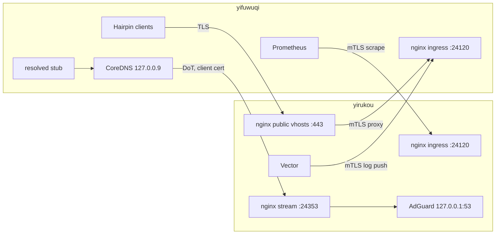
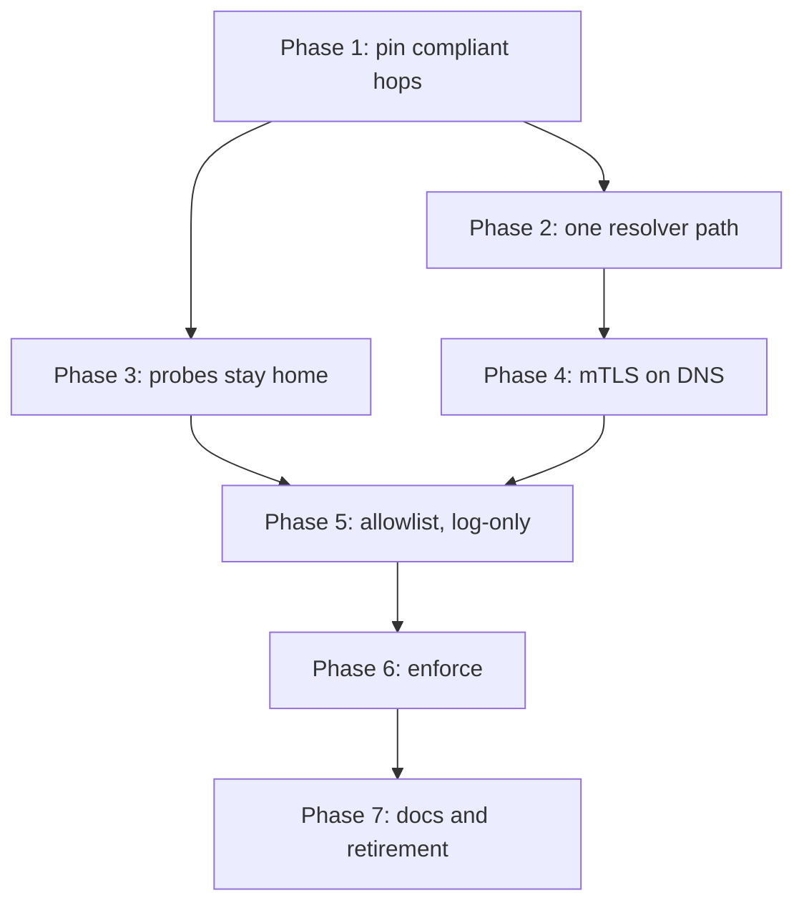

# Inter-Host Traffic Through mTLS nginx

## Status: DRAFT — written 2026-11-23, nothing implemented; the resolver hop itself is delegated to [mTLS on DNS](mtls-dns-plan.md)

## Objective

Every service flow between `yifuwuqi` and `yirukou` terminates at nginx under
TLS from the internal service CA, and that becomes a checked invariant rather
than a convention. Anything else one host originates to the other is either an
enumerated transport exception (SSH, ICMP, the tailnet's WireGuard) or is
rejected by the sending host's firewall, and an eval-time contract stops new
code from adding a plain flow.

"Between" means traffic a process on one host opens to an address of the
other. Traffic `yirukou` merely routes — `yifuwuqi`'s WAN path, tailnet clients
on the subnet route, LAN devices — is not inter-host service traffic and is
left alone.

## Current State

### Repository-verified flows (2026-11-23)

| #   | Flow                   | Path today                                                | Transport            | Status                          |
| --- | ---------------------- | --------------------------------------------------------- | -------------------- | ------------------------------- |
| 1   | Application proxy      | `yirukou` nginx to `10.42.0.2:24120`                      | mTLS, subject pinned | compliant                       |
| 2   | Scrapes, probe fan-out | `yifuwuqi` Prometheus to `10.42.0.1:24120`                | mTLS                 | compliant                       |
| 3   | Log push               | `yirukou` Vector to `10.42.0.2:24120/loki/`               | mTLS                 | compliant                       |
| 4   | Hairpin clients        | `yifuwuqi` to `10.42.0.1:443`, then flow 1                | TLS, then mTLS       | compliant                       |
| 5   | Resolver upstream      | `resolved` on `eno1` to `yirukou:53`                      | plain DNS            | [mTLS on DNS](mtls-dns-plan.md) |
| 6   | Tailnet resolver       | `resolved` on `tailscale0` to MagicDNS, then `yirukou:53` | WireGuard, plain DNS | unplanned                       |
| 7   | DHCP resolver          | `resolved` on `enp4s0` to `10.42.42.1:53`                 | plain DNS            | latent, unplanned               |
| 8   | Cross-host DNS probes  | blackbox on each host to the other's `:53`                | plain DNS            | unplanned                       |
| 9   | Reachability probes    | blackbox ICMP and smokeping, both ways                    | ICMP                 | exception                       |
| 10  | Administration         | `ai-ssh`, deploy-rs, PKI push, Tailscale SSH              | SSH                  | exception                       |
| 11  | Tailnet transport      | `tailscaled` to `tailscaled`, UDP 41641                   | WireGuard            | exception                       |

- Flows 1–3 share one ingress port per host (`services.ingress.port = 24120`)
  and are built in [proxy-vhosts.nix](../../../modules/services/proxy-vhosts.nix),
  [prometheus.nix](../../../modules/services/monitoring/prometheus.nix) and
  [promtail.nix](../../../modules/services/monitoring/promtail.nix) from the
  peer relation in [mtls.nix](../../../modules/services/mtls.nix).
- Flow 4's clients are the Nix substituter `cache.aset.love`
  ([attic/client.nix](../../../modules/services/attic/client.nix), on every
  host; on `yirukou` the first leg is local), the homepage pings
  ([homepage.nix](../../../modules/services/homepage.nix)), the GitHub runner's
  `FORGEJO_INTERNAL_URL`
  ([github-runner.nix](../../../modules/services/github-runner.nix)) and
  Pinepods' `HOSTNAME`. The Forgejo runner and the Attic pushers already use
  loopback.
- Flow 6 exists because [tailscale.nix](../../../modules/services/tailscale.nix)
  hardcodes `--accept-dns=true` for every routing mode.
- Flow 7 comes from `UseDNS = true` in
  [enp4s0.nix](../../../hosts/yifuwuqi/networking/interfaces/enp4s0.nix);
  `10.42.42.1` is `yirukou`'s VLAN 42 listener, `194.242.2.2` is public.
- Flow 8: `probeScrapeConfig` drops only the origin host's own peer entry, so
  each host probes the other's resolver (`probePeers` with `resolver = true` in
  [monitoring.nix](../../../modules/addresses/monitoring.nix)), v4 and v6,
  every 15 s.

Firewall:

- `yifuwuqi`'s `eno1` opens SSH, 53, 139/445 and the 3000/6006 dev servers to
  the whole LAN, `yirukou` included, and admits 24120 only from `10.42.0.1`
  ([firewall.nix](../../../hosts/yifuwuqi/networking/firewall.nix)).
- `yirukou`'s `br0` opens 53, 80, 443, 853, 3443 and SSH to the LAN,
  `yifuwuqi` included, and admits 24120 only from `10.42.0.2`
  ([firewall.nix](../../../hosts/yirukou/networking/firewall.nix)).
- Neither host limits what it originates to the other. nixos-fw has no output
  hook; the only output-hook table today is the Forgejo runner's
  `sandbox-egress` ([forgejo-runner.nix](../../../modules/services/forgejo-runner.nix)).
- The AdGuard exporter binds every interface whatever `listenAddress` says
  ([adguard-exporter/default.nix](../../../modules/services/monitoring/adguard-exporter/default.nix)),
  so only the firewall keeps `:9617` off the LAN.

### Live-host observations (2026-11-23 12:25 -03:00)

Socket tables from `/proc/net/{tcp,tcp6,udp,udp6}` on both hosts (`yirukou`
through `ai-ssh`), plus `resolvectl` and `tailscale dns status` on `yifuwuqi`:

- `yifuwuqi` to `yirukou`: 11 established to `10.42.0.1:24120` (one per scrape
  job) and 8 in `TIME_WAIT` to `10.42.0.1:443` (hairpin HTTPS).
- Into `yifuwuqi` from `10.42.0.1`: three SSH sessions and one SMB session that
  have **no matching socket on `yirukou`**. They are tailnet clients on the
  subnet route, masqueraded to the gateway address. At `yifuwuqi`, source
  `10.42.0.1` is not an identity, so filtering the peer there by source address
  would cut tailnet SSH and SMB.
- `yirukou` to `yifuwuqi`: one established to `10.42.0.2:24120` (proxy or log
  push); 11 inbound on its own `:24120`.
- `eno1` and `tailscale0` both carry the `~.` routing domain; `enp4s0` is a
  default route with `10.42.42.1` and `194.242.2.2`. Tailscale reports MagicDNS
  disabled tailnet-wide, resolvers `100.69.0.1` then `10.42.0.1`, and no split
  DNS or search domains.
- systemd-resolved.service(8) sends a query to every link that shares the
  best-matching routing domain, in parallel, and returns the first success.
  Eight uncached lookups all answered via `eno1`, so `tailscale0` currently
  loses the race. Once `eno1` points at a local forwarder, `tailscale0` becomes
  a silent second path that bypasses it.

## Decisions

1. **Scope is host-originated traffic.** A flow is inter-host when a process on
   one host opens it to an address of the other. Forwarded traffic never
   crosses the output hook and is out of scope.
1. **One compliance rule.** Every inter-host service flow is TLS terminated by
   nginx on the receiving host. Peer hops (proxy, scrape, log push, DNS relay)
   are mutual TLS from `service-ca`. Hairpin clients reach `yirukou`'s public
   vhosts with server-authenticated TLS and continue over flow 1: those
   listeners serve browsers, so they cannot demand a client certificate, and
   both legs still end at nginx.
1. **DNS goes through nginx.** Implement [mTLS on DNS](mtls-dns-plan.md) as
   written, forwarder included. The daemon-free alternative, `resolved` talking
   to AdGuard's DoT `:853`, is ruled out: it would terminate in AdGuard rather
   than nginx and would present no client certificate.
1. **`yifuwuqi` gets exactly one resolver path.** Add `yi.tailscale.acceptDns`
   (default `true`, so no other host changes) and set it `false` on
   `yifuwuqi`; set `UseDNS = false` on `enp4s0`. In normal operation nothing
   resolves differently: MagicDNS is off tailnet-wide and `.ts` names come from
   AdGuard rewrites. Without this, the DNS cutover is not fail-closed and a
   non-nginx DNS path to `yirukou` survives it.
1. **Probes stay on their own host.** The `dns` and `dns6` probes of `lan` peers
   target the origin host's own resolver on its LAN address, which is the path
   LAN devices use and never leaves the host. ICMP stays cross-host and keeps
   measuring the wire. `yirukou` never resolves through `yifuwuqi`, so nothing
   replaces that direction. Once the relay is in place, `yifuwuqi`'s self-probe
   runs stub, CoreDNS, nginx stream, AdGuard, so the relay hop stays under
   probe. The count stays at 9 blackbox probes per host.
1. **The exceptions are closed and enumerated.** SSH (OpenSSH on 24212,
   Tailscale SSH on 22) is the recovery lane when nginx or the mTLS material is
   broken, and the channel `mtls-pki-generate` delivers certificates over, so it
   must depend on neither. ICMP and ICMPv6 carry no service. WireGuard on the
   Tailscale port is transport. Anything else needs an amendment to this
   decision.
1. **The sending host enforces.** Each host's output hook rejects new
   connections to any peer address outside an allowlist derived once from the
   registry in `mtls.nix`. The output hook only sees locally generated packets,
   so routed tailnet and WAN traffic is untouched; that is why the sender
   enforces rather than `yifuwuqi`'s input (see the live evidence above).
   `yirukou` also mirrors the `yifuwuqi`-to-`yirukou` allowlist on input, where
   `10.42.0.2` is unambiguous.
1. **Log before reject.** The allowlist ships log-only and switches to reject
   after an observation window with no unexplained hits.
1. **One contract, grown per phase.** A `peer-mtls` contract pins each
   guarantee in the change that makes it true, following the "current policy,
   never aspiration" rule at the top of
   [checks.nix](../../../nix/checks.nix).

Peer address sets come from the registry: for `yirukou` its LAN v4 and v6, VLAN
42 v4 and v6, and tailnet v4; for `yifuwuqi` its LAN v4 and v6 and tailnet v4
and v6. The sinkhole addresses and the WAN leases carry no service and are
left out.

Allowlist, for new connections only (established and related traffic always
passes):

| Direction               | TCP                                                          | UDP   | Other        |
| ----------------------- | ------------------------------------------------------------ | ----- | ------------ |
| `yifuwuqi` to `yirukou` | 24120 ingress, DNS stream port, 443 public vhosts, 24212, 22 | 41641 | ICMP, ICMPv6 |
| `yirukou` to `yifuwuqi` | 24120 ingress, 24212, 22                                     | 41641 | ICMP, ICMPv6 |

## Architecture

Target state; SSH, ICMP and WireGuard are omitted.



## Phases & Implementation Details

### Phase 1: Pin the compliant hops (evaluation only)

Add `nix/peer-mtls-contract.nix` and append its results to `contractResults`
in [checks.nix](../../../nix/checks.nix), passing `contractIssues` in;
`checks.nix` is already past 400 lines. Predicates that hold today:

- both hosts evaluate `yi.mtls.enable = true`;
- on `yirukou`, every nginx location whose `proxyPass` names a `yifuwuqi`
  address is `https://` and its `extraConfig` carries `proxy_ssl_certificate`
  and `proxy_ssl_verify on`;
- on `yifuwuqi`, every scrape job whose effective address (`__tmp_address` for
  the probe job, the target otherwise) is a `yirukou` address sets
  `scheme = "https"` and `tls_config.cert_file`;
- on `yirukou`, every Vector sink whose endpoint names a `yifuwuqi` address is
  `https://` with `tls.crt_file`.

Match an address together with its port separator so `10.42.0.2` never matches
`10.42.0.20`.

Acceptance: `nix flake check --no-build` prints `contract peer-mtls passed`
for both hosts, and setting `yi.mtls.enable = false` on either host makes the
evaluation throw.

### Phase 2: One resolver path on `yifuwuqi`

- [tailscale.nix](../../../modules/services/tailscale.nix): a `bool` option
  `acceptDns`, rendered as `--accept-dns=${lib.boolToString cfg.acceptDns}` in
  both `baseFlags` branches.
- [hosts/yifuwuqi/services.nix](../../../hosts/yifuwuqi/services.nix):
  `yi.tailscale.acceptDns = false`, with the reason.
- [enp4s0.nix](../../../hosts/yifuwuqi/networking/interfaces/enp4s0.nix):
  `UseDNS = false`.
- Contract: `yifuwuqi`'s Tailscale set flags carry `--accept-dns=false`, and
  every networkd network on `yifuwuqi` that enables DHCP sets
  `dhcpV4Config.UseDNS = false` (today only `enp4s0`; `wlp2s0` has DHCP off).

Deploy `yifuwuqi` alone. `tailscaled-set` is a oneshot wanted by `tailscaled`,
so a switch that leaves `tailscaled` running may not rerun it: if
`tailscale dns status` still reports Tailscale DNS enabled, start
`tailscaled-set.service` once.

Acceptance: `resolvectl dns` and `resolvectl domain` list servers and `~.` on
`eno1` only; `resolvectl query --cache=no example.org` and
`resolvectl query yirukou.ts` answer; a tailnet client using `100.69.0.6:53`
still resolves.

### Phase 3: Probes stay on their own host

In `probeScrapeConfig` ([prometheus.nix](../../../modules/services/monitoring/prometheus.nix)):

```nix
lib.filter (
  probe:
  if probe.scope == "lan" && lib.hasPrefix "dns" probe.layer then
    probe.peer == host
  else
    probe.peer != host
) monitoring.probes
```

- Rewrite the `yifuwuqi` entry's comment in
  [monitoring.nix](../../../modules/addresses/monitoring.nix), which still
  describes an AdGuard and Unbound chain the host no longer runs, and the "A
  host never probes its own peer entry" paragraph in
  [monitoring.md](../services/monitoring.md).
- Contract: no `dns` or `dns6` probe target is a peer address.

Deploy `yifuwuqi` only; the probe job lives in its Prometheus and both
blackbox configurations are unchanged.

Acceptance: `probe_success{layer=~"dns6?", scope="lan"}` returns four series,
each with `peer` equal to `host`, all `1`. The Internet dashboard's LAN DNS
panels still render, because they select on `layer` and `scope`, not on `peer`.

### Phase 4: Resolver hop through nginx

Run [mTLS on DNS](mtls-dns-plan.md) Phases 1–5 unchanged, and only after Phase
2 here. Its `dnsTlsPort` registry value is the DNS stream port in the allowlist.
Contract: no networkd `DNS=` on `yifuwuqi` names a `yirukou` address, and the
CoreDNS `forward` block uses `tls` with `yi.mtls.clientCert`.

### Phase 5: Peer allowlist, log-only

[mtls.nix](../../../modules/services/mtls.nix) already computes `peer`. It
gains one port derivation keyed on the destination. The egress table applies
it to `peer`, and `yirukou`'s input mirror applies it to `yirukou` itself, so
the registry stays the single source for every port:

```nix
# Ports the other mTLS host may open to `target`; SSH and Tailscale are Decision 6.
peerPorts = target: {
  tcp = [
    allAddresses.hosts.${target}.services.ingress.port
    allAddresses.hosts.${target}.ssh.listenPort
    22
  ]
  ++ lib.optionals (target == monitoring.proxyHost) [
    dnsTlsPort # mTLS on DNS registry value
    443
  ];
  udp = [ config.services.tailscale.port ];
};
```

It also gains one table, defined once for both hosts under `cfg.enable`. The DR
drill ([secrets/test.nix](../../../secrets/test.nix)) runs with
`yi.mtls.enable = false`, so the drill is unaffected:

```nft
table inet mtls-peer {
  chain output {
    type filter hook output priority filter; policy accept;
    ip daddr { <peer v4> } jump to_peer
    ip6 daddr { <peer v6> } jump to_peer
  }
  chain to_peer {
    ct state established,related return
    meta l4proto { icmp, ipv6-icmp } return
    tcp dport { <tcp allowlist> } return
    udp dport { <udp allowlist> } return
    limit rate 5/second burst 10 packets log prefix "mtls-peer: " level warn
  }
}
```

- [yirukou firewall.nix](../../../hosts/yirukou/networking/firewall.nix): the
  input mirror goes in the `yirukou-edge` input chain. It matches
  `ct state new` only, so the chain stays drop-only as the file's layering note
  requires. The mirror covers `ip saddr { 10.42.0.2, 100.69.0.6 }` and its
  `ip6` counterparts on `br0` and `tailscale0`, logging with
  `mtls-peer-in: `. Add the `mtls-peer` table to the header's layer list.
- [adguard-exporter/default.nix](../../../modules/services/monitoring/adguard-exporter/default.nix):
  `IPAddressDeny = "any"` and `IPAddressAllow = "localhost"`, because the
  binary ignores `listenAddress`.
- Contract: every TCP port in an allowlist is one the target serves with TLS
  through nginx (its ingress port, the DNS stream port, `yirukou`'s
  `defaultSSLListenPort`) or an SSH port, and `yirukou`'s input mirror equals
  `yifuwuqi`'s egress set.

Acceptance: the generation activates on both hosts with no service change. Run
`journalctl -k --grep mtls-peer` (also readable through `ai-ssh`) daily for
the whole window. Each hit is either moved behind nginx at its source or added
to Decision 6; nothing is allowlisted silently.

### Phase 6: Enforce

- `to_peer` ends with `meta l4proto tcp reject with tcp reset` followed by
  `reject with icmpx type admin-prohibited`; the `yirukou` mirror ends with
  `drop`.
- Contract: both verdicts are present.

Acceptance:

- every Prometheus job reports `up == 1`, the proxied domains answer from a LAN
  client, Loki keeps receiving `host="yirukou"` lines, and
  `resolvectl query --cache=no example.org` answers on `yifuwuqi`;
- `dig @10.42.0.1 example.org` from `yifuwuqi` and `dig @10.42.0.2 example.org`
  from `yirukou` fail at once (rejected locally), while the same queries from a
  LAN client succeed;
- a tailnet client still reaches `ssh.aset.love` and `//10.42.0.2/share`,
  which shows routed traffic is untouched.

### Phase 7: Docs and retirement

- [dns-and-proxy.md](../services/dns-and-proxy.md) §2.3: add the DNS relay to
  the hop list, plus the exception list and the allowlist. Also correct §1,
  which still draws AdGuard and Unbound on `yifuwuqi`.
- [sysctl-firewall.md](../networking/sysctl-firewall.md): the `mtls-peer`
  table and the `yirukou` input mirror.
- [architecture-rollout-plan.md](architecture-rollout-plan.md): tick the lane,
  then delete this plan in the change set that completes its last phase.

## Files & LOC Budget

About +140 Nix lines on top of [mTLS on DNS](mtls-dns-plan.md)'s own ~45.

| File                                                                                              | Change                                  |
| ------------------------------------------------------------------------------------------------- | --------------------------------------- |
| `nix/peer-mtls-contract.nix` (new)                                                                | +70: the `peer-mtls` predicates         |
| [checks.nix](../../../nix/checks.nix)                                                             | +2: import, append                      |
| [mtls.nix](../../../modules/services/mtls.nix)                                                    | +35: port derivation, `mtls-peer` table |
| [yirukou firewall.nix](../../../hosts/yirukou/networking/firewall.nix)                            | +8: input mirror, header line           |
| [tailscale.nix](../../../modules/services/tailscale.nix)                                          | +8: `acceptDns`                         |
| [prometheus.nix](../../../modules/services/monitoring/prometheus.nix)                             | +6/-1: probe filter                     |
| [adguard-exporter/default.nix](../../../modules/services/monitoring/adguard-exporter/default.nix) | +2: loopback-only IP filter             |
| [hosts/yifuwuqi/services.nix](../../../hosts/yifuwuqi/services.nix)                               | +1                                      |
| [enp4s0.nix](../../../hosts/yifuwuqi/networking/interfaces/enp4s0.nix)                            | +1/-1                                   |
| [monitoring.nix](../../../modules/addresses/monitoring.nix)                                       | comment only                            |

## Rollout Order



1. Phase 1 first: it is evaluation-only and guards every later change.
1. Phases 2 and 3 are independent `yifuwuqi`-only generations; Phase 2 must
   land before the DNS cutover.
1. Phase 4 keeps [mTLS on DNS](mtls-dns-plan.md)'s own order, `yirukou` before
   `yifuwuqi`.
1. Phase 5 lands on both hosts once Phases 3 and 4 are done, so the log starts
   clean. The window is at least 7 days, covering every daily maintenance slot
   and one Monday slot.
1. Phase 6 goes `yirukou` first, then `yifuwuqi`, each in its own generation,
   and never in the same generation as the DNS cutover or the
   [impermanence cutover](impermanence-yirukou-plan.md).
1. Reverting Phase 6 is one generation that removes the verdict lines; the
   log-only table stays.

## Out of Scope

- Device-facing paths: DNS for LAN, VLAN 42 and tailnet clients, Samba, user
  SSH, DHCP, multicast mDNS.
- Routed traffic, including tailnet clients that reach `yifuwuqi` as
  `10.42.0.1`.
- Other mesh hosts. `image.aset.love` on `yirukou` proxies plain HTTP to
  `yitaishi`'s tailnet listener; covering it needs a third host leaf.
- Cloudflare Origin Pulls, the roadmap's conditional edge lane.
- PKI changes. Every listener here reuses the existing leaves; the stream
  listener presents `yirukou-server`.

## Open Questions

- **Hairpin clients.** Keep `yifuwuqi`'s own `*.aset.love` consumers on
  `yirukou`'s public vhosts, or move the non-UI ones (the Nix substituter, the
  GitHub runner's Forgejo URL) to loopback, as the Forgejo runner and the Attic
  pushers already are? Moving them removes both inter-host legs per request,
  but the substituter is fleet-wide in `attic/client.nix` and would need a
  `yifuwuqi` override.
- **Link-local chatter.** LLMNR and unicast mDNS replies, and Tailscale peerapi
  (Taildrop), are not in the allowlist. Should they be exempted by source port,
  or left to fail (or LLMNR switched off on both servers)? The log-only window
  will show whether any occur.
- **A dedicated relay-hop probe.** blackbox 0.29.1 supports `dns_over_tls` with
  a client `tls_config`, but the client certificate path is per host, so
  `blackbox.yml` would have to be generated in Nix. CoreDNS metrics are the
  other option. Without either, the self-probe detects a broken hop within
  CoreDNS's 300 s cache.
- **`FallbackDNS` on `yifuwuqi`.** After Phase 2, losing carrier on `eno1`
  leaves `resolved` with no link servers, so it falls back to its compiled-in
  public list (`1.1.1.1`, `8.8.8.8`, and so on). Today it would continue
  through the tailnet to `yirukou` instead. This is not inter-host traffic, but
  it is the silent downgrade the DNS plan's fail-closed decision rules out.
  Should `FallbackDNS` be emptied on `yifuwuqi`?
