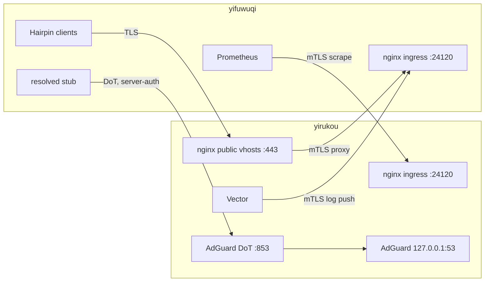
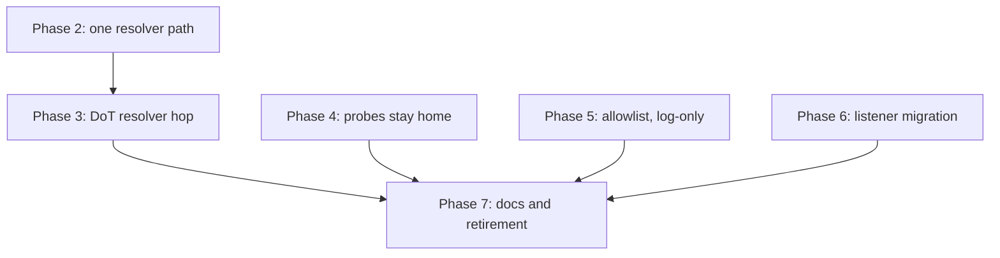

# Inter-Host Traffic Through mTLS nginx

## Status: DEPLOYED AND COMPLETE 2026-11-26 — Phases 2, 3, 4, 5 and 6b are live on `yifuwuqi`, `yirukou` and `yitaishi` with their acceptance recorded; 6a is closed as Decision 12 after the user declined the loopback bind, and every open question is resolved. Two user steps remain: deploy the `1900`/`5351` detector exemption to `yifuwuqi` and `yirukou`, then confirm over one more week that `mtls-peer` stays silent and delete this plan

## Objective

Every service flow between `yifuwuqi` and `yirukou` terminates at nginx under
TLS from the internal service CA, and that becomes a checked invariant rather
than a convention. Anything else one host originates to the other is either an
enumerated transport exception (SSH, ICMP, the tailnet's WireGuard) or shows up
in a log-only egress record. Every compliant hop is built by one of three
generators keyed on `yi.mtls.enable` (`mkRemoteVhosts`, Prometheus'
`ingressTls`, Vector's sink `tls` block), so new code reaches the peer through
those generators rather than hand-rolling a plain hop.

One hop is a named exception: the resolver. `yifuwuqi` has no resolver of its
own, and systemd-resolved cannot present a client certificate, so that hop is
server-authenticated TLS (DoT) to AdGuard's existing `:853` listener rather than
mTLS to nginx (Decision 3). The certificate still authenticates the relay; the
exception is recorded here, not inherited as an unstated gap.

The same rule, applied at the listener instead of the hop: a service port is
not an interface. Anything nginx can front binds loopback and owns no firewall
rule at all; a port that still needs one is either a non-HTTP protocol or a
named exception with a reason (Phase 6).

"Between" means traffic a process on one host opens to an address of the
other. Traffic `yirukou` merely routes — `yifuwuqi`'s WAN path, tailnet clients
on the subnet route, LAN devices — is not inter-host service traffic and is
left alone.

## Current State

### Repository-verified flows (2026-11-23, dispositions reworked 2026-11-25)

| #   | Flow                   | Path today                                                | Transport             | Status    |
| --- | ---------------------- | --------------------------------------------------------- | --------------------- | --------- |
| 1   | Application proxy      | `yirukou` nginx to `10.42.0.2:24120`                      | mTLS, subject pinned  | compliant |
| 2   | Scrapes, probe fan-out | `yifuwuqi` Prometheus to `10.42.0.1:24120`                | mTLS                  | compliant |
| 3   | Log push               | `yirukou` Vector to `10.42.0.2:24120/loki/`               | mTLS                  | compliant |
| 4   | Hairpin clients        | `yifuwuqi` to `10.42.0.1:443`, then flow 1                | TLS, then mTLS        | compliant |
| 5   | Resolver upstream      | `resolved` on `eno1` to `yirukou:853`                     | DoT (server-auth)     | 3 done    |
| 6   | Tailnet resolver       | `resolved` on `tailscale0` to MagicDNS, then `yirukou:53` | WireGuard, plain DNS  | 2 done    |
| 7   | DHCP resolver          | `resolved` on `enp4s0` to `10.42.42.1:53`                 | plain DNS             | 2 done    |
| 8   | Cross-host DNS probes  | each host to its own resolver on its LAN address          | plain DNS, host-local | 4 done    |
| 9   | Reachability probes    | blackbox ICMP and smokeping, both ways                    | ICMP                  | exception |
| 10  | Administration         | `ai-ssh`, deploy-rs, PKI push, Tailscale SSH              | SSH                   | exception |
| 11  | Tailnet transport      | `tailscaled` to `tailscaled`, UDP 41641                   | WireGuard             | exception |
| 12  | LLM inference          | `yifuwuqi` (SillyTavern) to `yitaishi:11436`              | plain HTTP on tailnet | residue   |
| 13  | Image inference        | `yirukou` to `yitaishi:11437`                             | plain HTTP on tailnet | 6b done   |

- Flows 1–3 share one ingress port per host (`services.ingress.port = 24120`)
  and are built in [proxy-vhosts.nix](../../../modules/services/proxy-vhosts.nix),
  [prometheus.nix](../../../modules/services/monitoring/prometheus.nix) and
  [promtail.nix](../../../modules/services/monitoring/promtail.nix) from the
  peer relation in [mtls.nix](../../../modules/services/mtls.nix).
- Flow 4's clients are the Nix substituter `attic.aset.love`
  ([attic/client.nix](../../../modules/services/attic/client.nix), on every
  host; on `yirukou` the first leg is local), the homepage pings
  ([homepage.nix](../../../modules/services/homepage.nix)), the GitHub runner's
  `FORGEJO_INTERNAL_URL`
  ([github-runner.nix](../../../modules/services/github-runner.nix)) and
  Pinepods' `HOSTNAME`. The Forgejo runner and the Attic pushers already use
  loopback.
- Flow 5 is the only flow that will not end at nginx. `yifuwuqi` runs no
  resolver of its own; its `eno1` link points at `yirukou`'s AdGuard DoT
  listener on `:853`, and that encrypted hop is the whole resolver path.
- Flow 6 exists because [tailscale.nix](../../../modules/services/tailscale.nix)
  defaulted `--accept-dns=true` for every routing mode, so `resolved` also
  accepted `100.69.0.1` on `tailscale0` for the same `~.` routing domain.
  `yi.tailscale.acceptDns = false` on `yifuwuqi` removes that path (Phase 2);
  every other host still accepts DNS.
- Flow 7 came from `UseDNS = true` in
  [enp4s0.nix](../../../hosts/yifuwuqi/networking/interfaces/enp4s0.nix), which
  Phase 2 set to `false`: the fallback uplink no longer adopts its router as a
  resolver. `10.42.42.1` is `yirukou`'s VLAN 42 listener, `194.242.2.2` public.
- Flow 8: `probeScrapeConfig` now keeps a host's own `dns`/`dns6` entry and
  drops every other self-probe, so each host resolves against itself
  (`probePeers` with `resolver = true` in
  [monitoring.nix](../../../modules/addresses/monitoring.nix)), v4 and v6,
  every 15 s. No DNS query crosses the pair any more.
- Flows 12 and 13 are outside the peer pair: `mtls.nix`'s `peer` throws for any
  host that is neither `yirukou` nor `yifuwuqi`, and both listeners live on
  `yitaishi`. Covering them with mTLS needs a third host leaf; Phase 6b narrows
  `11437` and records `11436` as residue.

Firewall:

- `yifuwuqi`'s `eno1` opens SSH, 53, 139/445, and the 3000/6006 dev servers to
  the whole LAN, `yirukou` included, and admits 24120 only from `10.42.0.1`
  ([firewall.nix](../../../hosts/yifuwuqi/networking/firewall.nix)). Note what
  is *not* there: no application port. Every backend binds loopback and is
  reached through the local ingress, so the shape Phase 6 generalises already
  holds on this host.
- `yirukou`'s `br0` opens 53, 80, 443, 853, 3443 and SSH to the LAN,
  `yifuwuqi` included, and admits 24120 only from `10.42.0.2`
  ([firewall.nix](../../../hosts/yirukou/networking/firewall.nix)). `853` being
  in the LAN set already is what makes the DoT hop need no firewall change.
- `yitaishi` and `yixiaoqing` both ran 11436/11437/4242 against `tailscale0`,
  but both run `yi.tailscale` in client mode, which puts `tailscale0` in
  `trustedInterfaces` — and nixpkgs' `input` chain accepts a trusted interface
  before `input-allow` is consulted. Every one of those port entries was inert:
  [services.nix](../../../hosts/yitaishi/services.nix) and
  [lan-mouse.nix](../../../modules/services/lan-mouse.nix) read as a scope and
  enforced nothing. The 11436/11437 lines are deleted (Phase 6b) and lan-mouse
  now emits its rule only where the interface is untrusted. The actual gate on
  the two AI listeners is each unit's own `IPAddressAllow`; lan-mouse has no
  gate at all and is reachable by any tailnet peer. Neither host declares a
  firewall port at all now, and `listener-exposure` fails evaluation if that
  changes silently.
- Neither host limits what it originates to the other. nixos-fw has no output
  hook; the only output-hook table today is the Forgejo runner's
  `sandbox-egress` ([forgejo-runner.nix](../../../modules/services/forgejo-runner.nix)).
- The AdGuard exporter binds every interface whatever `listenAddress` says
  ([adguard-exporter/default.nix](../../../modules/services/monitoring/adguard-exporter/default.nix)),
  so only the firewall keeps `:9617` off the LAN.

### Live-host observations (2026-11-23 12:25 -03:00)

Socket tables from `/proc/net/{tcp,tcp6,udp,udp6}` on both hosts (`yirukou`
through `ai-ssh`), plus `resolvectl` and `tailscale dns status` on `yifuwuqi`:

- `yifuwuqi` to `yirukou`: 11 established to `10.42.0.1:24120` (one per scrape
  job) and 8 in `TIME_WAIT` to `10.42.0.1:443` (hairpin HTTPS).
- Into `yifuwuqi` from `10.42.0.1`: three SSH sessions and one SMB session that
  have **no matching socket on `yirukou`**. They are tailnet clients on the
  subnet route, masqueraded to the gateway address. At `yifuwuqi`, source
  `10.42.0.1` is not an identity, so filtering the peer there by source address
  would cut tailnet SSH and SMB.
- `yirukou` to `yifuwuqi`: one established to `10.42.0.2:24120` (proxy or log
  push); 11 inbound on its own `:24120`.
- `eno1` and `tailscale0` both carry the `~.` routing domain; `enp4s0` is a
  default route with `10.42.42.1` and `194.242.2.2`. Tailscale reports MagicDNS
  disabled tailnet-wide, resolvers `100.69.0.1` then `10.42.0.1`, and no split
  DNS or search domains.
- systemd-resolved.service(8) sends a query to every link that shares the
  best-matching routing domain, in parallel, and returns the first success.
  Eight uncached lookups all answered via `eno1`, so `tailscale0` currently
  loses the race. A slower encrypted path on `eno1` widens that race, which is
  why Phase 2 removes the competing links before Phase 3 changes the transport.

### Upstream-verified premises (2026-11-25)

- **systemd-resolved has no client certificate.** It has no `tls` client-cert
  option at all, so no resolved upstream can be mutual TLS. It *can* use a
  non-default port and validate a server name (`DNS=addr:port#name`, systemd
  246+), and networkd validates `DNSOverTLS` per link.
- **AdGuard already serves DoT** on `:853` with the `aset.love` wildcard
  (`tls.port_dns_over_tls = 853`, `server_name = dns.aset.love`,
  [adguardhome.nix](../../../modules/services/adguardhome.nix)). The wildcard's
  `*.aset.love` SAN covers `dns.aset.love`, and `strict_sni_check = false` means
  no SNI is required — though resolved always sends the name, so the pin is real
  from the client side.
- **AdGuard reloads a renewed certificate on its own** since v0.107.72 (it
  watches `certificate_path` and `private_key_path`); nixpkgs pins 0.107.80.
  nixpkgs' ACME `cp -vp` rewrites `fullchain.pem` in place, so the watched inode
  sees an `IN_MODIFY`. No restart and no `reloadServices` entry are needed.
- **nginx stream cannot pin a client subject.** `if` is an
  `ngx_http_rewrite_module` directive and does not exist in `stream`; only
  `set`, `return` and `map` do. A stream listener could therefore only verify
  the chain, admitting either host's client leaf — one of the reasons the
  CoreDNS-plus-stream design this plan previously referenced is gone.

## Decisions

1. **Scope is host-originated traffic.** A flow is inter-host when a process on
   one host opens it to an address of the other. Forwarded traffic never
   crosses the output hook and is out of scope.

1. **One compliance rule, one exception.** Every inter-host service flow is TLS
   terminated by nginx on the receiving host. Peer hops (proxy, scrape, log
   push) are mutual TLS from `service-ca`. Hairpin clients reach `yirukou`'s
   public vhosts with server-authenticated TLS and continue over flow 1: those
   listeners serve browsers, so they cannot demand a client certificate, and
   both legs still end at nginx. The DNS hop (Decision 3) is the exception, and
   it is the only one.

1. **The resolver hop is DoT to AdGuard, not nginx.** `eno1` points `resolved`
   at `yirukou`'s `:853` with `DNSOverTLS = yes` and the SNI name
   `dns.aset.love`. No new daemon, no new port, no new firewall line, no second
   forwarder cache, no `service-ca` leaf. The costs are accepted and stated
   plainly: the hop is server-authenticated rather than mutual, it trusts the
   ACME wildcard rather than the internal CA, and it therefore loses the
   "nginx terminates every hop" property for exactly this one flow. What it does
   *not* change: `:53` and `:853` stay open to LAN and VLAN 42 clients, so the
   certificate is relay authentication, not admission control — AdGuard's
   `bind_hosts` and the interface firewall remain the admission rule.
   The rejected alternative is recorded so it is not re-proposed: a CoreDNS
   forwarder on `127.0.0.9` feeding an nginx stream listener on a new port
   would add a daemon, a port, a firewall line and a cache, would still be
   chain-only (second premise above), and its `forward` block silently falls
   back to plain DNS unless the upstream is spelled `tls://`.

1. **`yifuwuqi` gets exactly one resolver path.** Add `yi.tailscale.acceptDns`
   (default `true`, so no other host changes) and set it `false` on
   `yifuwuqi`; set `UseDNS = false` on `enp4s0`; set `FallbackDNS = []`. In
   normal operation nothing resolves differently: MagicDNS is off tailnet-wide
   and `.ts` names come from AdGuard rewrites. Without this, the DoT cutover is
   not fail-closed — two plaintext paths to the resolver survive it, and the
   compiled-in fallback list is a third.

1. **Probes stay on their own host.** The `dns` and `dns6` probes of `lan` peers
   target the origin host's own resolver on its LAN address, which is the path
   LAN devices use and never leaves the host. ICMP stays cross-host and keeps
   measuring the wire. `yirukou` never resolves through `yifuwuqi`, so nothing
   replaces that direction. Because `resolved` forwards over DoT, a `yifuwuqi`
   self-probe runs stub, DoT, AdGuard, Unbound — the relay hop stays under probe
   with no extra exporter, which is why the previous plan's separate
   relay-hop-probe question is gone. The count stays at 9 blackbox probes per
   host.

1. **The exceptions are closed and enumerated.** SSH (OpenSSH on 24212,
   Tailscale SSH on 22) is the recovery lane when nginx or the mTLS material is
   broken, and the channel `mtls-pki-generate` delivers certificates over, so it
   must depend on neither. ICMP and ICMPv6 carry no service. WireGuard on the
   Tailscale port is transport. Anything else needs an amendment to this
   decision.

1. **Detection is log-only, permanently.** Each host's output hook records new
   connections to any peer address outside an allowlist derived once from the
   registry in `mtls.nix`, and never rejects. Rejection is not worth its cost
   here: admission is already enforced three times over (peer certificates, the
   per-location nginx allowlists, the per-interface firewall), the output hook
   cannot tell a tailnet client's forwarded traffic from the host's own, and a
   reject verdict turns a missing allowlist entry into an outage at 03:00
   instead of a line in `journalctl`. The output hook only sees locally
   generated packets, so routed tailnet and WAN traffic is untouched. The
   allowlist is still registry-derived and still contract-pinned, so drift fails
   `nix flake check` rather than waiting for someone to read the log. No
   `yirukou`-side mirror: it would re-log the same packets from the receiving
   end, keyed on a source address this plan itself calls not an identity.

1. **`peer` is a two-host relation, not a registry utility.** `mtls.nix` throws
   for any host outside the pair, so the port derivation and the log-only table
   may only be imported by `yirukou` and `yifuwuqi`. Adding a third host means
   generalising `peer` into a set first; a module that imports `mtls.nix` on
   another host fails evaluation by design.

1. **Contracts guard hand-written config, not generated config.** Every
   compliant hop comes out of one of three generators keyed on
   `yi.mtls.enable`, and no hand-written `yirukou` vhost dials a peer address,
   so a contract over those hops could only restate the generators. The
   settings worth pinning are the ones typed per host: Phase 2's three resolver
   settings and Phase 5's nftables allowlist.

1. **Fronting a listener is not a way to comply.** A service moved behind
   nginx for the sake of a rule is a listener migration, judged by whether the
   app can bind loopback, not a transport change. It is in scope only where
   the app is HTTP and the client can send `Host`; the disposition table above
   is exhaustive, and adding a row needs an amendment here.

1. **A service port is not an interface.** Every backend nginx can front binds
   loopback, and the firewall rule for its port is deleted rather than
   narrowed. `yifuwuqi` already obeys this — its `eno1` admits no application
   port, only the ingress from the gateway. `3000`/`6006` are the one recorded
   exception (Decision 12). Anything that keeps a rule is a non-HTTP protocol
   (DNS, DoT, DoH on the DDR port, SMB, lan-mouse, WireGuard), one of Decision
   6's exceptions, or Decision 12's dev servers, and the `listener-exposure`
   contract names it.

1. **`3000`/`6006` stay, by decision.** The `workd` dev servers will not move to
   loopback, so this is the amendment Decision 11 asks for: both ports keep
   their `eno1` rule and are named in the `listener-exposure` exception table
   with that reason. They are HTTP and could become vhosts, which is exactly why
   the exception is written down rather than folded into Decision 11's
   "non-HTTP protocol" list. Removing them later is a one-line firewall edit
   plus two table rows, and the contract fails evaluation if either half is
   done alone.

Peer address sets come from the registry: for `yirukou` its LAN v4 and v6, VLAN
42 v4 and v6, and tailnet v4; for `yifuwuqi` its LAN v4 and v6 and tailnet v4
and v6. The sinkhole addresses and the WAN leases carry no service and are
left out.

Allowlist, for new connections only (established and related traffic always
passes, and nothing is rejected):

| Direction               | TCP                                                  | UDP   | Other        |
| ----------------------- | ---------------------------------------------------- | ----- | ------------ |
| `yifuwuqi` to `yirukou` | 24120 ingress, 853 DoT, 443 public vhosts, 24212, 22 | 41641 | ICMP, ICMPv6 |
| `yirukou` to `yifuwuqi` | 24120 ingress, 24212, 22                             | 41641 | ICMP, ICMPv6 |

`853` is the DoT hop of Decision 3. `41641` is UDP only: peer traffic is
WireGuard, and Tailscale's failure path is DERP over `443` to the internet, never
a TCP connection to the peer. Anything that appears on `41641/tcp` between the
hosts is a finding, and the log will show it.

### Listener disposition

Decision 10 rules out fronting a listener as a way to satisfy it; Decision 11
says which listeners stop being ports at all. Every port open on any host
today, and what happens to it:

| Port(s)            | Host                     | Protocol    | Disposition                                                                                        |
| ------------------ | ------------------------ | ----------- | -------------------------------------------------------------------------------------------------- |
| 3000, 6006         | `yifuwuqi`               | HTTP        | keep: `workd` declines to bind loopback — an amendment to Decision 11                              |
| 11436              | `yitaishi`               | HTTP        | residue: `llama-server` fetches models, so no address filter; tailnet-wide                         |
| 11437              | `yitaishi`               | HTTP        | **Narrowed** (6b): binds the tailnet address, `IPAddressAllow` = `yirukou`                         |
| 53                 | `yirukou`                | DNS         | keep: resolver for LAN, VLAN 42 and tailnet                                                        |
| 853                | `yirukou`                | DoT / DoQ   | keep: DDR advertises it, and it is the DoT hop                                                     |
| 3443               | `yirukou`                | DoH         | keep: DDR advertises this exact port                                                               |
| 80, 443            | `yirukou`                | HTTP        | keep: the gate itself, and the hairpin clients                                                     |
| 24212              | all                      | SSH         | exception: the recovery lane (Decision 6)                                                          |
| 139, 445, 137, 138 | `yifuwuqi`               | SMB/NetBIOS | keep: no HTTP shape, and the clients are not nginx                                                 |
| 4242               | `yitaishi`, `yixiaoqing` | lan-mouse   | keep: a game-input protocol, not a service; the module emits no rule while `tailscale0` is trusted |
| 51820, 41641       | all                      | WireGuard   | exception: transport (Decision 6)                                                                  |

Two entries deserve their reasons, because both look like candidates:

- **`3443` cannot fold into `443`.** AdGuard's DDR answer is built from the
  listener's own port (`makeDDRResponse` emits an `SVCBPort` per
  `HTTPSListenAddrs` entry, `internal/dnsforward/process.go:212-220`), and
  `tls.port_https = 3443` is what resolvers are told to use. Serving DoH on
  `443` under the same name would mean advertising nginx — which terminates
  TLS and could proxy `/dns-query` to AdGuard, since that vhost already
  exists — so the migration is really "point DDR at nginx", a DNS change with
  its own rollout, not a firewall edit.
- **`11436`/`11437` are not inter-host in the sense of this plan.** They are
  tailnet-only listeners on `yitaishi`, a host outside the peer pair, so
  `mtls.nix`'s two-host `peer` throws there. Fronting them with nginx on
  `yitaishi` costs a third leaf plus a third nginx instance; narrowing each
  listener to its single client is the smaller change that achieves the same
  thing. Only `11437` can actually be narrowed that way — `11436` is consumed
  by `llama-server`, whose unit cannot take an address filter because it dials
  out to fetch model weights (Phase 6b).

## Architecture

Target state; SSH, ICMP and WireGuard are omitted.



## Phases & Implementation Details

### Phase 2: One resolver path on `yifuwuqi`

No transport change yet; this phase only removes the competing paths, so the
DoT cutover in Phase 3 cannot be silently bypassed.

- [x] (AI) [tailscale.nix](../../../modules/services/tailscale.nix): a `bool`
  option `acceptDns` (default `true`, so no other host changes), rendered as
  `--accept-dns=${lib.boolToString cfg.acceptDns}` in both `baseFlags` branches.
- [x] (AI) [tailscale.nix](../../../modules/services/tailscale.nix):
  `tailscaled-set.restartTriggers` keyed on a `writeText` of `runtimeFlags`.
  **Found by QA after the first deploy, and it invalidated Phase 2 as written.**
  nixpkgs declares `tailscaled-set` as a oneshot `wantedBy tailscaled.service`, so it runs only when the daemon starts. A switch that
  leaves `tailscaled` running never re-applies `extraSetFlags`: the live daemon
  kept `--accept-dns=true` from 2026-11-25, `resolved` still received
  `100.100.100.100` and `fd7a:115c:a1e0::53` on `tailscale0`, and
  `/run/systemd/resolve/resolv.conf` still listed both. Two symptoms, one
  cause: the MagicDNS link survived, and `tailscaled`'s own DNS forwarder kept
  sending plaintext `:53` to both `yirukou` addresses (measured at ~2.6
  queries/s, evenly split between `10.42.0.1` and `100.69.0.1`, which is a
  forwarder with two upstreams, not an application). The trigger makes any flag
  change re-run the oneshot — a `tailscale set`, not a daemon restart.
- [x] (AI) [hosts/yifuwuqi/services.nix](../../../hosts/yifuwuqi/services.nix):
  `yi.tailscale.acceptDns = false`, with the reason.
- [x] (AI) [enp4s0.nix](../../../hosts/yifuwuqi/networking/interfaces/enp4s0.nix):
  `UseDNS = false`.
- [x] (AI) [hosts/yifuwuqi/networking.nix](../../../hosts/yifuwuqi/networking.nix):
  `services.resolved.settings.Resolve.FallbackDNS = [ ]`, which renders
  `FallbackDNS=` and clears the compiled-in public list. Losing `eno1` then
  leaves no resolver at all — but a lost `eno1` also takes out every LAN-facing
  service on this host, so the honest failure is the visible one, and deploy,
  `ai-ssh` and the generated SSH config all use literal addresses and keep
  working.
- [x] (AI) Contract `resolver-path` in [checks.nix](../../../nix/checks.nix):
  no DHCP-backed link on `yifuwuqi` sets `dhcpV4Config.UseDNS = true`,
  `yi.tailscale.acceptDns` is `false`, and `FallbackDNS` is empty. These three
  are typed per host rather than generated, so they are the settings a contract
  can actually protect.

Verified 2026-11-26: `extraSetFlags` on `yifuwuqi` is
`--accept-dns=false --advertise-routes=192.168.0.1/32 --advertise-exit-node=false --ssh`
and every other host still renders `--accept-dns=true`; `35-enp4s0` shows
`dhcp=ipv4, useDns=false`; `FallbackDNS` evaluates to `[ ]`;
`contract resolver-path passed for yifuwuqi`. Mutation-tested: flipping
`acceptDns`, restoring `FallbackDNS`, setting `UseDNS = true`, and adding a new
DHCP link that accepts lease DNS each throw; unmodified input does not.

- [x] (User) Deployed 2026-11-26. The manual `systemctl start tailscaled-set`
  step this item used to prescribe is gone: `restartTriggers` now re-runs the
  oneshot on any flag change, which is what the first deploy showed was
  missing.

**QA after deploy (2026-11-26 08:46–08:50, `ai-ssh`).** What held: the live
`30-eno1.network` carries both `:853#dns.aset.love` upstreams with
`DNSOverTLS=yes`; `35-enp4s0.network` has `UseDNS=false`; `resolved.conf` has a
bare `FallbackDNS=`; `/etc/resolv.conf` resolves to the stub, whose only
upstreams are the two DoT servers; one established TCP socket to `:853` exists
in `/proc/net/tcp6`, and `systemd-resolved` logged no errors after its 08:45:58
reload. What failed: `tailscaled` had `ActiveEnterTimestamp` from 2026-11-25
with `NRestarts=0` and `tailscaled-set` was `inactive` with no timestamp, so
the daemon still held `--accept-dns=true` — the MagicDNS link and the
plaintext `:53` forwarder above. The fix that actually worked was
`RemainAfterExit = true`, not the `restartTriggers` entry this item originally
proposed — `switch-to-configuration` only walks active units, so a finished
oneshot is invisible to it either way.

- [x] (User) Deploy `yifuwuqi` again and confirm the trigger fired. Done
  2026-11-26 09:09:06: `tailscaled-set` reports `ActiveState=active`,
  `SubState=exited`, `Result=success`, and the running unit carries
  `RemainAfterExit=true`.

**Phase 2 acceptance, run 2026-11-26 09:13 on `yifuwuqi`.** All items pass:

- `resolvectl dns` lists servers on `eno1` only — `fd75:c55f:6d19:1::1#dns.aset.love`
  and `10.42.0.1#dns.aset.love`; every other link, `tailscale0` and `enp4s0`
  included, is empty.
- `resolvectl domain` shows `~.` on `eno1` and nowhere else.
- `/run/systemd/resolve/resolv.conf` lists exactly those two nameservers, with
  no `100.100.100.100` and no `fd7a:115c:a1e0::53`.
- `resolvectl query --cache=no example.org` answers "via local or encrypted
  transport: yes" over `link: eno1`; `resolvectl query yirukou.ts` answers
  `100.69.0.1` from the AdGuard rewrite.
- Plaintext DNS to a peer stopped with the fix: `journalctl -k --grep mtls-peer`
  matched `DPT=53` **0 times** in the 5 minutes after 09:09:06, down from
  177–245 per minute before it. The `restartTriggers` entry was not what fixed
  it; `RemainAfterExit = true` was, because the first deploy left the oneshot
  `inactive (dead)` where `switch-to-configuration` never looked. The plan's
  trigger item was written from that wrong hypothesis and is superseded.
- What `mtls-peer` still logs is NAT-PMP (`5351`, 90 hits/10 min) and SSDP
  (`1900`, 20 hits/10 min) to `yirukou` — the plan's open question about
  link-local chatter, now with evidence attached.

### Phase 3: Resolver hop over DoT

Implemented 2026-11-26 in
[eno1.nix](../../../hosts/yifuwuqi/networking/interfaces/eno1.nix), which now
takes `addresses`, `allAddresses` and `lib`:

```nix
dotName = "dns.${allAddresses.baseDomain}";
dotUpstream = addr: "${if lib.hasInfix ":" addr then "[${addr}]" else addr}:853#${dotName}";
...
DNS = map dotUpstream addresses.dns.lanUpstreams;
DNSOverTLS = "yes";
```

The name is the point: without the `#dns.aset.love` suffix `resolved` would
have no name to validate against, and `DNSOverTLS = "yes"` would then be
encryption without authentication. `addresses.dns.lanUpstreams` is
`[ <yirukou LAN v6> <yirukou LAN v4> ]`, so both families go over TLS to the
same AdGuard listener; the IPv6 entry is bracketed because
`systemd.network(5)` requires it when a port follows.

Nothing else changes: the stub listeners, `DNSStubListenerExtra`, the container
DNAT to `10.42.0.2:53`, and `:53`/`:853` for LAN and VLAN 42 clients all stay.
There is no firewall edit — `853` is already in `yirukou`'s LAN port set.

Two costs stand. `resolved` runs with `Cache = "no"`
([common.nix](../../../modules/common.nix)), so every lookup that misses
AdGuard's 64 MiB cache crosses a TLS connection; `resolved` keeps upstream
connections open rather than handshaking per query, so this is a
connection-reuse question rather than a per-query handshake. And the container
path is unchanged but no longer local: containers DNAT to `10.42.0.2:53` (this
host's stub), which now forwards over the LAN to `10.42.0.1:853` instead of
`:53`.

- [x] (AI) Contract: `resolver-path` in [checks.nix](../../../nix/checks.nix)
  grew the two clauses this phase needs — every link that carries `DNS=` sets
  `DNSOverTLS = "yes"`, and no `DNS=` entry lacks a `#server-name`. It does
  **not** assert "no `DNS=` names a peer address without the suffix", because
  matching upstreams against the peer address set would re-derive the registry;
  the `#name` clause already makes an unnamed peer upstream impossible.

Verified 2026-11-26: `30-eno1` renders
`DNS = ["[fd75:c55f:6d19:1::1]:853#dns.aset.love", "10.42.0.1:853#dns.aset.love"]`
with `DNSOverTLS = "yes"`, `FallbackDNS = []` and `acceptDns = false`
unchanged, and the `yifuwuqi` toplevel builds. Mutation-tested against a
transcribed copy of the predicate: `DNSOverTLS = "no"`, the key absent,
an upstream with no `#name`, a second plaintext link, a DHCP link accepting
lease DNS, `acceptDns = true` and a non-empty `FallbackDNS` each throw; a config
satisfying every clause does not.

- [x] (User) Deployed `yifuwuqi` 2026-11-26 08:45, after Phase 2. Revert is one
  line: restore `DNS = addresses.dns.lanUpstreams` and drop `DNSOverTLS`.

**Phase 3 acceptance, run 2026-11-26 09:14 on `yifuwuqi`.** All items that need
only the host pass:

- `resolvectl status eno1` shows `DNS Servers: fd75:c55f:6d19:1::1#dns.aset.love 10.42.0.1#dns.aset.love`, `DNS Domain: ~.`, and `+DNSOverTLS` in the
  protocols line with `Current DNS Server` set to the v6 upstream.
- `resolvectl query --cache=no example.org` answers, and `ss -tnp` shows one
  established socket `[fd75:c55f:6d19:1::2]:40856 → [fd75:c55f:6d19:1::1]:853`.
- `openssl s_client -connect 10.42.0.1:853 -servername dns.aset.love -brief`
  reports `CONNECTION ESTABLISHED`, `TLSv1.3`, `Peer certificate: CN=*.aset.love`,
  `Verification: OK`, `notAfter=Feb 24 06:49:29 2027 GMT`, SAN
  `DNS:*.aset.love, DNS:aset.love`.
- `dig +tls +tls-ca -p 853 @10.42.0.1 example.org +tls-hostname=dns.aset.love`
  answers `NOERROR` with `flags: qr rd ra ad` — DNSSEC validated end to end.
  The wrong-name control had to use `wrong.example.com`: **the plan's
  `wrong.aset.love` test cannot fail**, because the ACME wildcard legitimately
  covers it. With a name outside the wildcard, `dig` reports `TLS peer certificate verification for 10.42.0.1#853 failed: hostname mismatch` and
  `openssl ... -verify_hostname wrong.example.com` returns
  `Verify return code: 62 (hostname mismatch)`. The pin is real; the test as
  written was not.

### Phase 4: Probes stay on their own host

Implemented 2026-11-26 in `probeScrapeConfig`
([prometheus.nix](../../../modules/services/monitoring/prometheus.nix)). The
predicate is named for readability; the semantics are the spec's:

```nix
selfProbeable = probe: probe.scope == "lan" && lib.hasPrefix "dns" probe.layer;
...
lib.filter (probe: if selfProbeable probe then probe.peer == host else probe.peer != host) monitoring.probes
```

So each host probes **only itself** for `dns`/`dns6` and **only the peer** for
every other layer. The cross-host DNS probe was dropped: `yirukou` never
resolves through `yifuwuqi`, and the `mtls-peer` allowlist carries no TCP 53,
so that probe measured a path nobody takes while logging once per scrape.

- [x] (AI) Rewrite the `yifuwuqi` entry's comment in
  [monitoring.nix](../../../modules/addresses/monitoring.nix), which still
  describes an AdGuard and Unbound chain the host no longer runs.
- [x] (AI) Rewrite the "A host never probes its own peer entry" paragraph in
  [monitoring.md](../services/monitoring.md): the rule now applies to ICMP and
  smokeping only, because the `dns`/`dns6` self-probe is what keeps the DoT hop
  under test. The per-host totals stay 9 blackbox probes and 5 smokeping
  targets.
- [x] (AI) Contract: no `dns` or `dns6` probe target is a peer address —
  **not written**, by decision. That predicate is the inverse of the filter
  that produces the targets, so it would restate a generator; the runtime
  evidence (four series, `peer == host`, all `1`) is what pins it instead.

Verified 2026-11-26: the `probe` job renders 9 entries per origin host, of which
4 are `dns`/`dns6` self-probes — `yifuwuqi` keeps `dns 10.42.0.2:53` and
`dns6 [fd75:c55f:6d19:1::2]:53` with `peer = host`, `yirukou` likewise for
`10.42.0.1` — while ICMP, HTTP and smokeping cross hosts only. Layer totals:
`icmp` 8, `icmp6` 2, `dns` 4, `dns6` 2, `http` 2, plus 5 smokeping targets per
host.

- [x] (User) Deployed 2026-11-26 08:45. The job renders as designed, and the
  `DPT=53` traffic that masked it was `tailscaled`'s forwarder (Phase 2), not a
  probe. That is now confirmed rather than assumed: `DPT=53` went to zero when
  the Phase 2 fix landed, while the four dns self-probes kept returning `1`.

Acceptance, run 2026-11-26 09:16 against Prometheus' own API on `yifuwuqi`
(`127.0.0.1:24090`, no Grafana session needed): `probe_success{layer=~"dns6?", scope="lan"}` returns exactly four series — `(yifuwuqi, yifuwuqi, dns, 1)`,
`(yifuwuqi, yifuwuqi, dns6, 1)`, `(yirukou, yirukou, dns, 1)` and
`(yirukou, yirukou, dns6, 1)` — each with `peer` equal to `host`, all `1`. The
self-probe crosses stub, DoT, AdGuard and Unbound. `count by (host) (probe_success)` returns 9 for each host, and the per-layer split is `icmp` 4,
`icmp6` 1, `dns` 2, `dns6` 1, `http` 1 per host. The Internet dashboard's LAN
DNS panels still render, because they select on `layer` and `scope`, not on
`peer`.

Post-Phase-2 confirmation of the gate's premise: after 09:09:06 there is not a
single `DPT=53` line in `mtls-peer`, so any future one is a real finding rather
than `tailscaled`'s forwarder.

### Phase 5: Peer allowlist, log-only

Implemented 2026-11-26. [mtls.nix](../../../modules/services/mtls.nix) gained
`peerPorts` and `peerAddressesByFamily`, both keyed on the registry, and a
`mtls-peer` nftables table. Three deviations from the text below, each forced:

- **The `content` is a bare chain set.** NixOS wraps
  `networking.nftables.tables.<name>.content` in
  `table <family> <name> { ... }` already, so the plan's nested
  `table inet mtls-peer { ... }` would have been a parse error.
- **Two address lines, not one.** `ip daddr` cannot hold IPv6 literals, so the
  output chain emits an `ip daddr` set of the peer's v4 addresses and an
  `ip6 daddr` set of its v6 addresses.
- **The port list is generated, not retyped.** `peerPorts` derives ingress,
  SSH and 22 from the registry and adds 853/443 only for `yirukou`, so the
  allowlist cannot drift from the ports the fleet actually serves.

The contract the plan asks for here is **not written**, deliberately: like the
deleted `peer-mtls` contract it would compare a generated table against the
derivation that generates it. What pins the table instead is the build —
`networking.nftables.checkRuleset` defaults to `true`, so `nft --check` runs on
the rendered ruleset as part of every `yifuwuqi`/`yirukou` build, which a
malformed table fails.

Verified 2026-11-26: the built `nftables-rules` script for `yifuwuqi` contains
`ip daddr { 10.42.0.1, 100.69.0.1 }`, `ip6 daddr { fd75:c55f:6d19:1::1 }`,
`tcp dport { 24120, 24212, 22, 853, 443 }` and `udp dport { 41641 }`, and it
passed `nft --check`. Both toplevels build.

- [x] (AI) [adguard-exporter/default.nix](../../../modules/services/monitoring/adguard-exporter/default.nix):
  `IPAddressDeny = "any"` with `IPAddressAllow = "localhost"`, because the
  binary ignores `listenAddress` and binds every interface.

**Phase 5 QA, sampled 2026-11-26 09:04–09:14 and again after the 09:26 switch
(`ai-ssh`, then the host itself).** The table is live on `yifuwuqi` and behaving
as designed. Ten minutes of `journalctl -k --grep mtls-peer` gave exactly three
destinations by port: UDP `53` (877 hits, all from before 09:09:06 and zero
after it — Phase 2's forwarder, not a flow), UDP `5351` (90 hits, NAT-PMP) and
UDP `1900` (20 hits, SSDP). No TCP hits at all. After the switch the rates are
`5351` ~10/min and `1900` ~2.5/min, with `DPT=53` still at **0**. The two
survivors are the link-local chatter the open questions below already name, and
neither is a service hop. The table also survived the redeploy:
`/run/current-system/etc/systemd/system/nftables.service` still starts the
`nftables-rules` script that defines `table inet mtls-peer`, and logging
continued across the switch.

**Phase 5 window, 2026-11-26 11:46 UTC onward.** The plan's `journalctl` read
cannot be done as written: journald here is capped at `SystemMaxUse = 800M` and
already sits at 810M, so it holds about **two days**, not the week the gate
assumes. Loki is the lane that actually spans it — Vector ships every journal
entry, retention is `168h`, and the kernel stream is searchable. Both probes
below were run against Loki's HTTP API on `yifuwuqi`.

The retained window opens 2026-11-19, i.e. after the table was deployed, so the
whole of it was measured with `mtls-peer` installed. Inventory over the three
days ending 2026-11-26 12:35 UTC, which covers one Monday:

| Host       | Proto/port | Count | Window (UTC)        |
| ---------- | ---------- | ----- | ------------------- |
| `yifuwuqi` | UDP/53     | 3140  | 11-26 11:45 → 12:09 |
| `yifuwuqi` | UDP/5351   | 468   | 11-26 11:46 → 12:35 |
| `yifuwuqi` | UDP/1900   | 111   | 11-26 11:46 → 12:35 |
| `yirukou`  | UDP/53     | 28    | 11-26 11:42 → 11:45 |

No TCP flows at all in either direction. The `UDP/53` rows are the
`tailscaled` forwarder of Phase 2, bound to the few minutes before the 09:09
fix; after it the count is zero. What survives is NAT-PMP (`5351`) and SSDP
(`1900`), identified as unanswered UPnP IGD discovery and silenced in the chain
rather than allowlisted as a hop — see the closed open question below.

- [x] (AI) Close the window on the known traffic. The three-day inventory above
  showed exactly three ports and no TCP; the two survivors were diagnosed as
  UPnP gateway discovery and are now `return`ed in `mtls-peer` with the reason
  written into the rule.

- [ ] (User) Deploy `yifuwuqi` and `yirukou`, then confirm over one week that
  `mtls-peer` stays silent now that `1900`/`5351` are exempted, using Loki
  rather than journald:

```sh
curl -sG http://127.0.0.1:24100/loki/api/v1/query_range \
  --data-urlencode 'query={unit="kernel"} |= "mtls-peer"' \
  --data-urlencode "start=$(date -u -d '-7 days' +%s)000000000" \
  --data-urlencode "end=$(date -u +%s)000000000" \
  --data-urlencode 'limit=5000' \
  | jq -r '.data.result[].values[][1]' | sed -n 's/.*PROTO=\([A-Z]*\).*DPT=\([0-9]*\) .*/\1 \2/p' \
  | sort | uniq -c | sort -rn
```

Each new port is either moved behind nginx at its source or added to
Decision 6; nothing is allowlisted silently. After the window the table stays:
it is the standing detector for a new unlisted flow. `limit` is capped at 5000
by Loki's `max_entries_limit_per_query`, so page by time rather than raising it.

### Phase 6: Listener migration (no rule where nginx can front)

Independent of Phases 2–5; it needs neither the allowlist nor the DNS cutover.
The unit of work is one listener, and each completes on its own.

**6a — `3000` and `6006` on `yifuwuqi`: closed as an exception.** Two
dev-server ports opened to the whole LAN for a user (`workd`) whose servers
declare no port in this repo. Both are HTTP and could be fronted — registry
entry, vhost, `127.0.0.1` bind, firewall line deleted — but the bind is a
per-user choice this repo cannot declare, and on 2026-11-26 the user declined
it. So Decision 12 records the amendment Decision 11 asks for: the two lines in
[firewall.nix](../../../hosts/yifuwuqi/networking/firewall.nix) stay, and the
`listener-exposure` table names both with that reason.

- [x] (User) Decision taken 2026-11-26: the dev servers keep their ports; no
  vhost, no registry entry, no loopback bind.
- [x] (AI) Decision 12 written and the disposition table row reworded; the
  contract's exception rows already carried `3000`/`6006`. Nothing in the
  config changed, which is the point of recording it.

If the servers bind loopback later, the change is mechanical: drop the two
lines from `firewall.nix`, drop the two contract rows, add the registry entry
and the vhost. The contract fails if only half is done.

**6b — `11436`/`11437` on `yitaishi`.** Not a fronting migration, and not a
firewall edit either: the firewall is not the gate.

`yitaishi` runs `yi.tailscale` in client mode, which puts `tailscale0` in
`networking.firewall.trustedInterfaces`, and nixpkgs' `input` chain accepts a
trusted interface before `input-allow` is ever consulted. The
`allowedTCPPorts` entries in
[yitaishi/services.nix](../../../hosts/yitaishi/services.nix) are therefore
inert — they read as a scope and enforce nothing. The real gate is each unit's
own `IPAddressAllow`.

- [x] (AI) [sd-cpp.nix](../../../modules/services/ai/sd-cpp.nix): the unit's
  `IPAddressAllow` was `[ "localhost" "100.64.0.0/10" ]` — every tailnet peer.
  It is now `localhost` plus `cfg.allowedClients` plus the bind address itself,
  and `listenAddress` moved from `"0.0.0.0"` to the tailnet address, so the LAN
  side stops answering. Egress is safe: `sd-cpp-fetch` downloads the weights in
  its own unit, which has no address filter.
  Two things the plan did not anticipate. First, the host-specific client list
  is an option (`allowedClients`) rather than a hardcoded `yirukou`, because
  this module is shared and the client set is host policy. Second, and more
  sharply, `postStart` probed `127.0.0.1`: once `listenAddress` stops being a
  wildcard there is no loopback listener, so that loop would have spun until
  `TimeoutStartSec = 15min` and then failed the start. It now probes the bound
  address, and the bind address joins `IPAddressAllow` because the filter
  matches destinations on egress and would otherwise block the unit's own
  readiness probe.
- [x] (AI) [yitaishi/services.nix](../../../hosts/yitaishi/services.nix): the
  two inert `allowedTCPPorts` entries (`11436`, `11437`) are deleted. Leaving
  config that reads as a rule while `trustedInterfaces` short-circuits the
  whole chain is worse than no rule.
- [x] (AI) [lan-mouse.nix](../../../modules/services/lan-mouse.nix): its
  `4242` rule on `tailscale0` was the same defect, one module further out — both
  lan-mouse hosts run client mode, so `tailscale0` is trusted and the list
  enforced nothing. The rule is now emitted only when the interface is *not*
  trusted, which keeps it correct for a future server-mode host instead of
  deleting a line that would become load-bearing there. Found by the
  `listener-exposure` contract below, not by reading.
- [x] (AI) [llama-cpp.nix](../../../modules/services/ai/llama-cpp.nix) is
  deliberately untouched: `llama-server` dials HuggingFace when it loads a
  preset model, so an address filter on that unit would break the fetch, and an
  `11436` narrowing would need a third nginx leaf on `yitaishi`. `11436` stays
  reachable from the tailnet as recorded residue.

Verified 2026-11-26: `sd-cpp.service` renders
`--listen-ip 100.69.0.4 --listen-port 11437` with
`IPAddressAllow = ["localhost" "100.69.0.1" "100.69.0.4"]` and
`IPAddressDeny = "any"`, and `postStart` curls `http://100.69.0.4:11437/v1/models`.
Neither `yitaishi` nor `yixiaoqing` declares a firewall port at all now;
`llama-cpp` unchanged.

- [x] (User) Deployed `yitaishi` 2026-11-26 ~09:26. `yixiaoqing` was skipped
  deliberately (it carries only the `lan-mouse.nix` change and will pick it up
  on its next switch), so the `4242` rule remains there until then — inert
  either way, since its `tailscale0` is trusted.

**6b acceptance after deploy, run 2026-11-26 09:29 (`ai-ssh`).** Verified live:
`sd-cpp` is `active` with `Result=success`, `ExecMainStartTimestamp` unchanged
from the 08:44 start, `IPAddressAllow=127.0.0.0/8 100.69.0.1/32 ::1/128 100.69.0.4/32`, `IPAddressDeny=0.0.0.0/0 ::/0`. On `yitaishi` the
`firewall-start` script contains no `4242` at all, and there is no `nftables`
unit because that host runs the plain `firewall.service`. Not run: image
generation through `sd-cpp.aset.love`, the third-tailnet-host negative probe,
and the `11436` residue check — all three need a client outside the mesh.

**Contract: `listener-exposure`.** Written 2026-11-26 in
[checks.nix](../../../nix/checks.nix). Every port a host declares in
`networking.firewall.interfaces` must appear in a closed exception table with a
reason, and every exception must still match a declared port — so a new rule
fails evaluation until someone records why it cannot become a vhost, and a
removed rule fails until its row is deleted. It also fails any host whose
`trustedInterfaces` carry a port list, because nixpkgs' `input` chain accepts the
whole interface before `input-allow` is consulted.

Two deviations from the text above, both deliberate:

- **It does not consult `proxyPass`.** The plan asked for "consumed by an nginx
  `proxyPass` somewhere in the fleet (so the rule is redundant)", but no such
  rule exists today — every fronted backend binds loopback or the LAN address,
  and `yifuwuqi`'s `eno1` admits no application port at all. A check for that
  would pass vacuously and imply coverage it does not have. The closed table is
  the honest form: it records the disposition of each port rather than
  inferring one.
- **`extraInputRules` is not parsed.** It is free-form nftables text; matching
  ports inside it would need a parser, and the rules there are keyed on source
  addresses (`yirukou` gateway, cloudflared, container subnets) rather than
  opening a service port.

Mutation-tested 2026-11-26: a declared port missing from the table, an exception
row with no matching port, a port list on trusted `tailscale0`, and dropping
`3000` while it is still declared each throw; the unmodified tree evaluates. The
contract found one real defect on its first run — `lan-mouse.nix` declaring
`4242` on a trusted `tailscale0`, now gated on the interface not being trusted.

With 6a closed as an exception, the acceptance that remains is 6b's, and it is
user-side: `systemctl show -p IPAddressAllow` on `sd-cpp.service` shows only
loopback plus `yirukou`, and from a third tailnet host
`curl http://<yitaishi ts>:11437/v1/models` fails; a SillyTavern chat and one
`sd-cpp.aset.love` generation still work. `11436` stays reachable from the
tailnet and that is recorded as a known residue, not a passing check.

**6b QA after deploy (2026-11-26 08:44, `ai-ssh`).** Verified live:
`sd-cpp.service` `ExecStart` carries `--listen-ip 100.69.0.4`, and the running
unit reports `IPAddressAllow=127.0.0.0/8 100.69.0.1/32 ::1/128 100.69.0.4/32`
with `IPAddressDeny=0.0.0.0/0 ::/0`. The bind address is present so the unit's
own `postStart` probe can reach it; `100.69.0.1` is `yirukou`. The two
`yitaishi` firewall port entries are gone (only `4242` remains, from
lan-mouse). Not run: the third-tailnet-host negative probe and the image
generation, both of which need a client outside the mesh I can reach.

### Phase 7: Docs and retirement

- [x] (AI) [dns-and-proxy.md](../services/dns-and-proxy.md): §1 now draws one
  pipeline — `yirukou` runs AdGuard and Unbound, `yifuwuqi` runs only the
  `systemd-resolved` stub and forwards over DoT — and the stale "both hosts run
  identical, synchronized DNS modules" paragraph is gone. §2.3 gained the
  resolver exception and the log-only egress allowlist.
- [x] (AI) [hosts/yifuwuqi.md](../hosts/yifuwuqi.md): the interface table,
  the per-interface DNS paragraph and the secondary-stub bullet now describe
  DoT on `eno1`, `UseDNS = false` on `enp4s0`, `acceptDns = false` on
  `tailscale0` and an empty `FallbackDNS`.
- [x] (AI) [sysctl-firewall.md](../networking/sysctl-firewall.md): a
  [Inter-Host Egress Allowlist](#inter-host-egress-allowlist) section covers
  the `mtls-peer` table, the generated port set and what log-only means. The
  `yifuwuqi Firewall` section also stopped claiming AdGuard listens there.
- [x] (AI) [architecture-rollout-plan.md](architecture-rollout-plan.md): the
  DNS lane and its checklist item are updated for the deployed state.
- [ ] (User) Retire this plan: with 6a closed as Decision 12, the only remaining
  gate is the Phase 5 week above. When it is clean, delete this file, drop it
  from `SUMMARY.md`, and drop the inter-host mTLS lane from
  [architecture-rollout-plan.md](architecture-rollout-plan.md).

## Files & LOC Budget

About +175 Nix lines, net of the listener migrations.

| File                                                                                              | Change                                        |
| ------------------------------------------------------------------------------------------------- | --------------------------------------------- |
| [checks.nix](../../../nix/checks.nix)                                                             | +2: `resolver-path`; +55: `listener-exposure` |
| [mtls.nix](../../../modules/services/mtls.nix)                                                    | +35: port derivation, `mtls-peer` table       |
| [tailscale.nix](../../../modules/services/tailscale.nix)                                          | +10: `acceptDns`                              |
| [eno1.nix](../../../hosts/yifuwuqi/networking/interfaces/eno1.nix)                                | +6/-1: DoT upstreams, `DNSOverTLS`            |
| [enp4s0.nix](../../../hosts/yifuwuqi/networking/interfaces/enp4s0.nix)                            | +1/-1: `UseDNS = false`                       |
| [hosts/yifuwuqi/networking.nix](../../../hosts/yifuwuqi/networking.nix)                           | +1: empty `FallbackDNS`                       |
| [hosts/yifuwuqi/services.nix](../../../hosts/yifuwuqi/services.nix)                               | +1: `acceptDns = false`                       |
| [prometheus.nix](../../../modules/services/monitoring/prometheus.nix)                             | +7/-1: probe filter                           |
| [adguard-exporter/default.nix](../../../modules/services/monitoring/adguard-exporter/default.nix) | +2: loopback-only IP filter                   |
| [monitoring.nix](../../../modules/addresses/monitoring.nix)                                       | comment only                                  |
| [proxy-vhosts.nix](../../../modules/services/proxy-vhosts.nix)                                    | none: 6a closed as an exception               |
| [hosts.nix](../../../modules/addresses/hosts.nix)                                                 | +8: their registry entries (6a)               |
| [yifuwuqi firewall.nix](../../../hosts/yifuwuqi/networking/firewall.nix)                          | none: 6a closed as an exception               |
| [sd-cpp.nix](../../../modules/services/ai/sd-cpp.nix)                                             | +20: `allowedClients`, bound-address probe    |
| [yitaishi/services.nix](../../../hosts/yitaishi/services.nix)                                     | -4: inert ports, tailnet bind, one client     |
| [lan-mouse.nix](../../../modules/services/lan-mouse.nix)                                          | +13/-6: no rule on a trusted interface        |

## Rollout Order



1. Phase 2 must land before Phase 3, in its own `yifuwuqi` generation, or the
   DoT cutover is not fail-closed.
1. Phase 3 is one `yifuwuqi` generation and one revertible line.
1. Phases 4, 5 and 6 are mutually independent; each is its own generation.
   Preferred order is 6, then 4, then 5, so the log-only window opens with the
   dev-server chatter already gone and the probes already local. Phase 5 may
   share a generation with Phase 3: it rejects nothing, so it cannot break the
   cutover.
1. Never share a generation with the
   [impermanence cutover](impermanence-yirukou-plan.md).

## Out of Scope

- Device-facing paths: DNS for LAN, VLAN 42 and tailnet clients, Samba, user
  SSH, DHCP, multicast mDNS.
- Routed traffic, including tailnet clients that reach `yifuwuqi` as
  `10.42.0.1`.
- Other mesh hosts as mTLS peers. `sd-cpp.aset.love` on `yirukou` proxies
  plain HTTP to `yitaishi`'s tailnet listener; Phase 6b narrows `11437` and
  records `11436` as residue, and covering the hop itself still needs a third
  host leaf.
- Cloudflare Origin Pulls, the roadmap's conditional edge lane.
- PKI changes. Every listener here reuses the existing leaves.

## Open Questions

- **Hairpin clients.** Keep `yifuwuqi`'s own `*.aset.love` consumers on
  `yirukou`'s public vhosts, or move the non-UI ones (the Nix substituter, the
  GitHub runner's Forgejo URL) to loopback, as the Forgejo runner and the Attic
  pushers already are? Moving them removes both inter-host legs per request,
  but the substituter is fleet-wide in `attic/client.nix` and would need a
  `yifuwuqi` override.
- **Link-local chatter.** **Closed 2026-11-26 by inspection.** The two ports
  are UPnP IGD discovery, not a service: a container on `yifuwuqi` asks the
  default gateway for a port mapping, sending NAT-PMP on `5351` and a unicast
  SSDP `M-SEARCH` on `1900` from one source socket in the same instant
  (~10/min and ~2.5/min). Every probe is unicast to `10.42.0.1`, nothing binds
  either port on `yirukou`, no host runs an IGD, and no reply appears in either
  direction — so nothing uses them and nothing can answer them. The `mtls-peer`
  chain now returns on `udp dport { 1900, 5351 }` with that reason recorded, so
  the detector keeps reporting only flows that could become a hop. The sending
  container could not be pinned down without root (the socket lives in a
  container netns and no single `podman-*` cgroup owned it when sampled), which
  does not matter while no IGD exists; if one is ever added, these probes
  become live again and the rule must be revisited.
- **The `3000`/`6006` dev servers are undeclared.** Resolved 2026-11-26 by
  Decision 12: no module in this repo starts them (the `workd` user's own
  servers, [workd.nix](../../../users/home/workd.nix) installs `nodejs` and
  nothing listens), the user declined the loopback bind, and the ports stay as
  a recorded exception. Reopening it means a declared service, not a plan.
- **DDR is the only thing pinning `3443`.** Folding AdGuard's DoH into the
  existing `dns.aset.love` vhost on `443` is possible — nginx terminates TLS
  there and already proxies `/dns-query` — but AdGuard answers DDR from its own
  listener ports, so the change is "point DDR at nginx, or stop advertising
  DDR". Worth doing only if `3443` is the last non-nginx listener left.

Resolved in the 2026-11-25 review, recorded so they are not reopened: the CoreDNS forwarder and the nginx stream listener (replaced by `resolved` DoT — Decision 3), the reject verdicts and the `yirukou` input mirror (replaced by permanent log-only detection — Decision 7), the dedicated relay-hop probe (the `dns`/`dns6` self-probe now crosses the DoT hop — Phase 4), and `FallbackDNS` (emptied — Decision 4).
