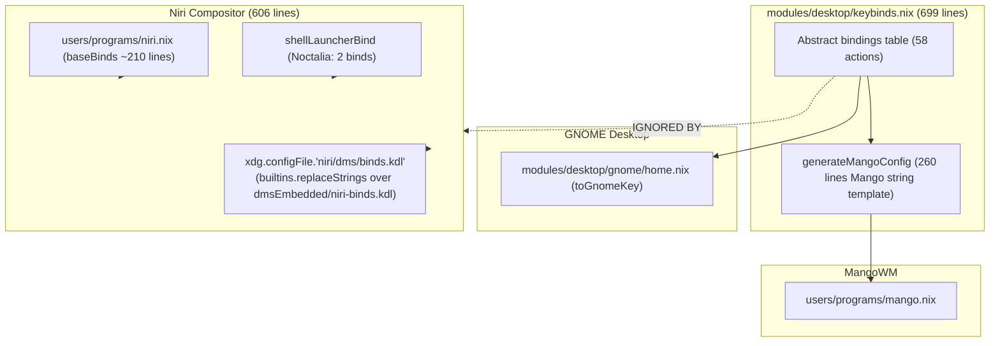

# Desktop Keybindings Refactoring Plan (Net-Zero Changes)

## Objective

Refactor desktop keybindings across all supported window managers (Niri, MangoWM, GNOME) and desktop shells (DMS, Noctalia) with **net-zero functional changes** (preserving 100% of currently effective key combinations, actions, and behaviors), while achieving:

1. **Single Source of Truth (DRY)**: Eliminate the duplicate and out-of-sync keybinding definitions between `modules/desktop/keybinds.nix`, `users/programs/niri.nix`, `users/programs/mango.nix`, and DMS embedded binds.
1. **Elimination of Fragile String Replacements**: Remove the 25-clause `builtins.replaceStrings` hack in `users/programs/niri.nix` that patches `${dmsEmbedded}/niri-binds.kdl`.
1. **Clean Separation of Concerns**: Decouple the generic keybinding data schema from compositor-specific formatting (e.g., removing the 260-line MangoWM generator from `keybinds.nix` into an adapter).
1. **Parity Between Shell Environments**: Ensure consistent behavior between `yitaishi` (Niri + DMS) and `yixiaoqing` (Niri + Noctalia) without accidental session kills or broken launcher binds.

______________________________________________________________________

## Current State

### 1. Landscape of Desktop Environments & Hosts

- **Workstation (`yitaishi`)**:
  - `desktopEnvironment = "niri"`
  - `desktopShell = "dms"`
  - `hdr = true`
- **Laptop (`yixiaoqing`)**:
  - `desktopEnvironment = "niri"`
  - `desktopShell = "noctalia"`
  - `hdr = false`
- **Alternative / Supported WMs**:
  - `mango` (`users/programs/mango.nix`, `modules/desktop/mango.nix`)
  - `gnome` (`modules/desktop/gnome/home.nix`)

### 2. The Four Disconnected Keybinding Islands

Currently, keybindings are implemented in four disconnected silos:



### 3. Concrete Code Smells & Divergences

1. **God-file `modules/desktop/keybinds.nix` (699 lines)**:

   - Mixes abstract key definitions (SUPER,t, ALT,space) with MangoWM config generation syntax (`bind=SUPER,t,spawn,kitty`).
   - Despite being titled *"Centralized Desktop Keybindings (Source of Truth)"*, Niri doesn't import or use it at all.

1. **Fragile String Hacking in `users/programs/niri.nix` (Lines 538–603)**:

   - When `desktopShell == "dms"`, Niri reads `${dmsEmbedded}/niri-binds.kdl` from DMS input and applies a 25-clause `builtins.replaceStrings` list.
   - If DMS updates its embedded file formatting or whitespace upstream, these string replacements silently fail to match, causing silent functional regressions.

1. **Behavioral Divergence Between Hosts**:

   - `Ctrl+Alt+Delete`:
     - On `yitaishi` (DMS): Opens Task Manager (`processlist focusOrToggle`).
     - On `yixiaoqing` (Noctalia): Immediately terminates the compositor session (`quit`).
   - `Mod+Comma`:
     - On `yitaishi` (DMS): Opens Settings (`settings focusOrToggle`).
     - On `yixiaoqing` (Noctalia): Consumes window into column (`consume-window-into-column`).
   - `Mod+X`, `Mod+Y`, `Mod+N`, `Mod+P`:
     - On `yitaishi` (DMS): Power menu, wallpaper picker, notepad, output profile cycle.
     - On `yixiaoqing` (Noctalia): Unbound (dead keys).
   - `Mod+Ctrl+Left/Right/H/L`:
     - On `yitaishi` (DMS): Focuses adjacent monitor (`focus-monitor-left/right`).
     - On `yixiaoqing` (Noctalia): Moves column within workspace (`move-column-left/right`).

1. **Repetitive Boilerplate**:

   - Arrow keys (`Left`, `Down`, `Up`, `Right`), Vim keys (`H`, `J`, `K`, `L`), and Emacs keys (`B`, `N`, `P`, `F`) are copy-pasted across multiple modifier variations (`Mod`, `Mod+Ctrl`, `Mod+Shift`, `Mod+Shift+Ctrl`).
   - Numbered workspaces 1–9 are manually unrolled in multiple files.

______________________________________________________________________

## Decisions

### Decision 1: Strict Net-Zero Functional Changes

- All existing key shortcuts and their exact resulting behavior on `yitaishi`, `yixiaoqing`, and Mango must remain completely functional with zero unwanted changes.
- Where Niri on `yitaishi` has effective bindings in `dms/binds.kdl`, those exact bindings are preserved as the standard.
- On `yixiaoqing` (Noctalia), missing shell shortcuts (settings, power menu, control center) will be wired to their Noctalia equivalents (already defined in `modules/desktop/keybinds.nix`), while preserving all existing window navigation.

### Decision 2: Modular Architecture for `modules/desktop/keybinds/`

Split the monolith into clean, single-responsibility files:

```
modules/desktop/keybinds/
├── default.nix       # Public interface: exports bindings, adapters, and helpers
├── schema.nix        # Central Source of Truth: abstract definitions (keys, descriptions, categories)
├── shell-commands.nix # Shell-agnostic command resolver (maps abstract shell actions to DMS vs Noctalia vs standard)
├── mango.nix         # MangoWM config generator (extracted from keybinds.nix)
├── niri.nix          # Niri config generator: produces typed binds and/or clean KDL for Niri and DMS
└── gnome.nix         # GNOME dconf keybinding helper (toGnomeKey)
```

For 100% backwards-compatibility:
`modules/desktop/keybinds.nix` can simply `import ./keybinds/default.nix { inherit lib; }` or be replaced with a directory module.

### Decision 3: Declarative Generation for DMS Niri Binds

- Instead of reading DMS's embedded KDL and performing string replacements with `builtins.replaceStrings`, generate the clean `dms/binds.kdl` directly using Nix or a clean template derived from the central source of truth.
- This ensures compile-time safety, zero whitespace brittleness, and single-point maintenance.

______________________________________________________________________

## Phases

### Phase 1: Structure Extraction & Modularization

1. Create `modules/desktop/keybinds/schema.nix`:
   - Contains all logical desktop keybindings: launchers, window management, movement, focus, monitors, workspaces, hardware controls, screenshots, mouse/scroll bindings.
1. Create `modules/desktop/keybinds/shell-commands.nix`:
   - Resolves commands for `desktopShell` (`"dms"` vs `"noctalia"` vs `"default"`), including:
     - Spotlight / Launcher
     - Spotlight Bar
     - Clipboard
     - Settings
     - Notifications
     - Notepad
     - Wallpaper picker
     - Power menu
     - Task manager / System control
     - Display profile cycling
     - Lock screen
     - Cheat sheet / Hotkey overlay
1. Create `modules/desktop/keybinds/mango.nix`:
   - Move `generateMangoConfig` out of `modules/desktop/keybinds.nix`.
   - Uses `schema.nix` and `shell-commands.nix`.
1. Ensure `users/programs/mango.nix` evaluates to the exact identical string before and after.

### Phase 2: Niri Keybinding Adapter

1. Create `modules/desktop/keybinds/niri.nix`:
   - Translates abstract keys (`SUPER,t` -> `Mod+T`, `SUPER+SHIFT,space` -> `Mod+Shift+Space`, `none,Print` -> `Print`).
   - Generates the typed `programs.niri.settings.binds` attrset directly from `schema.nix` and `shell-commands.nix`.
   - Incorporates Niri-specific features:
     - Directional navigation (Arrows + Vim `HJKL`) generated via clean helper tables (`lib.listToAttrs`).
     - Workspace 1–9 focus and move generated programmatically.
     - Mouse wheel bindings with cooldowns.
     - Recent-windows switcher.
     - Sizing presets and manual sizing.
1. Generate clean `xdg.configFile."niri/dms/binds.kdl"` directly from the generator when `desktopShell == "dms"`, eliminating `builtins.replaceStrings`.

### Phase 3: GNOME Integration

1. Move `toGnomeKey` and GNOME key mappings into `modules/desktop/keybinds/gnome.nix` or reference the schema directly from `modules/desktop/gnome/home.nix`.
1. Verify dconf settings evaluation matches character-for-character.

### Phase 4: Verification & Nix Evaluation Check

1. Compare `nix eval` outputs for `yitaishi` and `yixiaoqing` before and after:
   - Check `programs.niri.settings.binds`
   - Check `xdg.configFile."niri/dms/binds.kdl".text`
   - Check `xdg.configFile."mango/dms/binds.conf".text`
   - Check `dconf.settings."org/gnome/desktop/wm/keybindings"`
1. Verify diff is strictly net-zero or cleanly structured without accidental regressions.

______________________________________________________________________

## Rollout Order

1. **Step 1 (Dry-run comparison)**: Capture current evaluation outputs for all desktop configs to temporary files in `/tmp/ai/` for diffing.
1. **Step 2 (Module extraction)**: Create `modules/desktop/keybinds/` directory and extract `schema.nix`, `shell-commands.nix`, and `mango.nix`. Keep `modules/desktop/keybinds.nix` re-exporting.
1. **Step 3 (Niri generator)**: Implement `niri.nix` adapter and hook into `users/programs/niri.nix`.
1. **Step 4 (Evaluation diff)**: Diff generated KDL and Mango conf against the baseline.
1. **Step 5 (Hand-off)**: Hand the user the exact build/test commands to verify on `yitaishi`.

______________________________________________________________________

## Resolved Decisions & User Direction

1. **Window Movement vs Monitor Focus**:
   - `Mod+Shift+<dir>` uniformly handles window/column movement across all window managers.
   - `Mod+Ctrl+<dir>` (and `Mod+Alt+<dir>`) handles monitor focus across all compositors.
   - Mouse wheel and axis scroll bindings (normal scroll and `Mod` + scroll) are preserved with 150ms cooldowns.
1. **`Ctrl+Alt+Delete` Behavior**:
   - Resolved per user direction: *"yixiaoqing option for all"*.
   - `Ctrl+Alt+Delete` triggers `quit` (exit compositor session) across all setups (`yitaishi`, `yixiaoqing`, MangoWM).
   - Task Manager remains cleanly mapped to `SUPER,m` / `Ctrl+Alt+M`.
1. **Fullscreen on Niri (`Mod+F`)**:
   - Resolved per user direction: *"super+f has shift on niri btw, it shouldn't have shift"*.
   - `Mod+F` (Super+F without Shift) toggles `fullscreen-window`, aligning with MangoWM and standard desktop ergonomics.
   - `Mod+Shift+F` toggles `maximize-column`.
1. **Focus Follows Mouse on Niri**:
   - Resolved per user direction: *"ensure the focus follows the mouse on niri as well, both window and monitor"*.
   - Enabled `focus-follows-mouse.enable = true` in `users/programs/niri.nix` without `max-scroll-amount = "0%"`, allowing mouse focus to move seamlessly across both windows and monitors.
1. **Direct Directory Module Entrypoint**:
   - Resolved per user direction: *"there's also this 1 line keybinds file, we don't need it"*.
   - Removed `modules/desktop/keybinds.nix` completely. All consumers (`users/programs/niri.nix`, `users/programs/mango.nix`, `modules/desktop/gnome/home.nix`) import `modules/desktop/keybinds` directly.
