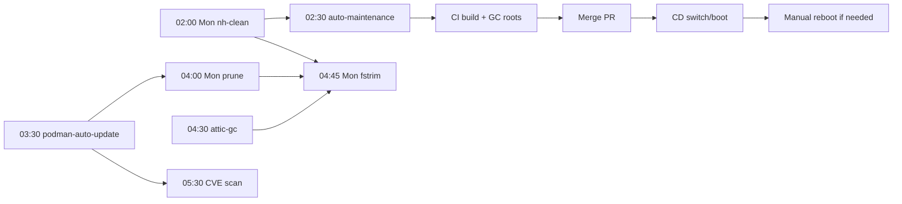

# Centralized Fleet Maintenance & Schedule Architecture Plan

## Objective

Put all periodic maintenance jobs across `yifuwuqi`, `yirukou`, `yitaishi`, `yixiaoqing`, and `yichuang` on one timetable (`America/Sao_Paulo`, no DST; [modules/locale.nix](../../../modules/locale.nix)): Nix GC, container updates/pruning, TRIM, btrfs scrubs, SMART self-tests, Attic GC, the [auto-maintenance bot](auto-maintenance-bot-plan.md), and 05:30/17:30 CVE scans. Eliminate midnight collisions, order dependent jobs, and keep CI-built closures rooted until deployed.

## Current state & problems

| Timer / Service                       | Hosts                 | Source                                                                                                                                                                                                                                              | Prior schedule / state                                                                                |
| ------------------------------------- | --------------------- | --------------------------------------------------------------------------------------------------------------------------------------------------------------------------------------------------------------------------------------------------- | ----------------------------------------------------------------------------------------------------- |
| `nh-clean`                            | all                   | [modules/packages/default.nix](../../../modules/packages/default.nix)                                                                                                                                                                               | `weekly` (Mon 00:00), `--keep-since 2d --keep 2`, `Persistent=true`, no delay                         |
| `podman-prune` / `podman-auto-update` | `yifuwuqi`            | [modules/virtualisation/podman.nix](../../../modules/virtualisation/podman.nix)                                                                                                                                                                     | Prune: `weekly`, `--all`, 1800s delay. Update: `daily`, 900s delay                                    |
| `fstrim`                              | all                   | [modules/server-settings.nix](../../../modules/server-settings.nix)                                                                                                                                                                                 | `weekly`, upstream `RandomizedDelaySec=100min`, `AccuracySec=1h`                                      |
| `recyclarr`                           | `yifuwuqi`            | [modules/services/arr/default.nix](../../../modules/services/arr/default.nix)                                                                                                                                                                       | `daily`, 5m delay (calls local arr APIs on `127.0.0.1`, independent of gluetun)                       |
| `security-audit-cve` / `-fast`        | `yifuwuqi`, `yirukou` | [modules/services/monitoring/security-monitor/default.nix](../../../modules/services/monitoring/security-monitor/default.nix)                                                                                                                       | CVE: `03:30` + 1800s (vulnix + trivy on `yifuwuqi`). Fast: every 15m                                  |
| `restart-gluetun`                     | `yifuwuqi`            | [modules/services/qbittorrent-vpn.nix](../../../modules/services/qbittorrent-vpn.nix)                                                                                                                                                               | `OnBootSec=6h`, `OnUnitActiveSec=6h`, 5m delay (drifts with boot)                                     |
| `atticd` GC / `attic-closure-keeper`  | `yifuwuqi`            | [server.nix](../../../modules/services/attic/server.nix), [closure-keeper.nix](../../../modules/services/attic/closure-keeper.nix)                                                                                                                  | In-process GC every `1 days` (1d retention). Keeper re-pushes `/nix/store/*-nixos-system-*` every 15m |
| Continuous / internal                 | fleet                 | `smb-mounts-recover` (30s), `logrotate`/`fwupd-refresh` (hourly), `systemd-tmpfiles-clean`/`acme-renew-fufu.land` (daily), journald (7d/800M), Loki (168h), Prometheus (30d), AdGuard (24h/720h), Forgejo cron (`@midnight`), Forgejo mirror (`8h`) | Unchanged except mirror interval (`10m`) and `attic-closure-keeper` ordering                          |

- **Problems**:
  - **00:00 pile-up & upstream timer quirks**: `nh-clean`, `podman-prune`, `fstrim`, `recyclarr`, and `podman-auto-update` collide at midnight. Upstream `OnCalendar` is additive (requires `[ "" slot ]`), and `fstrim` retains its 100m delay unless overridden.
  - **GC & CI closure loss**: `nix.gc.options` in `server-settings.nix` is dead (`nh` owns GC). Unrooted CI closures on `yifuwuqi` are deleted by Monday GC and expire from Attic after 1d, breaking the CD gate ([ci/deploy.sh](../../../ci/deploy.sh)). `yifuwuqi`'s shared 1 TB NVMe is 82% full with no `min-free`/`max-free`.
  - **Hygiene & desktop catch-up**: no Docker `autoPrune` on desktops, no btrfs scrub on `yitaishi`, no SMART self-tests, no `configurationLimit` on `yirukou`, no backups, and desktop boot catch-up runs at normal priority during login.

## Decisions

### 1. Slot table (`modules/maintenance.nix`) & timetable

Imported in [modules/common.nix](../../../modules/common.nix), exposing read-only `yi.maintenance.slots` (`{ calendar; jitter; timerConfig; timer; }`) with `RandomizedDelaySec = lib.mkForce jitter`, `FixedRandomDelay = true`, and `AccuracySec = "1m"`.

| Slot           | Cadence  | Unit                                 | Hosts                                | Delay   | Notes / Ordering                                                                       |
| -------------- | -------- | ------------------------------------ | ------------------------------------ | ------- | -------------------------------------------------------------------------------------- |
| 01:30          | daily    | `backups` (reserved)                 | `yifuwuqi`                           | 5m      | Reserved for future off-host backup plan                                               |
| 02:00          | Mon      | `nh-clean`                           | all                                  | 10m     | Runs first so closures built later in the week survive until next Monday               |
| 02:30          | daily    | `auto-maintenance-fix` -> `-publish` | `yifuwuqi`                           | 5m      | `After=nh-clean.service`; triggers CI build ([bot plan](auto-maintenance-bot-plan.md)) |
| 03:30          | daily    | `podman-auto-update`                 | `yifuwuqi`                           | 15m     | `OnCalendar = [ "" slot.calendar ]`; updates before prune and 05:30 CVE scan           |
| 04:00          | Mon      | `podman-prune`, `docker-prune`       | `yifuwuqi`; `yitaishi`, `yixiaoqing` | 10m     | `After=podman-auto-update.service` / `nh-clean.service`; Docker keeps `<168h`          |
| 04:15          | daily    | `recyclarr`                          | `yifuwuqi`                           | 5m      | Arr quality sync                                                                       |
| 04:30          | daily    | `attic-gc`                           | `yifuwuqi`                           | 5m      | Oneshot `atticd --mode garbage-collector-once`; replaces in-process collector          |
| 04:45          | Mon      | `fstrim`                             | all                                  | 10m     | `After=` `nh-clean`, `podman-prune`, `docker-prune`, `attic-gc`                        |
| 05:00          | Sun      | `smartd` self-tests                  | `yifuwuqi`, `yirukou`                | none    | `-a -s (S/../../7/05\|L/../0[1-7]/7/05)` (weekly short, 1st Sun long)                  |
| 05:30, 17:30   | daily    | `security-audit-cve`                 | `yifuwuqi`, `yirukou`                | 15m     | Follows overnight updates and daytime deploys                                          |
| 00, 06, 12, 18 | every 6h | `restart-gluetun`                    | `yifuwuqi`                           | 5m      | Calendar-pinned outside 01:30-06:00 (`Persistent` unset)                               |
| 1st of month   | monthly  | `btrfs-scrub@`                       | `yitaishi`                           | nixpkgs | Auto-enabled when btrfs fs present; `After=nh-clean.service`                           |

### 2. GC, desktop policy & monitoring

- **GC & disk protection**: remove dead `nix.gc.options` from `server-settings.nix`; set `min-free = 50 GiB` / `max-free = 100 GiB` on remote builders in [modules/distributed-builds.nix](../../../modules/distributed-builds.nix); root `develop` and `bot/auto-maintenance` host toplevels in [ci/build.sh](../../../ci/build.sh) under `/var/lib/nix-builder/gcroots/<ref>/<host>`; set `attic-closure-keeper` `After=nh-clean.service`; disable in-process Attic GC (`interval = "0 seconds"`) in favor of `attic-gc.service`; set `configurationLimit = 10` in [hosts/yirukou/boot.nix](../../../hosts/yirukou/boot.nix).
- **Desktops (`!config.serverMode.headless`)**: `nh-clean`, `docker-prune`, and `fstrim` run with `Nice = 19`, `IOSchedulingClass = "idle"`, `CPUSchedulingPolicy = "idle"`, plus `ConditionACPower = true` when `services.tlp.enable` is on (`yixiaoqing`).
- **Monitoring**: CVE scan age thresholds `14h`/`26h` in [security.nix](../../../modules/services/monitoring/dashboards/security.nix); failed maintenance unit count and daily (`26h`/`50h`) / weekly (`8d`/`15d`) timer age bar gauges in [systemd-units.nix](../../../modules/services/monitoring/dashboards/systemd-units.nix).

## Phases & rollout

1. **Phase 1 (CVE schedule & dashboard)**: set `cveScan` to `05,17:30:00` (15m jitter) and `14h`/`26h` thresholds in `security.nix`.
1. **Phase 2 & 3 (Slot table & ordering)**: add `modules/maintenance.nix` (imported in `common.nix`), wire consumers (`security-monitor`, `podman`, `qbittorrent-vpn`), override upstream timers, and add `After=` guards.
1. **Phase 4 & 5 (GC & hygiene)**: remove dead `nix.gc.options`, add builder `min-free`/`max-free`, add CI GC roots in `ci/build.sh`, switch Attic to `attic-gc`, set `yirukou` `configurationLimit`, enable Docker prune / btrfs scrub / smartd self-tests / desktop idle policy.
1. **Phase 6 & 7 (Dashboards & verification)**: add maintenance panels to `systemd-units.nix`; run `statix`, `deadnix`, `nixf-diagnose`, `shellcheck`, `nix flake check --no-build`, verify `systemd.timers` / unit text via `nix eval`, then deploy `yifuwuqi` -> `yirukou` -> desktops.

## Open questions

1. **Server Nix retention**: keep `2d`/`2` generations on servers or increase `programs.nh.clean.extraArgs`?
1. **Backups**: design off-host backup plan for Postgres, Forgejo, Grafana, and arr state (01:30 slot reserved).
1. **Reboots**: keep kernel reboots manual via `node_security_reboot_required` or schedule an automated window?
1. **Container images**: keep `podman-auto-update` on floating tags or pin digests in the repo via `auto-maintenance`?
