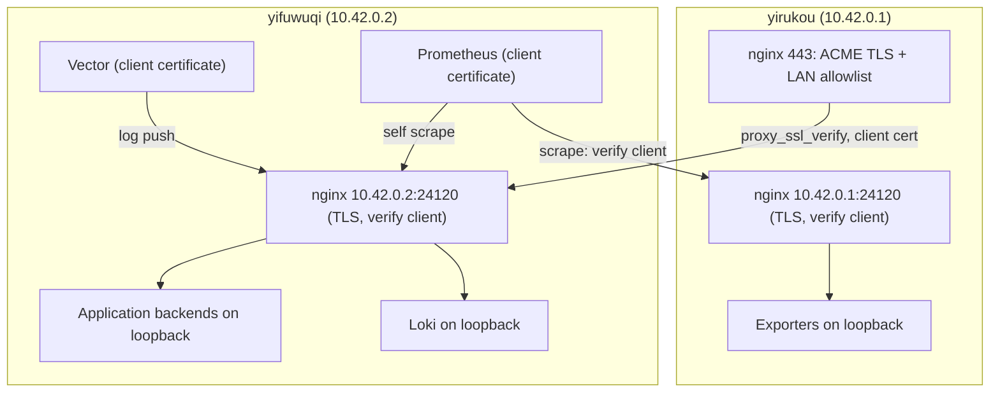
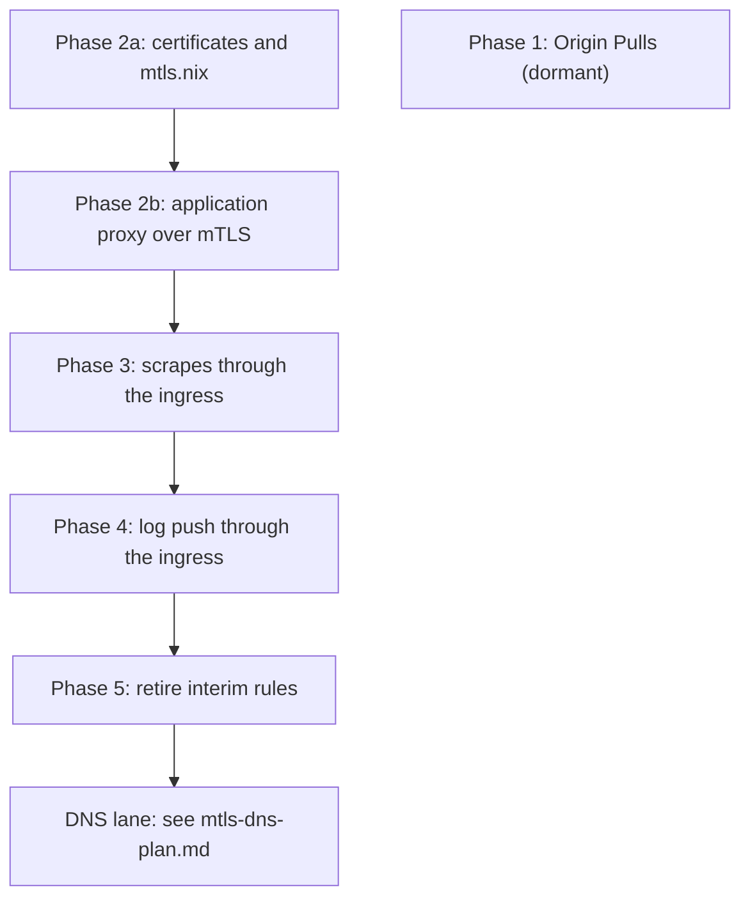

# Infrastructure mTLS Architecture & Implementation Plan

## Status: IMPLEMENTED — Phases 2a and 2b, 3, 4 and 5 landed 2026-11-22; cert lanes revised 2026-11-23 (two commands, shared libs, converging generate) and deployed to `yirukou` + `yifuwuqi` the same day. Phase 1 stays dormant until the `aset.love` canary.

## Objective

Make every HTTP service crossing `yirukou` and `yifuwuqi` reach the other host
only through nginx with mutual TLS, using one internal CA and per-host
certificates, without per-device enrolment and without adding listener ports.

Non-HTTP lanes are split out: SSH stays key-authenticated, the Cloudflare edge
tier stays dormant, and DNS has its own plan ([mTLS on DNS](mtls-dns-plan.md)).

## Current State (repository-verified 2026-11-22)

- **Application hop**: `mkRemoteVhosts` in
  [proxy-vhosts.nix](../../../modules/services/proxy-vhosts.nix) proxies 22
  domains to one plain-HTTP upstream,
  `http://10.42.0.2:24120` (`services.ingress.port`). `mkLocalVhosts` serves
  them from one plain listener on the `yifuwuqi` LAN address, routing on the
  preserved `Host` header to loopback backends (four exceptions keep the LAN
  address), with `allow 10.42.0.1; deny all;` and a `_` default vhost
  returning 404.
- **Access control**: `restrictedProxyConfig` in
  [nginx-proxy.nix](../../../modules/services/nginx-proxy.nix) allows only the
  LAN CIDRs and denies the rest; the `yifuwuqi` firewall
  ([firewall.nix](../../../hosts/yifuwuqi/networking/firewall.nix)) admits only
  `10.42.0.1` to the ingress port and Loki's push port.
- **Scrapes**: Prometheus on `yifuwuqi` scrapes ten exporter jobs on
  `yirukou` over plain HTTP on their own ports, gated by an interim
  source-scoped `extraInputRules` block in
  [exporters.nix](../../../modules/services/monitoring/exporters.nix).
  Central-host exporters listen on loopback.
- **Log push**: Vector on `yirukou` pushes to Loki at
  `http://10.42.0.2:24100`
  ([promtail.nix](../../../modules/services/monitoring/promtail.nix)); Loki
  binds the LAN address with `auth_enabled = false`
  ([loki.nix](../../../modules/services/monitoring/loki.nix)); Grafana reads
  it over the LAN ([grafana.nix](../../../modules/services/monitoring/grafana.nix)).
- **Contracts**: [checks.nix](../../../nix/checks.nix) enforces
  `proxy-allowlist` on `yirukou` locations and `exporter-source-scope` on
  scrape hosts; the latter is self-declared interim and retires in Phase 5.
- **Module surface**: nginx in nixpkgs ships `--with-stream_ssl_module`;
  there is no typed `sslVerifyClient`/`sslClientCertificate` vhost option, so
  those lines go through `extraConfig`. Prometheus `tls_config` exposes
  `ca_file`, `cert_file`, `key_file` and `server_name`.

## Decisions

1. **One internal CA, four leaves, stored under `/persist`, not in git, not in
   the store, not in sops.** `service-ca` (its key never leaves the minting
   host), `yirukou-server`, `yifuwuqi-server`, and one client certificate per
   host. The material lives in `/persist/keys/mtls/` on each host and the
   module only names the paths — the same shape as
   `hashedPasswordFile = "/persist/keys/passwords/root"`. Nix declares *where*
   identity lives, never *what* it contains, so rotation needs no rebuild.
1. **One listener port, both hosts, both roles.** `10.42.0.X:24120` becomes
   TLS with `ssl_verify_client on`. On `yifuwuqi` it serves the 22 application
   vhosts, the metric paths and the Loki push path; on `yirukou` it serves the
   metric paths. No second port, no second firewall hole.
1. **Client certificates prove the host, Host-header routing still names the
   service.** `yirukou` reaches `yifuwuqi` through one upstream, so a single
   certificate covers all 22 domains. `proxy_ssl_*`, `ssl_client_certificate`
   and `ssl_verify_client` are set per vhost, never in `commonHttpConfig`: at
   HTTP level they would also wrap `yirukou`'s loopback AdGuard vhosts and the
   `yitaishi` image upstream, which are plain HTTP by design.
1. **Verification is by DNS SAN on nginx hops and IP SAN on Go hops.**
   Certificates carry `DNS:<host>.lan` and `IP:10.42.0.X`. nginx's
   `proxy_ssl_name` matches with `X509_check_host()`, which rejects an IP
   literal even when the certificate carries the matching `IP:` SAN (verified
   against nginx 1.30.7), so every nginx upstream names the peer and verifies
   through the DNS SAN. Prometheus and Vector are Go and rustls clients that do
   consult `IP:` SANs, so their IP-literal targets need no override.
1. **The client certificate names the host only because the subject is pinned.**
   `ssl_verify_client on` proves the certificate chains to the CA, and both
   hosts hold leaves from it, so an unpinned check admits either host's
   certificate (verified: it returned `200`). Every serving vhost compares
   `$ssl_client_s_dn` against the expected `CN=<peer>-client` and returns `403`
   otherwise. nginx evaluates a server-level `if` in the rewrite phase, so a
   rejected identity never reaches a backend. The machine paths pin nothing:
   their callers are the scrape and log shippers, and the per-location address
   allowlist already names who may connect.
1. **The default vhost owns the handshake.** Prometheus and Vector cannot
   override the `Host` header, so their requests carry `10.42.0.X` and land on
   the default server for that listener. On `yifuwuqi` that is the existing
   `_` 404 vhost ([proxy-vhosts.nix](../../../modules/services/proxy-vhosts.nix));
   on `yirukou` it is one new vhost. Both carry the server certificate,
   `ssl_client_certificate` and `ssl_verify_client on`, plus the machine
   locations; everything else under `_` still returns 404.
1. **Metrics by path prefix, generated from one map.** One location per
   registry exporter, `location /<name>/ { proxy_pass http://127.0.0.1:<port>/; }`,
   with `metrics_path = "/<name>/metrics"` (`/blackbox/probe` for the probe
   job). The exporter map in
   [monitoring.nix](../../../modules/addresses/monitoring.nix) generates both
   the locations and the jobs, so ports stay in one place.
1. **Every registry exporter is fronted, including the central host's.**
   Prometheus scrapes `yifuwuqi`'s exporters through `10.42.0.2:24120` like any
   other target, so one scheme covers every job. Same-host loopback jobs that
   are not registry exporters (`prometheus`, `grafana`, `cadvisor`) stay plain
   HTTP and are documented as same-host.
1. **Loki moves to loopback and the push path uses the same prefix.**
   `location /loki/` proxies to Loki's root, so Vector pushes to
   `https://10.42.0.2:24120/loki/api/v1/push` and the `loki` scrape job reads
   `/loki/metrics`. Grafana's datasource points at `127.0.0.1`. The `:24100`
   firewall hole disappears.
1. **A `yi.mtls.enable` option gates the material**, default true. The DR test
   ([secrets/test.nix](../../../secrets/test.nix)) imports the real ingress
   module with synthetic secrets, so it sets the option false and keeps its
   plain-HTTP assertions.
1. **Three lanes stay outside mTLS.** SSH (deploy-rs, `nix-builder`) is
   key-authenticated; Nix substituter fetches to `cache.aset.love` keep
   server-auth only because Nix has no client-certificate option for
   substituters; DNS follows its own plan.

## Architecture



## Phases & Implementation Details

### Phase 1: Cloudflare Authenticated Origin Pulls (Tier 1, dormant)

Unchanged in intent. `yirukou` WAN TCP stays closed and no hostname is proxied
to it, so this phase is inert. When the `aset.love` canary is scheduled: pin
Cloudflare's Origin Pull CA, emit `ssl_client_certificate` and
`ssl_verify_client on` through `extraConfig` on a public listener, and keep the
trusted-LAN browser path separate so LAN browsers are never asked for a
Cloudflare client certificate. This tier touches neither host's ingress and
does not block Phases 2 to 5.

### Phase 2: Inter-Host Application Proxy (Tier 2)

1. **Material.** Add `modules/services/mtls.nix`, which owns `options.yi.mtls`,
   the `mtls` group, the tmpfiles rules that pin `/persist/keys/mtls/` modes,
   and the directive strings consumers reuse. The paths are `str`, not `path`:
   a `types.path` renders with surrounding newlines inside a nested attrset and
   corrupts the YAML that Prometheus receives. `secrets/scripts/mtls-lib.sh`
   plus the two `mtls-pki-*.sh` commands mint the material offline.

   ```nix
   serverVerify = ''
     ssl_client_certificate ${caFile};
     ssl_verify_client on;
     if ($ssl_client_s_dn != "CN=${clientCn}") {
       return 403;
     }
   '';
   machineVerify = ''
     ssl_client_certificate ${caFile};
     ssl_verify_client on;
   '';
   upstreamTls = ''
     proxy_ssl_certificate ${clientCert};
     proxy_ssl_certificate_key ${clientKey};
     proxy_ssl_trusted_certificate ${caFile};
     proxy_ssl_verify on;
     proxy_ssl_verify_depth 2;
     proxy_ssl_name ${peer}.lan;
     proxy_ssl_server_name on;
   '';
   ```

1. **`yifuwuqi` ingress.** `mkLocalVhosts` turns its existing `listen` entries
   into TLS and appends `serverTls` to every generated vhost, including `_`.
   nginx inherits neither the certificate nor client verification from the
   default server sharing a listen socket, so each vhost repeats them; the
   shared map means one edit, not 22.

1. **`yirukou` egress.** `mkRemoteVhosts` switches the upstream to `https://`
   and appends `upstreamTls` to the generated location config. WebSocket,
   body-size and timeout handling are unchanged.

1. **Firewall.** `gatewayPorts` on `yifuwuqi` narrows to the ingress port;
   Loki's port is removed in Phase 4.

1. **Secrets plumbing.** nginx runs as the `nginx` user, not root, so it needs
   the group too: nginx, Prometheus and Vector each join `mtls` rather than
   gaining privileges.

### Phase 3: Metrics Scrapes Through the Ingress (Tier 3a)

1. The ingress vhosts generate one `location "/<name>/"` per registry exporter
   from the same map that drives the scrape jobs, so no exporter port is
   restated; `monitoringLib.exporterAddress` is deleted.
1. [prometheus.nix](../../../modules/services/monitoring/prometheus.nix)
   targets `https://10.42.0.X:24120`, sets `metrics_path`, and attaches
   `tls_config` with the scraper's client certificate, key and the CA. The
   probe job keeps its `__param_*` relabeling and points at `/blackbox/probe`.
1. [exporters.nix](../../../modules/services/monitoring/exporters.nix) loses
   its `extraInputRules` block and pins every exporter to `127.0.0.1`;
   `yirukou` gains one line admitting `10.42.0.2` to `:24120`.
1. Delete the `exporter-source-scope` contract in
   [checks.nix](../../../nix/checks.nix). `proxy-allowlist` stays, with an
   explicit exemption for vhosts on the mTLS listener: their gate is the client
   certificate, and their location allowlist names the scraper rather than the
   LAN.
1. Prometheus runs with `checkConfig = "syntax-only"`: `promtool` cannot see the
   client key under `/persist/keys/mtls` inside the build sandbox, so a full
   check would fail the build.

### Phase 4: Log Push Through the Ingress (Tier 3b)

1. Loki binds `127.0.0.1` and drops `yirukou` from `IPAddressAllow`.
1. The `yifuwuqi` `_` vhost gains `location "/loki/"` proxying to Loki's root.
1. Vector's sink moves to the ingress with `ca_file`, `crt_file` and
   `key_file`; Grafana's Loki datasource moves to `127.0.0.1`. Both consumers
   of `monitoringLib.lanHttpEndpoint` disappear with that change, so the
   helper is deleted from
   [lib.nix](../../../modules/services/monitoring/lib.nix).

### Phase 5: Retire Interim IP Rules

Remove the `yifuwuqi` Loki allowance (done in Phase 4), leaving the gateway
rule with the TLS ingress port only, and confirm the exporter rule is gone.
The `exporter-source-scope` contract is already deleted in Phase 3.

## Certificate Material

Nothing here is committed, and nothing is a sops secret: the material lives in
`/persist/keys/mtls/` on each host, and `modules/services/mtls.nix` only names
the paths. Rotation is a copy and a restart, not a rebuild. Keep the CA 10 years
and the leaves 3.

Mint on one host, as root — the `mtls-pki-generate` command does exactly this.
`setup-sops` chains it as its last step, so `nix run .#secrets` converges the
mesh on every run (and stays quiet where this host has no mTLS role):

```bash
openssl ecparam -name secp384r1 -genkey -noout -out service-ca.key
openssl req -new -x509 -sha384 -key service-ca.key -out service-ca.crt -days 3650 \
  -subj "/CN=Aset Internal Service CA" \
  -addext "basicConstraints=critical,CA:TRUE" \
  -addext "keyUsage=critical,keyCertSign,cRLSign"

# Per host: one server leaf (with SANs) and one client leaf.
for spec in yirukou:10.42.0.1 yifuwuqi:10.42.0.2; do
  name=${spec%:*}; ip=${spec#*:}
  openssl ecparam -name secp384r1 -genkey -noout -out "$name-server.key"
  openssl req -new -key "$name-server.key" -out "$name.csr" -subj "/CN=$name-server"
  openssl x509 -req -in "$name.csr" -CA service-ca.crt -CAkey service-ca.key \
    -CAcreateserial -out "$name-server.crt" -days 1095 -sha384 \
    -extfile <(printf 'basicConstraints=critical,CA:FALSE\nkeyUsage=critical,digitalSignature\nextendedKeyUsage=serverAuth\nsubjectAltName=DNS:%s.lan,IP:%s\n' "$name" "$ip")

  openssl ecparam -name secp384r1 -genkey -noout -out "$name-client.key"
  openssl req -new -key "$name-client.key" -out "$name-client.csr" -subj "/CN=$name-client"
  openssl x509 -req -in "$name-client.csr" -CA service-ca.crt -CAkey service-ca.key \
    -CAcreateserial -out "$name-client.crt" -days 1095 -sha384 \
    -extfile <(printf 'basicConstraints=critical,CA:FALSE\nkeyUsage=critical,digitalSignature\nextendedKeyUsage=clientAuth\n')
done
```

Both hosts need `service-ca.crt`; each needs only its own two pairs. No host
reads a peer certificate, so only the CA cert is shared. `mtls-pki` is two
commands, one per behaviour — `generate` (converges the mesh; the lane
`setup-sops` chains) and `rotate` (re-sign one host's pair) — so the recurring
path needs no flags:

```bash
mtls-pki-generate   # mint what is missing, push what differs, skip the rest
mtls-pki-rotate     # re-sign one host's pair (needs the CA key)
```

`service-ca.key` never leaves the minting host. Without it you cannot renew;
with it you can mint any identity in the fleet.

| Identity          | SAN                                | Usage                                                         |
| ----------------- | ---------------------------------- | ------------------------------------------------------------- |
| `yirukou-server`  | `DNS:yirukou.lan`, `IP:10.42.0.1`  | `yirukou` listener; verified by name from `yifuwuqi`          |
| `yifuwuqi-server` | `DNS:yifuwuqi.lan`, `IP:10.42.0.2` | `yifuwuqi` listener (apps, metrics, Loki); verified by name   |
| `yifuwuqi-client` | none                               | Prometheus and Vector (they run on the central host)          |
| `yirukou-client`  | none                               | `yirukou` proxying to `yifuwuqi`; pinned by the server's `if` |

The server leaves need both SAN forms because the two consumers verify
differently: nginx matches the DNS name, and Go and rustls match the IP.

## Files & LOC Budget

Net **+1171** lines across the 37 files (+1492/−321), of which code is the bulk
and docs plus `flake.lock` the rest. The budget below is what landed, not the
original estimate.

| File                                                                              | Change                                                                                 |
| --------------------------------------------------------------------------------- | -------------------------------------------------------------------------------------- |
| `modules/services/mtls.nix` (new)                                                 | +171: options, group, tmpfiles, verify and upstream directive strings                  |
| `secrets/scripts/mtls-lib.sh` (new)                                               | 182: mesh table, CA guard, leaf profile, digest convergence — shared by both commands  |
| `secrets/scripts/mtls-pki-generate.sh` (new)                                      | 62: converge this host and, on the CA host, every peer; the lane `setup-sops` chains   |
| `secrets/scripts/mtls-pki-rotate.sh` (new)                                        | 64: re-sign one host's pair and push it, refusing where there is no CA key             |
| `secrets/scripts/setup-sops.sh`                                                   | +5: chains `mtls-pki-generate` as the last `setup-sops` step                           |
| `modules/services/certs/*.crt`                                                    | never committed: the draft's committed-certificate design was dropped instead          |
| [proxy-vhosts.nix](../../../modules/services/proxy-vhosts.nix)                    | +126/−30: TLS listen, `serverTls`, `upstreamTls`, machine vhost, exports               |
| [nginx-proxy.nix](../../../modules/services/nginx-proxy.nix)                      | +22/−1: `yirukou` machine vhost, explicit `mtls.nix` import                            |
| [local-ingress.nix](../../../modules/services/local-ingress.nix)                  | +11/−5: import `mtls.nix`, thread `config` into the proxy lib                          |
| [exporters.nix](../../../modules/services/monitoring/exporters.nix)               | +4/−19: interim rule and LAN listen addresses removed                                  |
| [prometheus.nix](../../../modules/services/monitoring/prometheus.nix)             | +53/−26: HTTPS targets, shared `ingressTls` bundle, ingress paths                      |
| [promtail.nix](../../../modules/services/monitoring/promtail.nix)                 | +16/−2: TLS sink                                                                       |
| [loki.nix](../../../modules/services/monitoring/loki.nix)                         | +5/−11: loopback bind                                                                  |
| [grafana.nix](../../../modules/services/monitoring/grafana.nix)                   | +1/−1: loopback datasource                                                             |
| [lib.nix](../../../modules/services/monitoring/lib.nix)                           | +4/−10: `exporterAddress`/`lanHttpEndpoint` deleted, `ingressAddress` added            |
| [hosts.nix](../../../modules/addresses/hosts.nix)                                 | +8/−3: shared `ingress` in the registry                                                |
| `hosts/yifuwuqi/networking/firewall.nix`, `hosts/yirukou/networking/firewall.nix` | +8/−6: gateway rule narrowed, scraper admitted                                         |
| [checks.nix](../../../nix/checks.nix)                                             | +16/−48: `exporter-source-scope` deleted, mTLS exemption added                         |
| [secrets/default.nix](../../../secrets/default.nix)                               | +56: two `mtls-pki-*` apps with the registry-injected mesh, CA host and SSH port       |
| [secrets/test.nix](../../../secrets/test.nix)                                     | +36: `yi.mtls.enable = false`; CA-host converge and rotate subtests                    |
| `packages/dev-certs/lib.sh` (new)                                                 | 91: `certs_run`/`certs_push` over one SSH connection, quoted payload, arrival sentinel |
| [packages/dev-certs/generate.sh](../../../packages/dev-certs/generate.sh)         | 46: mint the dev CA and leaf, CA key never written to disk                             |
| [packages/dev-certs/push.sh](../../../packages/dev-certs/push.sh)                 | 25: hand the four files to peers                                                       |
| [packages/dev-certs/default.nix](../../../packages/dev-certs/default.nix)         | +25/−6: one binary per command, `SSH_PORT` prelude, `gnutar`/`openssh`/`shadow`        |

## Rollout Order



1. Phase 2a is a no-op generation: material and option only.
1. Phases 2b, 3, 4 and 5 each deploy as their own generation, `yifuwuqi`
   before `yirukou` when a change is additive on one side.
1. **`yifuwuqi` and `yirukou` must ship the mTLS flip in one deploy.** The
   moment `yifuwuqi` runs `yi.mtls.enable` with `ssl_verify_client on` while
   `yirukou` still dials plain HTTP, the whole ingress fails closed — and
   `magicRollback` will not catch it, because nginx starts happily and only
   the requests break. Deploy the pair together (`ci/deploy.sh deploy yifuwuqi yirukou`), or set `yi.mtls.enable = false` on `yifuwuqi` for the
   intermediate generation.
1. Do not share a generation with the
   [impermanence plan](impermanence-yirukou-plan.md), which also moves key
   staging.
1. The DNS lane starts only after Phase 5 passes.

## Acceptance

Verified at implementation time against the rendered nginx configs and a
throwaway PKI with the same shape:

- A request without a client certificate fails the handshake (`400`); the
  wrong host's certificate is refused by the subject pin (`403`); the peer's
  certificate reaches the backend (`200`).
- The two-hop chain works end to end: the front proxy presents
  `yirukou-client`, the backend admits only `CN=yirukou-client`, and a wrong
  `proxy_ssl_name` fails with `502` and "upstream SSL certificate does not
  match".
- `promtool check config` accepts the rendered `prometheus.yml`, including the
  per-job `tls_config`, and `vector validate` accepts the rendered sink.
- `nginx -t` succeeds on both rendered configs.
- A browser on the trusted LAN reaches a proxied app unchanged, and the
  untrusted VLAN is still denied.

Confirmed on the real hosts after the 2026-11-23 deploy:

- Every scraper job reports `up == 1` (`not_up=0`), including the `probe` job;
  `probe_success` still separates target health from exporter reachability.
- Logs from `yirukou` still arrive in Grafana: 333 entries in the first 5
  minutes after the switch, newest within seconds of "now".
- `nixos-rebuild dry-build --flake .#yirukou` and `.#yifuwuqi` evaluate clean
  (`nix flake check --no-build` passes).
- The two-hop application path serves: `sonarr`/`radarr` `302`,
  `grafana`/`docs` `200` through `yirukou`'s 443 listener, which presents
  `yirukou-client` to `yifuwuqi`; a direct request to the ingress without a
  client certificate is refused with `400`.

## Deployment Prerequisites

`/persist/keys/mtls/` must hold the material before the first switch on each
host, or nginx fails to start (recoverable over SSH; the boot still completes).

- both hosts: `service-ca.crt`
- `yirukou`: `yirukou-server.{crt,key}`, `yirukou-client.{crt,key}`
- `yifuwuqi`: `yifuwuqi-server.{crt,key}`, `yifuwuqi-client.{crt,key}`

Mint and distribute with `nix run .#secrets` on the CA host (`yifuwuqi`), which
chains `mtls-pki-generate`: it mints the CA when absent, mints the whole mesh,
and pushes each peer the CA cert plus its own pair, skipping peers whose copies
already match. The same command on a peer converges that host alone, and never
mints a CA of its own. `service-ca.key` never leaves the CA host. Full runbook:
[secrets.md](../services/secrets.md#internal-service-mtls-certificates).

Verified at implementation time:

- nginx loads certificates from `/persist` (outside the store) and completes the
  mTLS handshake; `nginx -t` succeeds with those paths.
- One shared CA: correct client leaf `200`, the other host's leaf `403`, no
  certificate `400`.
- `systemd-tmpfiles` type `z` applies `0640` to the named files and is a no-op
  when one is missing, so an unseeded host still boots.
- `/persist` is a plain directory on `/` on both hosts today, so there is no
  mount-ordering dependency. The
  [impermanence plan](impermanence-yirukou-plan.md) makes it a real mount and
  must keep this ordering in mind.

## Verified Behaviour Notes

Two assumptions in the earlier draft were wrong and are recorded here so they
are not reintroduced:

- `proxy_ssl_name` cannot be an IP literal. nginx matches with
  `X509_check_host()`, which returns no match for `10.42.0.2` even when the
  certificate carries `IP:10.42.0.2`.
- `ssl_verify_client on` admits **either** host's certificate. Only the
  `$ssl_client_s_dn` comparison distinguishes them.

The DR drill sets `yi.mtls.enable = false`; the ingress must keep evaluating
there, so exporter locations tolerate a host that never imports the exporters
module. `mkMachineVhost` is exported for that reason: `yirukou` builds the
same machine vhost from `nginx-proxy.nix`.

## Out of Scope

- [mTLS on DNS](mtls-dns-plan.md): the resolver hop.
- [Impermanence on yirukou](impermanence-yirukou-plan.md): storage layout and
  key staging.
- SSH and Nix substituters, for the reasons in Decision 10.

## Open Questions

None blocking. The DNS lane carries the only remaining design choice.
