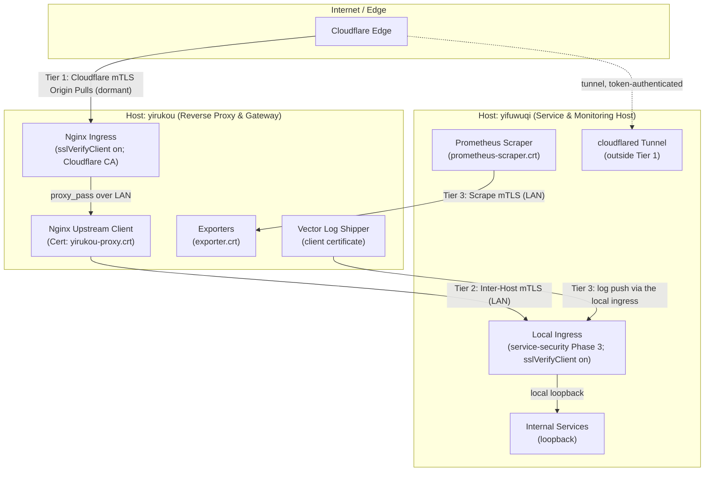
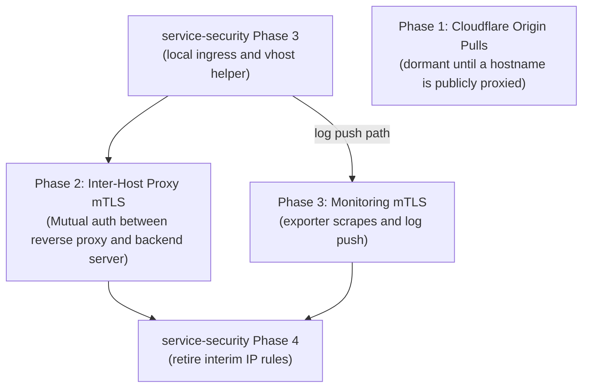

# Infrastructure mTLS Architecture & Implementation Plan

## Objective

Design and implement a server-side 3-tier Mutual TLS (mTLS) security architecture across the NixOS homelab infrastructure with **zero per-device client certificate overhead**:

1. **Cloudflare Authenticated Origin Pulls (Tier 1: Edge Ingress)**: Enforce mTLS between Cloudflare edge proxy servers and `yirukou` Nginx to block direct-to-IP port scans, botnets, and proxy bypass attempts. Dormant while no hostname is publicly proxied to `yirukou` (see Current State).
1. **Inter-Host Upstream Proxy mTLS (Tier 2: LAN Inter-Host)**: Authenticate and encrypt all reverse-proxied traffic between `yirukou` (reverse proxy) and `yifuwuqi` (service host) across the LAN (`10.42.0.0/24`).
1. **Observability mTLS (Tier 3: Monitoring Mesh)**: Mutually authenticate every cross-host monitoring hop: Prometheus on `yifuwuqi` scraping the exporters on `yirukou`, and Vector on `yirukou` pushing logs to Loki.

> [!NOTE]
> Personal client devices (laptops, phones, tablets, browsers) require **no** certificate installation. Administrative web services (Cockpit, Forgejo, Arr apps, Grafana) remain protected by `restrictedProxyConfig` (LAN-only after Decision 2 of the [VPN to LAN Migration Plan](vpn-to-lan-migration-plan.md)) and by application-level authentication. That authentication still has gaps (SillyTavern without a whitelist, qBittorrent skipping login for whitelisted subnets, Grafana anonymous viewers), tracked in the [Service Security Architecture Plan](service-security-architecture-plan.md).

### Scope

Owns:

- The internal CA (`fufu-service-ca`), certificate issuance and rotation.
- Cloudflare Authenticated Origin Pulls (Tier 1).
- TLS settings on the cross-host hops: nginx `proxy_ssl_*` and `sslVerifyClient`, exporter web configs and Prometheus `tls_config`, Vector and Loki TLS.

Not owned here:

- Which listeners exist and what binds where, including the `yifuwuqi` local ingress and its vhost helper: [Service Security Architecture Plan](service-security-architecture-plan.md).
- Who may connect at the network layer: the service-security plan for LAN and container rules, the [VPN to LAN Migration Plan](vpn-to-lan-migration-plan.md) for tailnet rules.
- `yirukou` storage: [Impermanence on yirukou](impermanence-yirukou-plan.md).

______________________________________________________________________

## Current State

- **Perimeter Ingress**: `yirukou` runs Nginx (`modules/services/nginx-proxy.nix`) with a wildcard ACME certificate for `*.fufu.land` obtained via Cloudflare DNS-01 (`sops.secrets.cloudflare_api_token`).
- **No Public Origin on yirukou**: `yirukou`'s WAN interfaces accept only UDP `51820` (`hosts/yirukou/networking/firewall.nix`), and public DNS has no records for the names checked on 2026-11-06 (`fufu.land`, `git`, `docs`, `cache`, `search`, `grafana`); the zone serves ACME DNS-01. Nothing reaches `yirukou` Nginx through Cloudflare today, so Tier 1 has no traffic to protect.
- **Second Cloudflare Ingress**: A cloudflared tunnel container on `yifuwuqi` (`modules/services/cloudflared.nix`) connects outbound to Cloudflare. Its hostname-to-origin rules live in the Cloudflare dashboard, not in this repository. Authenticated Origin Pulls do not apply to tunnel traffic.
- **Access Control**: Administrative services use `restrictedProxyConfig` (IP allowlisting: LAN `10.42.0.0/24` and VPN CIDRs). Decision 2 of the VPN to LAN plan removes the VPN CIDR.
- **Inter-Host Traffic**: Reverse proxy on `yirukou` passes traffic to `yifuwuqi` over plain HTTP (`http://${yifuwuqiLan}:${port}`), one backend port per service. The firewall side is in the service-security plan.
- **Monitoring**: Prometheus on `yifuwuqi` scrapes ten exporter jobs on `yirukou` over plain HTTP (node, smokeping, blackbox, systemd, process, smartctl, nginx, adguard, unbound, redis), generated from `allAddresses.monitoring.exporters` in `modules/services/monitoring/exporters.nix` and `modules/services/monitoring/prometheus.nix`. Exporters on `yifuwuqi` (the central host) listen on loopback.
- **Log Shipping**: Vector on `yirukou` pushes the journal to Loki at `http://10.42.0.2:24100` (`modules/services/monitoring/promtail.nix`); Loki runs with `auth_enabled = false`.
- **Secret Management**: Sops-nix encrypts `secrets/secrets.yaml` to the hosts' SSH host keys. Since `4faab7d`, only root can edit or decrypt it (`docs/src/services/secrets.md`).

______________________________________________________________________

## Decisions

1. **PKI Authority Model**:
   - **Cloudflare Edge**: Cloudflare Origin Pull Static Root CA (publicly trusted Cloudflare certificate).
   - **Internal Service & Scrape CA (`fufu-service-ca`)**: Dedicated homelab internal Root CA for inter-host reverse proxying and Prometheus metrics scraping.
1. **Zero Device Enrollment**:
   - No user/device PKI (`fufu-client-ca` removed). No `.p12` files, device keychain imports, or mobile profiles.
1. **100% Declarative Host Deployment**:
   - **Public Certificates & CAs** (`*.crt`): Committed directly to Git (e.g. `modules/services/certs/`) and referenced via Nix store paths.
   - **Private Keys** (`*.key`): Encrypted into `secrets/secrets.yaml` via Sops-nix and mounted automatically at runtime (e.g. `/run/secrets/certs/...`). They are added as root (`su -`), since sops access is root-only.
1. **Tier 2 Terminates on the Local Ingress**:
   - The service-security plan (Decision 4, Phase 3) puts one nginx listener on `yifuwuqi` in front of every proxied backend. Tier 2 adds the server certificate and client verification to that listener, and `yirukou` switches every `yifuwuqi` upstream to it through the vhost helper from the same phase. No per-service TLS vhosts.
1. **Tier 3 Lives in the Generators**:
   - Exporter web configs go into `mkExporter`, and Prometheus `scheme`/`tls_config` into `mkScrapeConfig` and `probeScrapeConfig`, once for all jobs. Exporters on the central host stay plain HTTP on loopback.
   - Either each `yirukou` exporter serves TLS itself (`--web.config.file`, where the binary supports it), or `yirukou`'s nginx fronts all exporters on one TLS port (Open Question 4).
   - Vector's push: the preferred path is Loki on `127.0.0.1` behind the `yifuwuqi` local ingress, so Tier 2's listener verifies Vector's client certificate while Grafana and Prometheus keep loopback access. The alternative, Loki serving TLS itself, moves Grafana's datasource and the `loki` scrape job to TLS too.
1. **The cloudflared Tunnel Stays Outside Tier 1**:
   - The tunnel is a separate Cloudflare-to-`yifuwuqi` hop, authenticated by its tunnel token. Before Tier 2 enforces client certificates on the local ingress, decide how tunnel origins reach backends (Open Question 5).

______________________________________________________________________

## Architecture Diagram



______________________________________________________________________

## Phases & Implementation Details

______________________________________________________________________

### Phase 1: Cloudflare Authenticated Origin Pulls (Tier 1: Edge Ingress)

This tier stays dormant while no hostname is publicly proxied to `yirukou` and its WANs keep TCP closed (Current State). Apply it together with the first such hostname.

#### 1.1 Declarative Configuration (NixOS)

Fetch Cloudflare's published Authenticated Origin Pull Root CA in `modules/services/nginx-proxy.nix`:

```nix
let
  # Cloudflare published Origin Pull CA certificate
  cloudflareOriginPullCa = pkgs.fetchurl {
    url = "https://developers.cloudflare.com/ssl/static/authenticated_origin_pull_ca.pem";
    hash = "sha256-n6M60Q7VvjK6iFk/jXq/79vG3mI70tZkG0h8N4dE8v0=";
  };
in
{
  # Virtual host configuration for Cloudflare-proxied traffic
  services.nginx.virtualHosts."*.fufu.land" = {
    sslClientCertificate = "${cloudflareOriginPullCa}";
    sslVerifyClient = "on";
  };
}
```

#### 1.2 Imperative Setup (Cloudflare Dashboard / API)

Enable Authenticated Origin Pulls for the zone:

**Option A: Cloudflare Dashboard**:

1. Log in to Cloudflare Dashboard $\\to$ Select `fufu.land`.
1. Navigate to **SSL/TLS** $\\to$ **Origin Server**.
1. Toggle **Authenticated Origin Pulls** to **ON**.

**Option B: Cloudflare API via CLI**:

```bash
export CLOUDFLARE_ZONE_ID="<your-zone-id>"
export CLOUDFLARE_API_TOKEN="<your-api-token>"

curl -s -X PATCH "https://api.cloudflare.com/client/v4/zones/${CLOUDFLARE_ZONE_ID}/origin_tls_client_auth/settings" \
  -H "Authorization: Bearer ${CLOUDFLARE_API_TOKEN}" \
  -H "Content-Type: application/json" \
  --data '{"enabled": true}' | jq .
```

______________________________________________________________________

### Phase 2: Inter-Host Upstream Proxy mTLS (Tier 2: LAN Inter-Host)

#### 2.1 One-Time CA & Certificate Generation

Run locally in a secure workspace directory (e.g. `~/.pki/service-ca/`):

```bash
mkdir -p ~/.pki/service-ca && cd ~/.pki/service-ca

# 1. Create Internal Service CA (valid 10 years)
openssl ecparam -name secp384r1 -genkey -noout -out service-ca.key
openssl req -new -x509 -sha384 -key service-ca.key -out service-ca.crt -days 3650 \
  -subj "/CN=Fufu Internal Service CA"

# 2. Issue yirukou Reverse Proxy Client Certificate (valid 3 years)
openssl ecparam -name secp384r1 -genkey -noout -out yirukou-proxy.key
openssl req -new -key yirukou-proxy.key -out yirukou-proxy.csr \
  -subj "/CN=yirukou.lan"
openssl x509 -req -in yirukou-proxy.csr -CA service-ca.crt -CAkey service-ca.key \
  -CAcreateserial -out yirukou-proxy.crt -days 1095 -sha384 \
  -extfile <(echo "extendedKeyUsage = clientAuth")

# 3. Issue yifuwuqi Backend Server Certificate (valid 3 years)
openssl ecparam -name secp384r1 -genkey -noout -out yifuwuqi-backend.key
openssl req -new -key yifuwuqi-backend.key -out yifuwuqi-backend.csr \
  -subj "/CN=yifuwuqi.lan"
openssl x509 -req -in yifuwuqi-backend.csr -CA service-ca.crt -CAkey service-ca.key \
  -CAcreateserial -out yifuwuqi-backend.crt -days 1095 -sha384 \
  -extfile <(echo -e "subjectAltName=DNS:yifuwuqi.lan,IP:10.42.0.2\nextendedKeyUsage = serverAuth")

# 4. Store public certificates in the Nix repository:
# cp service-ca.crt yirukou-proxy.crt yifuwuqi-backend.crt modules/services/certs/

# 5. Encrypt private keys into Sops (as root, `su -`):
# sops set secrets/secrets.yaml '["certs"]["yirukou_proxy_key"]' "$(cat yirukou-proxy.key)"
# sops set secrets/secrets.yaml '["certs"]["yifuwuqi_backend_key"]' "$(cat yifuwuqi-backend.key)"
```

#### 2.2 Declarative Configuration (NixOS)

**On `yirukou` (Reverse Proxy Client)** in `modules/services/nginx-proxy.nix`, applied to the `yifuwuqi` upstreams through the vhost helper from the service-security plan's Phase 3:

```nix
{ config, pkgs, ... }:
let
  serviceCaCert   = ./certs/service-ca.crt;
  yirukouCert     = ./certs/yirukou-proxy.crt;
in
{
  sops.secrets."certs/yirukou_proxy_key" = {
    owner = "nginx";
    group = "nginx";
  };

  services.nginx = {
    # Configure upstream TLS with mutual authentication
    commonHttpConfig = ''
      proxy_ssl_certificate ${yirukouCert};
      proxy_ssl_certificate_key ${config.sops.secrets."certs/yirukou_proxy_key".path};
      proxy_ssl_trusted_certificate ${serviceCaCert};
      proxy_ssl_verify on;
      proxy_ssl_verify_depth 2;
      proxy_ssl_name yifuwuqi.lan;
      proxy_ssl_server_name on;
    '';
  };
}
```

**On `yifuwuqi` (TLS on the local ingress)**: the service-security plan's Phase 3 creates one nginx listener on `10.42.0.2` with a location per backend on `127.0.0.1`. Tier 2 adds the server certificate and client verification to that listener; the snippet shows the settings, not a separate vhost:

```nix
{ config, pkgs, ... }:
let
  serviceCaCert    = ./certs/service-ca.crt;
  yifuwuqiCert     = ./certs/yifuwuqi-backend.crt;
in
{
  sops.secrets."certs/yifuwuqi_backend_key" = {
    owner = "nginx";
    group = "nginx";
  };

  services.nginx = {
    enable = true;
    virtualHosts."backend.lan" = {
      onlySSL = true;
      sslCertificate = "${yifuwuqiCert}";
      sslCertificateKey = config.sops.secrets."certs/yifuwuqi_backend_key".path;
      sslClientCertificate = "${serviceCaCert}";
      sslVerifyClient = "on"; # Require valid yirukou client certificate
      locations."/" = {
        proxyPass = "http://127.0.0.1:3000"; # one location per backend, generated by the vhost helper
      };
    };
  };
}
```

______________________________________________________________________

### Phase 3: Metrics & Prometheus Scraper mTLS (Tier 3: Monitoring Mesh)

#### 3.1 One-Time Scraper & Exporter Keypair Generation

```bash
# 1. Issue Prometheus Scraper Client Certificate
openssl ecparam -name secp384r1 -genkey -noout -out prometheus-scraper.key
openssl req -new -key prometheus-scraper.key -out prometheus-scraper.csr \
  -subj "/CN=prometheus-scraper"
openssl x509 -req -in prometheus-scraper.csr -CA service-ca.crt -CAkey service-ca.key \
  -CAcreateserial -out prometheus-scraper.crt -days 1095 -sha384 \
  -extfile <(echo "extendedKeyUsage = clientAuth")

# 2. Issue Node Exporter Server Certificate
openssl ecparam -name secp384r1 -genkey -noout -out exporter-server.key
openssl req -new -key exporter-server.key -out exporter-server.csr \
  -subj "/CN=node-exporter.lan"
openssl x509 -req -in exporter-server.csr -CA service-ca.crt -CAkey service-ca.key \
  -CAcreateserial -out exporter-server.crt -days 1095 -sha384 \
  -extfile <(echo -e "subjectAltName=DNS:node-exporter.lan,IP:10.42.0.1,IP:10.42.0.2\nextendedKeyUsage = serverAuth")

# 3. Store public certificates in the repo:
# cp prometheus-scraper.crt exporter-server.crt modules/services/certs/

# 4. Encrypt private keys into Sops (as root, `su -`):
# sops set secrets/secrets.yaml '["certs"]["prometheus_scraper_key"]' "$(cat prometheus-scraper.key)"
# sops set secrets/secrets.yaml '["certs"]["exporter_server_key"]' "$(cat exporter-server.key)"
```

#### 3.2 Declarative Configuration (NixOS)

**In `modules/services/monitoring/exporters.nix`** (on monitored hosts): set once in `mkExporter` for every exporter whose binary supports a web config (Decision 5); the node exporter block below shows the shape:

```nix
{ config, pkgs, lib, ... }:
let
  serviceCaCert  = ../certs/service-ca.crt;
  exporterCert   = ../certs/exporter-server.crt;

  webConfig = pkgs.writeText "exporter-web-config.yaml" ''
    tls_server_config:
      cert_file: ${exporterCert}
      key_file: ${config.sops.secrets."certs/exporter_server_key".path}
      client_ca_file: ${serviceCaCert}
      client_auth_type: RequireAndVerifyClientCert
  '';
in
{
  sops.secrets."certs/exporter_server_key" = {
    owner = "node-exporter";
    group = "node-exporter";
  };

  services.prometheus.exporters.node = {
    extraFlags = [ "--web.config.file=${webConfig}" ];
  };
}
```

**In `modules/services/monitoring/prometheus.nix`** (on `yifuwuqi`): set `scheme` and `tls_config` once in `mkScrapeConfig` and `probeScrapeConfig`; the hand-written `node` job below shows the fields. Only `yirukou` targets need them:

```nix
{ config, pkgs, ... }:
let
  serviceCaCert  = ../certs/service-ca.crt;
  scraperCert    = ../certs/prometheus-scraper.crt;
in
{
  sops.secrets."certs/prometheus_scraper_key" = {
    owner = "prometheus";
    group = "prometheus";
  };

  services.prometheus.scrapeConfigs = [
    {
      job_name = "node";
      scheme = "https";
      tls_config = {
        ca_file = "${serviceCaCert}";
        cert_file = "${scraperCert}";
        key_file = config.sops.secrets."certs/prometheus_scraper_key".path;
        server_name = "node-exporter.lan";
      };
      static_configs = [
        { targets = [ "10.42.0.1:9100" ]; }
      ];
    }
  ];
}
```

#### 3.3 Log Push (Vector to Loki)

Preferred path (Decision 5): Loki binds `127.0.0.1`, and the `yifuwuqi` local ingress gets a location for Loki's push API. Vector's `sinks.loki` in `modules/services/monitoring/promtail.nix` switches its endpoint to the ingress over HTTPS and presents a client certificate from the internal CA (`tls.crt_file`, `tls.key_file`, `tls.ca_file`). Grafana and Prometheus keep reaching Loki on loopback.

______________________________________________________________________

## Rollout Order



1. **Step 1: Deploy Phase 1 (Cloudflare)**, once a hostname is publicly proxied to `yirukou`:
   - Test direct origin connection `curl -k https://<yirukou-public-ip>` (must be rejected with TLS handshake failure).
   - Test via Cloudflare hostname `https://fufu.land` (should succeed normally).
1. **Step 2: Deploy Phase 2 (Inter-Host Upstream Proxy)**, after the service-security plan's Phase 3:
   - Validate upstream proxy connections from `yirukou` to `yifuwuqi` over HTTPS with mutual certificate verification.
1. **Step 3: Deploy Phase 3 (Monitoring)**:
   - Verify all Prometheus scrape targets report `UP` over TLS in Grafana / Prometheus web UI.
   - Loki keeps receiving `yirukou` logs; a push without the client certificate fails the TLS handshake.

### Cross-Plan Dependencies

- **Depends on** the [Service Security Architecture Plan](service-security-architecture-plan.md): Phase 2 terminates on its Phase 3 local ingress and uses its vhost helper; the preferred log-push path in Phase 3 uses the same ingress.
- **Unblocks** the [Service Security Architecture Plan](service-security-architecture-plan.md): its Phase 4 removes the interim IP rules once Phases 2 and 3 here pass.
- **Depends on** the [VPN to LAN Migration Plan](vpn-to-lan-migration-plan.md): `restrictedProxyConfig` contents (its Decision 2), and its Decision 7 if Open Question 3 picks Tailscale.
- **Relies on** [Impermanence on yirukou](impermanence-yirukou-plan.md): keys reach `yirukou` through sops into `/run/secrets`, which needs only that plan's `/persist/keys` staging; no new persistence entries.

______________________________________________________________________

## Open Questions & Review Items

1. **Certificate Lifetime**: Does a 10-year Internal Service CA with 3-year host certificates suit your maintenance rotation preferences?
1. **`step-ca` vs Sops Key Storage**: Sops + Git declarative storage provides zero runtime overhead. Would you prefer this static Sops model, or deploying `services.step-ca` as an automated CA daemon on `yifuwuqi`?
1. **Ingress Transport**: mTLS with the internal CA, or proxying over Tailscale, where `yirukou`'s node key already identifies it? Tailscale needs no new PKI, but every proxied request then depends on tailscaled and on the VPN to LAN plan's `tailscale0` policy (its Decision 7).
1. **Exporter TLS**: each exporter serving TLS itself where its binary supports it, or `yirukou`'s nginx fronting all exporters on one TLS port? Check the custom AdGuard exporter first.
1. **cloudflared Tunnel**: which hostnames does it serve, and how do its origins pass Tier 2's client verification? cloudflared would need to present a client certificate, or tunnel origins stay off the verified listener.
