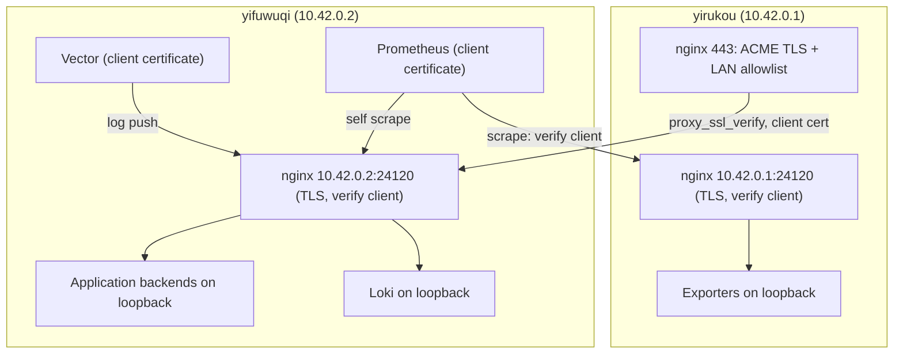
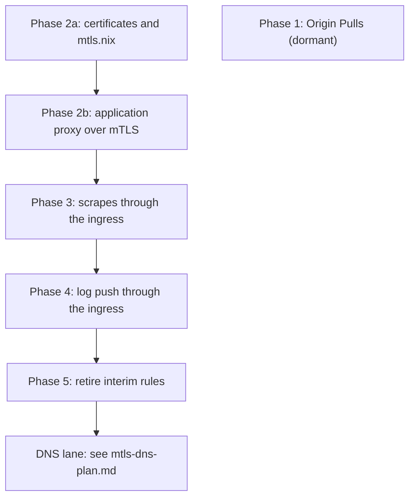

# Infrastructure mTLS Architecture & Implementation Plan

## Status: ACTIVE — design revised 2026-11-22 against the deployed two-host ingress; no phase implemented

## Objective

Make every HTTP service crossing `yirukou` and `yifuwuqi` reach the other host
only through nginx with mutual TLS, using one internal CA and per-host
certificates, without per-device enrolment and without adding listener ports.

Non-HTTP lanes are split out: SSH stays key-authenticated, the Cloudflare edge
tier stays dormant, and DNS has its own plan ([mTLS on DNS](mtls-dns-plan.md)).

## Current State (repository-verified 2026-11-22)

- **Application hop**: `mkRemoteVhosts` in
  [proxy-vhosts.nix](../../../modules/services/proxy-vhosts.nix) proxies 22
  domains to one plain-HTTP upstream,
  `http://10.42.0.2:24120` (`services.ingress.port`). `mkLocalVhosts` serves
  them from one plain listener on the `yifuwuqi` LAN address, routing on the
  preserved `Host` header to loopback backends (four exceptions keep the LAN
  address), with `allow 10.42.0.1; deny all;` and a `_` default vhost
  returning 404.
- **Access control**: `restrictedProxyConfig` in
  [nginx-proxy.nix](../../../modules/services/nginx-proxy.nix) allows only the
  LAN CIDRs and denies the rest; the `yifuwuqi` firewall
  ([firewall.nix](../../../hosts/yifuwuqi/networking/firewall.nix)) admits only
  `10.42.0.1` to the ingress port and Loki's push port.
- **Scrapes**: Prometheus on `yifuwuqi` scrapes ten exporter jobs on
  `yirukou` over plain HTTP on their own ports, gated by an interim
  source-scoped `extraInputRules` block in
  [exporters.nix](../../../modules/services/monitoring/exporters.nix).
  Central-host exporters listen on loopback.
- **Log push**: Vector on `yirukou` pushes to Loki at
  `http://10.42.0.2:24100`
  ([promtail.nix](../../../modules/services/monitoring/promtail.nix)); Loki
  binds the LAN address with `auth_enabled = false`
  ([loki.nix](../../../modules/services/monitoring/loki.nix)); Grafana reads
  it over the LAN ([grafana.nix](../../../modules/services/monitoring/grafana.nix)).
- **Contracts**: [checks.nix](../../../nix/checks.nix) enforces
  `proxy-allowlist` on `yirukou` locations and `exporter-source-scope` on
  scrape hosts; the latter is self-declared interim and retires in Phase 5.
- **Module surface**: nginx in nixpkgs ships `--with-stream_ssl_module`;
  there is no typed `sslVerifyClient`/`sslClientCertificate` vhost option, so
  those lines go through `extraConfig`. Prometheus `tls_config` exposes
  `ca_file`, `cert_file`, `key_file` and `server_name`.

## Decisions

1. **One listener port, both hosts, both roles.** `10.42.0.X:24120` becomes
   TLS with `ssl_verify_client on`. On `yifuwuqi` it serves the 22 application
   vhosts, the metric paths and the Loki push path; on `yirukou` it serves the
   metric paths. No second port, no second firewall hole.
1. **One internal CA, four leaves.** `service-ca` (its key never leaves the
   operator's workstation), `yirukou-server`, `yifuwuqi-server`, and one client
   certificate per host. Public `.crt` files are committed; the four private
   keys are sops secrets.
1. **Client certificates prove the host, Host-header routing still names the
   service.** `yirukou` reaches `yifuwuqi` through one upstream, so a single
   certificate covers all 22 domains. `proxy_ssl_*`, `ssl_client_certificate`
   and `ssl_verify_client` are set per vhost, never in `commonHttpConfig`: at
   HTTP level they would also wrap `yirukou`'s loopback AdGuard vhosts and the
   `yitaishi` image upstream, which are plain HTTP by design.
1. **Verification is by IP SAN.** Certificates carry `DNS:<host>.lan` and
   `IP:10.42.0.X`. Machine clients connect to the address and verify the IP
   SAN, so nothing depends on resolver state: `proxy_ssl_name` defaults to the
   `proxy_pass` host, and Prometheus and Vector need no `server_name` override.
1. **The default vhost owns the handshake.** Prometheus and Vector cannot
   override the `Host` header, so their requests carry `10.42.0.X` and land on
   the default server for that listener. On `yifuwuqi` that is the existing
   `_` 404 vhost ([proxy-vhosts.nix](../../../modules/services/proxy-vhosts.nix));
   on `yirukou` it is one new vhost. Both carry the server certificate,
   `ssl_client_certificate` and `ssl_verify_client on`, plus the machine
   locations; everything else under `_` still returns 404.
1. **Metrics by path prefix, generated from one map.** One location per
   registry exporter, `location /<name>/ { proxy_pass http://127.0.0.1:<port>/; }`,
   with `metrics_path = "/<name>/metrics"` (`/blackbox/probe` for the probe
   job). The exporter map in
   [monitoring.nix](../../../modules/addresses/monitoring.nix) generates both
   the locations and the jobs, so ports stay in one place.
1. **Every registry exporter is fronted, including the central host's.**
   Prometheus scrapes `yifuwuqi`'s exporters through `10.42.0.2:24120` like any
   other target, so one scheme covers every job. Same-host loopback jobs that
   are not registry exporters (`prometheus`, `grafana`, `cadvisor`) stay plain
   HTTP and are documented as same-host.
1. **Loki moves to loopback and the push path uses the same prefix.**
   `location /loki/` proxies to Loki's root, so Vector pushes to
   `https://10.42.0.2:24120/loki/api/v1/push` and the `loki` scrape job reads
   `/loki/metrics`. Grafana's datasource points at `127.0.0.1`. The `:24100`
   firewall hole disappears.
1. **A `yi.mtls.enable` option gates the material**, default true. The DR test
   ([secrets/test.nix](../../../secrets/test.nix)) imports the real ingress
   module with synthetic secrets, so it sets the option false and keeps its
   plain-HTTP assertions.
1. **Three lanes stay outside mTLS.** SSH (deploy-rs, `nix-builder`) is
   key-authenticated; Nix substituter fetches to `cache.aset.love` keep
   server-auth only because Nix has no client-certificate option for
   substituters; DNS follows its own plan.

## Architecture



## Phases & Implementation Details

### Phase 1: Cloudflare Authenticated Origin Pulls (Tier 1, dormant)

Unchanged in intent. `yirukou` WAN TCP stays closed and no hostname is proxied
to it, so this phase is inert. When the `aset.love` canary is scheduled: pin
Cloudflare's Origin Pull CA, emit `ssl_client_certificate` and
`ssl_verify_client on` through `extraConfig` on a public listener, and keep the
trusted-LAN browser path separate so LAN browsers are never asked for a
Cloudflare client certificate. This tier touches neither host's ingress and
does not block Phases 2 to 5.

### Phase 2: Inter-Host Application Proxy (Tier 2)

1. **Material.** Commit `modules/services/certs/{service-ca,yirukou-server,yifuwuqi-server,yirukou-client,yifuwuqi-client}.crt`
   and add `modules/services/mtls.nix`, which owns `options.yi.mtls.enable`,
   the `mtls` group, the four `sops.secrets` entries
   (`owner = "root"`, `group = "mtls"`, `mode = "0440"`), and the directive
   strings consumers reuse:

   ```nix
   serverTls = caFile: certFile: keyFile: ''
     ssl_certificate ${certFile};
     ssl_certificate_key ${keyFile};
     ssl_client_certificate ${caFile};
     ssl_verify_client on;
   '';
   upstreamTls = clientCert: clientKey: caFile: ''
     proxy_ssl_certificate ${clientCert};
     proxy_ssl_certificate_key ${clientKey};
     proxy_ssl_trusted_certificate ${caFile};
     proxy_ssl_verify on;
     proxy_ssl_verify_depth 2;
   '';
   ```

1. **`yifuwuqi` ingress.** `mkLocalVhosts` turns its existing `listen` entries
   into TLS (`ssl = true`, `addSSL = true`) and appends `serverTls` to every
   generated vhost, including `_`. `ssl_verify_client` is a server-level
   directive, so each generated vhost carries it; the shared map means one
   edit, not 22.

1. **`yirukou` egress.** `mkRemoteVhosts` switches the upstream to `https://`
   and appends `upstreamTls` to the generated location config. WebSocket,
   body-size and timeout handling are unchanged.

1. **Firewall.** `gatewayPorts` on `yifuwuqi` narrows to the ingress port;
   Loki's port is removed in Phase 4.

1. **Secrets plumbing.** nginx reads its key as root at startup; Prometheus
   and Vector read theirs as unprivileged users. Verify the group path
   resolves through `/run/secrets` (mode of the mount point and of any
   intermediate directory) before deploying, and drop the group in favour of
   `owner` if it does not.

### Phase 3: Metrics Scrapes Through the Ingress (Tier 3a)

1. `monitoringLib.exporterAddress` collapses to `127.0.0.1`; the `_` default
   vhosts on both hosts gain one `location "/<name>/"` per registry exporter.
1. [prometheus.nix](../../../modules/services/monitoring/prometheus.nix)
   targets `https://10.42.0.X:24120`, sets `metrics_path`, and attaches
   `tls_config` with the scraper's client certificate, key and the CA. The
   probe job keeps its `__param_*` relabeling and points at `/blackbox/probe`.
1. [exporters.nix](../../../modules/services/monitoring/exporters.nix) loses
   its `extraInputRules` block; `yirukou` gains one line admitting
   `10.42.0.2` to `:24120`.
1. Delete the `exporter-source-scope` contract in
   [checks.nix](../../../nix/checks.nix). `proxy-allowlist` stays; the
   `yirukou` machine vhost carries `restrictedProxyConfig` like every other
   serving location.

### Phase 4: Log Push Through the Ingress (Tier 3b)

1. Loki binds `127.0.0.1` and drops `yirukou` from `IPAddressAllow`.
1. The `yifuwuqi` `_` vhost gains `location "/loki/"` proxying to Loki's root.
1. Vector's sink moves to the ingress with `ca_file`, `crt_file` and
   `key_file`; Grafana's Loki datasource moves to `127.0.0.1`. Both consumers
   of `monitoringLib.lanHttpEndpoint` disappear with that change, so the
   helper is deleted from
   [lib.nix](../../../modules/services/monitoring/lib.nix).

### Phase 5: Retire Interim IP Rules

Remove the `yifuwuqi` Loki allowance (done in Phase 4), leaving the gateway
rule with the TLS ingress port only, and confirm the exporter rule is gone.
The `exporter-source-scope` contract is already deleted in Phase 3.

## Certificate Material

Run once in a secure workspace; rotate leaf certificates before their 3-year
expiry, keeping the 10-year CA.

```bash
openssl ecparam -name secp384r1 -genkey -noout -out service-ca.key
openssl req -new -x509 -sha384 -key service-ca.key -out service-ca.crt -days 3650 \
  -subj "/CN=Aset Internal Service CA"

# per host, once as a server and once as a client
openssl ecparam -name secp384r1 -genkey -noout -out "$name.key"
openssl req -new -key "$name.key" -out "$name.csr" -subj "/CN=$name"
openssl x509 -req -in "$name.csr" -CA service-ca.crt -CAkey service-ca.key \
  -CAcreateserial -out "$name.crt" -days 1095 -sha384 \
  -extfile <(echo -e "subjectAltName=DNS:$name.lan,IP:$ip\nextendedKeyUsage=serverAuth")

openssl x509 -req -in "$name.csr" -CA service-ca.crt -CAkey service-ca.key \
  -CAcreateserial -out "$name-client.crt" -days 1095 -sha384 \
  -extfile <(echo "extendedKeyUsage=clientAuth")
```

| Identity          | SAN                                | Usage                                                   |
| ----------------- | ---------------------------------- | ------------------------------------------------------- |
| `yirukou-server`  | `DNS:yirukou.lan`, `IP:10.42.0.1`  | `yirukou` listener and metrics frontend                 |
| `yifuwuqi-server` | `DNS:yifuwuqi.lan`, `IP:10.42.0.2` | `yifuwuqi` listener (apps, metrics, Loki)               |
| `yifuwuqi-client` | none                               | Prometheus and Vector scraping `yirukou` and themselves |
| `yirukou-client`  | none                               | `yirukou` proxying to `yifuwuqi`                        |

## Files & LOC Budget

Adds about 45 Nix lines net.

| File                                                                              | Change                                                             |
| --------------------------------------------------------------------------------- | ------------------------------------------------------------------ |
| `modules/services/mtls.nix` (new)                                                 | +55: option, group, secrets, directive helpers                     |
| `modules/services/certs/*.crt` (new)                                              | +12 total                                                          |
| [proxy-vhosts.nix](../../../modules/services/proxy-vhosts.nix)                    | +35/-10: TLS listen, `serverTls`, `upstreamTls`, machine locations |
| [nginx-proxy.nix](../../../modules/services/nginx-proxy.nix)                      | +25: `yirukou` machine vhost                                       |
| [local-ingress.nix](../../../modules/services/local-ingress.nix)                  | +3: import the option, drop the plain-HTTP comment                 |
| [exporters.nix](../../../modules/services/monitoring/exporters.nix)               | -16: interim rule removed                                          |
| [prometheus.nix](../../../modules/services/monitoring/prometheus.nix)             | +12/-6: HTTPS targets, `tls_config`                                |
| [promtail.nix](../../../modules/services/monitoring/promtail.nix)                 | +4/-1: TLS sink                                                    |
| [loki.nix](../../../modules/services/monitoring/loki.nix)                         | -3: loopback bind                                                  |
| [grafana.nix](../../../modules/services/monitoring/grafana.nix)                   | -1: loopback datasource                                            |
| [lib.nix](../../../modules/services/monitoring/lib.nix)                           | +4/-8: `lanHttpEndpoint` deleted                                   |
| `hosts/yifuwuqi/networking/firewall.nix`, `hosts/yirukou/networking/firewall.nix` | +3/-2                                                              |
| [checks.nix](../../../nix/checks.nix)                                             | -30: contract deleted                                              |
| [secrets/test.nix](../../../secrets/test.nix)                                     | +2: `yi.mtls.enable = false`                                       |

## Rollout Order



1. Phase 2a is a no-op generation: material and option only.
1. Phases 2b, 3, 4 and 5 each deploy as their own generation, `yifuwuqi`
   before `yirukou` when a change is additive on one side.
1. Do not share a generation with the
   [impermanence plan](impermanence-yirukou-plan.md), which also moves key
   staging.
1. The DNS lane starts only after Phase 5 passes.

## Acceptance

- `curl --cert ... --key ... --cacert service-ca.crt https://10.42.0.2:24120/node/metrics`
  succeeds from `yirukou`; the same request without a client certificate fails
  the handshake.
- Every Proxmox job reports `up == 1`; `probe_success` still separates target
  health from exporter reachability.
- A Vector push without its client certificate is rejected; logs from
  `yirukou` still arrive in Grafana.
- A browser on the trusted LAN reaches a proxied app unchanged, and the
  untrusted VLAN is still denied.
- `nixos-rebuild dry-build --flake .#yirukou` and `.#yifuwuqi` evaluate clean.

## Out of Scope

- [mTLS on DNS](mtls-dns-plan.md): the resolver hop.
- [Impermanence on yirukou](impermanence-yirukou-plan.md): storage layout and
  key staging.
- SSH and Nix substituters, for the reasons in Decision 10.

## Open Questions

None blocking. The DNS lane carries the only remaining design choice.
