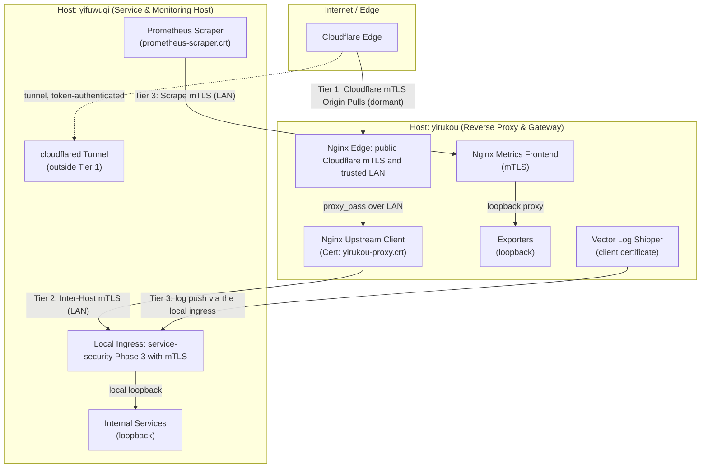
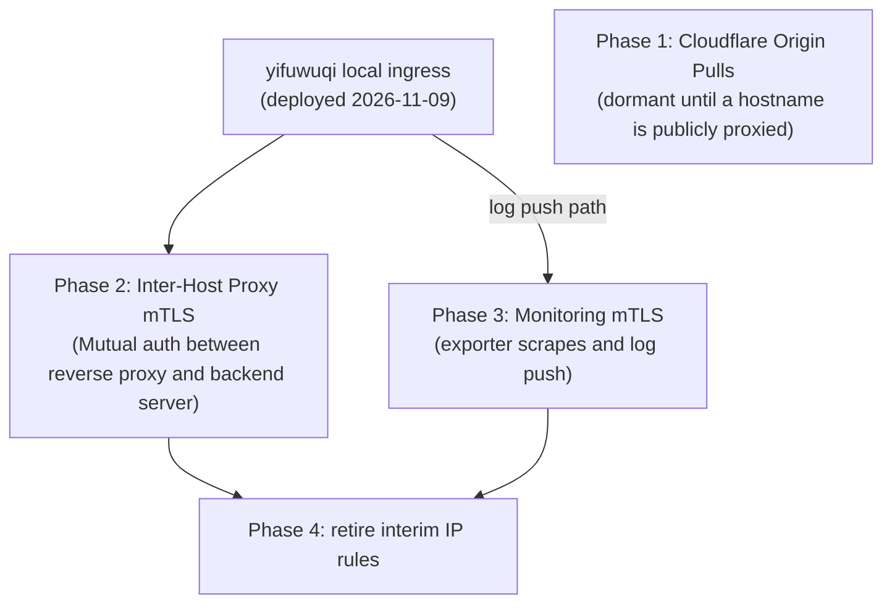

# Infrastructure mTLS Architecture & Implementation Plan

## Status: DRAFT — no tier implemented; repository reviewed 2026-11-08

## Objective

Design and implement a server-side 3-tier Mutual TLS (mTLS) security architecture across the NixOS homelab infrastructure with **zero per-device client certificate overhead**:

1. **Cloudflare Authenticated Origin Pulls (Tier 1: Edge Ingress)**: Enforce mTLS between Cloudflare edge proxy servers and `yirukou` Nginx to block direct-to-IP port scans, botnets, and proxy bypass attempts. Dormant while no hostname is publicly proxied to `yirukou` (see Current State).
1. **Inter-Host Upstream Proxy mTLS (Tier 2: LAN Inter-Host)**: Authenticate and encrypt all reverse-proxied traffic between `yirukou` (reverse proxy) and `yifuwuqi` (service host) across the LAN (`10.42.0.0/24`).
1. **Observability mTLS (Tier 3: Monitoring Mesh)**: Mutually authenticate every cross-host monitoring hop: Prometheus on `yifuwuqi` scraping the exporters on `yirukou`, and Vector on `yirukou` pushing logs to Loki.

> [!NOTE]
> Personal client devices (laptops, phones, tablets, browsers) require **no**
> certificate installation. Administrative services (Cockpit, Forgejo, Arr
> apps, Grafana, qBittorrent, and SillyTavern) are managed through SSH on
> `yifuwuqi`, not directly from client browsers. Explicitly client-facing
> hosted websites remain a separate ingress category; their proxy access is
> narrowed by VPN to LAN Phase 2 and protected by their own authentication.

### Scope

Owns:

- The internal CA (`fufu-service-ca`), certificate issuance and rotation.
- Cloudflare Authenticated Origin Pulls (Tier 1).
- TLS settings on the cross-host hops: nginx `proxy_ssl_*` and
  `ssl_verify_client`, the shared metrics frontend and Prometheus `tls_config`,
  and Vector/Loki TLS.

Not owned here:

- Which listeners exist and what binds where, including the `yifuwuqi` local ingress and its vhost helper: the retired Service Security Architecture Plan (git history) and [yifuwuqi](../hosts/yifuwuqi.md).
- Who may connect at the network layer: the host firewall rules in [yirukou](../hosts/yirukou.md) and [yifuwuqi](../hosts/yifuwuqi.md), and the tailnet rules from the retired VPN to LAN Migration Plan (git history).
- `yirukou` storage: [Impermanence on yirukou](impermanence-yirukou-plan.md).

______________________________________________________________________

## Evidence Status

- **Repository-verified**: no service CA, certificate artifacts,
  `ssl_verify_client`, upstream TLS, shared metrics frontend, or Prometheus TLS
  scrape configuration has been implemented. Current inter-host traffic is
  plaintext where this plan intends mTLS.
- **Live-host verified 2026-11-08**: `yirukou` still uses its persistent Ext4
  root and has active Tailscale; that confirms no impermanence cutover has
  coupled key staging to mTLS yet.
- **External or operational verification pending**: public DNS and Cloudflare
  Origin Pull state, confirmation that the cloudflared mapping remains
  SSH-only, and the first public-edge hostname.

______________________________________________________________________

## Current State

- **Perimeter Ingress**: `yirukou` runs Nginx (`modules/services/nginx-proxy.nix`) with a wildcard ACME certificate for `*.fufu.land` obtained via Cloudflare DNS-01 (`sops.secrets.cloudflare_api_token`).
- **Public Edge Status Requires Revalidation**: `yirukou` is the intended
  public edge, but the repository currently configures its WAN interfaces for
  UDP `51820` only. The 2026-11-06 DNS result and Cloudflare state are external
  observations, not current facts; recheck both before enabling Tier 1. Until
  a public Cloudflare-to-`yirukou` origin exists, Origin Pulls remain dormant.
- **Second Cloudflare Ingress**: A cloudflared tunnel container on `yifuwuqi`
  (`modules/services/cloudflared.nix`) is an SSH fail-safe only. Its dashboard
  mapping must remain limited to SSH and must not target the local ingress or
  hosted application backends. Authenticated Origin Pulls do not apply to this
  tunnel traffic.
- **Access Control**: VPN to LAN Phase 2 limits `restrictedProxyConfig` to
  `yirukou` LAN IPv4/IPv6 CIDRs; subnet-route Tailnet clients reach nginx
  SNAT'd as `10.42.0.1`. Administrative services stop being browser-facing
  under the service-security plan. The untrusted VLAN CIDRs are intentionally
  absent.
- **Inter-Host Traffic**: Reverse proxy on `yirukou` passes traffic to `yifuwuqi` over plain HTTP (`http://${yifuwuqiLan}:${port}`), one backend port per service. The firewall side is in the service-security plan.
- **Monitoring**: Prometheus on `yifuwuqi` scrapes ten exporter jobs on `yirukou` over plain HTTP (node, smokeping, blackbox, systemd, process, smartctl, nginx, adguard, unbound, redis), generated from `allAddresses.monitoring.exporters` in `modules/services/monitoring/exporters.nix` and `modules/services/monitoring/prometheus.nix`. Exporters on `yifuwuqi` (the central host) listen on loopback.
- **Log Shipping**: Vector on `yirukou` pushes the journal to Loki at `http://10.42.0.2:24100` (`modules/services/monitoring/promtail.nix`); Loki runs with `auth_enabled = false`.
- **Secret Management**: Sops-nix encrypts `secrets/secrets.yaml` to the hosts' SSH host keys. Since `4faab7d`, only root can edit or decrypt it (`docs/src/services/secrets.md`).

______________________________________________________________________

## Decisions

1. **PKI Authority Model**:
   - **Cloudflare Edge**: Cloudflare Origin Pull Static Root CA (publicly trusted Cloudflare certificate).
   - **Internal Service & Scrape CA (`fufu-service-ca`)**: Dedicated homelab internal Root CA for inter-host reverse proxying and Prometheus metrics scraping.
   - **Rotation**: retain the 10-year internal CA and 3-year host-certificate
     lifetime.
1. **Zero Device Enrollment**:
   - No user/device PKI (`fufu-client-ca` removed). No `.p12` files, device keychain imports, or mobile profiles.
1. **100% Declarative Host Deployment**:
   - **Public Certificates & CAs** (`*.crt`): Committed directly to Git (e.g. `modules/services/certs/`) and referenced via Nix store paths.
   - **Private Keys** (`*.key`): Encrypted into `secrets/secrets.yaml` via Sops-nix and mounted automatically at runtime (e.g. `/run/secrets/certs/...`). They are added as root (`su -`), since sops access is root-only.
   - **Selected model**: use Sops-backed static certificate material; do not
     deploy a `step-ca` runtime service.
1. **Tier 2 Terminates on the Local Ingress**:
   - The service-security plan (Decision 4, Phase 3) puts one nginx listener on `yifuwuqi` in front of every proxied backend. Tier 2 adds the server certificate and client verification to that listener, and `yirukou` switches every `yifuwuqi` upstream to it through the vhost helper from the same phase. No per-service TLS vhosts.
1. **Tier 3 Uses a Shared Nginx Metrics Frontend**:
   - `yirukou` Nginx fronts every non-central exporter on one dedicated TLS
     listener, verifies Prometheus's client certificate, and proxies each
     exporter path to loopback. This avoids exporter-specific TLS features and
     private-key distribution.
   - Prometheus generates HTTPS scrape configs, TLS settings, and metrics
     paths from the same exporter map. Exporters on the central host stay plain
     HTTP on loopback.
   - Vector's push: the preferred path is Loki on `127.0.0.1` behind the `yifuwuqi` local ingress, so Tier 2's listener verifies Vector's client certificate while Grafana and Prometheus keep loopback access. The alternative, Loki serving TLS itself, moves Grafana's datasource and the `loki` scrape job to TLS too.
1. **The cloudflared Tunnel Stays Outside Tier 1**:
   - The tunnel is a separate Cloudflare-to-`yifuwuqi` SSH fail-safe,
     authenticated by its tunnel token. It does not reach the verified local
     ingress and therefore needs no internal client certificate.
1. **Public and LAN Client Access Stay Separate**:
   - Client-facing hosted vhosts accept trusted LAN
     `10.42.0.0/24` and `fd75:c55f:6d19:1::/64`, and reject the untrusted VLAN
     `10.42.42.0/24` and `fd75:c55f:6d19:2::/64`.
   - The future public listener accepts only Cloudflare-authenticated traffic.
     It must be separate from the LAN browser path, or use an equivalent
     policy proven to accept trusted LAN browsers without a Cloudflare client
     certificate and reject untrusted VLAN clients.

______________________________________________________________________

## Architecture Diagram



______________________________________________________________________

## Phases & Implementation Details

______________________________________________________________________

### Phase 1: Cloudflare Authenticated Origin Pulls (Tier 1: Edge Ingress)

This tier stays dormant while `yirukou` WAN TCP remains closed (Current State).
Activate it with the `fufu.land` public canary only.

#### 1.1 Declarative Configuration (NixOS)

Pin Cloudflare's published Origin Pull CA in
`modules/services/nginx-proxy.nix`. The pinned NixOS Nginx module exposes no
typed `sslClientCertificate` or `sslVerifyClient` virtual-host options, so the
public listener must emit `ssl_client_certificate` and `ssl_verify_client on`
through `extraConfig`.

Create a public Cloudflare-authenticated listener and a separate trusted-LAN
browser path for each client-facing hostname, or prove an equivalent
source-and-certificate policy. The public listener rejects direct origin
traffic; the LAN path accepts only `10.42.0.0/24` and
`fd75:c55f:6d19:1::/64` while denying the VLAN 42 CIDRs. Do not require a
Cloudflare client certificate from LAN browsers, and do not add client
verification to tunnel-only or administrative hosts.

For the canary, convert the existing `fufu.land` static response from
`forceSSL = false` to an HTTPS vhost using the existing `fufu.land` ACME
certificate. Its public content remains the fixed `hello world` response; do
not proxy it to `yifuwuqi` or expose another application in this release.

#### 1.2 Imperative Setup (Cloudflare Dashboard / API)

Enable Authenticated Origin Pulls for the zone:

**Option A: Cloudflare Dashboard**:

1. Log in to Cloudflare Dashboard $\\to$ Select `fufu.land`.
1. Navigate to **SSL/TLS** $\\to$ **Origin Server**.
1. Toggle **Authenticated Origin Pulls** to **ON**.

**Option B: Cloudflare API via CLI**:

```bash
export CLOUDFLARE_ZONE_ID="<your-zone-id>"
export CLOUDFLARE_API_TOKEN="<your-api-token>"

curl -s -X PATCH "https://api.cloudflare.com/client/v4/zones/${CLOUDFLARE_ZONE_ID}/origin_tls_client_auth/settings" \
  -H "Authorization: Bearer ${CLOUDFLARE_API_TOKEN}" \
  -H "Content-Type: application/json" \
  --data '{"enabled": true}' | jq .
```

______________________________________________________________________

### Phase 2: Inter-Host Upstream Proxy mTLS (Tier 2: LAN Inter-Host)

#### 2.1 One-Time CA & Certificate Generation

Run locally in a secure workspace directory (e.g. `~/.pki/service-ca/`):

```bash
mkdir -p ~/.pki/service-ca && cd ~/.pki/service-ca

# 1. Create Internal Service CA (valid 10 years)
openssl ecparam -name secp384r1 -genkey -noout -out service-ca.key
openssl req -new -x509 -sha384 -key service-ca.key -out service-ca.crt -days 3650 \
  -subj "/CN=Fufu Internal Service CA"

# 2. Issue yirukou Reverse Proxy Client Certificate (valid 3 years)
openssl ecparam -name secp384r1 -genkey -noout -out yirukou-proxy.key
openssl req -new -key yirukou-proxy.key -out yirukou-proxy.csr \
  -subj "/CN=yirukou.lan"
openssl x509 -req -in yirukou-proxy.csr -CA service-ca.crt -CAkey service-ca.key \
  -CAcreateserial -out yirukou-proxy.crt -days 1095 -sha384 \
  -extfile <(echo "extendedKeyUsage = clientAuth")

# 3. Issue yifuwuqi Backend Server Certificate (valid 3 years)
openssl ecparam -name secp384r1 -genkey -noout -out yifuwuqi-backend.key
openssl req -new -key yifuwuqi-backend.key -out yifuwuqi-backend.csr \
  -subj "/CN=yifuwuqi.lan"
openssl x509 -req -in yifuwuqi-backend.csr -CA service-ca.crt -CAkey service-ca.key \
  -CAcreateserial -out yifuwuqi-backend.crt -days 1095 -sha384 \
  -extfile <(echo -e "subjectAltName=DNS:yifuwuqi.lan,IP:10.42.0.2\nextendedKeyUsage = serverAuth")

# 4. Store public certificates in the Nix repository:
# cp service-ca.crt yirukou-proxy.crt yifuwuqi-backend.crt modules/services/certs/

# 5. Encrypt private keys into Sops (as root, `su -`):
# sops set secrets/secrets.yaml '["certs"]["yirukou_proxy_key"]' "$(cat yirukou-proxy.key)"
# sops set secrets/secrets.yaml '["certs"]["yifuwuqi_backend_key"]' "$(cat yifuwuqi-backend.key)"
```

#### 2.2 Declarative Configuration (NixOS)

**On `yirukou` (Reverse Proxy Client)** in `modules/services/nginx-proxy.nix`, applied to the `yifuwuqi` upstreams through the vhost helper from the service-security plan's Phase 3:

```nix
{ config, pkgs, ... }:
let
  serviceCaCert   = ./certs/service-ca.crt;
  yirukouCert     = ./certs/yirukou-proxy.crt;
in
{
  sops.secrets."certs/yirukou_proxy_key" = {
    owner = "nginx";
    group = "nginx";
  };

  services.nginx = {
    # Configure upstream TLS with mutual authentication
    commonHttpConfig = ''
      proxy_ssl_certificate ${yirukouCert};
      proxy_ssl_certificate_key ${config.sops.secrets."certs/yirukou_proxy_key".path};
      proxy_ssl_trusted_certificate ${serviceCaCert};
      proxy_ssl_verify on;
      proxy_ssl_verify_depth 2;
      proxy_ssl_name yifuwuqi.lan;
      proxy_ssl_server_name on;
    '';
  };
}
```

**On `yifuwuqi` (TLS on the local ingress)**: the service-security plan's Phase 3 creates one nginx listener on `10.42.0.2` with a location per backend on `127.0.0.1`. Tier 2 adds the server certificate and client verification to that listener; the snippet shows the settings, not a separate vhost:

```nix
{ config, pkgs, ... }:
let
  serviceCaCert    = ./certs/service-ca.crt;
  yifuwuqiCert     = ./certs/yifuwuqi-backend.crt;
in
{
  sops.secrets."certs/yifuwuqi_backend_key" = {
    owner = "nginx";
    group = "nginx";
  };

  services.nginx = {
    enable = true;
    virtualHosts."backend.lan" = {
      onlySSL = true;
      sslCertificate = "${yifuwuqiCert}";
      sslCertificateKey = config.sops.secrets."certs/yifuwuqi_backend_key".path;
      extraConfig = ''
        ssl_client_certificate ${serviceCaCert};
        ssl_verify_client on;
      '';
      locations."/" = {
        proxyPass = "http://127.0.0.1:3000"; # one location per backend, generated by the vhost helper
      };
    };
  };
}
```

______________________________________________________________________

### Phase 3: Metrics & Prometheus Scraper mTLS (Tier 3: Monitoring Mesh)

#### 3.1 One-Time Scraper & Metrics Frontend Keypair Generation

```bash
# 1. Issue Prometheus Scraper Client Certificate
openssl ecparam -name secp384r1 -genkey -noout -out prometheus-scraper.key
openssl req -new -key prometheus-scraper.key -out prometheus-scraper.csr \
  -subj "/CN=prometheus-scraper"
openssl x509 -req -in prometheus-scraper.csr -CA service-ca.crt -CAkey service-ca.key \
  -CAcreateserial -out prometheus-scraper.crt -days 1095 -sha384 \
  -extfile <(echo "extendedKeyUsage = clientAuth")

# 2. Issue yirukou Metrics Frontend Server Certificate
openssl ecparam -name secp384r1 -genkey -noout -out yirukou-metrics.key
openssl req -new -key yirukou-metrics.key -out yirukou-metrics.csr \
  -subj "/CN=yirukou-metrics.lan"
openssl x509 -req -in yirukou-metrics.csr -CA service-ca.crt -CAkey service-ca.key \
  -CAcreateserial -out yirukou-metrics.crt -days 1095 -sha384 \
  -extfile <(echo -e "subjectAltName=DNS:yirukou-metrics.lan,IP:10.42.0.1\nextendedKeyUsage = serverAuth")

# 3. Store public certificates in the repo:
# cp prometheus-scraper.crt yirukou-metrics.crt modules/services/certs/

# 4. Encrypt private keys into Sops (as root, `su -`):
# sops set secrets/secrets.yaml '["certs"]["prometheus_scraper_key"]' "$(cat prometheus-scraper.key)"
# sops set secrets/secrets.yaml '["certs"]["yirukou_metrics_key"]' "$(cat yirukou-metrics.key)"
```

#### 3.2 Declarative Configuration (NixOS)

**On `yirukou`**: add one Nginx metrics listener using
`yirukou-metrics.crt`, its Sops-mounted key, and the service CA for
`ssl_verify_client on`. Generate locations from the exporter map; each location
proxies to its exporter over loopback. Move the `yirukou` exporter listeners
to loopback and close their former LAN firewall ports.

**On `yifuwuqi`**: configure the Prometheus generator once with HTTPS,
`tls_config`, the `prometheus-scraper` client key, the service CA, and
`server_name = "yirukou-metrics.lan"`. Generate each job's `metrics_path`
from the same exporter map while targeting the single Nginx metrics listener.
Central-host exporters remain plain HTTP on loopback.

#### 3.3 Log Push (Vector to Loki)

Preferred path (Decision 5): Loki binds `127.0.0.1`, and the `yifuwuqi` local ingress gets a location for Loki's push API. Vector's `sinks.loki` in `modules/services/monitoring/promtail.nix` switches its endpoint to the ingress over HTTPS and presents a client certificate from the internal CA (`tls.crt_file`, `tls.key_file`, `tls.ca_file`). Grafana and Prometheus keep reaching Loki on loopback.

### Phase 4: Retire Interim IP Rules

Absorbed from the retired Service Security Architecture Plan (completed 2026-11-09). After Phases 2 and 3 pass, drop the interim rules mTLS replaces:

1. The exporter source restriction on `yirukou` (Phase 3 scrapes authenticate by client certificate instead of source address).
1. The Loki push allowance on the `yifuwuqi` firewall (Vector pushes through the local ingress over mTLS).
1. The `yirukou` gateway rule keeps only the TLS ingress port.

______________________________________________________________________

## Rollout Order



Fleet sequencing is defined by the [Architecture Security Rollout](architecture-rollout-plan.md).
Phase 1 is a conditional edge lane; the internal critical path is the deployed
local ingress, then Phases 2 and 3, then Phase 4.

1. **Conditional edge lane — deploy Phase 1 (Cloudflare) for `fufu.land`**:
   - Test direct origin connection `curl -k https://<yirukou-public-ip>` (must be rejected with TLS handshake failure).
   - Test via Cloudflare hostname `https://fufu.land` (should succeed normally).
   - Test the same client-facing hostname from trusted LAN (must succeed) and
     from the untrusted VLAN (must be rejected).
1. **Internal critical path — deploy Phase 2 (Inter-Host Upstream Proxy)** on the deployed local ingress:
   - Validate upstream proxy connections from `yirukou` to `yifuwuqi` over HTTPS with mutual certificate verification.
1. **Internal critical path — deploy Phase 3 (Monitoring)** on the same local ingress:
   - Verify all Prometheus scrape targets report `UP` over TLS in Grafana / Prometheus web UI.
   - Loki keeps receiving `yirukou` logs; a push without the client certificate fails the TLS handshake.
1. **Internal critical path — deploy Phase 4 (Retire Interim IP Rules)** after Phases 2 and 3 pass:
   - The exporter source restriction and the Loki push allowance are gone; the `yirukou` gateway rule keeps only the TLS ingress port.

### Cross-Plan Dependencies

- **Fleet sequence**: [Architecture Security Rollout](architecture-rollout-plan.md)
  is the canonical dependency order.
- **Depends on** the `yifuwuqi` local ingress and vhost helper (deployed 2026-11-09, formerly the Service Security Architecture Plan's Phase 3): Phase 2 terminates on it, and the Phase 3 log-push path uses the same ingress.
- Phase 2 removes the overlay CIDR from `restrictedProxyConfig` (the VPN-to-LAN migration completed 2026-11-09): Tier 2 uses
  LAN mTLS, not a direct Tailscale transport.
- **Coordinates with** [Impermanence on yirukou](impermanence-yirukou-plan.md):
  current persistent-root deployments do not depend on impermanence. If its
  tmpfs-root cutover happens first, its `/persist/keys` staging must complete
  before these private keys are deployed.

______________________________________________________________________

## Open Questions & Review Items

No mTLS design choice remains open. The `fufu.land` canary is the first public
Cloudflare-to-`yirukou` listener and Origin Pull rollout.
