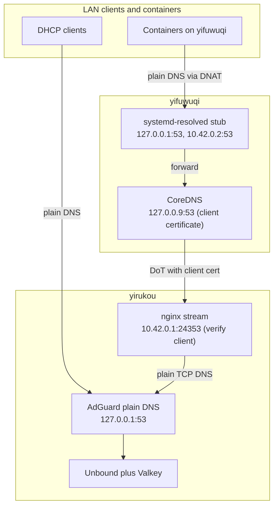
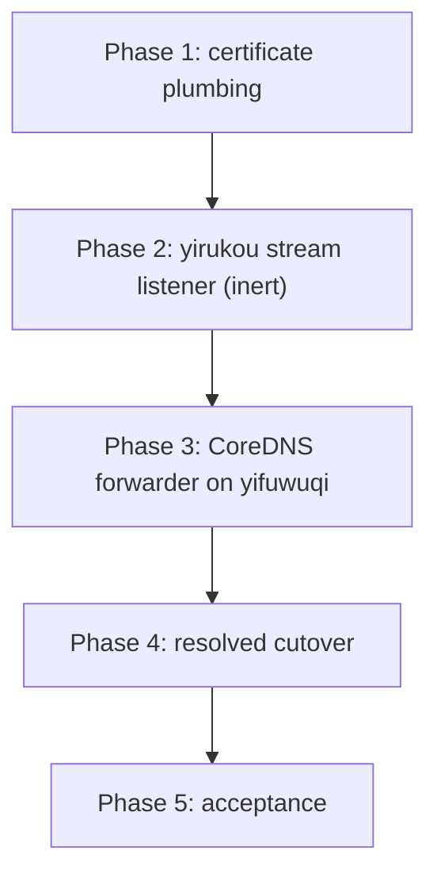

# mTLS on DNS: the Resolver Hop

## Status: DRAFT — not started; nothing blocks it

## Objective

Wrap the one DNS dependency crossing `yifuwuqi` to `yirukou` in mutual TLS
without changing any answer, any device path, or any DHCP advertisement.

Home devices keep using plain DNS. The certificate authenticates and encrypts
the relay hop only; it is not admission control, because plain `:53` stays open
for LAN clients.

## Current State (repository-verified 2026-11-22)

- **`yifuwuqi` runs no resolver.** [services.nix](../../../hosts/yifuwuqi/services.nix)
  imports neither `adguardhome.nix` nor `unbound.nix`. Its only DNS server is
  the systemd-resolved stub (`DNSStubListener` plus `DNSStubListenerExtra` in
  [networking.nix](../../../hosts/yifuwuqi/networking.nix)), listening on
  `::1`, `127.0.0.1`, the LAN addresses and the tailnet address.
- **Its upstream is `yirukou` over plain DNS.** `eno1` sets
  `DNS = addresses.dns.lanUpstreams` with `Domains = [ "~." ]`
  ([eno1.nix](../../../hosts/yifuwuqi/networking/interfaces/eno1.nix)), which
  resolves to `fd75:c55f:6d19:1::1` and `10.42.0.1` from
  [hosts.nix](../../../modules/addresses/hosts.nix).
- **The whole host depends on it**: containers resolve through a DNAT to
  `10.42.0.2:53` ([firewall.nix](../../../hosts/yifuwuqi/networking/firewall.nix)).
- **`yirukou` is the resolver.** AdGuard filters, rewrites and validates
  DNSSEC, then queries local Unbound. It also serves the LAN directly: DHCP
  advertises `lanServers` (`10.42.0.1`, `10.42.0.2`), the untrusted VLAN gets
  `10.42.42.1`, and `yirukou-dns` DNATs hardcoded public resolvers to local
  DNS ([dhcp.nix](../../../hosts/yirukou/networking/dhcp.nix),
  [firewall.nix](../../../hosts/yirukou/networking/firewall.nix)).
- **AdGuard already has DoT on `:853`** with the wildcard ACME certificate
  (`server_name = dns.aset.love`, `strict_sni_check = false`,
  [adguardhome.nix](../../../modules/services/adguardhome.nix)).
- **`resolved` cannot present a client certificate** and cannot use a
  non-standard upstream port, so a forwarder daemon is required on `yifuwuqi`.
  This plan is the price of that requirement.

## Decisions

1. **nginx stream terminates mTLS, AdGuard keeps plain DNS.**
   `yirukou` listens on `10.42.0.1:24353` with `ssl_certificate yirukou-server`, `ssl_client_certificate service-ca` and
   `ssl_verify_client on`, then proxies **plain TCP DNS** to
   `127.0.0.1:53`. No TLS-in-TLS, and internal DNS stops depending on the
   ACME certificate.
1. **CoreDNS is the client, on a private loopback address.**
   `resolved` owns `127.0.0.1:53` and `10.42.0.2:53` and supplies MagicDNS,
   `.local` and the container path; it must keep them. CoreDNS therefore binds
   `127.0.0.9:53` — inside `127.0.0.0/8`, so networkd can name it as a plain
   address with the implicit port 53 — and forwards to the stream listener
   with `tls` using the `yifuwuqi-client` certificate and key.
1. **Only the upstream changes.** `resolved` keeps every stub address and
   every client; `eno1` points at `127.0.0.9`. DHCP, the untrusted VLAN, the
   DNAT paths and the `.ts`/`.local` handling are untouched.
1. **Fail closed, with a documented escape hatch.** No `FallbackDNS` to the
   plain upstream: a broken CoreDNS should be visible rather than silently
   downgrading. The revert is one line in `eno1.nix` plus one generation, and
   deploys still work because `deploy`, `ai-ssh` and the generated SSH config
   use literal LAN addresses.
1. **Same PKI, no new material.** `yirukou-server`, `yifuwuqi-client` and
   `service-ca` come from
   [mtls.nix](../../../modules/services/mtls.nix) unchanged. The stream
   listener also serves no other protocol, so it is a separate port
   (`24353`) rather than a SNI branch on the HTTP listener.
1. **One hop, one port, one firewall line.** `24353` is deliberately not
   added to `lanTcpPorts`; a scoped `extraInputRules` line admits only
   `10.42.0.2`, so LAN and tailnet clients cannot reach it.

## Architecture



## Phases & Implementation Details

### Phase 1: Certificate plumbing (no behaviour change)

Confirm the `mtls` group reaches CoreDNS. The forwarder runs as a dynamic
user, so grant it the group instead of a static account:

```nix
systemd.services.coredns.serviceConfig = {
  SupplementaryGroups = [ "mtls" ];
};
systemd.services.coredns.wants = [ "sops-install-secrets.service" ];
```

The sops secrets stay `root:mtls 0440`, matching
[mtls.nix](../../../modules/services/mtls.nix).

### Phase 2: `yirukou` stream listener (inert until used)

Add to [nginx-proxy.nix](../../../modules/services/nginx-proxy.nix), using the
`serverTls` helper:

```nix
services.nginx.streamConfig = ''
  server {
    listen ${yirukouLan}:${toString dnsTlsPort} ssl;
    ${serverTls caFile yirukouServerCert yirukouServerKey}
    proxy_pass 127.0.0.1:${toString addresses.services.adguardhome.dnsPort};
    proxy_timeout 5s;
  }
'';
```

Add one registry value (`dnsTlsPort = 24353`) and one scoped firewall accept
for `10.42.0.2`. Nothing connects yet, so this generation is safe to land
alone.

### Phase 3: CoreDNS forwarder on `yifuwuqi`

New `modules/services/mtls-dns.nix`, imported from
[services.nix](../../../hosts/yifuwuqi/services.nix):

```nix
services.coredns = {
  enable = true;
  # Verbatim Corefile; bind keeps it off resolved's stub addresses.
  config = ''
    .:53 {
      bind 127.0.0.9
      forward . ${yirukouLan}:${toString dnsTlsPort} {
        tls ${clientCert} ${clientKey} ${caCert}
        tls_servername ${yirukouLan}
      }
      cache 300
      errors
    }
  '';
};
```

`tls_servername` names the IP literal, which Go verifies against the
certificate's `IP:` SAN — the same trust rule the rest of the mTLS work uses.
Verify the directive set against the CoreDNS version in
`/etc/nix/inputs/nixpkgs` before merging; the `forward` plugin's TLS option
names are the one thing in this plan taken from upstream docs rather than this
repository.

### Phase 4: Cut `resolved` over

`eno1`'s `DNS` points at `127.0.0.9` instead of `lanUpstreams`. Every other
field (`Domains`, `MulticastDNS`, the stub listeners) is unchanged. Deploy
`yifuwuqi` alone; if answers break, revert this one line.

### Phase 5: Acceptance and retirement

- `resolvectl query example.com` on `yifuwuqi` answers, and
  `resolvectl status eno1` shows `127.0.0.9`.
- `kdig +tls @10.42.0.1 -p 24353 example.com` without a client certificate
  fails the handshake; with `yifuwuqi-client` it answers.
- A container on `yifuwuqi` still resolves (the DNAT to `10.42.0.2:53` path).
- A DHCP client still resolves through `10.42.0.1`, and a VLAN client through
  `10.42.42.1`.
- `dns.aset.love` DoT on `:853`, DoH on `:443` and DDR behaviour are
  unchanged.
- DNSSEC: a validating query still returns `AD` where it did before.

## Files & LOC Budget

About +45 Nix lines.

| File                                                                | Change                                               |
| ------------------------------------------------------------------- | ---------------------------------------------------- |
| `modules/services/mtls-dns.nix` (new)                               | +30: CoreDNS unit, Corefile, group and sops ordering |
| [nginx-proxy.nix](../../../modules/services/nginx-proxy.nix)        | +10: `streamConfig` block                            |
| [hosts.nix](../../../modules/addresses/hosts.nix)                   | +2: `dnsTlsPort`, forwarder address                  |
| [eno1.nix](../../../hosts/yifuwuqi/networking/interfaces/eno1.nix)  | +1/-1: upstream points at the forwarder              |
| [hosts/yifuwuqi/services.nix](../../../hosts/yifuwuqi/services.nix) | +1                                                   |
| [firewall.nix](../../../hosts/yirukou/networking/firewall.nix)      | +2: scoped accept for `10.42.0.2`                    |

## Rollout Order



1. `yirukou` before `yifuwuqi`; never deploy this in the same generation as
   the [impermanence cutover](impermanence-yirukou-plan.md).
1. Reverting Phase 4 restores plain `:53` forwarding with no loss of
   resolver answers.

## Out of Scope

- Any device-facing TLS or certificate enrolment. Phones, TVs, consoles and
  IoT keep plain DNS.
- Moving `yifuwuqi` to its own resolver, which would delete this hop
  entirely at the cost of duplicating AdGuard filtering, rewrites and cache.
- DoT or DoH for clients; AdGuard's existing `:853`, `:3443` and
  `/dns-query` endpoints are unchanged.

## Open Questions

None.
