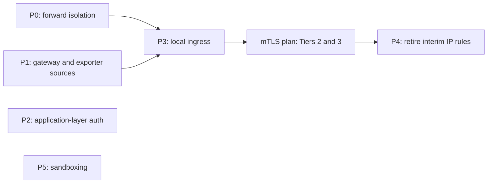

# Service Security Architecture & Defense-in-Depth Plan

## Status: DRAFT — Phase 0 deployed and verified 2026-11-08

## Objective

Close the remaining exposure between `yifuwuqi`'s services and everything that can reach them (LAN clients, containers, `yirukou`), use application-layer authentication wherever the network layer cannot identify the peer, and verify each layer with the security monitor.

1. **Default-deny on every hook**: input and forward, including container traffic and published container ports.
1. **Loopback and socket binding**: backends bind `127.0.0.1` or unix sockets behind one local ingress.
1. **Application-layer authentication**: Postgres, Loki, qBittorrent and SillyTavern authenticate clients instead of trusting source addresses.
1. **systemd sandboxing**: network-facing units adopt the shared `systemdHardening` set; `IPAddressAllow=` is a second layer where the peer set is static.
1. **Measured rollout**: every phase has a gate in the security monitor, Prometheus or Loki.

### Scope

Owns:

- `yifuwuqi` input and forward firewall mechanics: container isolation, published ports, the `yirukou` gateway rule.
- Exporter port exposure on non-central hosts (interim source restriction).
- Service bind addresses, the local ingress on `yifuwuqi`, and the `yifuwuqi` vhost helper in `modules/services/nginx-proxy.nix`.
- Application-layer auth: Postgres (`listen_addresses`, `pg_hba`), Loki gRPC binding, qBittorrent `AuthSubnetWhitelist`, SillyTavern whitelist.
- systemd sandboxing and `IPAddressAllow=` for network-facing units.
- Security dashboard panels used as phase gates.

Not owned here:

- The tailnet boundary (`tailscale0` trust, subnet routing, overlay CIDRs in allowlists, NetBird leftovers): [VPN to LAN Migration Plan](vpn-to-lan-migration-plan.md).
- Certificates and TLS between hosts: [mTLS Architecture Plan](mtls-architecture-plan.md).
- `yirukou`'s storage layout: [Impermanence on yirukou](impermanence-yirukou-plan.md).

______________________________________________________________________

## Evidence Status

- **Repository-verified**: Phase 0's configuration changes are active:
  forward filtering, shared private destinations, Cloudflared's source-scoped
  SSH path, FlareSolverr loopback publishing, and Gluetun consumer restoration.
  The remaining gaps and every live gate still require revalidation.
- **Live-host verified 2026-11-08**: `yifuwuqi` has its preferred default route
  through `10.42.0.1`; this does not replace the phase-specific firewall,
  listener, Prometheus, and Loki gates.
- **Phase 0 verified 2026-11-08**: Gluetun proxy egress reached
  `cp.cloudflare.com`, private traffic to `192.168.0.1` timed out,
  FlareSolverr refused the LAN address, and the Tailnet fallback route replied.
- **External or operational verification pending**: current listener owners,
  Podman DNAT reachability, and client-facing hosted-site classification must
  be rechecked immediately before their affected phase. The Cloudflare tunnel
  mapping was confirmed SSH-only on 2026-11-08.

______________________________________________________________________

## Current State

Repository facts below are current as of 2026-11-08. The former 2026-11-06
host snapshot is retained only where it identifies a verification target; it
must not be treated as current runtime evidence.

### Done Since the First Draft

- `eno1` is default-deny (`fa7821a`, `ad124b9`). It allows SSH `24212`, the AdGuard Home web UI `24333`, DNS `53`, and Samba (TCP `139`, `445`; UDP `137`, `138`).
- The `backend-ui-guard`, `valkey-guard` and `container-isolation` tables are deleted; `networking.nftables.tables = { }`.
- Valkey runs per host on `127.0.0.1` plus a unix socket. Unbound uses the
  socket, so no Valkey traffic crosses the LAN. The repository does not set a
  separate explicit protected-mode option.
- Firecrawl's redis, postgres and rabbitmq containers sit on the `--internal` network `firecrawl_internal`.
- The shared `systemdHardening` set in `modules/common.nix` covers the Arr
  services. Their 1.1–1.5 security scores are a historical observation and
  must be re-measured.
- Service ports moved to the 24xxx range (`dff580b`).

### Activated 2026-11-08

- `filterForward = true` now installs the forward chain. Container sources
  drop private IPv4 destinations with rate-limited logs, may use only the two
  WAN interfaces, and preserve `tailscale0 -> enp4s0` access to
  `192.168.0.1/32`.
- `privateDestinations` centralizes IPv4 and IPv6 private ranges for the
  firewall and Forgejo runner. The blanket container-to-`yirukou` forward
  accept is gone.
- Cloudflared has a static bridge source whose only explicit TCP host
  allowance is `yifuwuqi` SSH; it is excluded from application API access.
  FlareSolverr publishes only on loopback.
- `podman-gluetun` removes qBittorrent, FlareSolverr, torrent-indexer, slskd,
  and Soularr before replacement, allowing Gluetun itself to start.
- `ExecStartPost` queues their starts once Gluetun is active. The corrected
  deployment has all five units active and FlareSolverr responds on loopback.

### Gaps

1. **Forward isolation and consumer restoration are verified.**
   - The active source has the intended default-drop forward chain. Gluetun
     proxy egress succeeds to the WAN and times out to `192.168.0.1`; its
     consumers are active.
   - NixOS evaluates `ct status dnat accept` before `extraForwardRules`.
     Re-probe published-port reachability from a LAN client after activation.
   - Gluetun and its five consumers are active after the corrected deployment.
     Container WAN acceptance remains a separate runtime gate.
1. **Published Podman ports bypass the input chain.** Netavark DNATs them, so their packets traverse forward, and nixpkgs puts `ct status dnat accept` ahead of `extraForwardRules`. Re-probe this from a LAN client before rollout. Published on LAN addresses:
   - qBittorrent `24080`, torrent-indexer `24181` and slskd `24530` on `10.42.0.2`;
   - FlareSolverr `24191` is loopback-only in staged source; confirm it is no
     longer reachable from the LAN after activation.
   - qBittorrent's `AuthSubnetWhitelist` includes `10.42.0.0/24`, so LAN clients get its WebUI without a login.
1. **The gateway rule admits everything.** The configured
   `ip saddr ${allAddresses.hosts.yirukou.network.lan.ipv4.host} accept`
   resolves to `10.42.0.1` today and matches every port on every interface.
   `yirukou` advertises `10.42.0.0/24` with Tailscale's default subnet SNAT,
   so subnet-routed tailnet clients arrive with that source address too.
1. **Postgres trusts networks.** It listens on `0.0.0.0:5432` and `[::]:5432` with `trust` for `100.64.0.0/10` and `127.0.0.1/32`. Forgejo, Grafana and Attic use the unix socket; only postgres-exporter uses TCP.
1. **Configured wildcard listeners and runtime owners requiring revalidation:**
   - Loki gRPC on `0.0.0.0:9096`.
   - The AdGuard exporter on `*:9617` (its binary ignores `listenAddress`).
   - SillyTavern on `0.0.0.0:24000` with `--no-whitelist`.
   - homepage, docs, searxng, jellyfin and bazarr on `0.0.0.0`; Arr, Forgejo, Attic, Cockpit and seerr on `*`.
   - The 2026-11-06 snapshot recorded `*:43085` and `*:45655` without owners;
     identify them again with `ss -tlnp` before changing listener policy.
1. **Monitoring exposure:**
   - Non-central hosts open every exporter port on their LAN interface. On `yirukou` that is `9100`, `9113`, `9115`, `9121`, `9167`, `9256`, `9374`, `9558`, `9617` and `9633` for every `br0` client, including process names, unit names and per-client AdGuard query counts.
   - Loki runs with `auth_enabled = false`.
   - Grafana's anonymous Viewer role must not expose the Security dashboard;
     administration is through SSH on `yifuwuqi`.
1. **Misleading config:**
   - `IPAddressAllow`/`IPAddressDeny = lib.mkForce [ ]` in `modules/services/arr/default.nix` override nothing today but would silently cancel any future per-unit filter.
   - NixOS's default `services.openssh.openFirewall` behavior opens `24212`
     broadly unless it is disabled. sshd binds explicit internal addresses, so
     nothing should answer on `yirukou` WANs; confirm the rendered firewall
     before changing this policy.

### Last Observed Monitoring Baselines — Re-measure Before Rollout

- The following values came from the 2026-11-06 snapshot and are not current
  acceptance evidence:
- `node_systemd_unit_exposure_score` on `yifuwuqi`: opencode 9.2, vector 8.3, loki 8.2, cockpit 6.2, sillytavern 6.2, seerr 6.1. The 14 `podman-*` units score 9.8 because systemd rates the wrapper unit, not the container.
- `IPAddressDeny=` weighs 0.2 in `systemd-analyze security`, so the score tracks sandboxing as a whole, not IP filtering.
- NixOS enables `DefaultIPAccounting`, so `systemd_service_ip_ingress_bytes` and `systemd_service_ip_egress_bytes` give per-unit traffic baselines.
- Firewall refusals reach Loki as `{job="systemd-journal", unit="kernel"} |= "refused packet"`. No panel or alert reads them.

______________________________________________________________________

## Decisions

### 1. Default-Deny on Forward

- Set `filterForward = true` on `yifuwuqi`. Forward rules, in order:
  1. accept containers only to enumerated `yirukou` ports they need, replacing
     the all-port `trustedHostDestinations` accept; cloudflared needs no
     `yirukou` exception because it is an SSH fail-safe only;
  1. drop container traffic to private destinations (logged, rate-limited);
  1. accept container egress to the WAN-facing interfaces;
  1. accept the Tailscale route `tailscale0 -> enp4s0` for `192.168.0.1/32`, which belongs to the [VPN to LAN Migration Plan](vpn-to-lan-migration-plan.md).
- Define one `privateDestinations` set (IPv4 and IPv6) in `modules/addresses.nix`. The container rules and the forgejo-runner sandbox both read it.
- Podman `internal = true` networks stay limited to backend tiers such as Firecrawl's. They also block internet egress, so they cannot replace these rules.

### 2. Published Container Ports Bind Loopback

- Container publishes use `127.0.0.1`; LAN clients reach them through the local ingress (Decision 4).
- flaresolverr has no proxy vhost and moves to `127.0.0.1` in Phase 0.
  Prowlarr already targets its loopback URL in the repository.

### 3. Scoped Gateway Rule

- Replace the blanket accept with `iifname "eno1" ip saddr 10.42.0.1 tcp dport { ... } accept`. The port set is derived from the same proxied-service list that generates `yirukou`'s nginx vhosts, plus Loki's push port.
- A SNAT'd source address is a routing fact, not an identity. Under the VPN to LAN plan every remote client arrives as `10.42.0.1`, so this rule defines what remote clients reach until the [mTLS Architecture Plan](mtls-architecture-plan.md) (Tier 2) identifies `yirukou` cryptographically.

### 4. Local Ingress Before Loopback Binds

- One nginx listener on `10.42.0.2` fronts every proxied backend. Backends then bind `127.0.0.1` or unix sockets.
- Client-facing hosted sites remain reachable through their explicitly
  designated ingress routes. Administrative services are loopback-only and
  managed through SSH on `yifuwuqi`.
- Services that containers call keep a listener on the address those containers use: Lidarr on `10.42.0.2` for soularr, SearXNG via `host.containers.internal` for Firecrawl. The container input allowlist keeps naming exactly those ports.
- A helper in `modules/services/nginx-proxy.nix` will derive both the existing
  `yirukou` proxy upstreams and the new `yifuwuqi` ingress routes from one
  service list. Today the cloned remote vhosts are on `yirukou`; no
  `yifuwuqi` ingress vhost exists yet.
- mTLS Tier 2 terminates on this listener.

### 5. Application-Layer Authentication

- **Postgres**: drop every `trust` line, bind only to loopback, and use the
  socket with `peer`; postgres-exporter moves to the socket. Administration
  requiring a client connection uses SSH to `yifuwuqi`, not a remotely exposed
  database listener. This replaces Decision 3 of the VPN to LAN plan.
- **Loki**: gRPC binds `127.0.0.1`. Push authentication is mTLS Tier 3.
- **qBittorrent**: `AuthSubnetWhitelist` shrinks to `127.0.0.1`, which also
  drops the NetBird `100.42.0.0/16` entry. Administration is through SSH on
  `yifuwuqi`, not a proxied browser endpoint.
- **SillyTavern**: bind to loopback and manage through SSH unless it is
  explicitly classified as a client-facing hosted service.
- **Valkey**: resolved by host-local instances (former Open Question 1).

### 6. systemd Sandboxing

- Network-facing units scored EXPOSED or MEDIUM (loki, vector, cockpit, sillytavern, seerr, opencode) adopt `systemdHardening`, relaxing only what each unit needs.
- `IPAddressAllow=` only where the peer set is static (loki, postgres). Bind addresses come first; the cgroup filter is a second layer.
- Remove the Arr `mkForce [ ]` lines.

### 7. Monitoring as Acceptance Gates

- Security dashboard: refused packets by interface and destination port, container-isolation drops (both from Loki), and an unsafe-units stat that excludes `podman-*` wrappers.
- Exporter ports on non-central hosts accept only the central host's address until mTLS Tier 3.

______________________________________________________________________

## Phases

P2 and P5 do not depend on the other phases.

### Phase 0: Forward Isolation — Deployed and Verified

1. `hosts/yifuwuqi/networking/firewall.nix`: enables `filterForward`, adds the
   ordered WAN and fallback-route accepts, removes the blanket
   `trustedHostDestinations` accept, and fixes the reverse-path comment.
1. `modules/services/cloudflared.nix`: creates a dedicated static bridge and
   makes its SSH allowance source-scoped; no Cloudflared exception reaches
   `yirukou` or a future local ingress.
1. `modules/addresses.nix`: provides `privateDestinations`;
   `modules/services/forgejo-runner.nix` reads it.
1. `modules/services/qbittorrent-vpn.nix`: publishes FlareSolverr on
   `127.0.0.1` and handles Gluetun's shared-network-namespace consumers
   before replacement. Its post-start restoration queues the consumers
   after Gluetun starts.
1. `docs/src/networking/sysctl-firewall.md`: describes the active rules and
   remaining runtime gates.

### Phase 1: Gateway and Exporter Sources

1. Gateway rule scoped per Decision 3.
1. `modules/services/monitoring/exporters.nix`: on non-central hosts, open exporter ports for the central host's address only.
1. `modules/services/monitoring/loki.nix`: gRPC on `127.0.0.1`.

### Phase 2: Application-Layer Authentication

1. `modules/services/postgresql.nix`: remove `trust`, add socket `peer`, set
   `listen_addresses` to loopback, and point the postgres-exporter DSN at the
   socket.
1. `modules/services/qbittorrent-vpn.nix` and `modules/services/ai/sillytavern.nix` per Decision 5.

### Phase 3: Local Ingress

1. `yifuwuqi` ingress listener and the vhost helper in `modules/services/nginx-proxy.nix`.
1. Backends bind `127.0.0.1`; the LAN publishes in `modules/services/qbittorrent-vpn.nix` go away.
1. The gateway port set shrinks to the ingress port plus Loki's push port.

### Phase 4: Retire Interim IP Rules

After mTLS Tiers 2 and 3, drop the exporter source rule and the Loki push allowance; the gateway rule keeps only the TLS ingress port.

### Phase 5: Sandboxing

1. Decision 6 units adopt `systemdHardening`; loki and postgres get `IPAddressAllow=`.
1. Remove the Arr `mkForce [ ]` lines.
1. Target: no network-facing unit outside `podman-*` scores above MEDIUM.

______________________________________________________________________

## Rollout Order

Each phase: evaluate the changed options with `nix eval` and `nixos-rebuild dry-build --flake .#<host>`, deploy through [CI/CD](../services/ci-cd.md) section 5 (`ci/deploy.sh switch <host>`), then pass the gate.

Fleet sequencing is defined by the [Architecture Security Rollout](architecture-rollout-plan.md).
This plan's Phase 0 must precede VPN Phase 3, and Phase 3 must precede the
internal mTLS phases.

1. **Phase 0 gate (passed 2026-11-08)**:
   - `nc -zv 10.42.0.2 24191` refused.
   - The Gluetun HTTP proxy returned `204` from `https://cp.cloudflare.com`
     and timed out to `http://192.168.0.1/`.
   - A Tailnet client reached `192.168.0.1` through the fallback route.
1. **Phase 1 gate**: from a LAN client other than `yifuwuqi`, `curl http://10.42.0.1:9100/metrics` fails; `up{host="yirukou"}` stays `1` for every job; Loki shows no new refusals from `10.42.0.1` on proxied ports.
1. **Phase 2 gate**: `psql -h 127.0.0.1 -U postgres` without a password fails; Grafana, Forgejo, Attic and `up{job="postgres"}` stay healthy; qBittorrent administration is available only through an SSH session to `yifuwuqi`.
1. **Phase 3 gate**: every designated client-facing `*.fufu.land` vhost answers through the ingress; `ss -tlnH` on `yifuwuqi` shows no backend on `0.0.0.0` or `*` beyond the ingress, Samba, DNS, SSH and the container-facing exceptions; from a LAN client, `nc -zv 10.42.0.2 24080` fails.
1. **Phase 4 gate**: the mTLS plan's verification passes before the interim rules go.
1. **Phase 5 gate**: `node_systemd_unit_exposure_score` meets the Phase 5 target.

### Cross-Plan Dependencies

- **Fleet sequence**: [Architecture Security Rollout](architecture-rollout-plan.md)
  is the canonical dependency order.
- **Depends on** the [VPN to LAN Migration Plan](vpn-to-lan-migration-plan.md): Phase 0 keeps its `192.168.0.1/32` tailnet route, and its SNAT topology is why Decision 3 scopes the gateway rule.
- **Unblocks** the [mTLS Architecture Plan](mtls-architecture-plan.md): Tier 2 terminates on the Phase 3 ingress and uses the Phase 3 vhost helper.
- **Depends on** the [mTLS Architecture Plan](mtls-architecture-plan.md): Phase 4 waits for Tiers 2 and 3.
- **Coordinates with** [Impermanence on yirukou](impermanence-yirukou-plan.md): `yirukou` changes from Phase 1 ship in a different generation from the impermanence boot, and that plan persists the security-monitor state these gates read.

______________________________________________________________________

## Open Questions

1. **Unattributed listeners**: what owns `*:43085` and `*:45655` on `yifuwuqi`?
