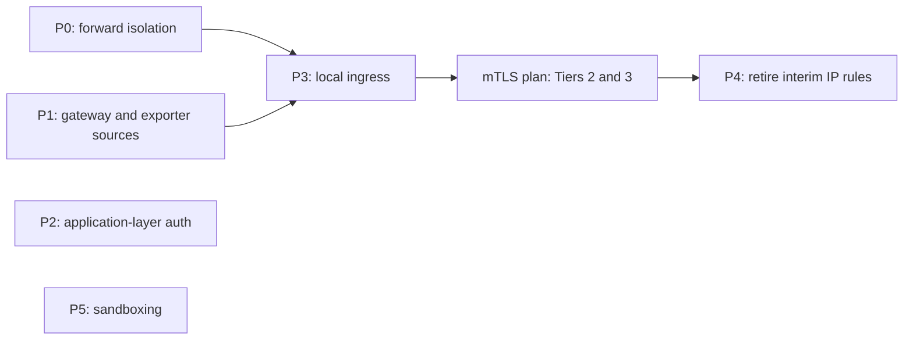

# Service Security Architecture & Defense-in-Depth Plan

## Objective

Close the remaining exposure between `yifuwuqi`'s services and everything that can reach them (LAN clients, containers, `yirukou`), use application-layer authentication wherever the network layer cannot identify the peer, and verify each layer with the security monitor.

1. **Default-deny on every hook**: input and forward, including container traffic and published container ports.
1. **Loopback and socket binding**: backends bind `127.0.0.1` or unix sockets behind one local ingress.
1. **Application-layer authentication**: Postgres, Loki, qBittorrent and SillyTavern authenticate clients instead of trusting source addresses.
1. **systemd sandboxing**: network-facing units adopt the shared `systemdHardening` set; `IPAddressAllow=` is a second layer where the peer set is static.
1. **Measured rollout**: every phase has a gate in the security monitor, Prometheus or Loki.

### Scope

Owns:

- `yifuwuqi` input and forward firewall mechanics: container isolation, published ports, the `yirukou` gateway rule.
- Exporter port exposure on non-central hosts (interim source restriction).
- Service bind addresses, the local ingress on `yifuwuqi`, and the `yifuwuqi` vhost helper in `modules/services/nginx-proxy.nix`.
- Application-layer auth: Postgres (`listen_addresses`, `pg_hba`), Loki gRPC binding, qBittorrent `AuthSubnetWhitelist`, SillyTavern whitelist.
- systemd sandboxing and `IPAddressAllow=` for network-facing units.
- Security dashboard panels used as phase gates.

Not owned here:

- The tailnet boundary (`tailscale0` trust, subnet routing, overlay CIDRs in allowlists, NetBird leftovers): [VPN to LAN Migration Plan](vpn-to-lan-migration-plan.md).
- Certificates and TLS between hosts: [mTLS Architecture Plan](mtls-architecture-plan.md).
- `yirukou`'s storage layout: [Impermanence on yirukou](impermanence-yirukou-plan.md).

______________________________________________________________________

## Current State

Checked on `yifuwuqi` on 2026-11-06 against the deployed nftables ruleset, `nix eval`, `ss -tlnH`, Prometheus and Loki.

### Done Since the First Draft

- `eno1` is default-deny (`fa7821a`, `ad124b9`). It allows SSH `24212`, the AdGuard Home web UI `24333`, DNS `53`, and Samba (TCP `139`, `445`; UDP `137`, `138`).
- The `backend-ui-guard`, `valkey-guard` and `container-isolation` tables are deleted; `networking.nftables.tables = { }`.
- Valkey runs per host on `127.0.0.1` plus a unix socket, with protected mode back on (`0c9fed1`). Unbound uses the socket, so no Valkey traffic crosses the LAN.
- Firecrawl's redis, postgres and rabbitmq containers sit on the `--internal` network `firecrawl_internal`.
- The shared `systemdHardening` set in `modules/common.nix` covers the Arr services, which score 1.1–1.5 (OK).
- Service ports moved to the 24xxx range (`dff580b`).

### Gaps

1. **Container forward isolation is not loaded.**
   - `networking.firewall.filterForward` is `false` on `yifuwuqi`, and nixpkgs renders `extraForwardRules` only when it is `true`. The deployed `nixos-fw` table has no forward chain, so "drop container to private networks" has not been enforced since the Aug 22 refactor.
   - Containers, including Firecrawl's Playwright browser and cloudflared, can reach the LAN, `yirukou`, `192.168.0.1` and the tailnet. `docs/src/networking/sysctl-firewall.md` says this isolation is enforced.
   - Enabling `filterForward` sets a drop policy, so container egress to WAN and the Tailscale route to `192.168.0.1/32` each need an explicit accept.
   - The blocked set (`10.0.0.0/8`, `172.16.0.0/12`, `192.168.0.0/16`) lacks `100.64.0.0/10`, `169.254.0.0/16` and IPv6. `modules/services/forgejo-runner.nix` keeps its own, fuller list.
   - In the existing accept for `trustedHostDestinations`, only the `yirukou` entry is a forward destination; the other two are `yifuwuqi`'s own addresses and hit the input chain. Containers may therefore reach every `yirukou` port.
   - Evidence: `nix eval .#nixosConfigurations.yifuwuqi.config.networking.firewall.filterForward` prints `false`, and the ruleset referenced by `systemctl cat nftables.service` has no `chain forward` in `table inet nixos-fw`.
1. **Published Podman ports bypass the input chain.** Netavark DNATs them, so their packets traverse forward, and nixpkgs puts `ct status dnat accept` ahead of `extraForwardRules`. Not yet probed from a LAN client. Published on LAN addresses:
   - qBittorrent `24080`, torrent-indexer `24181` and slskd `24530` on `10.42.0.2`;
   - flaresolverr `24191` on all addresses.
   - qBittorrent's `AuthSubnetWhitelist` includes `10.42.0.0/24`, so LAN clients get its WebUI without a login.
1. **The gateway rule admits everything.** `ip saddr 10.42.0.1 accept` matches every port on every interface. `yirukou` advertises `10.42.0.0/24` with Tailscale's default subnet SNAT, so subnet-routed tailnet clients arrive with that source address too.
1. **Postgres trusts networks.** It listens on `0.0.0.0:5432` and `[::]:5432` with `trust` for `100.64.0.0/10` and `127.0.0.1/32`. Forgejo, Grafana and Attic use the unix socket; only postgres-exporter uses TCP.
1. **Wildcard listeners that nothing reaches off-box:**
   - Loki gRPC on `0.0.0.0:9096`.
   - The AdGuard exporter on `*:9617` (its binary ignores `listenAddress`).
   - SillyTavern on `0.0.0.0:24000` with `--no-whitelist`.
   - homepage, docs, searxng, jellyfin and bazarr on `0.0.0.0`; Arr, Forgejo, Attic, Cockpit and seerr on `*`.
   - `*:43085` and `*:45655`, not yet attributed (`ss -tlnp` as root names them).
1. **Monitoring exposure:**
   - Non-central hosts open every exporter port on their LAN interface. On `yirukou` that is `9100`, `9113`, `9115`, `9121`, `9167`, `9256`, `9374`, `9558`, `9617` and `9633` for every `br0` client, including process names, unit names and per-client AdGuard query counts.
   - Loki runs with `auth_enabled = false`.
   - Grafana's anonymous Viewer role opens the Security dashboard (CVE inventory, unsafe units).
1. **Misleading config:**
   - `IPAddressAllow`/`IPAddressDeny = lib.mkForce [ ]` in `modules/services/arr/default.nix` override nothing today but would silently cancel any future per-unit filter.
   - The `checkReversePath` comment in `hosts/yifuwuqi/networking/firewall.nix` cites an exit node; `hosts/yifuwuqi/services.nix` sets `exitNodeHost = null`.
   - `services.openssh.openFirewall` opens `24212` on every interface of both hosts, including `yirukou`'s WANs. sshd binds explicit internal addresses, so nothing answers there, but the rule is wider than the listener.

### Monitoring Baselines

- `node_systemd_unit_exposure_score` on `yifuwuqi`: opencode 9.2, vector 8.3, loki 8.2, cockpit 6.2, sillytavern 6.2, seerr 6.1. The 14 `podman-*` units score 9.8 because systemd rates the wrapper unit, not the container.
- `IPAddressDeny=` weighs 0.2 in `systemd-analyze security`, so the score tracks sandboxing as a whole, not IP filtering.
- NixOS enables `DefaultIPAccounting`, so `systemd_service_ip_ingress_bytes` and `systemd_service_ip_egress_bytes` give per-unit traffic baselines.
- Firewall refusals reach Loki as `{job="systemd-journal", unit="kernel"} |= "refused packet"`. No panel or alert reads them.

______________________________________________________________________

## Decisions

### 1. Default-Deny on Forward

- Set `filterForward = true` on `yifuwuqi`. Forward rules, in order:
  1. accept containers to the `yirukou` ports they need (Open Question 3), replacing the all-port `trustedHostDestinations` accept;
  1. drop container traffic to private destinations (logged, rate-limited);
  1. accept container egress to the WAN-facing interfaces;
  1. accept the Tailscale route `tailscale0 -> enp4s0` for `192.168.0.1/32`, which belongs to the [VPN to LAN Migration Plan](vpn-to-lan-migration-plan.md).
- Define one `privateDestinations` set (IPv4 and IPv6) in `modules/addresses.nix`. The container rules and the forgejo-runner sandbox both read it.
- Podman `internal = true` networks stay limited to backend tiers such as Firecrawl's. They also block internet egress, so they cannot replace these rules.

### 2. Published Container Ports Bind Loopback

- Container publishes use `127.0.0.1`; LAN clients reach them through the local ingress (Decision 4).
- flaresolverr has no proxy vhost and moves to `127.0.0.1` in Phase 0, once Prowlarr's FlareSolverr URL is confirmed to use `127.0.0.1`.

### 3. Scoped Gateway Rule

- Replace the blanket accept with `iifname "eno1" ip saddr 10.42.0.1 tcp dport { ... } accept`. The port set is derived from the same proxied-service list that generates `yirukou`'s nginx vhosts, plus Loki's push port.
- A SNAT'd source address is a routing fact, not an identity. Under the VPN to LAN plan every remote client arrives as `10.42.0.1`, so this rule defines what remote clients reach until the [mTLS Architecture Plan](mtls-architecture-plan.md) (Tier 2) identifies `yirukou` cryptographically.

### 4. Local Ingress Before Loopback Binds

- One nginx listener on `10.42.0.2` fronts every proxied backend. Backends then bind `127.0.0.1` or unix sockets.
- Services that containers call keep a listener on the address those containers use: Lidarr on `10.42.0.2` for soularr, SearXNG via `host.containers.internal` for Firecrawl. The container input allowlist keeps naming exactly those ports.
- A helper in `modules/services/nginx-proxy.nix` replaces the ~20 cloned `yifuwuqi` vhosts, so upstream address and scheme change in one place.
- mTLS Tier 2 terminates on this listener.

### 5. Application-Layer Authentication

- **Postgres**: drop every `trust` line. Local clients use the socket with `peer`; postgres-exporter moves to the socket. If remote access stays (Open Question 1), it uses `scram-sha-256` from explicit addresses. This replaces Decision 3 of the VPN to LAN plan.
- **Loki**: gRPC binds `127.0.0.1`. Push authentication is mTLS Tier 3.
- **qBittorrent**: `AuthSubnetWhitelist` shrinks to `127.0.0.1`, which also drops the NetBird `100.42.0.0/16` entry. Proxied access then requires a login.
- **SillyTavern**: loopback behind the ingress, or its whitelist back on.
- **Valkey**: resolved by host-local instances (former Open Question 1).

### 6. systemd Sandboxing

- Network-facing units scored EXPOSED or MEDIUM (loki, vector, cockpit, sillytavern, seerr, opencode) adopt `systemdHardening`, relaxing only what each unit needs.
- `IPAddressAllow=` only where the peer set is static (loki, postgres). Bind addresses come first; the cgroup filter is a second layer.
- Remove the Arr `mkForce [ ]` lines.

### 7. Monitoring as Acceptance Gates

- Security dashboard: refused packets by interface and destination port, container-isolation drops (both from Loki), and an unsafe-units stat that excludes `podman-*` wrappers.
- Exporter ports on non-central hosts accept only the central host's address until mTLS Tier 3.

______________________________________________________________________

## Phases

P2 and P5 do not depend on the other phases.

### Phase 0: Forward Isolation

1. `hosts/yifuwuqi/networking/firewall.nix`: `filterForward = true` with the Decision 1 rules; fix the `checkReversePath` comment.
1. `modules/addresses.nix`: add `privateDestinations`; `modules/services/forgejo-runner.nix` reads it.
1. `modules/services/qbittorrent-vpn.nix`: flaresolverr publish on `127.0.0.1`.
1. `docs/src/networking/sysctl-firewall.md`: describe the enforced rules.

### Phase 1: Gateway and Exporter Sources

1. Gateway rule scoped per Decision 3.
1. `modules/services/monitoring/exporters.nix`: on non-central hosts, open exporter ports for the central host's address only.
1. `modules/services/monitoring/loki.nix`: gRPC on `127.0.0.1`.

### Phase 2: Application-Layer Authentication

1. `modules/services/postgresql.nix`: remove `trust`, add socket `peer`, set `listen_addresses` per Open Question 1; point the postgres-exporter DSN at the socket.
1. `modules/services/qbittorrent-vpn.nix` and `modules/services/ai/sillytavern.nix` per Decision 5.

### Phase 3: Local Ingress

1. `yifuwuqi` ingress listener and the vhost helper in `modules/services/nginx-proxy.nix`.
1. Backends bind `127.0.0.1`; the LAN publishes in `modules/services/qbittorrent-vpn.nix` go away.
1. The gateway port set shrinks to the ingress port plus Loki's push port.

### Phase 4: Retire Interim IP Rules

After mTLS Tiers 2 and 3, drop the exporter source rule and the Loki push allowance; the gateway rule keeps only the TLS ingress port.

### Phase 5: Sandboxing

1. Decision 6 units adopt `systemdHardening`; loki and postgres get `IPAddressAllow=`.
1. Remove the Arr `mkForce [ ]` lines.
1. Target: no network-facing unit outside `podman-*` scores above MEDIUM.

______________________________________________________________________

## Rollout Order

Each phase: evaluate the changed options with `nix eval` and `nixos-rebuild dry-build --flake .#<host>`, deploy through [CI/CD](../services/ci-cd.md) section 5 (`ci/deploy.sh switch <host>`), then pass the gate.

1. **Phase 0 gate**:
   - From a LAN client: `nc -zv 10.42.0.2 24191` fails.
   - As root on `yifuwuqi`, from a container that has `nc`: `nc -zv 192.168.0.1 80` fails and appears on the container-drop panel; `curl -sI https://cp.cloudflare.com` still works.
   - From a tailnet client: `curl -I http://192.168.0.1/` still works.
1. **Phase 1 gate**: from a LAN client other than `yifuwuqi`, `curl http://10.42.0.1:9100/metrics` fails; `up{host="yirukou"}` stays `1` for every job; Loki shows no new refusals from `10.42.0.1` on proxied ports.
1. **Phase 2 gate**: `psql -h 127.0.0.1 -U postgres` without a password fails; Grafana, Forgejo, Attic and `up{job="postgres"}` stay healthy; `qbittorrent.fufu.land` asks for a login.
1. **Phase 3 gate**: every `*.fufu.land` vhost answers through the ingress; `ss -tlnH` on `yifuwuqi` shows no backend on `0.0.0.0` or `*` beyond the ingress, Samba, DNS, SSH and the container-facing exceptions; from a LAN client, `nc -zv 10.42.0.2 24080` fails.
1. **Phase 4 gate**: the mTLS plan's verification passes before the interim rules go.
1. **Phase 5 gate**: `node_systemd_unit_exposure_score` meets the Phase 5 target.

### Cross-Plan Dependencies

- **Depends on** the [VPN to LAN Migration Plan](vpn-to-lan-migration-plan.md): Phase 0 keeps its `192.168.0.1/32` tailnet route, and its SNAT topology is why Decision 3 scopes the gateway rule.
- **Unblocks** the [mTLS Architecture Plan](mtls-architecture-plan.md): Tier 2 terminates on the Phase 3 ingress and uses the Phase 3 vhost helper.
- **Depends on** the [mTLS Architecture Plan](mtls-architecture-plan.md): Phase 4 waits for Tiers 2 and 3.
- **Coordinates with** [Impermanence on yirukou](impermanence-yirukou-plan.md): `yirukou` changes from Phase 1 ship in a different generation from the impermanence boot, and that plan persists the security-monitor state these gates read.

______________________________________________________________________

## Open Questions

1. **Remote Postgres**: does anything connect to Postgres over the tailnet (for example a desktop database client)? If not, `listen_addresses` becomes loopback only.
1. **Unattributed listeners**: what owns `*:43085` and `*:45655` on `yifuwuqi`?
1. **Container access to yirukou and the cloudflared tunnel**: which hostnames and origins does the tunnel serve, and which `yirukou` ports do containers need? The tunnel's ingress rules live in the Cloudflare dashboard. After Phase 0 its origins must be the local ingress or an allowed port.
1. **Grafana anonymous access**: should anonymous viewers keep the Security dashboard?
1. **AdGuard web UI on `eno1`**: does any LAN client need `24333` on `yifuwuqi` directly, or can it move behind the ingress?
