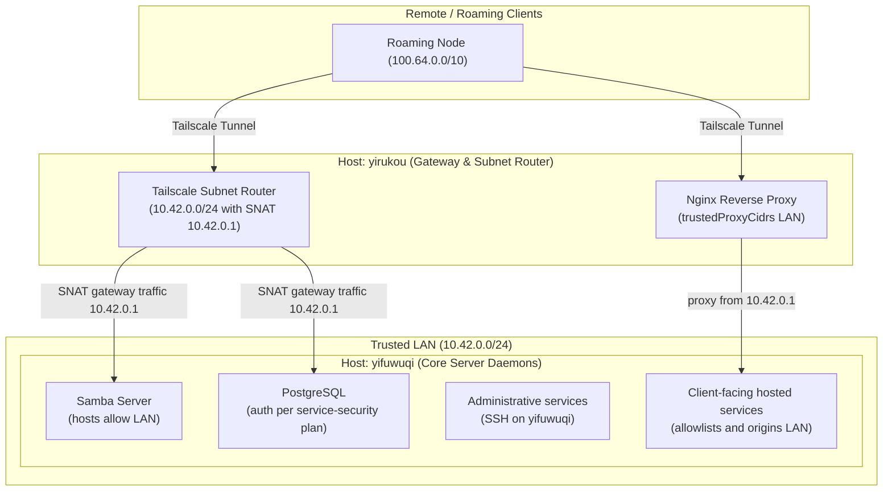
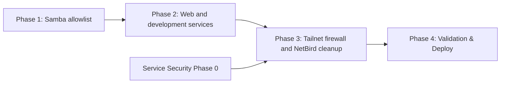

# VPN to LAN Migration Plan

## Status: DRAFT — Phase 1 deployed and verified 2026-11-08

## Objective

Migrate internal service access controls, firewall rules, and reverse proxy definitions away from overlay network bindings (Tailscale `100.64.0.0/10` and `100.69.0.x`, NetBird `100.42.0.0/16`) to the trusted local LAN (`10.42.0.0/24` and `fd75:c55f:6d19:1::/64`).

Under this architecture:

- Source-address allowlists in services that remain LAN-reachable name only LAN
  CIDRs and loopback, never overlay CIDRs. Allowlists narrow reachability;
  authentication belongs to the
  [Service Security Architecture Plan](service-security-architecture-plan.md).
- Remote access to client-facing and explicitly allowed LAN services is
  consolidated through `yirukou`'s Tailscale subnet router (`10.42.0.0/24`
  with SNAT), so remote connections arrive at backend services as gateway LAN
  traffic (`10.42.0.1`). Internal administration uses SSH on `yifuwuqi`.
- Servers stop trusting `tailscale0` wholesale. Direct ingress from the VPN overlay to unproxied backend services is eliminated.

### Scope

Owns:

- Subnet routing and the `yirukou` subnet router.
- `tailscale0` firewall trust on servers (`modules/services/tailscale.nix` and per-host tailnet ports).
- Overlay CIDRs and addresses in allowlists: nginx `trustedProxyCidrs` and the legacy VPN vhost, Samba `hosts allow`, Cockpit `allowed-origins`, and the Forgejo webhook `ALLOWED_HOST_LIST`.
- NetBird leftovers in `modules/addresses.nix` (`network.netbird`, sshd `listenAddresses`, AdGuard `dnsBindHosts`).

Not owned here:

- Postgres authentication and listen addresses, the qBittorrent whitelist, the `yifuwuqi` gateway rule and container isolation: [Service Security Architecture Plan](service-security-architecture-plan.md).
- Cryptographic identity of the proxy hop: [mTLS Architecture Plan](mtls-architecture-plan.md).
- Persisting Tailscale state on `yirukou`: [Impermanence on yirukou](impermanence-yirukou-plan.md).

______________________________________________________________________

## Evidence Status

- **Repository-verified**: Phase 1's active Samba ACL excludes the VPN CIDR.
  The overlay CIDRs, legacy vhost, unconditional `tailscale0` trust, and
  NetBird remnants for later phases remain in the Nix configuration.
- **Live-host verified 2026-11-08**: `yifuwuqi` prefers its default route via
  `10.42.0.1`; this does not prove Tailnet route approval or client adoption.
- **Preflight verified 2026-11-08**: `yitaishi` installs
  `10.42.0.0/24` through `tailscale0` and reaches `10.42.0.2`.
- **Phase 1 verified 2026-11-08**: yitaishi's enabled automount targets
  `//10.42.0.2/share`; Samba answers on `10.42.0.2:445` with the LAN-only
  allowlist.
- **Operational verification pending**: Tailscale SSH behavior after the later
  trust change.

______________________________________________________________________

## Current State

1. **Reverse Proxy & Web Access**:

   - In `modules/services/nginx-proxy.nix`, `trustedProxyCidrs` includes `allAddresses.hosts.yifuwuqi.network.vpn.ipv4.cidr` (`100.64.0.0/10`).
   - The same list already contains `yirukou`'s trusted LAN IPv4/IPv6 CIDRs
     and omits the untrusted VLAN CIDRs (`10.42.42.0/24` and
     `fd75:c55f:6d19:2::/64`).
   - `nginx-proxy.nix` retains a legacy test virtual host binding directly to `"${addresses.network.vpn.ipv4.host}"`.
   - In `modules/services/forgejo.nix`, `trustedCidrs` includes the VPN CIDR for webhook delivery allowlists.
   - In `modules/services/cockpit.nix`, `allowed-origins` includes `http://${addresses.network.vpn.ipv4.host}:${port}` and `https://${addresses.network.vpn.ipv4.host}:${port}`.

1. **Storage and Database**:

   - In `modules/services/postgresql.nix`, `pg_hba.conf` grants passwordless `trust` to the entire VPN CIDR: `host all all ${allAddresses.hosts.yifuwuqi.network.vpn.ipv4.cidr} trust`. The service-security plan (Decision 5) removes it along with every other `trust` entry.
   - The active `modules/services/samba/server.nix` allows only `${lanCidr}`,
     `${lanCidr6}`, and loopback.
   - In `modules/services/samba/client.nix`, CIFS mounts are **already migrated**: `serverIp` is set to `yifuwuqi.network.lan.ipv4.host` (`10.42.0.2`), with no VPN daemon dependencies.

1. **Firewall & Container Isolation**:

   - Service Security Phase 0's staged forward policy removes
     `trustedHostDestinations` entirely. VPN Phase 3 no longer has a separate
     source edit for that former VPN entry.
   - `modules/services/tailscale.nix` adds `tailscale0` to `networking.firewall.trustedInterfaces` on every host that imports it. Tailnet peers reach every listening port on `yifuwuqi` (including Postgres) and `yirukou` directly. On `yirukou` this makes the SSH-only `tailscale0` rule in `hosts/yirukou/networking/firewall.nix` dead config, and `yifuwuqi` lists `tailscale0` a second time in its own firewall file.

1. **NetBird Leftovers**:

   - The NetBird module is commented out on every host, but `modules/addresses.nix` still defines `network.netbird` for each one.
   - sshd `listenAddresses` and `yifuwuqi`'s AdGuard `dnsBindHosts` include the NetBird address. With `ip_nonlocal_bind = 1` (`modules/networking/sysctl-base.nix`), sshd and AdGuard listen on `100.42.0.2` although no interface carries it.
   - qBittorrent's `AuthSubnetWhitelist` names `100.42.0.0/16`, which is public address space, not CGNAT.
   - `modules/services/netbird.nix` marks `wt0` trusted, so re-enabling NetBird would reopen every port on that interface.

1. **Peerings & Roaming Nodes (Intentional Tailscale Usage)**:

   - `yirukou` declares the `10.42.0.0/24` advertised subnet route. Separately,
     `yifuwuqi` declares its `192.168.0.1/32` route; these are distinct
     routing responsibilities and must not be conflated as one ingress path.
   - **`lan-mouse`**: As documented in `docs/src/hardware/lan-mouse.md`, KVM traffic between `yitaishi` and `yixiaoqing` is bound to Tailscale (`100.x.x.x`). This is required because `yixiaoqing` is a laptop with no static LAN reservation that frequently roams across networks, and `yitaishi` does not have a static LAN IP assigned in `modules/addresses.nix`.
   - **Distributed Builds**: `modules/distributed-builds.nix` targets `yitaishi` via its VPN address because `yitaishi`'s sshd binds strictly to VPN interfaces and `hosts.yitaishi` does not possess a static `network.lan` block in `addresses.nix`.
   - **Obsolete Components**: `llama-swap-amdgpu` (port 50052) was completely removed from the gang and replaced by local `llama-cpp-node`. `modules/services/openvscode-server.nix` is unimported dead code replaced by `modules/services/opencode.nix`.

______________________________________________________________________

## Decisions

### 1. Subnet Router as the Single Remote Ingress Boundary

- `yirukou` declares `10.42.0.0/24` to Tailscale with default SNAT masquerade
  enabled. Route approval and a client reaching the LAN through it are
  admission gates before removing overlay allowlists.
- Remote devices access client-facing services and Samba through their LAN IP
  addresses (`10.42.0.1`, `10.42.0.2`) over the subnet route. PostgreSQL stays
  loopback-only under the service-security plan.
- Remove `100.64.0.0/10` from service allowlists. Remote traffic arrives at host services SNAT'd as `10.42.0.1` and matches LAN allowlists.
- SNAT consequence: on `yifuwuqi`, every remote client is indistinguishable from `yirukou` itself. Rules keyed on `10.42.0.1` apply to all remote clients; the service-security plan scopes them (its Decision 3), and the mTLS plan's Tier 2 gives the proxy hop a cryptographic identity.

### 2. Restrict Reverse Proxy Access to LAN Subnets

- Client-facing hosted vhosts allow only `10.42.0.0/24` and
  `fd75:c55f:6d19:1::/64` for direct LAN access. Do not add the untrusted VLAN
  `10.42.42.0/24` or `fd75:c55f:6d19:2::/64`; administrative vhosts are
  SSH-only under the service-security plan.
- Remove `allAddresses.hosts.yifuwuqi.network.vpn.ipv4.cidr` from `trustedProxyCidrs` in `modules/services/nginx-proxy.nix`.
- Delete the legacy `addresses.network.vpn.ipv4.host` virtual host block.

### 3. PostgreSQL Follows the Service-Security Plan

- Postgres listen addresses and `pg_hba` belong to the [Service Security Architecture Plan](service-security-architecture-plan.md) (Decision 5). It removes the VPN CIDR line along with every other `trust` entry, instead of widening `trust` to `10.42.0.0/24`.
- This plan only requires that no Postgres rule names an overlay CIDR.

### 4. Restrict Samba Access to LAN

- Remove `vpnCidr` from `modules/services/samba/server.nix`, restricting `hosts allow` to `${lanCidr} ${lanCidr6} 127.0.0.1 localhost ::1`.

### 5. Clean Up Dead & Legacy Modules

- Remove `addresses.network.vpn.ipv4.host` from `modules/services/cockpit.nix` `allowed-origins`.
- Remove `allAddresses.hosts.yifuwuqi.network.vpn.ipv4.cidr` from `modules/services/forgejo.nix` webhook allowlist.
- Service Security Phase 0 removes the former VPN entry with the entire
  `trustedHostDestinations` allow rule.
- Delete unimported legacy module `modules/services/openvscode-server.nix`.
- NetBird is retired: remove its addresses from sshd `listenAddresses` and
  AdGuard `dnsBindHosts`, then delete `modules/services/netbird.nix` and the
  `network.netbird` blocks. The qBittorrent whitelist entry goes with the
  service-security plan's Decision 5.

### 6. Preserve Tailscale for Dynamic and Roaming Peerings

- Retain Tailscale IPs for `lan-mouse` and `modules/distributed-builds.nix` until/unless dynamic nodes (`yitaishi`, `yixiaoqing`) receive static LAN allocations and static LAN listeners.

### 7. Servers Stop Trusting `tailscale0`

- **Current state**: `modules/services/tailscale.nix` adds `tailscale0` to
  `trustedInterfaces` in every routing mode, and `yifuwuqi` duplicates that
  trust in its host firewall.
- **Target state**: add `tailscale0` to `trustedInterfaces` only in `client`
  routing mode; server and router hosts declare explicit ports instead.
  Remove the duplicate entry in `hosts/yifuwuqi/networking/firewall.nix`.
- `yirukou`: `tailscale0` gets the same ports as `br0` (`lanTcpPorts` plus SSH, and `internalUdpPorts`), because tailnet clients use its DNS and nginx. Forwarding into `10.42.0.0/24` already has its own rule.
- `yifuwuqi`: `tailscale0` allows SSH `24212` and DNS `53` (AdGuard binds `100.69.0.6`).
- Clients (`yitaishi`, `yixiaoqing`) keep trusting `tailscale0`; `lan-mouse` and distributed builds depend on it (Decision 6).
- `yifuwuqi`'s Tailscale route to `192.168.0.1/32` keeps working: the service-security plan's Phase 0 adds its forward accept when it enables forward filtering.
- Host firewalls are the authoritative service boundary. Tailnet policy needs to
  permit authorized clients to use the subnet route, but it is not a second
  per-service authorization system in this plan.

______________________________________________________________________

## Phases

### Phase 1: Storage and Database Services — Deployed and Verified

1. PostgreSQL: no change in this plan; the service-security plan's Phase 2 replaces `pg_hba`.
1. `modules/services/samba/server.nix` removes `vpnCidr` from `hosts allow`.
   The subnet route, automount target, and Samba listener were verified after
   deployment.

### Phase 2: Web, Proxy, and Development Services

1. In `modules/services/nginx-proxy.nix`, remove `yifuwuqi.network.vpn.ipv4.cidr` from `trustedProxyCidrs` and delete the `"${addresses.network.vpn.ipv4.host}"` virtual host.
1. In `modules/services/forgejo.nix`, remove `yifuwuqi.network.vpn.ipv4.cidr` from `trustedCidrs`.
1. In `modules/services/cockpit.nix`, remove VPN URLs from `allowed-origins`.
1. Delete unimported file `modules/services/openvscode-server.nix`.
1. Verify a designated client-facing vhost accepts trusted LAN traffic and
   rejects both IPv4 and IPv6 untrusted-VLAN traffic.

### Phase 3: Host Firewall Rules

1. The former `trustedHostDestinations` VPN entry was removed with Service
   Security Phase 0; no additional source edit remains for it here.
1. Apply Decision 7 in `modules/services/tailscale.nix`, `hosts/yirukou/networking/firewall.nix` and `hosts/yifuwuqi/networking/firewall.nix` only after Service Security Phase 0 has accepted `tailscale0 -> enp4s0` traffic to `192.168.0.1/32`.
1. Apply the NetBird retirement cleanup from Decision 5 in
   `modules/addresses.nix` and `modules/services/netbird.nix`.

### Phase 4: Validation & Evaluation

1. Run `nix build .#nixosConfigurations.<host>.config.system.build.toplevel --dry-run` across `yifuwuqi` and `yirukou`.
1. Verify that services build and evaluate cleanly without syntax errors or broken references.
1. Check that `nix eval .#nixosConfigurations.<host>.config.networking.firewall.trustedInterfaces` no longer lists `tailscale0` on `yifuwuqi` and `yirukou`.

______________________________________________________________________

## Rollout Order

Fleet sequencing is defined by the [Architecture Security Rollout](architecture-rollout-plan.md).
Deploy and validate each phase independently:

1. **Admission gate**: verify an approved `yirukou` subnet route and a Tailnet
   client reaching LAN services through it.
1. **Phase 1**: remove Samba's VPN allowlist, then verify Samba through the
   subnet route.
1. **Phase 2**: remove the proxy, Forgejo, Cockpit, and legacy vhost overlay
   entries; delete the unimported OpenVSCode module; verify trusted-LAN access
   succeeds while untrusted-VLAN access fails.
1. **Phase 3**: after Service Security Phase 0 passes, apply Decision 7 and
   perform the NetBird retirement cleanup.
1. **Phase 4**: evaluate both hosts, deploy the completed phase through
   [CI/CD](../services/ci-cd.md) section 5, and verify from a Tailnet client:
   - a designated client-facing hosted domain works over the subnet route;
   - `nc -zv 100.69.0.6 24200` fails (no direct overlay ingress to `yifuwuqi` backends);
   - Tailscale SSH and plain SSH on `24212` still work on both servers;
   - `tailscale status` still shows `yirukou`'s `10.42.0.0/24` route.

### Cross-Plan Dependencies

- **Fleet sequence**: [Architecture Security Rollout](architecture-rollout-plan.md)
  is the canonical dependency order.
- **Coordinates with** the [Service Security Architecture Plan](service-security-architecture-plan.md): it owns Postgres (Decision 3 here defers to it) and the qBittorrent whitelist; its gateway rule decides what SNAT'd remote clients reach on `yifuwuqi`; its staged Phase 0 removes the former container VPN allow rule and keeps the `192.168.0.1/32` tailnet route when forward filtering activates.
- **Unblocks** the [mTLS Architecture Plan](mtls-architecture-plan.md): Phase 2
  removes overlay access from `restrictedProxyConfig` for client-facing
  vhosts. Its Tier 2 remains LAN mTLS rather than a direct Tailscale
  transport.
- **Coordinates with** [Impermanence on yirukou](impermanence-yirukou-plan.md):
  the current Ext4 root already persists Tailscale state. If impermanence is
  deployed, `/var/lib/tailscale` must be persisted before rebooting into its
  tmpfs-root generation.

______________________________________________________________________

## Open Questions

1. **Tailscale SSH**: confirm it keeps working with `tailscale0` untrusted on one server before rolling out to both.
